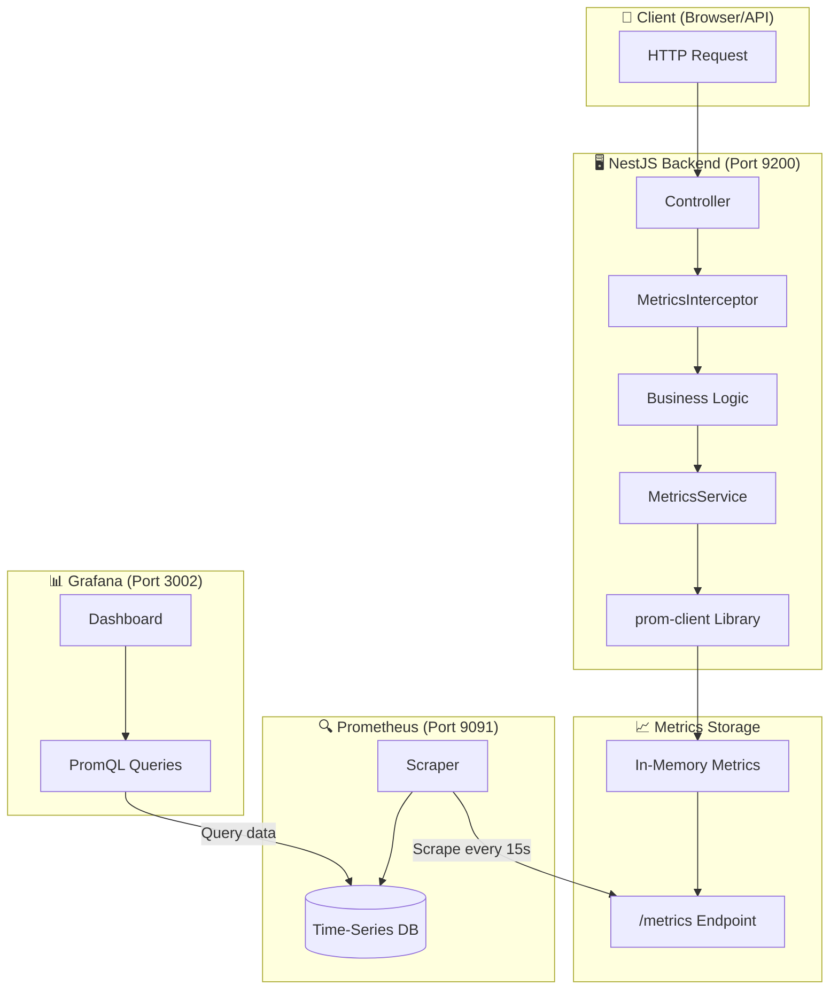
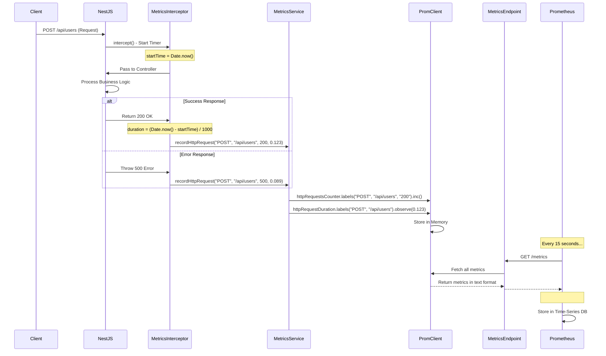
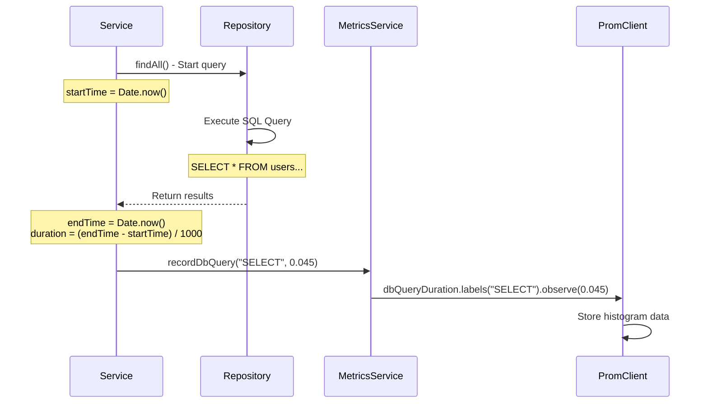
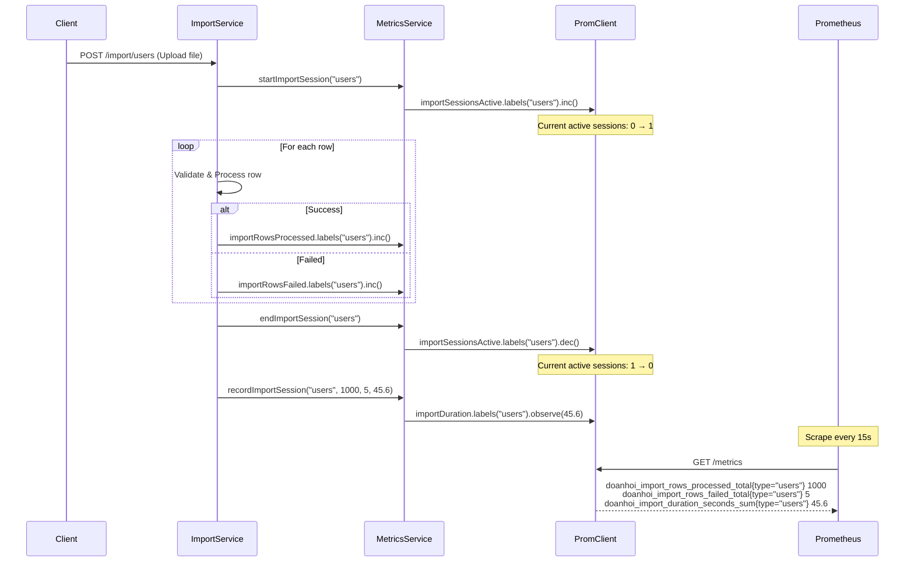
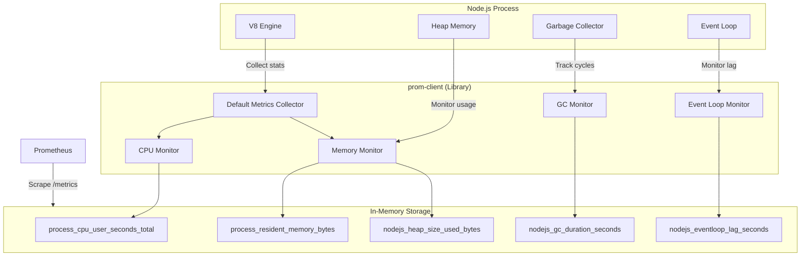

# 📊 Metrics Collection Flow - Đoàn Hội Portal

## 🎯 Tổng quan Architecture



---

## 1️⃣ HTTP Request Metrics Flow

### 🔄 Flow Diagram



### 📝 Code Flow

```typescript
// 1. Request đến → MetricsInterceptor
// File: backend/src/common/interceptors/metrics.interceptor.ts

@Injectable()
export class MetricsInterceptor implements NestInterceptor {
  intercept(context: ExecutionContext, next: CallHandler) {
    const startTime = Date.now(); // ⏱️ Bắt đầu đếm thời gian
    
    return next.handle().pipe(
      tap(() => {
        // ✅ Request thành công
        const duration = (Date.now() - startTime) / 1000; // seconds
        this.metricsService.recordHttpRequest(
          method,    // "POST"
          path,      // "/api/users"
          statusCode, // 200
          duration   // 0.123
        );
      }),
      catchError((error) => {
        // ❌ Request lỗi
        const duration = (Date.now() - startTime) / 1000;
        this.metricsService.recordHttpRequest(
          method, path, error.status || 500, duration
        );
        return throwError(() => error);
      }),
    );
  }
}

// 2. MetricsService ghi metrics
// File: backend/src/metrics/metrics.service.ts

recordHttpRequest(method, path, statusCode, duration) {
  // Counter: Tăng số lượng request
  this.httpRequestsCounter
    .labels(method, path, statusCode.toString())
    .inc(); // +1
  
  // Histogram: Ghi thời gian xử lý
  this.httpRequestDuration
    .labels(method, path)
    .observe(duration); // 0.123s
}

// 3. Prometheus scrape
// Prometheus gửi GET /metrics mỗi 15 giây
// Nhận về format text:

# HELP doanhoi_http_requests_total Total number of HTTP requests
# TYPE doanhoi_http_requests_total counter
doanhoi_http_requests_total{method="POST",path="/api/users",status="200"} 142

# HELP doanhoi_http_request_duration_seconds HTTP request duration
# TYPE doanhoi_http_request_duration_seconds histogram
doanhoi_http_request_duration_seconds_bucket{method="POST",path="/api/users",le="0.01"} 45
doanhoi_http_request_duration_seconds_bucket{method="POST",path="/api/users",le="0.05"} 120
doanhoi_http_request_duration_seconds_bucket{method="POST",path="/api/users",le="0.1"} 138
doanhoi_http_request_duration_seconds_bucket{method="POST",path="/api/users",le="+Inf"} 142
doanhoi_http_request_duration_seconds_sum{method="POST",path="/api/users"} 12.456
doanhoi_http_request_duration_seconds_count{method="POST",path="/api/users"} 142
```

### 🎯 Grafana Queries

```promql
# 1. Request Per Second (RPS)
rate(doanhoi_http_requests_total[5m])

# 2. Request count by status code
sum by (status) (doanhoi_http_requests_total)

# 3. P95 Response Time
histogram_quantile(0.95, rate(doanhoi_http_request_duration_seconds_bucket[5m]))

# 4. Error Rate (5xx errors)
sum(rate(doanhoi_http_requests_total{status=~"5.."}[5m]))
  / 
sum(rate(doanhoi_http_requests_total[5m])) * 100
```

---

## 2️⃣ Database Metrics Flow

### 🔄 Flow Diagram



### 📝 Code Implementation

```typescript
// File: backend/src/users/users.service.ts (Ví dụ)

async findAll() {
  const startTime = Date.now();
  
  try {
    // Execute query
    const users = await this.userRepository.find();
    
    // Record metrics
    const duration = (Date.now() - startTime) / 1000;
    this.metricsService.recordDbQuery('SELECT', duration);
    
    return users;
  } catch (error) {
    const duration = (Date.now() - startTime) / 1000;
    this.metricsService.recordDbQuery('SELECT_ERROR', duration);
    throw error;
  }
}

// Prometheus output:
# TYPE doanhoi_db_query_duration_seconds histogram
doanhoi_db_query_duration_seconds_bucket{query_type="SELECT",le="0.001"} 12
doanhoi_db_query_duration_seconds_bucket{query_type="SELECT",le="0.005"} 45
doanhoi_db_query_duration_seconds_bucket{query_type="SELECT",le="0.01"} 89
doanhoi_db_query_duration_seconds_sum{query_type="SELECT"} 2.345
doanhoi_db_query_duration_seconds_count{query_type="SELECT"} 95
```

### 🎯 Grafana Queries

```promql
# 1. Average query duration by type
rate(doanhoi_db_query_duration_seconds_sum[5m])
  / 
rate(doanhoi_db_query_duration_seconds_count[5m])

# 2. Slow queries (> 100ms)
histogram_quantile(0.99, rate(doanhoi_db_query_duration_seconds_bucket[5m]))

# 3. Query rate per second
rate(doanhoi_db_query_duration_seconds_count[5m])
```

---

## 3️⃣ Import Session Metrics Flow

### 🔄 Flow Diagram



### 📝 Code Implementation

```typescript
// File: backend/src/users/services/import.service.ts

async importUsers(file: Express.Multer.File) {
  const sessionType = 'users';
  const startTime = Date.now();
  
  // 1. Bắt đầu session
  this.metricsService.startImportSession(sessionType);
  
  let successCount = 0;
  let failedCount = 0;
  
  try {
    const rows = await this.parseExcel(file);
    
    for (const row of rows) {
      try {
        await this.createUser(row);
        successCount++;
        
        // Ghi metric cho mỗi row thành công
        this.metricsService.importRowsProcessed
          .labels(sessionType)
          .inc();
          
      } catch (error) {
        failedCount++;
        
        // Ghi metric cho mỗi row lỗi
        this.metricsService.importRowsFailed
          .labels(sessionType)
          .inc();
      }
    }
    
    // 2. Ghi tổng kết session
    const duration = (Date.now() - startTime) / 1000;
    this.metricsService.recordImportSession(
      sessionType,
      successCount,
      failedCount,
      duration
    );
    
  } finally {
    // 3. Kết thúc session
    this.metricsService.endImportSession(sessionType);
  }
}

// Prometheus output:
# TYPE doanhoi_import_sessions_active gauge
doanhoi_import_sessions_active{type="users"} 0

# TYPE doanhoi_import_rows_processed_total counter
doanhoi_import_rows_processed_total{type="users"} 15234

# TYPE doanhoi_import_rows_failed_total counter
doanhoi_import_rows_failed_total{type="users"} 42

# TYPE doanhoi_import_duration_seconds histogram
doanhoi_import_duration_seconds_sum{type="users"} 234.56
doanhoi_import_duration_seconds_count{type="users"} 12
```

### 🎯 Grafana Queries

```promql
# 1. Active import sessions
doanhoi_import_sessions_active

# 2. Import success rate (%)
(
  rate(doanhoi_import_rows_processed_total[5m])
    / 
  (rate(doanhoi_import_rows_processed_total[5m]) + rate(doanhoi_import_rows_failed_total[5m]))
) * 100

# 3. Average import duration
rate(doanhoi_import_duration_seconds_sum[5m])
  / 
rate(doanhoi_import_duration_seconds_count[5m])

# 4. Total rows processed per minute
rate(doanhoi_import_rows_processed_total[1m]) * 60
```

---

## 4️⃣ Node.js Default Metrics Flow (Tự động)

### 🔄 Flow Diagram



### 📝 Code Setup

```typescript
// File: backend/src/metrics/metrics.module.ts

PrometheusModule.register({
  defaultMetrics: {
    enabled: true,  // ⚡ Kích hoạt tự động collect
    config: {
      prefix: "doanhoi_",  // Thêm prefix vào tên metrics
    },
  },
  path: "/metrics",  // Endpoint để Prometheus scrape
})

// ⚠️ Không cần code thêm gì!
// prom-client tự động collect các metrics này:
```

### 📊 Metrics tự động được collect

```prometheus
# 1. CPU Usage
# TYPE process_cpu_user_seconds_total counter
process_cpu_user_seconds_total 45.67

# 2. Memory Usage (RSS - Resident Set Size)
# TYPE process_resident_memory_bytes gauge
process_resident_memory_bytes 125829120  # ~120 MB

# 3. Heap Memory (JS objects)
# TYPE nodejs_heap_size_used_bytes gauge
nodejs_heap_size_used_bytes 52428800  # ~50 MB

# TYPE nodejs_heap_size_total_bytes gauge
nodejs_heap_size_total_bytes 104857600  # ~100 MB

# 4. External Memory (Buffers, C++ objects)
# TYPE nodejs_external_memory_bytes gauge
nodejs_external_memory_bytes 8388608  # ~8 MB

# 5. Garbage Collection
# TYPE nodejs_gc_duration_seconds histogram
nodejs_gc_duration_seconds_bucket{le="0.001",kind="major"} 12
nodejs_gc_duration_seconds_bucket{le="0.01",kind="major"} 45
nodejs_gc_duration_seconds_sum{kind="major"} 2.34
nodejs_gc_duration_seconds_count{kind="major"} 56

# 6. Event Loop Lag (Độ trễ event loop)
# TYPE nodejs_eventloop_lag_seconds gauge
nodejs_eventloop_lag_seconds 0.002  # 2ms lag

# 7. Active Handles & Requests
# TYPE nodejs_active_handles gauge
nodejs_active_handles 5

# TYPE nodejs_active_requests gauge  
nodejs_active_requests 3

# 8. Process Info
# TYPE process_start_time_seconds gauge
process_start_time_seconds 1735190400

# TYPE nodejs_version_info gauge
nodejs_version_info{version="v20.17.0",major="20",minor="17",patch="0"} 1
```

### 🎯 Grafana Queries

```promql
# 1. CPU Usage (%)
rate(process_cpu_user_seconds_total{job="doanhoi-backend-api"}[5m]) * 100

# 2. Memory Usage (MB)
process_resident_memory_bytes{job="doanhoi-backend-api"} / 1024 / 1024

# 3. Heap Usage (%)
(nodejs_heap_size_used_bytes / nodejs_heap_size_total_bytes) * 100

# 4. Event Loop Lag (ms)
nodejs_eventloop_lag_seconds * 1000

# 5. GC Pause Time (P95)
histogram_quantile(0.95, rate(nodejs_gc_duration_seconds_bucket[5m]))

# 6. Active Handles/Requests
nodejs_active_handles + nodejs_active_requests
```

---

## 5️⃣ Complete Data Flow Timeline

```mermaid
gantt
    title Metrics Collection Timeline (15 second interval)
    dateFormat ss
    axisFormat %S
    
    section Application
    Handle Requests           :0, 15s
    Record HTTP Metrics      :0, 15s
    Record DB Metrics        :0, 15s
    Record Import Metrics    :0, 15s
    
    section prom-client
    Collect Node.js Metrics  :0, 15s
    Update In-Memory Store   :0, 15s
    
    section Prometheus
    Scrape /metrics          :15, 1s
    Parse & Store TSDB       :16, 2s
    
    section Grafana
    Query Prometheus         :after Scrape /metrics, 1s
    Render Dashboard         :after Query Prometheus, 2s
```



---

## 6️⃣ Prometheus Scrape Format Example

**Khi Prometheus gọi `GET http://backend:9200/metrics`, nhận về:**

```prometheus
# HELP process_cpu_user_seconds_total Total user CPU time spent in seconds.
# TYPE process_cpu_user_seconds_total counter
process_cpu_user_seconds_total 45.67

# HELP process_resident_memory_bytes Resident memory size in bytes.
# TYPE process_resident_memory_bytes gauge
process_resident_memory_bytes 125829120

# HELP doanhoi_http_requests_total Total number of HTTP requests
# TYPE doanhoi_http_requests_total counter
doanhoi_http_requests_total{method="GET",path="/api/users",status="200",app="doanhoi-portal",environment="production"} 1523
doanhoi_http_requests_total{method="POST",path="/api/users",status="201",app="doanhoi-portal",environment="production"} 234
doanhoi_http_requests_total{method="GET",path="/api/users/:id",status="404",app="doanhoi-portal",environment="production"} 12
doanhoi_http_requests_total{method="POST",path="/api/auth/login",status="401",app="doanhoi-portal",environment="production"} 45

# HELP doanhoi_http_request_duration_seconds HTTP request duration in seconds
# TYPE doanhoi_http_request_duration_seconds histogram
doanhoi_http_request_duration_seconds_bucket{method="GET",path="/api/users",le="0.01"} 456
doanhoi_http_request_duration_seconds_bucket{method="GET",path="/api/users",le="0.05"} 1200
doanhoi_http_request_duration_seconds_bucket{method="GET",path="/api/users",le="0.1"} 1480
doanhoi_http_request_duration_seconds_bucket{method="GET",path="/api/users",le="0.5"} 1520
doanhoi_http_request_duration_seconds_bucket{method="GET",path="/api/users",le="1"} 1523
doanhoi_http_request_duration_seconds_bucket{method="GET",path="/api/users",le="+Inf"} 1523
doanhoi_http_request_duration_seconds_sum{method="GET",path="/api/users"} 45.67
doanhoi_http_request_duration_seconds_count{method="GET",path="/api/users"} 1523

# HELP doanhoi_import_sessions_active Number of active import sessions
# TYPE doanhoi_import_sessions_active gauge
doanhoi_import_sessions_active{type="users"} 2
doanhoi_import_sessions_active{type="organizations"} 0

# HELP nodejs_heap_size_used_bytes Process heap size used in bytes
# TYPE nodejs_heap_size_used_bytes gauge
nodejs_heap_size_used_bytes 52428800

# HELP nodejs_eventloop_lag_seconds Lag of event loop in seconds
# TYPE nodejs_eventloop_lag_seconds gauge
nodejs_eventloop_lag_seconds 0.002
```

---

## 7️⃣ Key Concepts

### **Counter** (Bộ đếm)
- Chỉ tăng, không giảm
- Reset về 0 khi restart service
- Dùng cho: Total requests, errors, rows processed
- Query: `rate(metric[5m])` để tính tốc độ tăng

### **Gauge** (Đồng hồ đo)
- Có thể tăng/giảm
- Giá trị hiện tại tại thời điểm đo
- Dùng cho: Memory, CPU, active sessions, connections
- Query: Dùng trực tiếp `metric`

### **Histogram** (Biểu đồ phân bố)
- Đếm observations theo buckets (khoảng giá trị)
- Tự động tạo `_sum`, `_count`, `_bucket`
- Dùng cho: Request duration, query time
- Query: `histogram_quantile()` để tính percentiles

### **Summary** (Tóm tắt)
- Tính toán percentiles trên client
- Không dùng trong project này
- Thay thế: Histogram (recommended)

---

## 🎯 Tổng kết

**Flow chính:**
```
1. Request → MetricsInterceptor → MetricsService → prom-client
2. prom-client lưu metrics vào RAM (in-memory)
3. Prometheus scrape /metrics mỗi 15s
4. Prometheus lưu vào Time-Series Database
5. Grafana query Prometheus để hiển thị dashboard
```

**Metrics hiện có:**
- ✅ HTTP Requests: RPS, latency, errors
- ✅ Database: Query duration
- ✅ Import: Sessions, rows, duration
- ✅ Node.js: CPU, memory, heap, GC, event loop

**Metrics còn thiếu:**
- ❌ Server-level: CPU %, RAM %, Disk, Network (cần Node Exporter)
- ❌ PostgreSQL: Connection pool, slow queries (cần Postgres Exporter)
- ❌ HTTP 5xx error breakdown by endpoint
- ❌ Request queue length

Bạn muốn tôi implement thêm metrics nào không? 🚀
