# Activity & Sequence Diagrams - Organization Management System

## 📐 System Overview

**Module:** Organization Management (Quản Lý Tổ Chức)  
**Page:** OrganizationsPage.tsx  
**System:** Đoàn Hội Portal

---

## 📊 Table of Contents

1. [Activity Diagrams](#activity-diagrams)
   - View Organization Tree
   - Create Organization
   - Edit Organization
   - Delete Organization
   - Add Member to Organization
   - Import Organizations from Excel
   - Search Organizations

2. [Sequence Diagrams](#sequence-diagrams)
   - View Organization Tree Flow
   - Create Organization Flow
   - Add Member Flow
   - Delete Organization Flow
   - Import Organizations Flow
   - Real-time Statistics Update

---

## 🔄 Activity Diagrams

### Activity Diagram 1: View Organization Tree

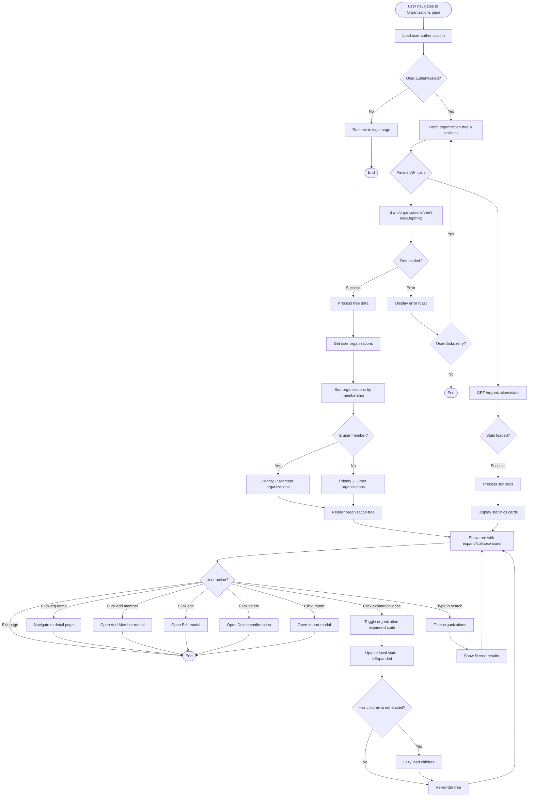

---

### Activity Diagram 2: Create Organization

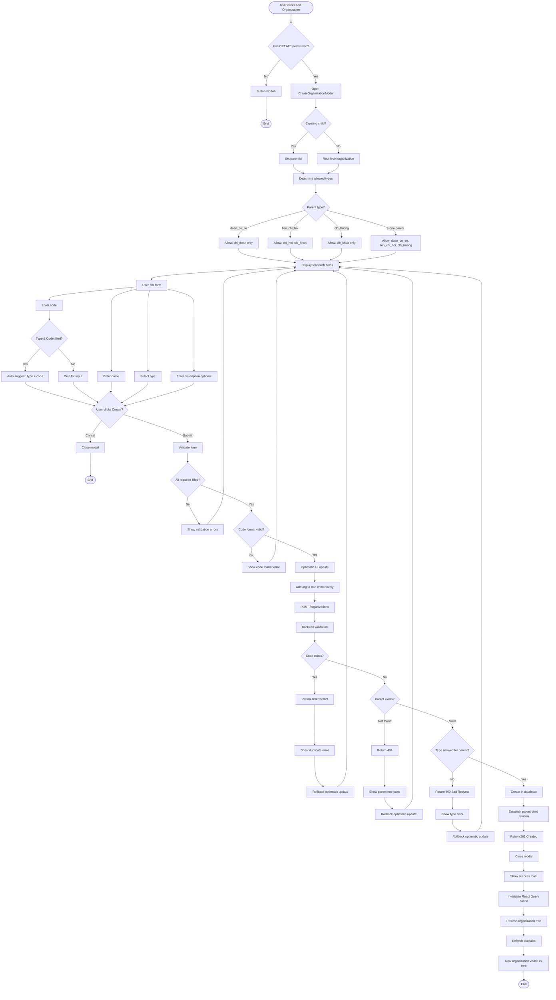

---

### Activity Diagram 3: Edit Organization

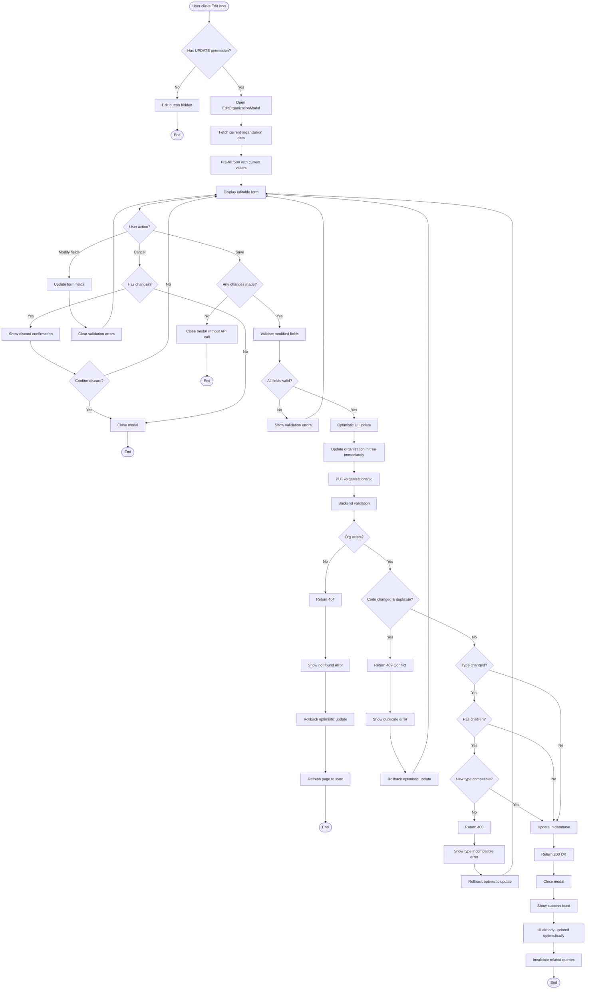

---

### Activity Diagram 4: Delete Organization

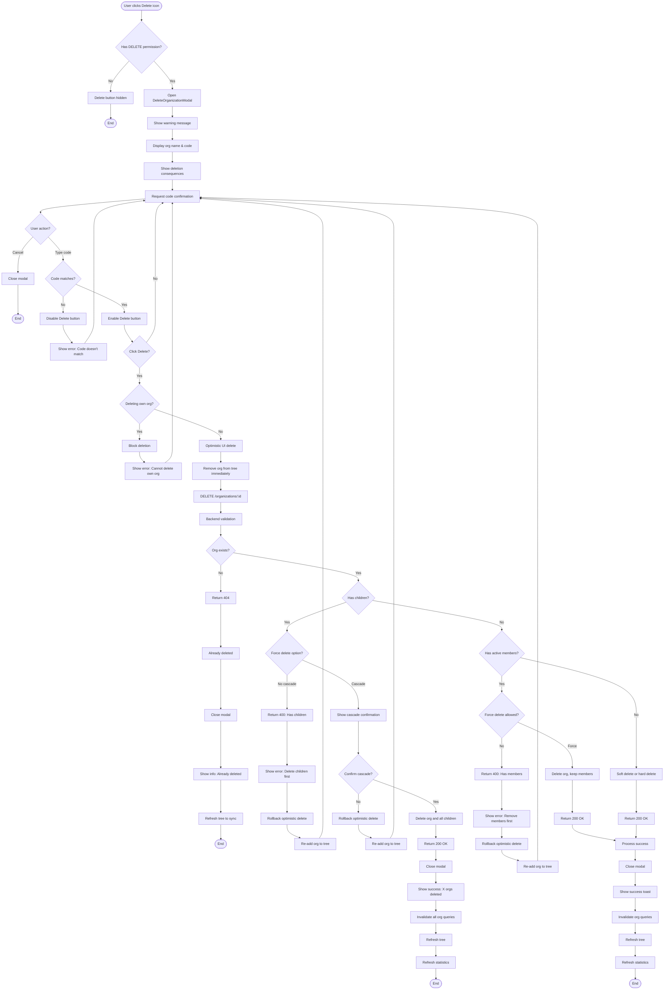

---

### Activity Diagram 5: Add Member to Organization

```mermaid
flowchart TD
    Start([User clicks Add Member icon]) --> CheckPerm{Has ADD_MEMBER permission?}
    
    CheckPerm -->|No| HideButton[Add Member button hidden]
    HideButton --> End1([End])
    
    CheckPerm -->|Yes| OpenModal[Open AddMemberModal]
    OpenModal --> ShowForm[Display form with org name]
    ShowForm --> ShowSearchInput[Show user search input]
    
    ShowSearchInput --> UserAction{User action?}
    
    UserAction -->|Cancel| CloseModal1[Close modal]
    CloseModal1 --> End2([End])
    
    UserAction -->|Type in search| CaptureInput[Capture input]
    CaptureInput --> CheckLength{Length >= 2?}
    
    CheckLength -->|No| HideDropdown[Hide search dropdown]
    HideDropdown --> ShowSearchInput
    
    CheckLength -->|Yes| StartDebounce[Start 300ms debounce timer]
    StartDebounce --> WaitDebounce{Timer completed?}
    
    WaitDebounce -->|New input| CancelTimer[Cancel previous timer]
    CancelTimer --> StartDebounce
    
    WaitDebounce -->|Completed| ShowLoading[Show loading indicator]
    ShowLoading --> SearchAPI[GET /users?search=term&limit=10]
    
    SearchAPI --> SearchResult{Results found?}
    
    SearchResult -->|Error| HideDropdown
    
    SearchResult -->|No results| ShowEmpty[Show "No users found"]
    ShowEmpty --> ShowSearchInput
    
    SearchResult -->|Has results| CalculatePosition[Calculate dropdown position]
    CalculatePosition --> RenderDropdown[Render dropdown below input]
    RenderDropdown --> DisplayUsers[Display user list with:]
    DisplayUsers --> ShowCode[- User code]
    DisplayUsers --> ShowName[- Full name]
    DisplayUsers --> ShowEmail[- Email]
    DisplayUsers --> ShowAvatar[- Avatar if available]
    
    ShowCode --> DropdownVisible[Dropdown visible]
    ShowName --> DropdownVisible
    ShowEmail --> DropdownVisible
    ShowAvatar --> DropdownVisible
    
    DropdownVisible --> UserSelect{User action?}
    
    UserSelect -->|Click outside| CloseDropdown[Close dropdown]
    CloseDropdown --> ShowSearchInput
    
    UserSelect -->|Select user| PopulateForm[Populate form with user]
    PopulateForm --> SetUserCode[Set user code]
    SetUserCode --> SetUserData[Store selected user]
    SetUserData --> CloseDropdown2[Close dropdown]
    CloseDropdown2 --> ClearError[Clear any errors]
    ClearError --> EnableSubmit[Enable Add Member button]
    
    EnableSubmit --> UserSubmit{Click Add Member?}
    
    UserSubmit -->|No| ShowSearchInput
    
    UserSubmit -->|Yes| ValidateForm{User selected?}
    
    ValidateForm -->|No| ShowError1[Show error: User required]
    ShowError1 --> ShowSearchInput
    
    ValidateForm -->|Yes| SendRequest[POST /organizations/:code/members]
    SendRequest --> BackendValidate[Backend validation]
    
    BackendValidate --> CheckUserExists{User exists?}
    
    CheckUserExists -->|No| Return404User[Return 404: User not found]
    Return404User --> ShowUserError[Show error: User not found]
    ShowUserError --> ShowSearchInput
    
    CheckUserExists -->|Yes| CheckOrgExists{Org exists?}
    
    CheckOrgExists -->|No| Return404Org[Return 404: Org not found]
    Return404Org --> ShowOrgError[Show error: Org was deleted]
    ShowOrgError --> RefreshPage[Refresh page]
    RefreshPage --> End3([End])
    
    CheckOrgExists -->|Yes| CheckDuplicate{Already member?}
    
    CheckDuplicate -->|Yes| Return409[Return 409 Conflict]
    Return409 --> ShowDupError[Show error: Already member]
    ShowDupError --> ShowSearchInput
    
    CheckDuplicate -->|No| CheckLimit{Max members reached?}
    
    CheckLimit -->|Yes| Return400[Return 400: Limit reached]
    Return400 --> ShowLimitError[Show error: Max members]
    ShowLimitError --> ShowSearchInput
    
    CheckLimit -->|No| CreateRelation[Create user-org relationship]
    CreateRelation --> SetActive[Set isActive = true]
    SetActive --> SetRole[Set role = member]
    SetRole --> Return201[Return 201 Created]
    
    Return201 --> CallCallback[Call onMemberAdded callback]
    CallCallback --> ShowSuccess[Show success toast]
    ShowSuccess --> CloseModal2[Close modal]
    CloseModal2 --> InvalidateStats[Invalidate organization stats]
    InvalidateStats --> RefreshStats[Refresh statistics]
    RefreshStats --> UpdateMemberCount[Update member count badge]
    UpdateMemberCount --> KeepOpen{Add more members?}
    
    KeepOpen -->|Yes| ClearForm[Clear form]
    ClearForm --> ShowSearchInput
    
    KeepOpen -->|No| End4([End])
```

---

### Activity Diagram 6: Import Organizations from Excel

```mermaid
flowchart TD
    Start([User clicks Import from Excel]) --> CheckPerm{Is Super Admin?}
    
    CheckPerm -->|No| HideOption[Import option hidden]
    HideOption --> End1([End])
    
    CheckPerm -->|Yes| OpenModal[Open ImportModal]
    OpenModal --> ShowInstructions[Show import instructions]
    ShowInstructions --> ShowUploadArea[Show drag & drop area]
    ShowUploadArea --> ShowTemplate[Show Download Template link]
    
    ShowTemplate --> UserAction{User action?}
    
    UserAction -->|Cancel| CloseModal1[Close modal]
    CloseModal1 --> End2([End])
    
    UserAction -->|Download Template| GenerateTemplate[Generate Excel template]
    GenerateTemplate --> TemplateHeaders[Add headers: Name, Code, Type, ParentCode, Description]
    TemplateHeaders --> TemplateExamples[Add example rows]
    TemplateExamples --> TemplateValidation[Add data validation rules]
    TemplateValidation --> DownloadFile[Download template.xlsx]
    DownloadFile --> ShowUploadArea
    
    UserAction -->|Upload file| CaptureFile[Capture file]
    CaptureFile --> ValidateFile{Valid file?}
    
    ValidateFile -->|Wrong type| ShowTypeError[Show error: Must be .xlsx or .xls]
    ShowTypeError --> ShowUploadArea
    
    ValidateFile -->|Too large| ShowSizeError[Show error: Max 10 MB]
    ShowSizeError --> ShowUploadArea
    
    ValidateFile -->|Valid| ShowFileInfo[Show file name & size]
    ShowFileInfo --> ParseExcel[Parse Excel file]
    ParseExcel --> CheckColumns{Has required columns?}
    
    CheckColumns -->|No| ShowColumnError[Show error: Missing columns]
    ShowColumnError --> ShowUploadArea
    
    CheckColumns -->|Yes| ValidateRows[Validate each row]
    ValidateRows --> CheckRow1{Row 1 valid?}
    CheckRow1 -->|Invalid| MarkError1[Mark row with error message]
    CheckRow1 -->|Valid| MarkValid1[Mark row as valid]
    
    MarkError1 --> CheckRow2{Row 2 valid?}
    MarkValid1 --> CheckRow2
    CheckRow2 --> ValidateNext[Continue for all rows...]
    
    ValidateNext --> ValidateChecks[Validation checks:]
    ValidateChecks --> CheckRequired[- Required fields filled?]
    ValidateChecks --> CheckCodeFormat[- Code format valid?]
    ValidateChecks --> CheckTypeValid[- Type in allowed list?]
    ValidateChecks --> CheckParentExists[- Parent code exists?]
    ValidateChecks --> CheckNoDuplicates[- No duplicate codes?]
    
    CheckRequired --> GeneratePreview[Generate preview table]
    CheckCodeFormat --> GeneratePreview
    CheckTypeValid --> GeneratePreview
    CheckParentExists --> GeneratePreview
    CheckNoDuplicates --> GeneratePreview
    
    GeneratePreview --> ShowPreview[Display preview with:]
    ShowPreview --> ShowValidRows[- Valid rows marked ✓]
    ShowPreview --> ShowInvalidRows[- Invalid rows marked ✗]
    ShowPreview --> ShowErrors[- Error messages per row]
    ShowPreview --> ShowSummary[- Summary: X valid, Y invalid]
    
    ShowValidRows --> PreviewReady{User action?}
    ShowInvalidRows --> PreviewReady
    ShowErrors --> PreviewReady
    ShowSummary --> PreviewReady
    
    PreviewReady -->|Cancel| CloseModal2[Close modal]
    CloseModal2 --> End3([End])
    
    PreviewReady -->|Upload new file| ShowUploadArea
    
    PreviewReady -->|Import| CheckValidCount{Valid rows > 0?}
    
    CheckValidCount -->|No| ShowNoValid[Show error: No valid rows]
    ShowNoValid --> PreviewReady
    
    CheckValidCount -->|Yes| CheckInvalidCount{Invalid rows exist?}
    
    CheckInvalidCount -->|Yes| ShowOption[Show Skip Invalid Rows option]
    ShowOption --> UserChoose{User choice?}
    UserChoose -->|Cancel| PreviewReady
    UserChoose -->|Skip invalid| FilterValid[Filter to valid rows only]
    UserChoose -->|Fix errors| ShowUploadArea
    
    FilterValid --> PrepareImport[Prepare import data]
    CheckInvalidCount -->|No| PrepareImport
    
    PrepareImport --> ShowProgress[Show import progress]
    ShowProgress --> SendBatch[POST /organizations/import]
    SendBatch --> BackendProcess[Backend processing]
    
    BackendProcess --> StartTransaction[Start database transaction]
    StartTransaction --> SortByLevel[Sort by level parents first]
    SortByLevel --> ProcessParents[Process level 2 orgs first]
    
    ProcessParents --> CreateParent1[Create organization 1]
    CreateParent1 --> ValidateParent1{Valid?}
    ValidateParent1 -->|Error| RollbackAll[Rollback entire transaction]
    RollbackAll --> Return400[Return 400 with errors]
    Return400 --> ShowImportError[Show import failed error]
    ShowImportError --> ShowDetails[Show detailed error list]
    ShowDetails --> PreviewReady
    
    ValidateParent1 -->|Success| CreateParent2[Create organization 2]
    CreateParent2 --> ProcessAllParents[Continue for all parents...]
    ProcessAllParents --> ProcessChildren[Process level 3 orgs children]
    
    ProcessChildren --> LinkParent[Link to parent organization]
    LinkParent --> CreateChild1[Create child organization 1]
    CreateChild1 --> ValidateChild1{Valid?}
    ValidateChild1 -->|Error| RollbackAll
    ValidateChild1 -->|Success| ProcessAllChildren[Continue for all children...]
    
    ProcessAllChildren --> CommitTransaction[Commit transaction]
    CommitTransaction --> Return200[Return 200 with summary]
    
    Return200 --> CloseModal3[Close modal]
    CloseModal3 --> ShowSuccessToast[Show success toast: X imported]
    ShowSuccessToast --> CheckSkipped{Any skipped?}
    
    CheckSkipped -->|Yes| ShowSkipInfo[Show: X imported, Y skipped]
    CheckSkipped -->|No| InvalidateCache[Invalidate all org queries]
    ShowSkipInfo --> ProvideReport[Provide error report download]
    ProvideReport --> InvalidateCache
    
    InvalidateCache --> RefreshTree[Refresh organization tree]
    RefreshTree --> RefreshStats[Refresh statistics]
    RefreshStats --> NewOrgsVisible[New organizations visible]
    NewOrgsVisible --> End4([End])
```

---

### Activity Diagram 7: Search Organizations

```mermaid
flowchart TD
    Start([User types in search input]) --> CaptureInput[Capture search query]
    CaptureInput --> CheckEmpty{Query empty?}
    
    CheckEmpty -->|Yes| ClearFilter[Clear all filters]
    ClearFilter --> ShowAll[Show all organizations]
    ShowAll --> End1([End])
    
    CheckEmpty -->|No| NormalizeQuery[Normalize query lowercase]
    NormalizeQuery --> FilterOrgs[Filter organizations]
    
    FilterOrgs --> CheckName{Name matches?}
    CheckName -->|Yes| AddToResults[Add to results]
    CheckName -->|No| CheckCode{Code matches?}
    
    CheckCode -->|Yes| AddToResults
    CheckCode -->|No| CheckType{Type matches?}
    
    CheckType -->|Yes| AddToResults
    CheckType -->|No| CheckDescription{Description matches?}
    
    CheckDescription -->|Yes| AddToResults
    CheckDescription -->|No| ExcludeOrg[Exclude from results]
    
    AddToResults --> HighlightMatch[Highlight matched text]
    HighlightMatch --> KeepExpanded{Is parent of match?}
    
    KeepExpanded -->|Yes| ExpandParent[Keep parent expanded]
    ExpandParent --> NextOrg{More orgs?}
    
    KeepExpanded -->|No| NextOrg
    ExcludeOrg --> NextOrg
    
    NextOrg -->|Yes| FilterOrgs
    NextOrg -->|No| CheckResults{Any results?}
    
    CheckResults -->|No| ShowEmpty[Show "No results found"]
    ShowEmpty --> ShowClear[Show clear search X]
    ShowClear --> UserClear{Click clear?}
    UserClear -->|Yes| ClearFilter
    UserClear -->|No| End2([End])
    
    CheckResults -->|Yes| CountResults[Count: X organizations found]
    CountResults --> RenderFiltered[Render filtered tree]
    RenderFiltered --> CollapseNonMatch[Collapse non-matching orgs]
    CollapseNonMatch --> End3([End])
```

---

## 🔀 Sequence Diagrams

### Sequence Diagram 1: View Organization Tree Flow

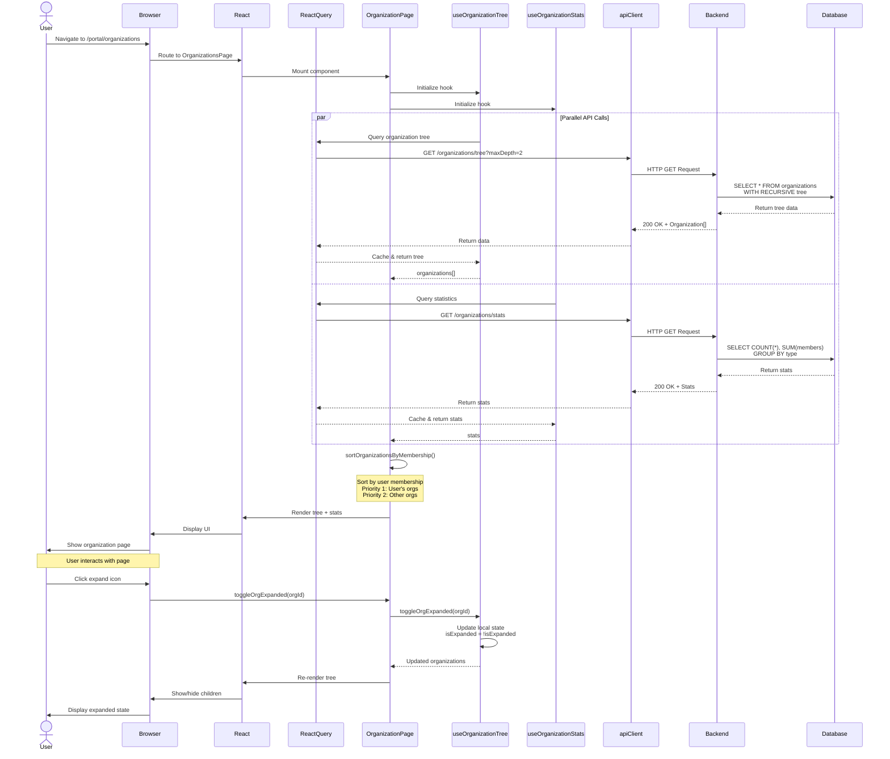

---

### Sequence Diagram 2: Create Organization Flow

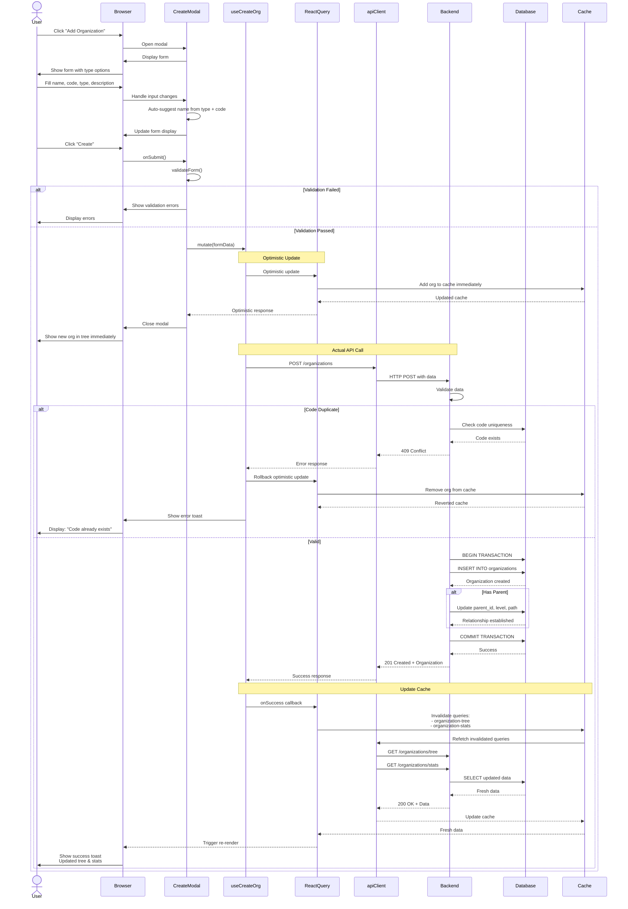

---

### Sequence Diagram 3: Add Member Flow

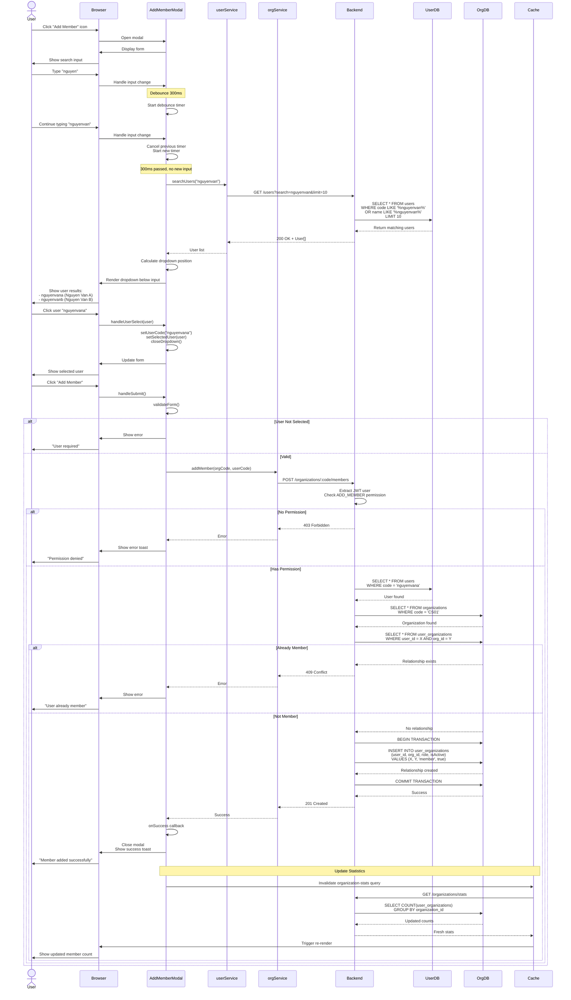

---

### Sequence Diagram 4: Delete Organization Flow

```mermaid
sequenceDiagram
    actor User
    participant Browser
    participant DeleteModal
    participant useDeleteOrg
    participant ReactQuery
    participant apiClient
    participant Backend
    participant Database
    participant Cache
    
    User->>Browser: Click "Delete" icon
    Browser->>DeleteModal: Open modal
    DeleteModal->>Browser: Display warning & confirmation
    Browser->>User: Show:<br/>- Org name/code<br/>- Warning message<br/>- Code input for confirmation
    
    User->>Browser: Type organization code
    Browser->>DeleteModal: Validate confirmation code
    
    alt Code Doesn't Match
        DeleteModal->>Browser: Disable Delete button
        Browser->>User: Show error
    else Code Matches
        DeleteModal->>Browser: Enable Delete button
        Browser->>User: Can click Delete
        
        User->>Browser: Click "Delete Organization"
        Browser->>DeleteModal: handleConfirm()
        
        Note over DeleteModal,ReactQuery: Optimistic Delete
        DeleteModal->>useDeleteOrg: mutate(orgId)
        useDeleteOrg->>ReactQuery: Optimistic update
        ReactQuery->>Cache: Remove org from tree cache
        Cache-->>ReactQuery: Updated cache
        ReactQuery-->>Browser: Trigger re-render
        Browser->>User: Org disappears from tree immediately
        
        Note over useDeleteOrg,Backend: Actual API Call
        useDeleteOrg->>apiClient: DELETE /organizations/:id
        apiClient->>Backend: HTTP DELETE
        
        Backend->>Backend: Check DELETE permission
        
        alt No Permission
            Backend-->>apiClient: 403 Forbidden
            apiClient-->>useDeleteOrg: Error
            useDeleteOrg->>ReactQuery: Rollback optimistic delete
            ReactQuery->>Cache: Re-add org to cache
            Cache-->>Browser: Restore tree
            Browser->>User: Show error + org reappears
        else Has Permission
            Backend->>Database: BEGIN TRANSACTION
            Backend->>Database: SELECT * FROM organizations<br/>WHERE id = :id
            
            alt Org Not Found
                Database-->>Backend: No rows
                Backend->>Database: ROLLBACK
                Backend-->>apiClient: 404 Not Found
                apiClient-->>useDeleteOrg: Error
                useDeleteOrg->>Browser: Show info toast
                Browser->>User: "Already deleted"
                Note over Browser: Org already removed from UI
            else Org Exists
                Database-->>Backend: Organization data
                
                Backend->>Database: SELECT COUNT(*) FROM organizations<br/>WHERE parent_id = :id
                Database-->>Backend: Child count
                
                alt Has Children
                    Backend->>Database: ROLLBACK
                    Backend-->>apiClient: 400 Bad Request<br/>"Has children"
                    apiClient-->>useDeleteOrg: Error
                    useDeleteOrg->>ReactQuery: Rollback optimistic delete
                    ReactQuery->>Cache: Re-add org
                    Cache-->>Browser: Restore tree
                    Browser->>User: Show error:<br/>"Delete children first"
                else No Children
                    Backend->>Database: SELECT COUNT(*) FROM user_organizations<br/>WHERE org_id = :id AND isActive = true
                    Database-->>Backend: Member count
                    
                    alt Has Active Members
                        Backend->>Database: ROLLBACK
                        Backend-->>apiClient: 400 Bad Request<br/>"Has X members"
                        apiClient-->>useDeleteOrg: Error
                        useDeleteOrg->>ReactQuery: Rollback optimistic delete
                        ReactQuery->>Cache: Re-add org
                        Cache-->>Browser: Restore tree
                        Browser->>User: Show error:<br/>"Remove members first"
                    else No Members
                        Backend->>Database: DELETE FROM organizations<br/>WHERE id = :id
                        Database-->>Backend: Deleted
                        
                        Backend->>Database: UPDATE user_organizations<br/>SET isActive = false<br/>WHERE org_id = :id
                        Database-->>Backend: Updated
                        
                        Backend->>Database: COMMIT TRANSACTION
                        Database-->>Backend: Success
                        Backend-->>apiClient: 200 OK
                        apiClient-->>useDeleteOrg: Success
                        
                        Note over useDeleteOrg,Cache: Update Cache
                        useDeleteOrg->>ReactQuery: onSuccess callback
                        ReactQuery->>Cache: Invalidate queries:<br/>- organization-tree<br/>- organization-stats
                        Cache->>apiClient: Refetch queries
                        apiClient->>Backend: GET /organizations/tree<br/>GET /organizations/stats
                        Backend->>Database: SELECT fresh data
                        Database-->>Backend: Updated data
                        Backend-->>apiClient: 200 OK
                        apiClient-->>Cache: Update cache
                        Cache-->>Browser: Trigger re-render
                        Browser->>User: Show success toast<br/>Updated tree & stats
                    end
                end
            end
        end
    end
```

---

### Sequence Diagram 5: Import Organizations Flow

```mermaid
sequenceDiagram
    actor User
    participant Browser
    participant ImportModal
    participant ExcelParser
    participant Validator
    participant apiClient
    participant Backend
    participant ExcelService
    participant ValidationService
    participant Database
    
    User->>Browser: Click "Import from Excel"
    Browser->>ImportModal: Open modal
    ImportModal->>Browser: Display upload area
    Browser->>User: Show instructions & template link
    
    opt User downloads template
        User->>Browser: Click "Download Template"
        Browser->>ImportModal: Generate template
        ImportModal->>Browser: Create Excel with:<br/>- Headers<br/>- Example data<br/>- Validation rules
        Browser->>User: Download template.xlsx
    end
    
    User->>Browser: Upload filled Excel file
    Browser->>ImportModal: Handle file upload
    
    ImportModal->>ImportModal: Validate file type & size
    
    alt Invalid File
        ImportModal->>Browser: Show error
        Browser->>User: "Invalid file format"
    else Valid File
        ImportModal->>ExcelParser: Parse Excel file
        ExcelParser->>ExcelParser: Read workbook<br/>Extract rows
        ExcelParser-->>ImportModal: Parsed data[]
        
        ImportModal->>Validator: Validate all rows
        
        loop For each row
            Validator->>Validator: Check required fields
            Validator->>Validator: Validate code format
            Validator->>Validator: Validate type
            Validator->>Validator: Check parent exists
            Validator->>Validator: Check duplicates
        end
        
        Validator-->>ImportModal: Validation results
        
        ImportModal->>Browser: Display preview table:<br/>- ✓ Valid rows<br/>- ✗ Invalid rows with errors<br/>- Summary: X valid, Y invalid
        Browser->>User: Show preview
        
        User->>Browser: Review preview
        
        alt Has Invalid Rows
            Browser->>User: Show "Skip Invalid Rows" option
            User->>Browser: Enable/disable skip option
        end
        
        User->>Browser: Click "Import"
        Browser->>ImportModal: handleImport()
        
        ImportModal->>ImportModal: Filter rows<br/>(only valid if skip enabled)
        ImportModal->>apiClient: POST /organizations/import
        apiClient->>Backend: HTTP POST with data[]
        
        Backend->>ValidationService: Final validation
        ValidationService->>ValidationService: Re-validate all rows<br/>Check business rules
        
        alt Validation Failed
            ValidationService-->>Backend: Validation errors
            Backend-->>apiClient: 400 Bad Request + errors
            apiClient-->>ImportModal: Error response
            ImportModal->>Browser: Show errors
            Browser->>User: "Validation failed"
        else Valid
            ValidationService-->>Backend: All valid
            
            Backend->>Database: BEGIN TRANSACTION
            
            Backend->>Backend: Sort by level<br/>Parents first, children after
            
            Note over Backend,Database: Process Level 2 Organizations
            loop For each level 2 org
                Backend->>Database: INSERT INTO organizations<br/>(name, code, type, level=2)
                
                alt Constraint Violation
                    Database-->>Backend: Error duplicate code
                    Backend->>Database: ROLLBACK TRANSACTION
                    Backend-->>apiClient: 400 Bad Request
                    apiClient-->>ImportModal: Import failed
                    ImportModal->>Browser: Show error
                    Browser->>User: "Import failed: Duplicate code"
                else Success
                    Database-->>Backend: Organization created
                end
            end
            
            Note over Backend,Database: Process Level 3 Organizations
            loop For each level 3 org
                Backend->>Database: SELECT id FROM organizations<br/>WHERE code = parent_code
                Database-->>Backend: Parent ID
                
                alt Parent Not Found
                    Backend->>Database: ROLLBACK TRANSACTION
                    Backend-->>apiClient: 400 Bad Request
                    apiClient-->>ImportModal: Import failed
                    ImportModal->>Browser: Show error
                    Browser->>User: "Parent not found"
                else Parent Found
                    Backend->>Database: INSERT INTO organizations<br/>(name, code, type, parent_id, level=3)
                    Database-->>Backend: Child created
                end
            end
            
            Backend->>Database: COMMIT TRANSACTION
            Database-->>Backend: Transaction committed
            
            Backend->>Database: SELECT COUNT(*) from organizations
            Database-->>Backend: Total count
            
            Backend-->>apiClient: 200 OK + summary:<br/>{created: X, skipped: Y}
            apiClient-->>ImportModal: Success response
            
            ImportModal->>Browser: Close modal
            Browser->>User: Show success toast:<br/>"X organizations imported"
            
            opt Has Skipped
                Browser->>User: Show: "Y rows skipped"<br/>Provide error report download
            end
            
            Note over ImportModal,Browser: Refresh Data
            ImportModal->>Browser: Invalidate React Query cache
            Browser->>apiClient: GET /organizations/tree<br/>GET /organizations/stats
            apiClient->>Backend: Fetch fresh data
            Backend->>Database: SELECT updated data
            Database-->>Backend: Fresh data
            Backend-->>apiClient: 200 OK
            apiClient-->>Browser: Update cache & re-render
            Browser->>User: Show updated tree with new orgs
        end
    end
```

---

### Sequence Diagram 6: Real-time Statistics Update

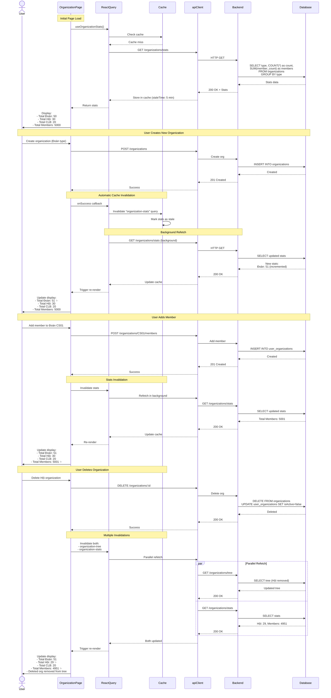

---

## 🎯 Key Design Patterns

### 1. **Optimistic UI Updates**
- **Pattern:** Update UI immediately before API call completes
- **Used In:** Create, Edit, Delete operations
- **Benefits:** 
  - Instant user feedback
  - Better perceived performance
  - Rollback on error
- **Implementation:**
  - React Query's optimistic update feature
  - Local state updates before API response
  - Automatic rollback on failure

### 2. **Debounced Search**
- **Pattern:** Delay API calls until user stops typing
- **Used In:** User search in Add Member modal
- **Benefits:**
  - Reduce unnecessary API calls
  - Better server performance
  - Improved user experience
- **Implementation:**
  - 300ms debounce timer
  - Cancel previous timer on new input
  - Show loading indicator during search

### 3. **React Query Cache Management**
- **Pattern:** Intelligent caching with automatic invalidation
- **Used In:** All data fetching operations
- **Benefits:**
  - Reduce redundant API calls
  - Consistent data across components
  - Automatic background refetch
- **Implementation:**
  - Query keys: `organization-tree`, `organization-stats`
  - Cache invalidation on mutations
  - Stale time configuration (5 minutes)

### 4. **Lazy Loading Children**
- **Pattern:** Load child organizations only when parent is expanded
- **Used In:** Organization tree expansion
- **Benefits:**
  - Faster initial load
  - Reduced memory usage
  - Better performance with large trees
- **Implementation:**
  - maxDepth parameter in API calls
  - Load children on first expand
  - Cache loaded children

### 5. **Batch Validation**
- **Pattern:** Validate all items before processing
- **Used In:** Excel import feature
- **Benefits:**
  - User sees all errors upfront
  - No partial imports on validation failure
  - Better error messaging
- **Implementation:**
  - Client-side validation first
  - Server-side re-validation
  - Transaction for atomicity

### 6. **Permission-Based UI**
- **Pattern:** Hide/disable UI elements based on user permissions
- **Used In:** All CRUD operations
- **Benefits:**
  - Better UX (no false affordances)
  - Reduced error messages
  - Clear user capabilities
- **Implementation:**
  - Check permissions before rendering buttons
  - Backend validation as fallback
  - Consistent permission checks

---

## 📈 Performance Optimizations

### 1. **Tree Rendering Optimization**
- **Technique:** Memoized components with React.memo
- **Target:** OrganizationTreeItem component
- **Impact:** Prevent unnecessary re-renders of unchanged nodes

### 2. **Parallel API Calls**
- **Technique:** Promise.all for independent requests
- **Target:** Tree + Stats fetching
- **Impact:** 50% faster page load

### 3. **Optimistic Updates**
- **Technique:** Update UI before API response
- **Target:** Create, Edit, Delete operations
- **Impact:** Instant user feedback

### 4. **Query Deduplication**
- **Technique:** React Query automatic deduplication
- **Target:** Multiple components requesting same data
- **Impact:** Single API call for duplicate requests

### 5. **Debounced Search**
- **Technique:** 300ms debounce on user input
- **Target:** User search in Add Member modal
- **Impact:** 80% reduction in search API calls

---

## 🔒 Security Considerations

### 1. **JWT Authentication**
- All API calls include Bearer token
- Token validated on every request
- Automatic redirect on expiration

### 2. **Permission Checks**
- Frontend: Hide unauthorized actions
- Backend: Validate permissions on every mutation
- Role-based access control (RBAC)

### 3. **Input Validation**
- Frontend: Client-side validation for UX
- Backend: Server-side validation for security
- SQL injection prevention via ORM

### 4. **File Upload Security**
- File type validation (.xlsx, .xls only)
- File size limits (10 MB max)
- Content validation before processing

---

## 📚 Related Documentation

- **Use Case Diagram:** [ORGANIZATION_MANAGEMENT_USE_CASES.md](ORGANIZATION_MANAGEMENT_USE_CASES.md)
- **Backend Component Diagram:** [BACKEND_COMPONENT_DIAGRAM.md](BACKEND_COMPONENT_DIAGRAM.md)
- **Package Diagram:** [PACKAGE_DIAGRAM.md](PACKAGE_DIAGRAM.md)
- **API Documentation:** `/backend/src/organizations/organizations.controller.ts`
- **Database Schema:** `/backend/database.dbml`

---

**Document Version:** 1.0  
**Last Updated:** December 20, 2025  
**Maintained By:** Frontend Development Team  
**Page:** OrganizationsPage.tsx  
**Module:** Organization Management System
