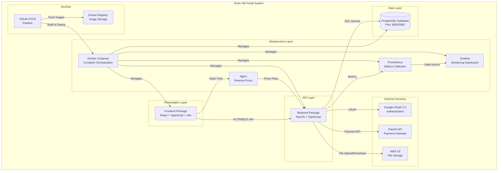
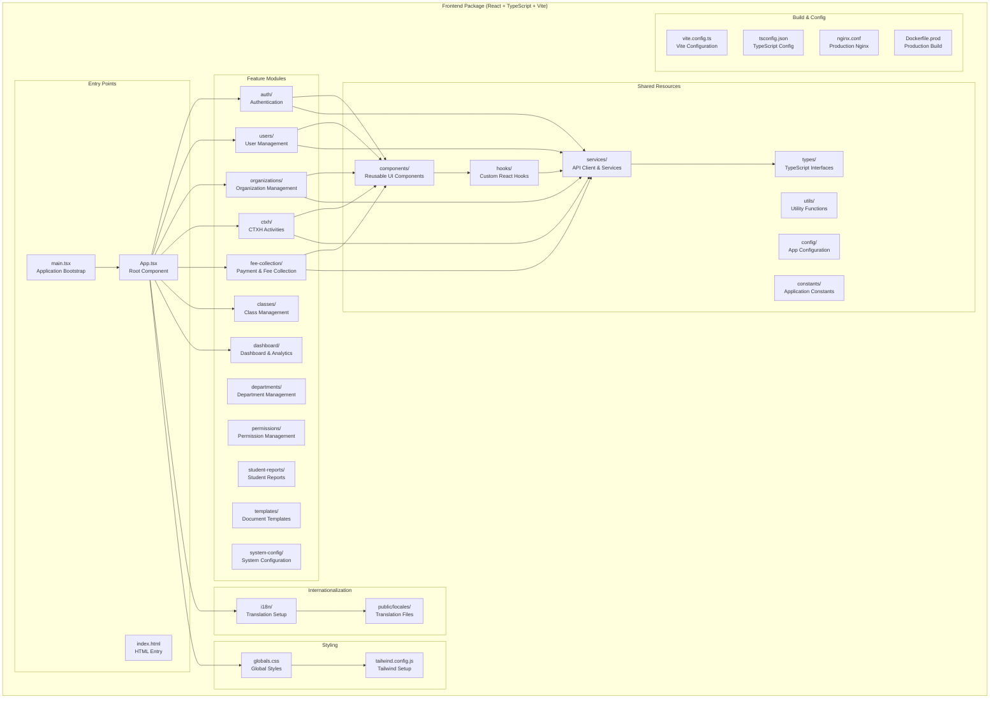
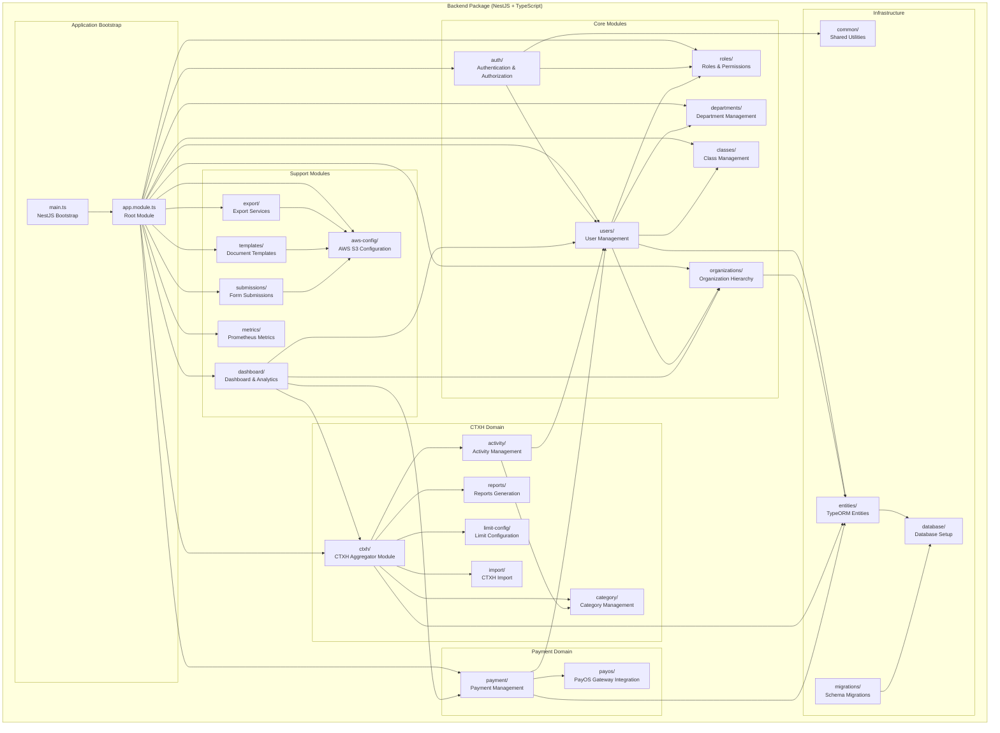
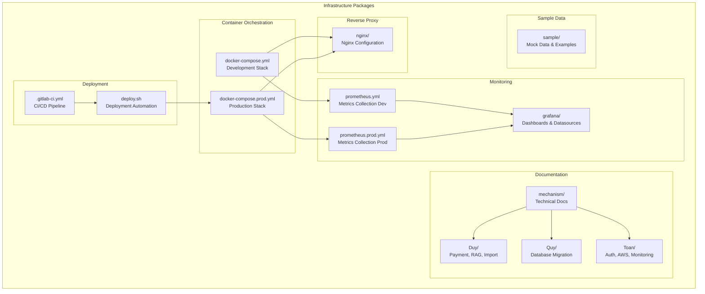
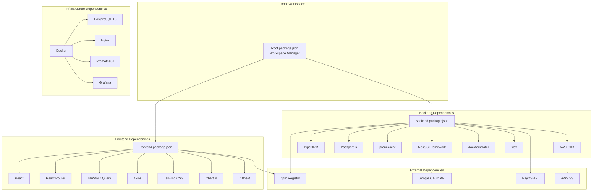
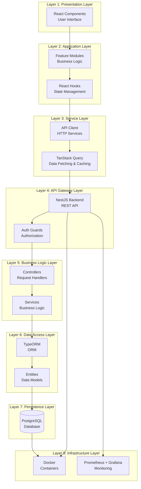
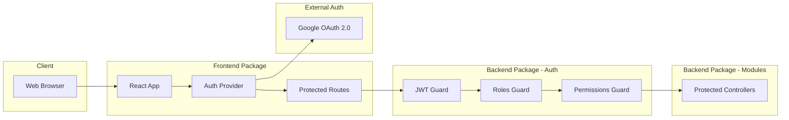
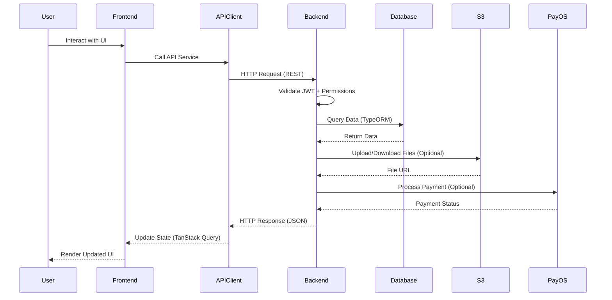
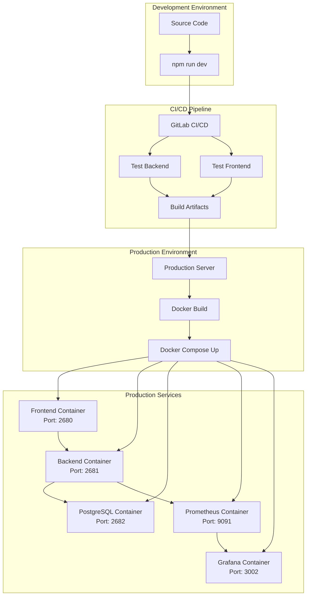

# Package Diagram - Đoàn Hội Portal System

## 📐 System Architecture Overview

Hệ thống **Đoàn Hội Portal** được xây dựng theo kiến trúc **Monorepo** với 2 ứng dụng chính: **Backend (NestJS)** và **Frontend (React)**, được triển khai bằng **Docker** và giám sát bởi **Prometheus + Grafana**.

---

## 🏗️ High-Level Package Diagram



---

## 📦 Detailed Package Structure

### 1. Root Package (Monorepo)

```
doanhoi-portal/
├── 📦 backend/                 # Backend NestJS application
├── 📦 frontend/                # Frontend React application
├── 📦 nginx/                   # Nginx configuration
├── 📦 grafana/                 # Grafana dashboards & datasources
├── 📦 mechanism/               # Technical documentation
├── 📦 sample/                  # Sample data & mockups
├── 🐳 docker-compose.yml       # Development containers
├── 🐳 docker-compose.prod.yml  # Production containers
├── 📊 prometheus.yml           # Prometheus dev config
├── 📊 prometheus.prod.yml      # Prometheus prod config
├── 🚀 deploy.sh                # Deployment script
├── ⚙️ .gitlab-ci.yml           # CI/CD pipeline
├── 📄 package.json             # Root workspace config
└── 📝 *.md                     # Documentation files
```

---

## 🎨 Frontend Package Structure



### Frontend Package Details

```
frontend/
├── 📂 src/
│   ├── 🚀 main.tsx                      # Application entry point
│   ├── 📱 App.tsx                       # Root component with routing
│   ├── 🎨 globals.css                   # Global CSS styles
│   │
│   ├── 📦 features/                     # Feature modules (by domain)
│   │   ├── auth/                        # Authentication & Login
│   │   │   ├── components/              # Auth-specific components
│   │   │   ├── hooks/                   # Auth-specific hooks
│   │   │   ├── services/                # Auth API services
│   │   │   └── types/                   # Auth TypeScript types
│   │   │
│   │   ├── users/                       # User Management
│   │   │   ├── components/              # User components (modals, forms)
│   │   │   ├── hooks/                   # User-specific hooks
│   │   │   └── types/                   # User types
│   │   │
│   │   ├── organizations/               # Organization Management
│   │   │   ├── components/              # Organization components
│   │   │   ├── services/                # Organization services
│   │   │   └── types/                   # Organization types
│   │   │
│   │   ├── ctxh/                        # CTXH Activities & Reports
│   │   │   ├── components/              # CTXH components
│   │   │   │   ├── activity/            # Activity management
│   │   │   │   ├── category/            # Category management
│   │   │   │   ├── limit-config/        # Limit configuration
│   │   │   │   └── reports/             # CTXH reports
│   │   │   ├── hooks/                   # CTXH hooks
│   │   │   └── types/                   # CTXH types
│   │   │
│   │   ├── fee-collection/              # Payment & Fee Collection
│   │   │   ├── components/              # Payment components
│   │   │   │   ├── admin/               # Admin payment management
│   │   │   │   └── member/              # Member payment views
│   │   │   ├── page/                    # Payment pages
│   │   │   ├── hooks/                   # Payment hooks
│   │   │   └── types/                   # Payment types
│   │   │
│   │   ├── classes/                     # Class Management
│   │   ├── dashboard/                   # Dashboard & Analytics
│   │   ├── departments/                 # Department Management
│   │   ├── permissions/                 # Permission Management
│   │   ├── student-reports/             # Student Reports
│   │   ├── templates/                   # Document Templates
│   │   └── system-config/               # System Configuration
│   │
│   ├── 📦 shared/                       # Shared resources (cross-cutting)
│   │   ├── components/                  # Reusable UI components
│   │   │   ├── Layout.tsx               # Main layout wrapper
│   │   │   ├── ProtectedRoute.tsx       # Auth route guard
│   │   │   ├── PermissionGuard.tsx      # Permission guard
│   │   │   ├── Pagination.tsx           # Pagination component
│   │   │   ├── Toast.tsx                # Toast notifications
│   │   │   ├── ImportModal.tsx          # Generic import modal
│   │   │   ├── SearchableCombobox.tsx   # Searchable dropdown
│   │   │   ├── UserTable/               # Reusable user table
│   │   │   ├── forms/                   # Form components
│   │   │   ├── charts/                  # Chart components
│   │   │   └── export/                  # Export components
│   │   │
│   │   ├── services/                    # API services
│   │   │   ├── apiClient.ts             # Axios client with interceptors
│   │   │   ├── userService.ts           # User API calls
│   │   │   ├── organizationService.ts   # Organization API calls
│   │   │   ├── classService.ts          # Class API calls
│   │   │   ├── dashboardService.ts      # Dashboard API calls
│   │   │   ├── exportService.ts         # Export API calls
│   │   │   ├── permissionService.ts     # Permission API calls
│   │   │   ├── users-import-service/    # User import services
│   │   │   └── fee-collection-service/  # Payment services
│   │   │
│   │   ├── hooks/                       # Custom React hooks
│   │   │   ├── queries/                 # TanStack Query hooks
│   │   │   │   ├── useUserQueries.ts    # User data queries
│   │   │   │   ├── useOrganizationQueries.ts
│   │   │   │   ├── useClassQueries.ts
│   │   │   │   └── useDashboardQueries.ts
│   │   │   ├── useUserList.ts           # User list hook
│   │   │   ├── usePermissions.ts        # Permission hook
│   │   │   ├── useToast.ts              # Toast notification hook
│   │   │   ├── useExport.ts             # Export hook
│   │   │   └── useImportConfig.ts       # Import config hook
│   │   │
│   │   ├── types/                       # TypeScript interfaces
│   │   │   ├── auth.types.ts            # Auth types
│   │   │   ├── user.types.ts            # User types
│   │   │   ├── organization.types.ts    # Organization types
│   │   │   ├── permission.types.ts      # Permission types
│   │   │   └── api.types.ts             # API response types
│   │   │
│   │   ├── utils/                       # Utility functions
│   │   │   ├── formatters.ts            # Data formatting
│   │   │   ├── validators.ts            # Validation functions
│   │   │   └── helpers.ts               # Helper functions
│   │   │
│   │   ├── config/                      # Configuration
│   │   │   └── appConfig.ts             # App configuration
│   │   │
│   │   └── constants/                   # Constants
│   │       └── index.ts                 # Application constants
│   │
│   ├── 📦 i18n/                         # Internationalization
│   │   ├── config.ts                    # i18next configuration
│   │   └── index.ts                     # i18n initialization
│   │
│   └── 📦 utils/                        # Root-level utilities
│
├── 📂 public/                           # Static assets
│   └── locales/                         # Translation JSON files
│       ├── vi/                          # Vietnamese translations
│       │   ├── common.json
│       │   ├── auth.json
│       │   ├── users.json
│       │   └── ...
│       └── en/                          # English translations
│
├── ⚙️ vite.config.ts                    # Vite build configuration
├── ⚙️ tsconfig.json                     # TypeScript configuration
├── ⚙️ tailwind.config.js                # Tailwind CSS configuration
├── ⚙️ postcss.config.js                 # PostCSS configuration
├── 🐳 Dockerfile.prod                   # Production Docker build
├── 🌐 nginx.conf                        # Nginx configuration
└── 📦 package.json                      # Dependencies & scripts
```

---

## 🖥️ Backend Package Structure



### Backend Package Details

```
backend/
├── 📂 src/
│   ├── 🚀 main.ts                       # NestJS application bootstrap
│   ├── 📦 app.module.ts                 # Root application module
│   │
│   ├── 📦 auth/                         # Authentication & Authorization
│   │   ├── auth.controller.ts           # Auth endpoints
│   │   ├── auth.service.ts              # Auth business logic
│   │   ├── auth.module.ts               # Auth module definition
│   │   ├── strategies/                  # Passport strategies
│   │   │   ├── jwt.strategy.ts          # JWT strategy
│   │   │   ├── local.strategy.ts        # Local strategy
│   │   │   └── google.strategy.ts       # Google OAuth strategy
│   │   ├── guards/                      # Auth guards
│   │   │   ├── jwt-auth.guard.ts        # JWT guard
│   │   │   ├── roles.guard.ts           # Role-based guard
│   │   │   └── permissions.guard.ts     # Permission-based guard
│   │   ├── decorators/                  # Custom decorators
│   │   │   ├── current-user.decorator.ts
│   │   │   ├── roles.decorator.ts
│   │   │   └── permissions.decorator.ts
│   │   └── dto/                         # Data Transfer Objects
│   │
│   ├── 📦 users/                        # User Management
│   │   ├── users.controller.ts          # User CRUD endpoints
│   │   ├── users.service.ts             # User business logic
│   │   ├── users.module.ts              # User module definition
│   │   ├── services/                    # Sub-services
│   │   │   ├── user-import.service.ts   # Excel import
│   │   │   ├── user-export.service.ts   # Excel export
│   │   │   └── user-search.service.ts   # Advanced search
│   │   ├── dto/                         # User DTOs
│   │   └── interfaces/                  # User interfaces
│   │
│   ├── 📦 organizations/                # Organization Management
│   │   ├── organizations.controller.ts  # Organization endpoints
│   │   ├── organizations.service.ts     # Organization logic
│   │   ├── organizations.module.ts      # Organization module
│   │   ├── organization-import.service.ts # Excel import
│   │   ├── services/                    # Sub-services
│   │   └── dto/                         # Organization DTOs
│   │
│   ├── 📦 roles/                        # Roles & Permissions
│   │   ├── roles.controller.ts          # Role CRUD endpoints
│   │   ├── roles.service.ts             # Role management
│   │   ├── roles.module.ts              # Role module
│   │   └── dto/                         # Role DTOs
│   │
│   ├── 📦 departments/                  # Department Management
│   │   ├── departments.controller.ts
│   │   ├── departments.service.ts
│   │   ├── departments.module.ts
│   │   ├── services/
│   │   └── dto/
│   │
│   ├── 📦 classes/                      # Class Management
│   │   ├── classes.controller.ts
│   │   ├── classes.service.ts
│   │   ├── classes.module.ts
│   │   ├── services/
│   │   └── dto/
│   │
│   ├── 📦 ctxh/                         # CTXH Domain (Aggregator)
│   │   ├── ctxh.module.ts               # CTXH aggregator module
│   │   ├── index.ts                     # Barrel exports
│   │   │
│   │   ├── activity/                    # Activity Management
│   │   │   ├── activities.controller.ts
│   │   │   ├── activities.service.ts
│   │   │   ├── activities.module.ts
│   │   │   ├── services/                # Participant, Check-in services
│   │   │   └── dto/
│   │   │
│   │   ├── category/                    # Category Management
│   │   │   ├── category.controller.ts
│   │   │   ├── category.service.ts
│   │   │   ├── category.module.ts
│   │   │   └── dto/
│   │   │
│   │   ├── reports/                     # CTXH Reports
│   │   │   ├── reports.controller.ts
│   │   │   ├── reports.service.ts
│   │   │   ├── reports.module.ts
│   │   │   └── dto/
│   │   │
│   │   ├── limit-config/                # Activity Limit Configuration
│   │   │   ├── limit-config.controller.ts
│   │   │   ├── limit-config.service.ts
│   │   │   ├── limit-config.module.ts
│   │   │   └── dto/
│   │   │
│   │   └── import/                      # CTXH Data Import
│   │
│   ├── 📦 payment/                      # Payment Management
│   │   ├── payment.module.ts            # Payment module
│   │   ├── payment-admin.controller.ts  # Admin payment endpoints
│   │   ├── payment-assignment.controller.ts # User assignment endpoints
│   │   ├── services/                    # Payment services
│   │   │   ├── payment.service.ts
│   │   │   ├── assignment.service.ts
│   │   │   └── verification.service.ts
│   │   ├── controllers/                 # Additional controllers
│   │   ├── config/                      # Payment configuration
│   │   └── dto/                         # Payment DTOs
│   │
│   ├── 📦 payos/                        # PayOS Gateway Integration
│   │   ├── payos.controller.ts          # Webhook handler
│   │   ├── payos.service.ts             # PayOS API integration
│   │   └── payos.module.ts              # PayOS module
│   │
│   ├── 📦 dashboard/                    # Dashboard & Analytics
│   │   ├── dashboard.controller.ts      # Dashboard endpoints
│   │   ├── dashboard.service.ts         # Analytics logic
│   │   └── dashboard.module.ts          # Dashboard module
│   │
│   ├── 📦 export/                       # Export Services
│   │   ├── export.controller.ts         # Export endpoints
│   │   ├── export.service.ts            # Excel/DOCX export
│   │   ├── export.module.ts             # Export module
│   │   └── dto/                         # Export DTOs
│   │
│   ├── 📦 templates/                    # Document Templates
│   │   ├── templates.controller.ts      # Template endpoints
│   │   ├── templates.service.ts         # Template processing
│   │   ├── templates.module.ts          # Template module
│   │   ├── templates-test.controller.ts # Template testing
│   │   └── dto/                         # Template DTOs
│   │
│   ├── 📦 submissions/                  # Form Submissions
│   │   ├── submissions.controller.ts    # Submission endpoints
│   │   ├── submissions.service.ts       # Submission processing
│   │   └── dto/                         # Submission DTOs
│   │
│   ├── 📦 aws-config/                   # AWS S3 Configuration
│   │   ├── aws-s3-config.controller.ts  # S3 config endpoints
│   │   ├── aws-s3-config.service.ts     # S3 integration
│   │   └── aws-s3-config.module.ts      # AWS config module
│   │
│   ├── 📦 metrics/                      # Prometheus Metrics
│   │   ├── metrics.module.ts            # Metrics module
│   │   └── metrics.service.ts           # Metrics collection
│   │
│   ├── 📦 database/                     # Database Infrastructure
│   │   ├── create-schema.ts             # Schema initialization
│   │   ├── reset-database.ts            # Database reset utility
│   │   ├── migrations/                  # TypeORM migrations
│   │   │   └── *.ts                     # Migration files
│   │   ├── seeds/                       # Database seeding
│   │   │   ├── index.ts                 # Seed orchestrator
│   │   │   ├── permissions.seed.ts      # Seed permissions
│   │   │   ├── roles.seed.ts            # Seed roles
│   │   │   ├── default-users.seed.ts    # Seed default users
│   │   │   └── dataSource.ts            # TypeORM data source
│   │   └── scripts/                     # Database utilities
│   │       ├── update-permissions.ts
│   │       └── verify-super-admin-permissions.ts
│   │
│   ├── 📦 entities/                     # TypeORM Entities (Data Models)
│   │   ├── user.entity.ts               # User entity
│   │   ├── organization.entity.ts       # Organization entity
│   │   ├── role.entity.ts               # Role entity
│   │   ├── permission.entity.ts         # Permission entity
│   │   ├── department.entity.ts         # Department entity
│   │   ├── class.entity.ts              # Class entity
│   │   ├── activity.entity.ts           # Activity entity
│   │   ├── category.entity.ts           # Category entity
│   │   ├── payment-campaign.entity.ts   # Payment campaign entity
│   │   ├── payment-assignment.entity.ts # Payment assignment entity
│   │   └── ...                          # Other entities
│   │
│   ├── 📦 common/                       # Shared Infrastructure
│   │   ├── constants/                   # Application constants
│   │   ├── interceptors/                # HTTP interceptors
│   │   │   ├── logging.interceptor.ts
│   │   │   └── transform.interceptor.ts
│   │   ├── middleware/                  # Express middleware
│   │   │   └── logger.middleware.ts
│   │   └── scripts/                     # Utility scripts
│   │
│   └── 📦 migrations/                   # Schema migrations
│
├── 📂 test/                             # E2E tests
│   └── *.e2e-spec.ts                    # E2E test files
│
├── ⚙️ nest-cli.json                     # NestJS CLI configuration
├── ⚙️ tsconfig.json                     # TypeScript configuration
├── ⚙️ tsconfig.build.json               # Build TypeScript config
├── 🐳 Dockerfile.prod                   # Production Docker build
├── 📊 database.dbml                     # Database schema diagram
└── 📦 package.json                      # Dependencies & scripts
```

---

## 🐳 Infrastructure Package Structure



### Infrastructure Package Details

```
infrastructure/
├── 🐳 docker-compose.yml               # Development containers
│   ├── postgres (Port: 9000)
│   ├── pgadmin (Port: 9001)
│   ├── prometheus (Port: 9090)
│   └── grafana (Port: 3002)
│
├── 🐳 docker-compose.prod.yml          # Production containers
│   ├── postgres (Port: 2682)
│   ├── backend (Port: 2681)
│   ├── frontend (Port: 2680)
│   ├── prometheus (Port: 9091)
│   └── grafana (Port: 3002)
│
├── 📦 nginx/                           # Nginx Configuration
│   ├── nginx.conf                      # Main Nginx config
│   └── doanhoi.hcmut.edu.vn.conf       # Domain-specific config
│
├── 📊 prometheus.yml                   # Prometheus Dev Config
├── 📊 prometheus.prod.yml              # Prometheus Prod Config
│
├── 📦 grafana/                         # Grafana Configuration
│   └── provisioning/
│       ├── dashboards/                 # Dashboard JSON files
│       │   └── Đoàn Hội Portal - Application Metrics.json
│       └── datasources/                # Datasource configs
│           └── prometheus.yml
│
├── 🚀 deploy.sh                        # Deployment Script
├── ⚙️ .gitlab-ci.yml                   # GitLab CI/CD Pipeline
│   ├── test_backend
│   ├── test_frontend
│   ├── build_artifacts
│   ├── deploy_production
│   └── rollback_production
│
├── 📦 mechanism/                       # Technical Documentation
│   ├── Duy/                            # Duy's documentation
│   │   ├── payment_workflow.md
│   │   ├── rag.md
│   │   └── user_import_workflow.md
│   ├── Quy/                            # Quy's documentation
│   │   └── DATABASE_MIGRATION_GUIDE.md
│   └── Toan/                           # Toan's documentation
│       ├── AUTHORIZATION_MECHANISM.md
│       ├── AWS_S3_CONFIG_SETUP_GUIDE.md
│       ├── GRAFANA_DASHBOARD_GUIDE.md
│       ├── JWT_REFRESH_TOKEN_MECHANISM.md
│       ├── PROMETHEUS_GRAFANA_PRODUCTION_SETUP.md
│       └── QUICK_START_MONITORING.md
│
└── 📦 sample/                          # Sample Data
    ├── backend/
    │   └── dashboard/
    └── frontend/
        └── dashboard/
```

---

## 🔄 Package Dependency Diagram



---

## 📊 Layer Architecture Diagram



---

## 🔐 Security Package Flow



---

## 📈 Data Flow Between Packages



---

## 🎯 Package Responsibilities Matrix

| Package | Primary Responsibility | Key Technologies | Dependencies |
|---------|----------------------|------------------|--------------|
| **Frontend** | User interface & interaction | React, TypeScript, Vite, Tailwind | Backend API |
| **Backend** | Business logic & API | NestJS, TypeScript, TypeORM | PostgreSQL, External APIs |
| **Database** | Data persistence | PostgreSQL 15 | None |
| **Nginx** | Reverse proxy & load balancing | Nginx | Frontend, Backend |
| **Prometheus** | Metrics collection | Prometheus | Backend metrics endpoint |
| **Grafana** | Monitoring dashboard | Grafana | Prometheus datasource |
| **Docker** | Container orchestration | Docker Compose | All services |
| **GitLab CI** | CI/CD automation | GitLab CI/CD | All packages |

---

## 📦 Package Deployment Flow



---

## 🔗 Inter-Package Communication

### Frontend ↔ Backend Communication

```
Frontend Package (React)
    ↓ HTTP/REST API
Backend Package (NestJS)
    ↓ SQL Queries
Database Package (PostgreSQL)
```

### Backend ↔ External Services

```
Backend Package (NestJS)
    ├─→ Google OAuth API (Authentication)
    ├─→ PayOS API (Payment Processing)
    ├─→ AWS S3 (File Storage)
    └─→ Prometheus (Metrics Export)
```

### Monitoring Flow

```
Backend Package (NestJS)
    ↓ /metrics endpoint
Prometheus Package
    ↓ Data Source
Grafana Package
    ↓ Dashboard
Admin User
```

---

## 📋 Package Versioning

| Package | Version | Runtime | Build Tool |
|---------|---------|---------|------------|
| Root Workspace | 1.0.0 | Node.js 20 | npm workspaces |
| Backend | 0.0.1 | Node.js 20 | NestJS CLI |
| Frontend | 0.0.0 | Node.js 18+ | Vite |
| PostgreSQL | 15 | - | - |
| Prometheus | latest | - | - |
| Grafana | latest | - | - |

---

## 🚀 Package Scripts

### Root Package Scripts
```json
{
  "dev": "Run both backend & frontend in dev mode",
  "dev:backend": "Run backend in development mode",
  "dev:frontend": "Run frontend in development mode",
  "build": "Build both backend & frontend",
  "docker:up": "Start development containers",
  "docker:down": "Stop development containers",
  "prod:up": "Start production containers",
  "prod:down": "Stop production containers"
}
```

### Backend Package Scripts
```json
{
  "start": "Start production server",
  "start:dev": "Start development server with hot reload",
  "build": "Build production bundle",
  "test": "Run unit tests",
  "test:e2e": "Run E2E tests",
  "lint": "Lint TypeScript files",
  "seed": "Seed database with initial data",
  "migrate": "Run database migrations"
}
```

### Frontend Package Scripts
```json
{
  "dev": "Start Vite dev server",
  "build": "Build production bundle",
  "preview": "Preview production build",
  "lint": "Lint TypeScript files"
}
```

---

## 🎨 Package Technology Stack Summary

### Frontend Package
- **Framework:** React 18
- **Language:** TypeScript 5
- **Build Tool:** Vite 5
- **State Management:** TanStack Query 5
- **Routing:** React Router 6
- **Styling:** Tailwind CSS 3
- **UI Components:** Radix UI
- **Charts:** Chart.js + react-chartjs-2
- **Forms:** React Hook Form + Yup
- **i18n:** i18next
- **HTTP Client:** Axios
- **Icons:** Lucide React

### Backend Package
- **Framework:** NestJS 10
- **Language:** TypeScript 5
- **Runtime:** Node.js 20
- **ORM:** TypeORM 0.3
- **Database:** PostgreSQL 15
- **Authentication:** Passport.js + JWT
- **Validation:** class-validator + class-transformer
- **Documentation:** Swagger/OpenAPI
- **Monitoring:** Prometheus (prom-client)
- **File Processing:** xlsx, docxtemplater, pizzip
- **Cloud Storage:** AWS SDK S3
- **Payment:** PayOS SDK

### Infrastructure Package
- **Containerization:** Docker + Docker Compose
- **Reverse Proxy:** Nginx
- **Monitoring:** Prometheus + Grafana
- **CI/CD:** GitLab CI/CD
- **Database:** PostgreSQL 15

---

## 📚 Package Documentation Files

```
Root Documentation:
├── BACKEND_COMPONENT_DIAGRAM.md        # Backend architecture
├── PACKAGE_DIAGRAM.md                   # This file
├── DEVOPS_ENHANCEMENT_STRATEGY.md       # DevOps roadmap
├── TESTING_STRATEGY.md                  # Testing guidelines
└── i18n_plan.md                         # Internationalization plan

Backend Documentation:
├── UPDATE_PERMISSIONS_GUIDE.md          # Permission update guide
├── QUICK_FIX_PERMISSIONS.md             # Permission quick fix
└── database.dbml                        # Database schema

Frontend Documentation:
├── USERS_CACHE_IMPLEMENTATION_SUMMARY.md
├── QUICK_START_USERS_CACHE.md
├── LOAD_STRATEGY_BY_PAGE.md
├── OPTIMISTIC_UPDATE_FIX.md
├── OPTIMIZATION_SUMMARY.md
└── ORGANIZATION_COMBOBOX_CACHE_FIX.md

Mechanism Documentation:
├── Duy/
│   ├── payment_workflow.md
│   ├── rag.md
│   └── user_import_workflow.md
├── Quy/
│   └── DATABASE_MIGRATION_GUIDE.md
└── Toan/
    ├── AUTHORIZATION_MECHANISM.md
    ├── AWS_S3_CONFIG_SETUP_GUIDE.md
    ├── GRAFANA_DASHBOARD_GUIDE.md
    ├── JWT_REFRESH_TOKEN_MECHANISM.md
    ├── PROMETHEUS_GRAFANA_PRODUCTION_SETUP.md
    ├── QUICK_START_MONITORING.md
    └── cache/
```

---

## 🎯 Design Principles

### 1. **Separation of Concerns**
- Frontend handles presentation logic
- Backend handles business logic
- Database handles data persistence

### 2. **Modular Architecture**
- Each domain is a separate module
- Clear boundaries between modules
- Easy to add/remove features

### 3. **Dependency Inversion**
- Modules depend on abstractions (interfaces)
- Easy to swap implementations
- Better testability

### 4. **Single Responsibility**
- Each package has one clear purpose
- Components are small and focused
- Services handle specific tasks

### 5. **DRY (Don't Repeat Yourself)**
- Shared components in `shared/` folder
- Reusable services and hooks
- Common utilities extracted

---

## 🔄 Future Package Evolution

### Potential New Packages

1. **Mobile Package** (Future)
   - React Native application
   - Shared types with web frontend
   - Same backend API

2. **Admin Panel Package** (Future)
   - Separate admin interface
   - Advanced analytics
   - System configuration

3. **Notification Service Package** (Future)
   - Email notifications
   - SMS notifications
   - Push notifications

4. **Report Generator Package** (Future)
   - Complex report generation
   - Scheduled reports
   - PDF generation

5. **Audit Log Package** (Future)
   - Track all system changes
   - User activity monitoring
   - Compliance reporting

---

## 📖 References

- **Monorepo Best Practices:** https://monorepo.tools/
- **NestJS Documentation:** https://docs.nestjs.com/
- **React Documentation:** https://react.dev/
- **Docker Compose:** https://docs.docker.com/compose/
- **TypeScript Handbook:** https://www.typescriptlang.org/docs/

---

**Document Version:** 1.0  
**Last Updated:** December 9, 2025  
**Maintained By:** Development Team  
**Repository:** Đoàn Hội Portal (doanhoi-portal)
