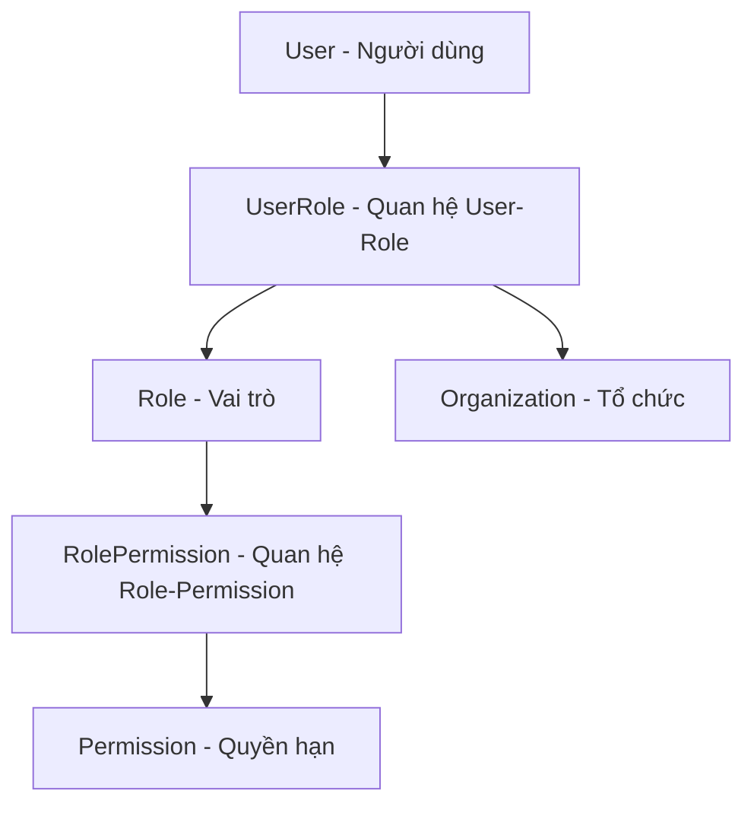

# 🔐 Hướng dẫn Cơ chế Phân quyền - Dự án Doanhoi Portal

## 📋 Tổng quan Hệ thống Phân quyền

Dự án Doanhoi Portal sử dụng hệ thống phân quyền dựa trên **Role-Based Access Control (RBAC)** với khả năng phân quyền theo tổ chức. Hệ thống được thiết kế linh hoạt để quản lý quyền truy cập của người dùng một cách chi tiết và hiệu quả.

## 🏗️ Kiến trúc Hệ thống

### 1. Các Thành phần Chính



### 2. Cấu trúc Database

#### **Bảng Users** 👤
- Lưu trữ thông tin người dùng cơ bản
- Quan hệ với UserRole để xác định vai trò

#### **Bảng Roles** 👥  
- Định nghĩa các vai trò trong hệ thống
- Có thể là vai trò hệ thống hoặc vai trò tùy chỉnh
- Ví dụ: `admin`, `manager`, `editor`, `viewer`

#### **Bảng Permissions** 🔑
- Định nghĩa các quyền hạn cụ thể
- Phân loại theo `category` (dashboard, users, organizations, etc.)
- Có 2 ngữ cảnh: `system` và `organization`

#### **Bảng UserRoles** 🔗
- Bảng trung gian liên kết User, Role và Organization
- Cho phép một người dùng có nhiều vai trò khác nhau trong các tổ chức khác nhau
- Trường `organizationId` có thể null (quyền toàn hệ thống)

## 🎯 Các Loại Quyền trong Hệ thống

### 1. Phân loại theo Context (Ngữ cảnh)

#### **System Permissions** (Quyền Hệ thống)
- Áp dụng toàn bộ hệ thống, không phụ thuộc vào tổ chức
- Ví dụ: `permissions.access`, `dashboard.access`
- Thường dành cho Super Admin

#### **Organization Permissions** (Quyền Tổ chức)
- Áp dụng trong phạm vi một tổ chức cụ thể
- Ví dụ: `users.create`, `departments.update`
- Người dùng có thể có quyền khác nhau ở các tổ chức khác nhau

### 2. Phân loại theo Category (Danh mục)

#### **Dashboard** 📊
- `dashboard.access`: Truy cập bảng điều khiển

#### **Users Management** 👥
- `users.access`: Truy cập trang người dùng
- `users.create`: Tạo người dùng mới
- `users.view_details`: Xem chi tiết người dùng
- `users.update`: Chỉnh sửa người dùng
- `users.delete`: Xóa người dùng
- `users.export`: Xuất dữ liệu người dùng

#### **Organizations Management** 🏢
- `organizations.access`: Truy cập trang tổ chức
- `organizations.create`: Tạo tổ chức mới
- `organizations.update`: Chỉnh sửa tổ chức
- `organizations.delete`: Xóa tổ chức
- `organizations.add_member`: Thêm thành viên
- `organizations.remove_member`: Xóa thành viên

#### **Departments Management** 🏛️
- `departments.access`: Truy cập trang đơn vị
- `departments.create`: Tạo đơn vị mới
- `departments.view_details`: Xem chi tiết đơn vị
- `departments.update`: Chỉnh sửa đơn vị
- `departments.delete`: Xóa đơn vị

#### **Classes Management** 🎓
- `classes.access`: Truy cập trang lớp học
- `classes.create`: Tạo lớp học mới
- `classes.view_details`: Xem chi tiết lớp học
- `classes.update`: Chỉnh sửa lớp học
- `classes.delete`: Xóa lớp học

#### **Payment Campaigns** 💰
- `payment-campaigns.access`: Truy cập trang quản lý đóng phí
- `payment-campaigns.create`: Tạo đợt đóng phí mới
- `payment-campaigns.read`: Xem thông tin đợt đóng phí
- `payment-campaigns.update`: Chỉnh sửa đợt đóng phí
- `payment-campaigns.delete`: Xóa đợt đóng phí
- `payment-campaigns.manage_assignments`: Quản lý phân công thanh toán
- `payment-campaigns.view_reports`: Xem báo cáo đóng phí
- `payment-campaigns.export`: Xuất dữ liệu đóng phí

#### **My Payments** 💳
- `my-payments.access`: Truy cập trang đóng phí của tôi
- `my-payments.view`: Xem thông tin đóng phí được phân công
- `my-payments.pay`: Thực hiện thanh toán
- `my-payments.history`: Xem lịch sử thanh toán

#### **Permissions Management** 🔐
- `permissions.access`: Truy cập trang phân quyền
- `permissions.create`: Tạo vai trò mới
- `permissions.view_details`: Xem chi tiết vai trò
- `permissions.update`: Chỉnh sửa vai trò
- `permissions.delete`: Xóa vai trò

## 🔧 Cách thức Hoạt động

### 1. Xác thực và Phân quyền trên Backend

#### **Middleware và Guards**

```typescript
// 1. JWT Authentication Guard
@UseGuards(JwtAuthGuard)

// 2. Permission Guard với decorator
@RequirePermissions('users.create', 'users.update')
@UseGuards(PermissionGuard)
```

#### **Quy trình Kiểm tra Quyền**

1. **User Authentication**: Xác thực người dùng qua JWT token
2. **Extract User Info**: Lấy thông tin user từ token
3. **Get Required Permissions**: Lấy danh sách quyền cần thiết từ decorator
4. **Check Organization Context**: Xác định tổ chức từ request parameters
5. **Validate Permissions**: Kiểm tra user có đủ quyền trong context tổ chức
6. **Grant/Deny Access**: Cho phép hoặc từ chối truy cập

### 2. Quản lý Quyền trên Frontend

#### **Permission Hook**
```typescript
// Sử dụng hook để kiểm tra quyền
const { hasPermission } = usePermissions();

// Kiểm tra quyền cụ thể
if (hasPermission('users.create')) {
  // Hiển thị nút tạo user
}
```

#### **Conditional Rendering**
```typescript
// Hiển thị UI dựa trên quyền
{hasPermission('users.delete') && (
  <DeleteButton onClick={handleDelete} />
)}
```


## 🔄 Quy trình Quản lý Phân quyền

### 1. Tạo Vai trò Mới

1. **Truy cập**: Vào trang "Quản lý Phân quyền"
2. **Tạo Role**: Click "Tạo vai trò mới"
3. **Điền thông tin**:
   - Tên vai trò (name): Mã định danh duy nhất
   - Tên hiển thị (displayName): Tên hiển thị cho người dùng
   - Mô tả (description): Mô tả chi tiết vai trò
4. **Chọn quyền**: Chọn các permissions phù hợp
5. **Lưu**: Xác nhận tạo vai trò

### 2. Gán Vai trò cho Người dùng

1. **Truy cập**: Vào trang "Quản lý Người dùng"
2. **Chọn User**: Chọn người dùng cần gán quyền
3. **Chỉnh sửa**: Click "Chỉnh sửa" 
4. **Gán Role**: Chọn vai trò và tổ chức (nếu cần)
5. **Lưu**: Xác nhận thay đổi

### 3. Quản lý Quyền theo Tổ chức

- **Cùng User, Khác Role**: Một người có thể có vai trò khác nhau ở các tổ chức khác nhau
- **Context Switching**: Hệ thống tự động chuyển đổi quyền dựa trên tổ chức đang truy cập
- **Inheritance**: Quyền system được kế thừa ở tất cả tổ chức

## 🚀 Ví dụ Thực tế

### Kịch bản 1: Sinh viên thuộc nhiều tổ chức
```
User: Nguyễn Văn A
- Tổ chức ĐHBK: Role "student" 
  → Có quyền: my-payments.access, my-payments.pay
- Tổ chức Hội SV: Role "manager"
  → Có quyền: payment-campaigns.access, users.view_details
```

### Kịch bản 2: Quản trị viên tổ chức
```
User: Trần Thị B  
- System: Role "organization_admin"
  → Có quyền: Tất cả permissions trong tổ chức được gán
- Tổ chức XYZ: organizationId = "xyz-123"
  → Có thể quản lý toàn bộ users, departments, classes trong tổ chức XYZ
```

### Kịch bản 3: Super Admin
```
User: Admin System
- System: Role "super_admin" 
- organizationId: null (toàn hệ thống)
  → Có quyền: Tất cả permissions, không giới hạn tổ chức
```


---

