# Backend Component Diagram - Đoàn Hội Portal

## 📐 Architecture Overview

Dự án backend được xây dựng theo kiến trúc **NestJS Modular Architecture** với pattern **Controller-Service-Repository**.

```
┌─────────────────────────────────────────────────────────────────────────────┐
│                          Đoàn Hội Portal Backend                            │
│                              (NestJS Framework)                              │
└─────────────────────────────────────────────────────────────────────────────┘
```

---

## 🏗️ High-Level Component Diagram

```mermaid
graph TB
    subgraph "Client Layer"
        Client[Frontend React App]
        Mobile[Mobile/External Apps]
    end

    subgraph "API Gateway Layer"
        MainApp[main.ts<br/>Bootstrap App]
        AppModule[app.module.ts<br/>Root Module]
    end

    subgraph "Cross-Cutting Concerns"
        Auth[Auth Module<br/>JWT, OAuth]
        Guards[Guards<br/>JWT, Roles]
        Interceptors[Interceptors<br/>Logging, Transform]
        Middleware[Middleware<br/>CORS, Security]
        Metrics[Metrics Module<br/>Prometheus]
    end

    subgraph "Core Business Modules"
        Users[Users Module<br/>User Management]
        Orgs[Organizations Module<br/>Organization Hierarchy]
        Roles[Roles Module<br/>Role & Permissions]
        Depts[Departments Module<br/>Department Management]
        Classes[Classes Module<br/>Class Management]
    end

    subgraph "CTXH Domain Modules"
        CTXHMain[CTXH Module<br/>Main Aggregator]
        Activities[Activities Module<br/>Activity Management]
        Categories[Categories Module<br/>Activity Categories]
        Reports[Reports Module<br/>CTXH Reports]
        LimitConfig[Limit Config Module<br/>Activity Limits]
    end

    subgraph "Payment Domain Modules"
        Payment[Payment Module<br/>Payment Management]
        PayOS[PayOS Module<br/>Payment Gateway]
    end

    subgraph "System Support Modules"
        Dashboard[Dashboard Module<br/>Analytics & Stats]
        Export[Export Module<br/>Excel/Document Export]
        Templates[Templates Module<br/>Document Templates]
        Submissions[Submissions Module<br/>Form Submissions]
        AWSConfig[AWS Config Module<br/>S3 Configuration]
    end

    subgraph "Data Layer"
        Database[(PostgreSQL<br/>Database)]
        TypeORM[TypeORM<br/>ORM Layer]
        Entities[Entities<br/>Data Models]
        Migrations[Migrations<br/>Schema Changes]
        Seeds[Seeds<br/>Initial Data]
    end

    subgraph "External Services"
        GoogleOAuth[Google OAuth 2.0]
        PayOSGateway[PayOS API]
        S3[AWS S3]
    end

    Client --> MainApp
    Mobile --> MainApp
    MainApp --> AppModule
    
    AppModule --> Auth
    AppModule --> Guards
    AppModule --> Interceptors
    AppModule --> Middleware
    AppModule --> Metrics

    Auth --> Users
    Guards --> Auth
    
    AppModule --> Users
    AppModule --> Orgs
    AppModule --> Roles
    AppModule --> Depts
    AppModule --> Classes
    AppModule --> CTXHMain
    AppModule --> Payment
    AppModule --> Dashboard
    AppModule --> Export
    AppModule --> Templates
    AppModule --> Submissions
    AppModule --> AWSConfig

    CTXHMain --> Activities
    CTXHMain --> Categories
    CTXHMain --> Reports
    CTXHMain --> LimitConfig

    Payment --> PayOS

    Users --> TypeORM
    Orgs --> TypeORM
    Roles --> TypeORM
    Depts --> TypeORM
    Classes --> TypeORM
    Activities --> TypeORM
    Categories --> TypeORM
    Reports --> TypeORM
    Payment --> TypeORM
    
    TypeORM --> Entities
    TypeORM --> Database
    
    Database --> Migrations
    Database --> Seeds

    Auth --> GoogleOAuth
    PayOS --> PayOSGateway
    AWSConfig --> S3
    Export --> S3
```

---

## 📦 Detailed Module Breakdown

### 1. **Core Infrastructure Layer**

#### 1.1. Application Bootstrap
```
┌────────────────────────────────────┐
│          main.ts                   │
│  ┌──────────────────────────────┐  │
│  │ - Bootstrap NestJS App       │  │
│  │ - Configure Swagger          │  │
│  │ - Setup CORS                 │  │
│  │ - Configure Global Pipes     │  │
│  │ - Enable Prometheus Metrics  │  │
│  └──────────────────────────────┘  │
└────────────────────────────────────┘
            │
            ▼
┌────────────────────────────────────┐
│        app.module.ts               │
│  ┌──────────────────────────────┐  │
│  │ - Import All Modules         │  │
│  │ - Configure Database         │  │
│  │ - Setup Config Module        │  │
│  └──────────────────────────────┘  │
└────────────────────────────────────┘
```

#### 1.2. Database Layer
```
database/
├── create-schema.ts       # Schema initialization
├── reset-database.ts      # Database reset utility
├── migrations/            # TypeORM migrations
│   └── *.ts              # Schema changes
├── seeds/                # Initial data
│   ├── index.ts          # Seed orchestrator
│   ├── permissions.seed.ts
│   ├── roles.seed.ts
│   └── default-users.seed.ts
└── scripts/              # Database utilities
    ├── update-permissions.ts
    └── verify-super-admin-permissions.ts
```

#### 1.3. Common Utilities
```
common/
├── constants/            # Application constants
├── interceptors/         # Response transformers
├── middleware/           # Express middleware
└── scripts/              # Utility scripts
```

---

### 2. **Authentication & Authorization Layer**

```mermaid
graph LR
    subgraph "Auth Module"
        AuthController[auth.controller.ts<br/>POST /login<br/>POST /google<br/>POST /refresh]
        AuthService[auth.service.ts<br/>- validateUser<br/>- login<br/>- generateTokens]
        
        subgraph "Strategies"
            JWTStrategy[jwt.strategy.ts]
            LocalStrategy[local.strategy.ts]
            GoogleStrategy[google.strategy.ts]
        end
        
        subgraph "Guards"
            JWTGuard[jwt-auth.guard.ts]
            RolesGuard[roles.guard.ts]
            PermissionsGuard[permissions.guard.ts]
        end
        
        subgraph "Decorators"
            CurrentUser[@CurrentUser]
            RequireRoles[@Roles]
            RequirePermissions[@Permissions]
        end
    end
    
    AuthController --> AuthService
    AuthService --> JWTStrategy
    AuthService --> LocalStrategy
    AuthService --> GoogleStrategy
    
    JWTGuard --> JWTStrategy
    RolesGuard --> CurrentUser
    PermissionsGuard --> CurrentUser
```

**Key Features:**
- ✅ JWT Token Authentication
- ✅ Google OAuth 2.0 Integration
- ✅ Refresh Token Rotation
- ✅ Role-Based Access Control (RBAC)
- ✅ Permission-Based Access Control

---

### 3. **User Management Domain**

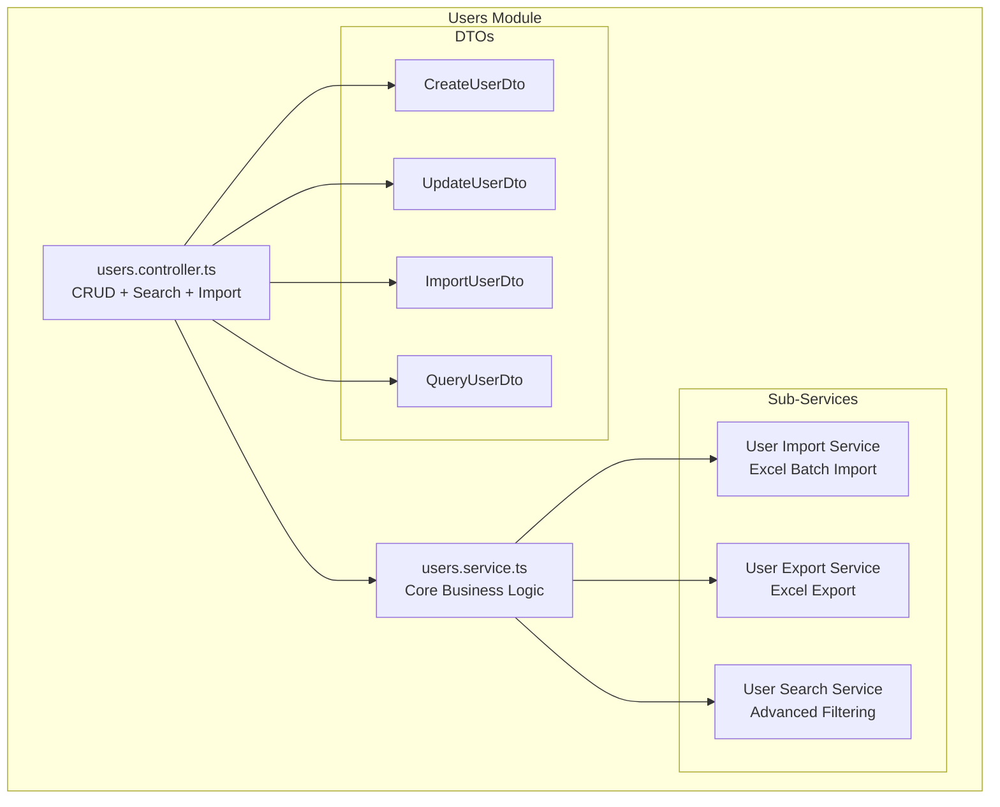

**Endpoints:**
- `GET /users` - List users with pagination
- `GET /users/:id` - Get user details
- `POST /users` - Create user
- `PUT /users/:id` - Update user
- `DELETE /users/:id` - Delete user
- `POST /users/import` - Batch import from Excel
- `GET /users/export` - Export to Excel
- `GET /users/search` - Advanced search

---

### 4. **Organization Management Domain**

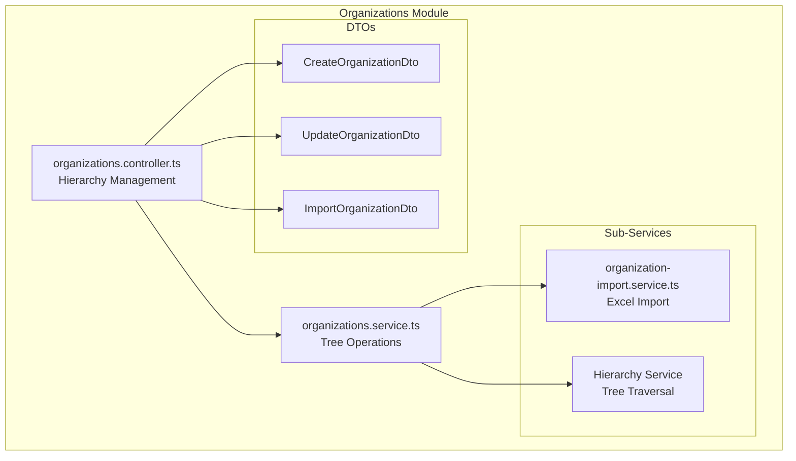

**Key Features:**
- ✅ Hierarchical organization structure (Parent-Child)
- ✅ Tree traversal (get all children)
- ✅ User assignment to organizations
- ✅ Batch import from Excel
- ✅ Organization statistics

---

### 5. **Roles & Permissions Domain**

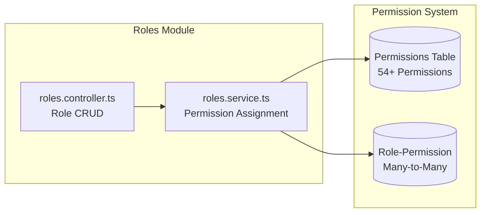

**Built-in Roles:**
- `SUPER_ADMIN` - Full system access
- `ADMIN` - Organization admin
- `MODERATOR` - Content management
- `USER` - Basic user

**Permission Categories:**
- User Management
- Organization Management
- Role Management
- CTXH Management
- Payment Management
- Report Access

---

### 6. **CTXH (Công Tác Xã Hội) Domain**

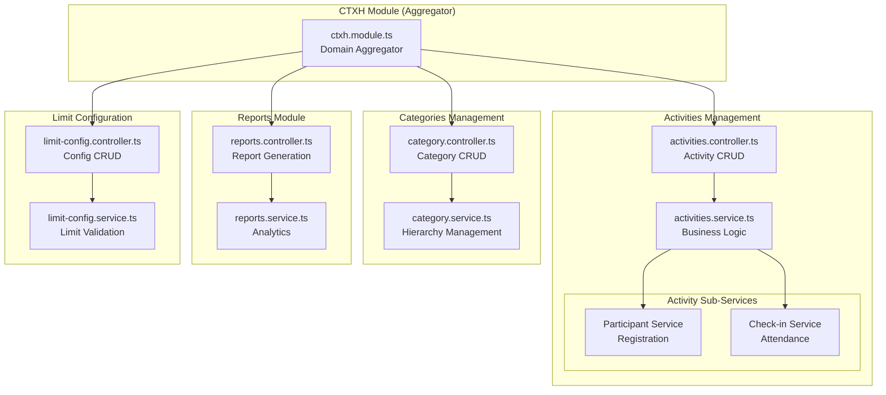

**Activity Workflow:**
```
Create Activity → Add Categories → Student Registration 
→ Check-in Participants → Generate Reports
```

**Key Features:**
- ✅ Activity categories with hierarchy
- ✅ Student participant management
- ✅ QR code check-in system
- ✅ Activity hour limits per category
- ✅ Student activity reports
- ✅ Statistics and analytics

---

### 7. **Payment Management Domain**

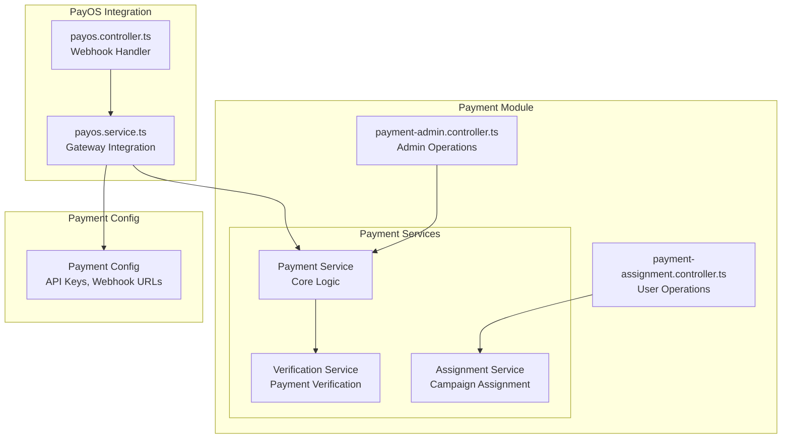

**Payment Flow:**
```
Create Campaign → Assign Users → Generate Payment Links 
→ User Payment (PayOS) → Webhook Callback → Verify Payment 
→ Update Status → Generate Receipt
```

**Key Features:**
- ✅ Payment campaign management
- ✅ Bulk user assignment
- ✅ PayOS payment gateway integration
- ✅ Webhook handling for payment status
- ✅ Payment verification
- ✅ Receipt generation

---

### 8. **Support Modules**

#### 8.1. Dashboard Module
```
┌────────────────────────────────────┐
│      Dashboard Module              │
│  ┌──────────────────────────────┐  │
│  │ - System Statistics          │  │
│  │ - User Analytics             │  │
│  │ - Activity Metrics           │  │
│  │ - Payment Statistics         │  │
│  │ - S3 Storage Usage           │  │
│  └──────────────────────────────┘  │
└────────────────────────────────────┘
```

#### 8.2. Export Module
```
┌────────────────────────────────────┐
│       Export Module                │
│  ┌──────────────────────────────┐  │
│  │ - Excel Export (XLSX)        │  │
│  │ - DOCX Template Export       │  │
│  │ - CSV Export                 │  │
│  │ - S3 Upload Integration      │  │
│  └──────────────────────────────┘  │
└────────────────────────────────────┘
```

#### 8.3. Templates Module
```
┌────────────────────────────────────┐
│      Templates Module              │
│  ┌──────────────────────────────┐  │
│  │ - Document Templates         │  │
│  │ - DOCX Generation            │  │
│  │ - Template Variables         │  │
│  │ - Docxtemplater Integration  │  │
│  └──────────────────────────────┘  │
└────────────────────────────────────┘
```

#### 8.4. Classes Module
```
┌────────────────────────────────────┐
│       Classes Module               │
│  ┌──────────────────────────────┐  │
│  │ - Class Management           │  │
│  │ - Student Assignment         │  │
│  │ - Class Statistics           │  │
│  └──────────────────────────────┘  │
└────────────────────────────────────┘
```

#### 8.5. Departments Module
```
┌────────────────────────────────────┐
│     Departments Module             │
│  ┌──────────────────────────────┐  │
│  │ - Department CRUD            │  │
│  │ - Department Hierarchy       │  │
│  │ - User Assignment            │  │
│  └──────────────────────────────┘  │
└────────────────────────────────────┘
```

#### 8.6. Submissions Module
```
┌────────────────────────────────────┐
│     Submissions Module             │
│  ┌──────────────────────────────┐  │
│  │ - Form Submissions           │  │
│  │ - File Uploads               │  │
│  │ - Submission Processing      │  │
│  └──────────────────────────────┘  │
└────────────────────────────────────┘
```

#### 8.7. AWS Config Module
```
┌────────────────────────────────────┐
│     AWS Config Module              │
│  ┌──────────────────────────────┐  │
│  │ - S3 Configuration           │  │
│  │ - Bucket Management          │  │
│  │ - Access Key Management      │  │
│  │ - Storage Statistics         │  │
│  └──────────────────────────────┘  │
└────────────────────────────────────┘
```

#### 8.8. Metrics Module
```
┌────────────────────────────────────┐
│      Metrics Module                │
│  ┌──────────────────────────────┐  │
│  │ - Prometheus Integration     │  │
│  │ - HTTP Metrics               │  │
│  │ - Database Metrics           │  │
│  │ - Custom Business Metrics    │  │
│  └──────────────────────────────┘  │
└────────────────────────────────────┘
```

---

## 🔄 Data Flow Architecture

### Request Flow Example: User Login

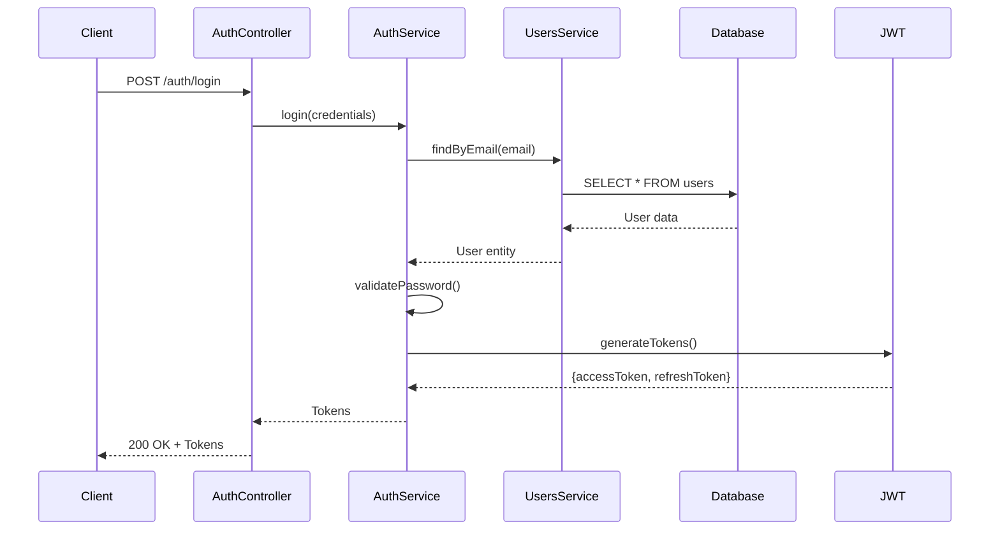

### Request Flow Example: Create CTXH Activity

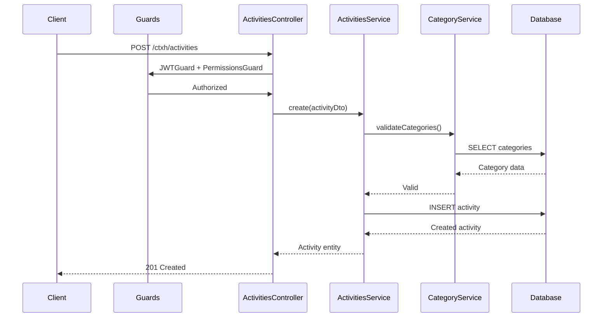

---

## 🗄️ Database Entity Relationships

```mermaid
erDiagram
    User ||--o{ UserOrganization : "belongs to"
    User ||--o{ PaymentAssignment : "assigned"
    User ||--o{ ActivityParticipant : "participates"
    User }o--|| Role : "has"
    
    Organization ||--o{ Organization : "parent-child"
    Organization ||--o{ UserOrganization : "contains"
    
    Role ||--o{ RolePermission : "has"
    Permission ||--o{ RolePermission : "assigned to"
    
    Activity ||--o{ ActivityCategory : "has"
    Activity ||--o{ ActivityParticipant : "has"
    Category ||--o{ ActivityCategory : "belongs to"
    Category ||--o{ Category : "parent-child"
    
    PaymentCampaign ||--o{ PaymentAssignment : "contains"
    PaymentAssignment ||--|| PaymentTransaction : "has"
    
    Class ||--o{ User : "contains"
    Department ||--o{ User : "contains"
```

---

## 📊 Module Dependency Graph

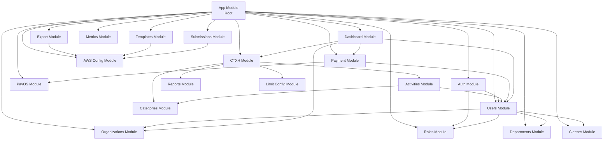

---

## 🔐 Security Architecture

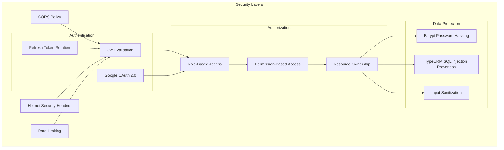

---

## 📈 Monitoring & Observability

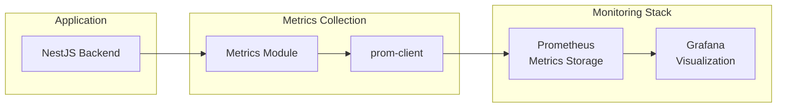

**Collected Metrics:**
- HTTP request duration
- HTTP request count by endpoint
- Database query performance
- Active connections
- Error rates
- Custom business metrics

---

## 🚀 Deployment Architecture

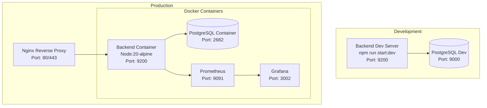

---

## 📋 API Endpoint Summary

### Authentication
- `POST /auth/login` - Email/password login
- `POST /auth/google` - Google OAuth login
- `POST /auth/refresh` - Refresh access token
- `GET /auth/profile` - Get current user profile

### Users Management
- `GET /users` - List users (paginated, filtered)
- `GET /users/:id` - Get user by ID
- `POST /users` - Create user
- `PUT /users/:id` - Update user
- `DELETE /users/:id` - Delete user
- `POST /users/import` - Batch import from Excel
- `GET /users/export` - Export to Excel

### Organizations
- `GET /organizations` - List organizations (tree)
- `GET /organizations/:id` - Get organization details
- `POST /organizations` - Create organization
- `PUT /organizations/:id` - Update organization
- `DELETE /organizations/:id` - Delete organization
- `POST /organizations/import` - Batch import

### Roles & Permissions
- `GET /roles` - List all roles
- `GET /roles/:id` - Get role with permissions
- `POST /roles` - Create role
- `PUT /roles/:id` - Update role permissions
- `DELETE /roles/:id` - Delete role

### CTXH Activities
- `GET /ctxh/activities` - List activities
- `GET /ctxh/activities/:id` - Get activity details
- `POST /ctxh/activities` - Create activity
- `PUT /ctxh/activities/:id` - Update activity
- `DELETE /ctxh/activities/:id` - Delete activity
- `POST /ctxh/activities/:id/register` - Student registration
- `POST /ctxh/activities/:id/checkin` - Check-in participant

### CTXH Categories
- `GET /ctxh/categories` - List categories (tree)
- `POST /ctxh/categories` - Create category
- `PUT /ctxh/categories/:id` - Update category
- `DELETE /ctxh/categories/:id` - Delete category

### CTXH Reports
- `GET /ctxh/reports/student/:id` - Student activity report
- `GET /ctxh/reports/activity/:id` - Activity participation report
- `GET /ctxh/reports/statistics` - Overall statistics

### Payment
- `GET /payment/campaigns` - List payment campaigns
- `POST /payment/campaigns` - Create campaign
- `PUT /payment/campaigns/:id` - Update campaign
- `POST /payment/campaigns/:id/assign` - Assign users
- `GET /payment/my-payments` - User's payment assignments
- `POST /payment/:id/create-link` - Generate payment link

### PayOS
- `POST /payos/webhook` - Payment webhook handler
- `GET /payos/verify/:id` - Verify payment status

### Dashboard
- `GET /dashboard/statistics` - System statistics
- `GET /dashboard/analytics` - User analytics
- `GET /dashboard/s3-usage` - S3 storage usage

### Export
- `POST /export/excel` - Export data to Excel
- `POST /export/docx` - Generate DOCX from template

### Templates
- `GET /templates` - List templates
- `POST /templates` - Create template
- `POST /templates/:id/generate` - Generate document

### Classes
- `GET /classes` - List classes
- `POST /classes` - Create class
- `PUT /classes/:id` - Update class

### Departments
- `GET /departments` - List departments
- `POST /departments` - Create department
- `PUT /departments/:id` - Update department

### AWS Config
- `GET /aws-config` - Get S3 configuration
- `POST /aws-config` - Update S3 configuration
- `GET /aws-config/usage` - Get storage usage

### Metrics
- `GET /metrics` - Prometheus metrics endpoint

---

## 🏛️ Design Patterns Used

### 1. **Module Pattern** (NestJS Core)
- Each domain is encapsulated in a module
- Clear boundaries and dependencies

### 2. **Dependency Injection** (IoC)
- Services injected via constructor
- Loose coupling, easy testing

### 3. **Repository Pattern** (TypeORM)
- Data access abstraction
- Database-agnostic queries

### 4. **DTO Pattern** (Data Transfer Objects)
- Input validation
- Type safety
- API documentation

### 5. **Guard Pattern** (Authorization)
- Reusable access control
- Declarative security

### 6. **Strategy Pattern** (Auth)
- Multiple auth strategies (JWT, Google)
- Easy to add new strategies

### 7. **Decorator Pattern** (Metadata)
- @CurrentUser, @Roles, @Permissions
- Clean controller code

### 8. **Service Layer Pattern**
- Business logic separation
- Reusable across controllers

---

## 🔧 Technology Stack

### Core Framework
- **NestJS** v10 - Progressive Node.js framework
- **TypeScript** v5 - Type-safe JavaScript
- **Node.js** v20 - Runtime environment

### Database
- **PostgreSQL** v15 - Relational database
- **TypeORM** v0.3 - ORM for TypeScript

### Authentication
- **Passport.js** - Authentication middleware
- **JWT** - JSON Web Tokens
- **bcryptjs** - Password hashing

### External Services
- **Google OAuth 2.0** - Social login
- **PayOS API** - Payment gateway
- **AWS S3** - File storage

### Documentation
- **Swagger/OpenAPI** - API documentation

### Monitoring
- **Prometheus** - Metrics collection
- **prom-client** - Prometheus client
- **Grafana** - Metrics visualization

### File Processing
- **XLSX** - Excel file handling
- **docxtemplater** - DOCX template engine
- **pizzip** - ZIP file handling

### Utilities
- **class-validator** - DTO validation
- **class-transformer** - Object transformation
- **axios** - HTTP client

---

## 📚 Module Responsibilities Summary

| Module | Primary Responsibility | Key Features |
|--------|----------------------|--------------|
| **Auth** | Authentication & Authorization | JWT, OAuth, Guards |
| **Users** | User management | CRUD, Import, Export, Search |
| **Organizations** | Organization hierarchy | Tree structure, Assignment |
| **Roles** | Role & permission management | RBAC, Permission matrix |
| **Departments** | Department management | Hierarchy, User assignment |
| **Classes** | Class management | Student assignment, Statistics |
| **CTXH Activities** | Activity management | CRUD, Registration, Check-in |
| **CTXH Categories** | Category hierarchy | Tree structure, Limits |
| **CTXH Reports** | Reporting & analytics | Student reports, Statistics |
| **CTXH Limit Config** | Activity limit rules | Category limits, Validation |
| **Payment** | Payment management | Campaigns, Assignments |
| **PayOS** | Payment gateway | Integration, Webhooks |
| **Dashboard** | System overview | Statistics, Analytics |
| **Export** | Data export | Excel, DOCX, S3 upload |
| **Templates** | Document generation | DOCX templates, Variables |
| **Submissions** | Form submissions | File uploads, Processing |
| **AWS Config** | S3 configuration | Bucket management, Usage stats |
| **Metrics** | Monitoring | Prometheus metrics |

---

## 🎯 Best Practices Implemented

✅ **Modular Architecture** - Clear separation of concerns  
✅ **Dependency Injection** - Loose coupling  
✅ **Type Safety** - Full TypeScript coverage  
✅ **Input Validation** - DTO validation with class-validator  
✅ **Error Handling** - Global exception filters  
✅ **Security** - JWT, RBAC, input sanitization  
✅ **Documentation** - Swagger/OpenAPI  
✅ **Testing Ready** - Service/Controller separation  
✅ **Monitoring** - Prometheus metrics  
✅ **Database Migrations** - Version-controlled schema  
✅ **Environment Config** - ConfigModule for secrets  

---

## 🔄 Future Enhancements

### Potential Additions
- 🔮 **Caching Layer** (Redis) for performance
- 🔮 **Queue System** (Bull/BullMQ) for async tasks
- 🔮 **WebSocket Module** for real-time features
- 🔮 **Notification Module** (Email, SMS, Push)
- 🔮 **Audit Log Module** for tracking changes
- 🔮 **API Versioning** for backward compatibility
- 🔮 **GraphQL Gateway** as alternative to REST
- 🔮 **Microservices Split** if scale demands

---

## 📖 References

- **NestJS Documentation:** https://docs.nestjs.com/
- **TypeORM Documentation:** https://typeorm.io/
- **PostgreSQL Documentation:** https://www.postgresql.org/docs/
- **Swagger/OpenAPI:** https://swagger.io/specification/

---

**Document Version:** 1.0  
**Last Updated:** December 4, 2025  
**Maintained By:** Backend Development Team
