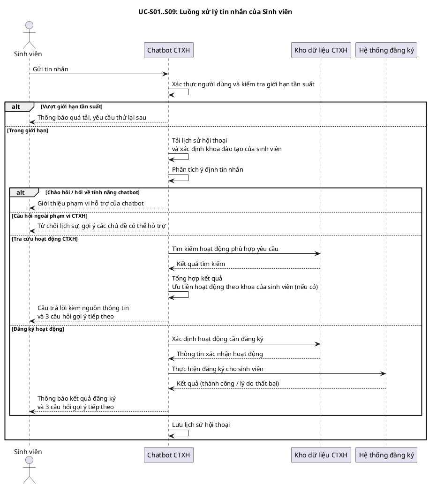
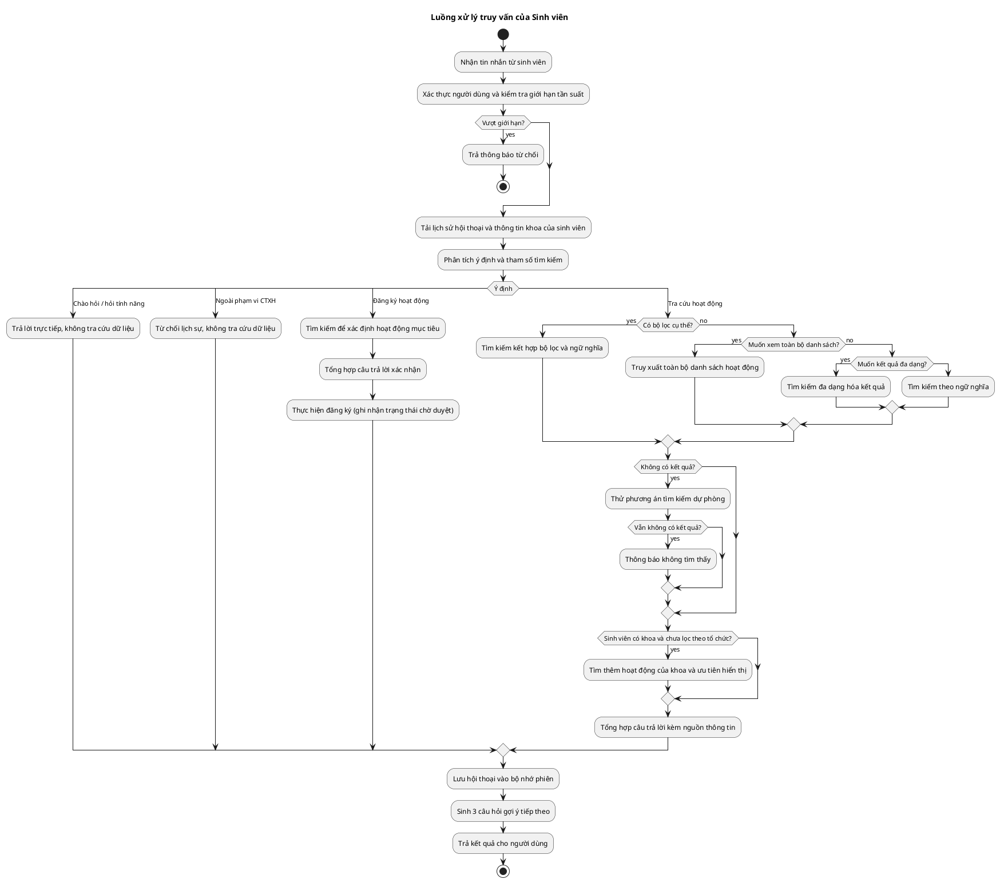
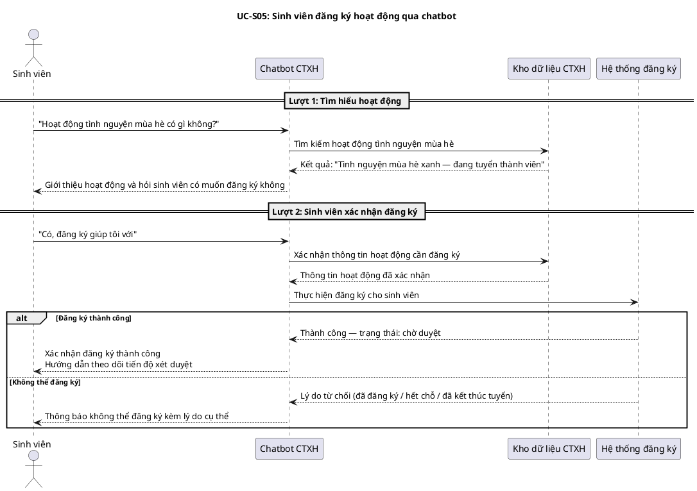
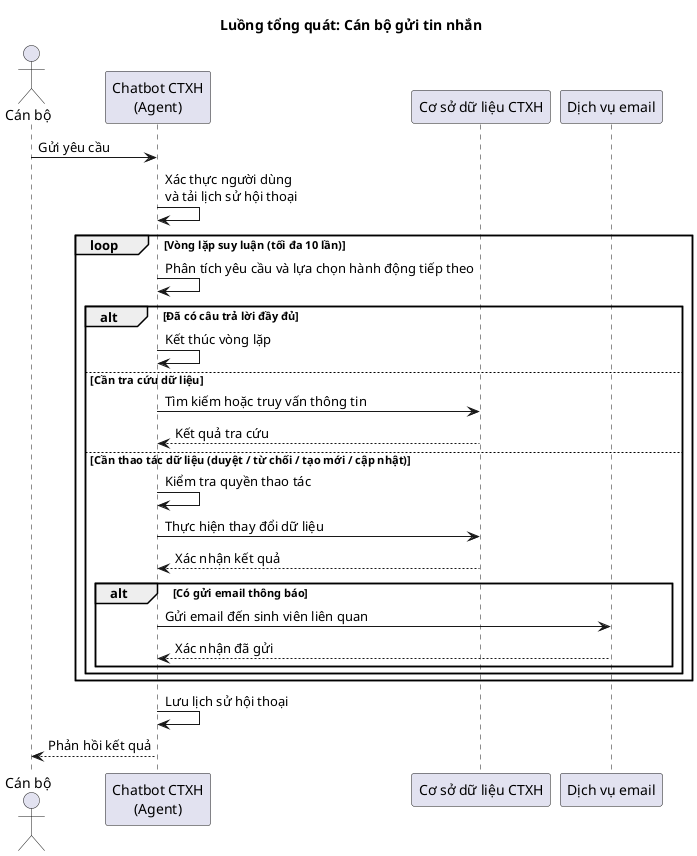
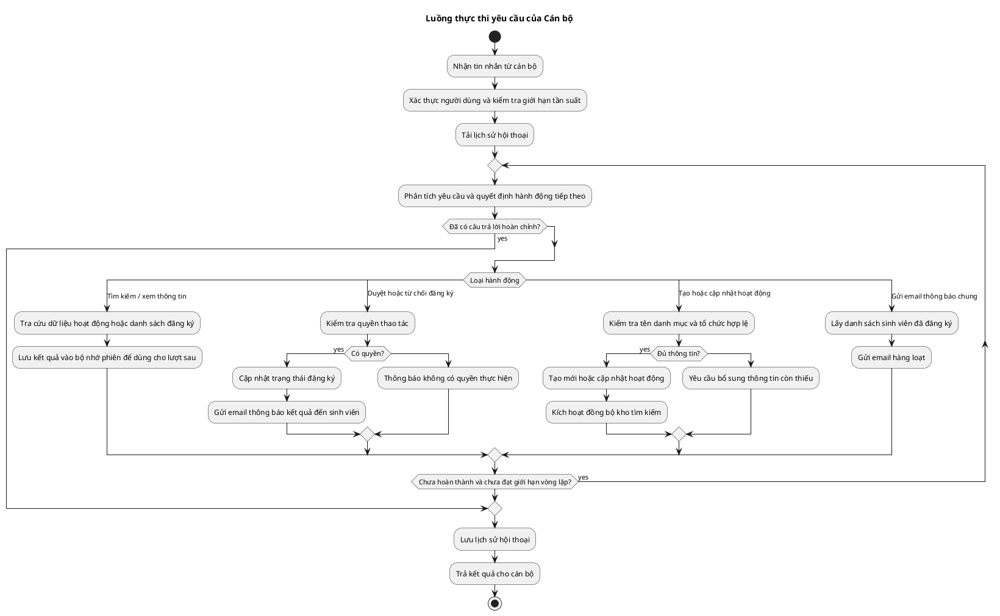
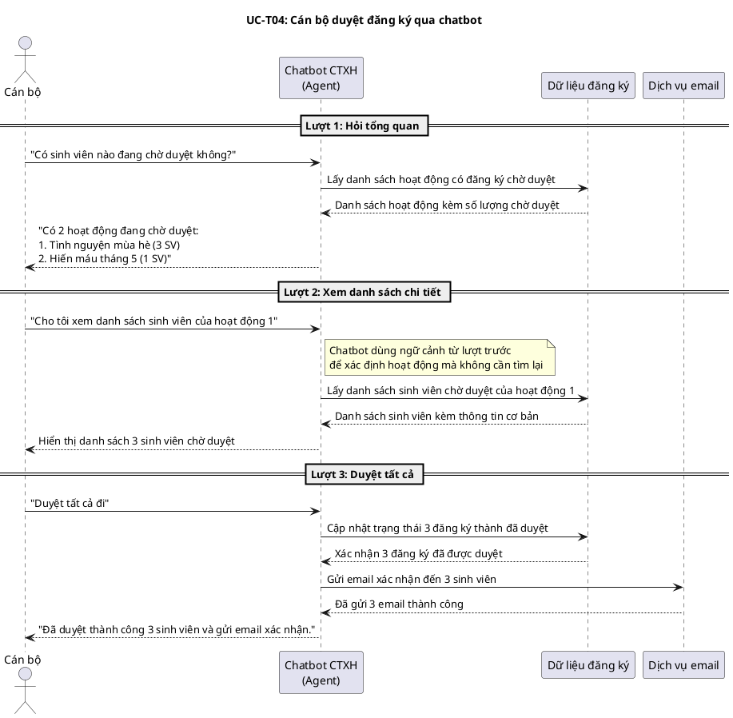
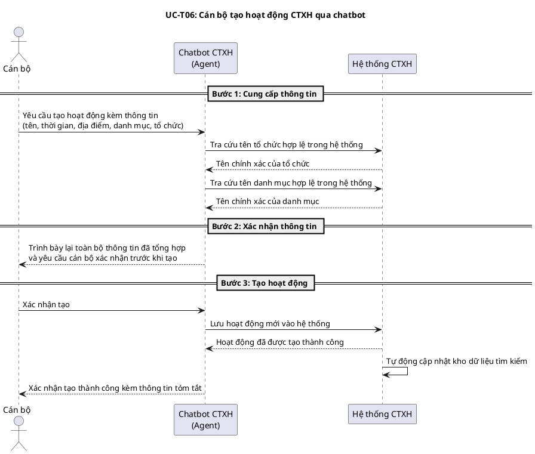
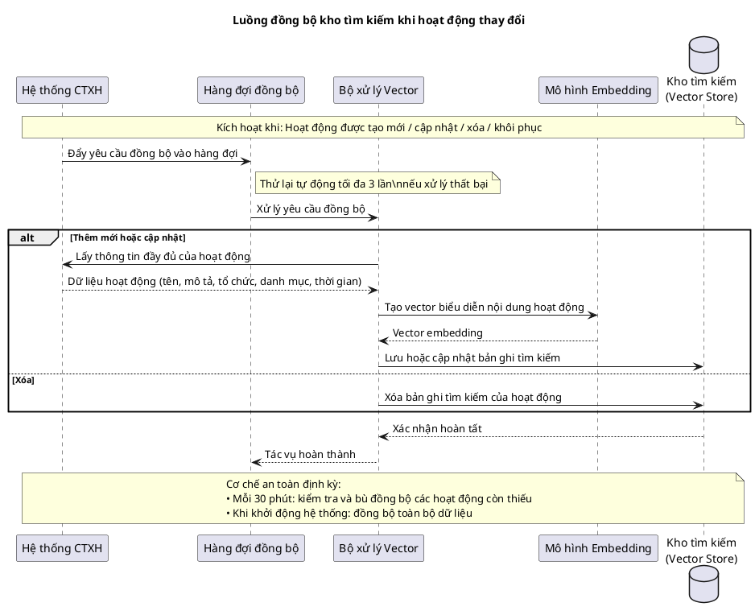
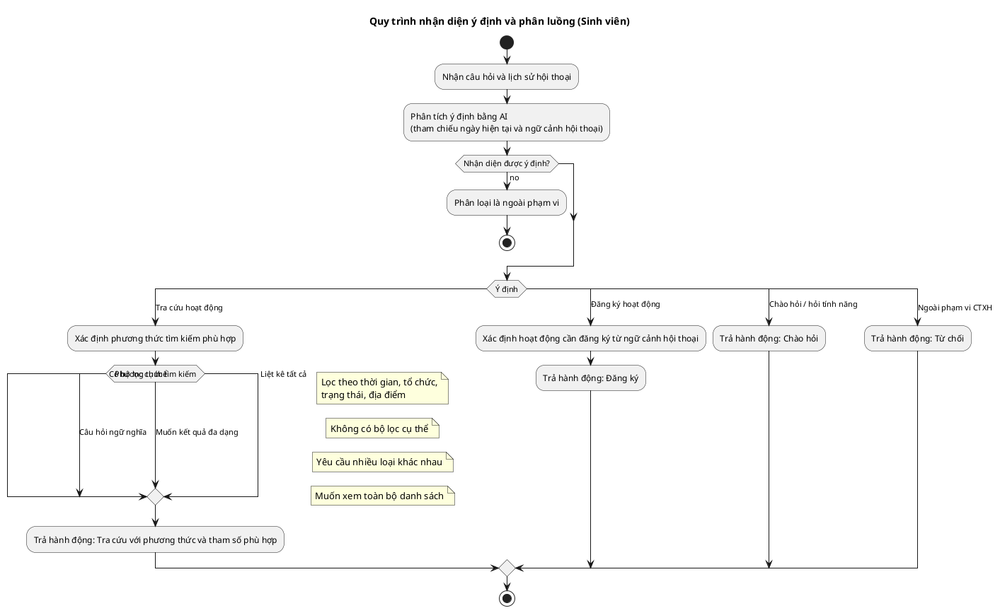
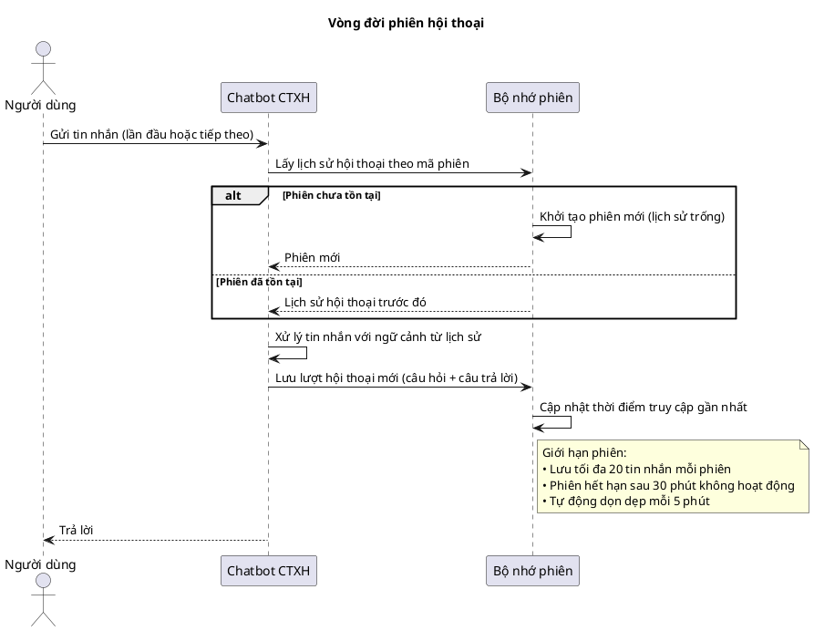

# Tài liệu Luồng Hoạt Động Chatbot CTXH

> **Phạm vi:** Hệ thống chatbot RAG hỗ trợ tra cứu và quản lý hoạt động Công tác Xã hội (CTXH) tại Đại học Bách Khoa TP.HCM.
> **Stack:** NestJS · LangChain.js · pgVector · Ollama / Google Gemini · BullMQ · Redis

---

## Mục lục

1. [Tổng quan kiến trúc](#1-tổng-quan-kiến-trúc)
2. [Phân luồng theo vai trò người dùng](#2-phân-luồng-theo-vai-trò-người-dùng)
3. [Danh sách Use Case](#3-danh-sách-use-case)
4. [Luồng sinh viên (Student Flow)](#4-luồng-sinh-viên-student-flow)
   - 4.1 [Sequence Diagram — Student Chat](#41-sequence-diagram--student-chat)
   - 4.2 [Activity Diagram — Student RAG Pipeline](#42-activity-diagram--student-rag-pipeline)
   - 4.3 [Sequence Diagram — Student Đăng ký hoạt động qua chat](#43-sequence-diagram--student-đăng-ký-hoạt-động-qua-chat)
5. [Luồng cán bộ (Staff Flow)](#5-luồng-cán-bộ-staff-flow)
   - 5.1 [Sequence Diagram — Staff Agent Chat](#51-sequence-diagram--staff-agent-chat)
   - 5.2 [Activity Diagram — Staff Tool Execution](#52-activity-diagram--staff-tool-execution)
   - 5.3 [Sequence Diagram — Duyệt đăng ký qua chat](#53-sequence-diagram--duyệt-đăng-ký-qua-chat)
   - 5.4 [Sequence Diagram — Tạo hoạt động qua chat](#54-sequence-diagram--tạo-hoạt-động-qua-chat)
6. [Luồng dữ liệu Ingestion (Vector Sync)](#6-luồng-dữ-liệu-ingestion-vector-sync)
   - 6.1 [Sequence Diagram — Ingestion Pipeline](#61-sequence-diagram--ingestion-pipeline)
7. [Luồng xử lý Agent Decision](#7-luồng-xử-lý-agent-decision)
   - 7.1 [Activity Diagram — Agent Decision](#71-activity-diagram--agent-decision)
8. [Cơ chế Session Memory](#8-cơ-chế-session-memory)
9. [Rate Limiting & Bảo mật](#9-rate-limiting--bảo-mật)
10. [Tóm tắt các thành phần chính](#10-tóm-tắt-các-thành-phần-chính)

---

## 1. Tổng quan kiến trúc

```
┌────────────────────────────────────────────────────────────────────┐
│                        Frontend (React)                            │
│   POST /ctxh-chat/message  |  SSE /ctxh-chat/stream               │
└──────────────────────────┬─────────────────────────────────────────┘
                           │ JWT Bearer Token
                           ▼
┌────────────────────────────────────────────────────────────────────┐
│               CtxhChatController  (NestJS)                         │
│   ─ JwtAuthGuard → xác thực người dùng                             │
│   ─ RateLimitInterceptor → 30 req/60s (Redis)                      │
│   ─ Phân luồng: userType === 'staff' → StaffAgentService           │
│                 userType === 'student' → LangChainRagChainService   │
└────┬──────────────────────────────────────────────┬────────────────┘
     │                                              │
     ▼ (student)                                    ▼ (staff)
┌──────────────────────┐               ┌────────────────────────────┐
│ LangChainRagChain    │               │  StaffAgentService         │
│  ─ CtxhAgentService  │               │  ─ Tool-calling loop       │
│  ─ VectorStore       │               │  ─ 12 custom tools         │
│  ─ McpSqlFallback    │               │  ─ PostgresMcpClient tools │
│  ─ MemoryService     │               │  ─ MemoryService           │
│  ─ LLM Generation    │               │  ─ LLM (Gemini/Ollama)     │
└──────────────────────┘               └────────────────────────────┘
           │                                        │
           ▼                                        ▼
┌────────────────────────────────────────────────────────────────────┐
│                 Infrastructure Layer                                │
│   PostgreSQL + pgVector  |  Redis (BullMQ + RateLimit)             │
│   Ollama (local)  |  Google Gemini (cloud)                         │
│   NodemailerService  |  ParticipationService                        │
└────────────────────────────────────────────────────────────────────┘
```

---

## 2. Phân luồng theo vai trò người dùng

| Thuộc tính | **Student** | **Staff** |
|---|---|---|
| Service xử lý | `LangChainRagChainService` | `StaffAgentService` |
| Mô hình agent | RAG + single Agent decision | ReAct tool-calling loop (≤10 vòng) |
| Số lần gọi LLM / tin nhắn | 2 (Agent decide + Generation) | 1–N tuỳ tool calls cần thiết |
| Truy cập Vector Store | Có (pgVector) | Không (dùng DB trực tiếp) |
| Tools có sẵn | `search_ctxh_activities`, `register_for_activity`, `respond_general` | 12 tools: tìm kiếm, duyệt, tạo, cập nhật, email, ... |
| Có thể đăng ký hoạt động | Có (tự động) | Không |
| Có thể quản lý hoạt động | Không | Có (tạo, duyệt, từ chối, cập nhật, xóa) |
| Session memory | In-memory (TTL 30 phút) | In-memory (TTL 30 phút) |
| Follow-up suggestions | Có (3 gợi ý) | Không |
| Confidence score | Có | Không (fixed 0.9) |

---

## 3. Danh sách Use Case

### 3.1 Use Case dành cho Sinh viên (Student)

| ID | Use Case | Mô tả | Intent |
|---|---|---|---|
| UC-S01 | Tìm kiếm hoạt động CTXH | Tra cứu hoạt động theo trạng thái, thời gian, địa điểm, tổ chức | `search` / mode=`filtered` |
| UC-S02 | Tìm kiếm ngữ nghĩa | Hỏi mơ hồ, không có filter cụ thể | `search` / mode=`semantic` |
| UC-S03 | Xem đa dạng hoạt động | Muốn xem nhiều loại hoạt động khác nhau | `search` / mode=`diverse` |
| UC-S04 | Liệt kê tất cả hoạt động | Yêu cầu danh sách toàn bộ | `search` / mode=`list_all` |
| UC-S05 | Đăng ký hoạt động qua chat | Nói "tôi muốn đăng ký" hoặc xác nhận gợi ý của bot | `register` |
| UC-S06 | Hỏi thông tin chatbot | "Em có thể hỏi gì?", "Bạn là ai?" | `greeting` |
| UC-S07 | Câu hỏi ngoài phạm vi | Câu hỏi không liên quan đến CTXH | `out_of_scope` |
| UC-S08 | Tìm hoạt động theo khoa | Ưu tiên hiển thị hoạt động của khoa sinh viên đang học | `search` + org injection |
| UC-S09 | Xem chi tiết hoạt động | Hỏi thêm về hoạt động đã đề cập trong hội thoại | `search` với context memory |

### 3.2 Use Case dành cho Cán bộ (Staff)

| ID | Use Case | Mô tả | Tool sử dụng |
|---|---|---|---|
| UC-T01 | Xem hoạt động chờ duyệt | "Có sinh viên nào đang chờ duyệt không?" | `get_pending_overview` |
| UC-T02 | Xem danh sách sinh viên PENDING | Lấy DS sinh viên chờ duyệt của 1 hoạt động | `get_pending_participants` |
| UC-T03 | Xem danh sách đã duyệt | Lấy DS sinh viên APPROVED của 1 hoạt động | `get_approved_participants` |
| UC-T04 | Duyệt đăng ký và gửi email | Duyệt một hoặc nhiều sinh viên, tự động gửi email | `approve_and_notify` |
| UC-T05 | Từ chối đăng ký | Từ chối với lý do, gửi email thông báo | `reject_registration` |
| UC-T06 | Tạo 1 hoạt động mới | Điền đầy đủ thông tin, xác nhận trước khi tạo | `create_activity` |
| UC-T07 | Tạo nhiều hoạt động | Tạo 2–3 hoạt động cùng lúc | `batch_create_activities` |
| UC-T08 | Cập nhật hoạt động | Chỉnh sửa thông tin, đổi trạng thái, xóa mềm | `manage_activity` |
| UC-T09 | Gửi email thông báo chung | Thông báo đến tất cả sinh viên đã đăng ký | `send_notification_email` |
| UC-T10 | Tìm kiếm hoạt động | Tìm theo từ khóa, trạng thái, ngày | `search_activities` |
| UC-T11 | Tra cứu danh mục | Tìm đúng tên danh mục trong hệ thống | `lookup_category` |
| UC-T12 | Tra cứu tổ chức | Tìm đúng tên tổ chức/khoa trong hệ thống | `lookup_organization` |
| UC-T13 | Truy vấn SQL trực tiếp | Câu hỏi phức tạp, cán bộ muốn số liệu thống kê | PostgresMCP tools |

---

## 4. Luồng sinh viên (Student Flow)

### 4.1 Sequence Diagram — Student Chat



---

### 4.2 Activity Diagram — Student RAG Pipeline



---

### 4.3 Sequence Diagram — Student Đăng ký hoạt động qua chat



---

## 5. Luồng cán bộ (Staff Flow)

### 5.1 Sequence Diagram — Staff Agent Chat



---

### 5.2 Activity Diagram — Staff Tool Execution



---

### 5.3 Sequence Diagram — Duyệt đăng ký qua chat



---

### 5.4 Sequence Diagram — Tạo hoạt động qua chat



---

## 6. Luồng dữ liệu Ingestion (Vector Sync)

### 6.1 Sequence Diagram — Ingestion Pipeline



---

## 7. Luồng xử lý Agent Decision

### 7.1 Activity Diagram — Agent Decision



---

## 8. Cơ chế Session Memory

```
┌─────────────────────────────────────────────────────────────────────┐
│                  LangChainMemoryService                             │
│                                                                     │
│  Map<sessionId, MemoryEntry>                                        │
│                                                                     │
│  MemoryEntry {                                                      │
│    memory: BufferMemory              — LangChain conversation buffer│
│    history: InMemoryChatMessageHistory                              │
│    lastAccessed: Date                — cập nhật mỗi lần truy cập   │
│    turnCount: number                 — số lượt hội thoại            │
│    recentMentionedActivities: [      — sliding window activities    │
│      {turnIndex, activities: [{activityId, activityName,           │
│                                isRecruiting}]}                      │
│    ]                                                                │
│    pendingRegistration?: {           — chờ xác nhận đăng ký        │
│      activityId, activityName                                       │
│    }                                                                │
│  }                                                                  │
│                                                                     │
│  Config:                                                            │
│  • maxMemories: 1000 sessions                                       │
│  • memoryTTL: 30 phút (1800000 ms)                                  │
│  • maxMessagesPerSession: 20 tin nhắn                               │
│  • Cleanup interval: mỗi 5 phút                                     │
└─────────────────────────────────────────────────────────────────────┘
```

**Sequence: Session Lifecycle**



---

## 9. Rate Limiting & Bảo mật

```
┌──────────────────────────────────────────────────────────────┐
│               RateLimitInterceptor (Redis)                   │
│                                                              │
│  Key: rate_limit:{userId | IP}                               │
│  Limit: 30 requests / 60 seconds                            │
│                                                              │
│  Khi request đến:                                            │
│  1. Lấy count từ Redis                                       │
│  2. count >= 30 → 429 Too Many Requests + retryAfter (TTL)  │
│  3. count < 30 → INCR + EXPIRE (60s) → tiếp tục            │
│                                                              │
│  Bảo mật:                                                    │
│  • JwtAuthGuard — xác thực mọi request                      │
│  • checkCtxhPermission — validate staff actions              │
│  • SQL inputs qua parameterized queries (TypeORM)            │
│  • Rate limit ngăn LLM abuse                                 │
└──────────────────────────────────────────────────────────────┘
```

---

## 10. Tóm tắt các thành phần chính

| Thành phần | File | Vai trò |
|---|---|---|
| `CtxhChatController` | `controllers/ctxh-chat.controller.ts` | Entry point, phân luồng student/staff |
| `LangChainRagChainService` | `services/langchain-rag-chain.service.ts` | Orchestration RAG cho student |
| `CtxhAgentService` | `services/ctxh-agent.service.ts` | Single LLM call: quyết định action/tool |
| `StaffAgentService` | `services/staff-agent.service.ts` | ReAct loop với 12 tools cho cán bộ |
| `LangChainVectorStoreService` | `services/langchain-vector-store.service.ts` | Wrapper pgVector: similarity, MMR, filtered search |
| `McpSqlFallbackService` | `services/mcp-sql-fallback.service.ts` | Fallback SQL khi vector search trả 0 kết quả |
| `McpMetadataEnricherService` | `services/mcp-metadata-enricher.service.ts` | Enrich metadata từ DB (số đăng ký, trạng thái real-time) |
| `LangChainMemoryService` | `services/langchain-memory.service.ts` | Session memory in-memory (TTL 30 phút) |
| `CtxhVectorSyncService` | `services/ctxh-vector-sync.service.ts` | Event bridge → BullMQ jobs khi activity thay đổi |
| `LangChainIngestionService` | `services/langchain-ingestion.service.ts` | Tạo embedding và upsert vào ctxh_embeddings |
| `VectorIngestionProcessor` | `processors/vector-ingestion.processor.ts` | BullMQ consumer xử lý embedding jobs |
| `FollowUpSuggestionsService` | `services/follow-up-suggestions.service.ts` | Sinh 3 câu gợi ý tiếp theo cho student |
| `UserContextService` | `services/user-context.service.ts` | Lấy tên khoa đào tạo của sinh viên |
| `PostgresMcpClientService` | `services/postgres-mcp-client.service.ts` | MCP client giao tiếp với Postgres MCP server |
| `RateLimitInterceptor` | `interceptors/rate-limit.interceptor.ts` | 30 req/60s per user/IP via Redis |
| `UniversalEmbeddingsService` | `services/universal-embeddings.service.ts` | Tự động chọn Ollama hay Gemini embedding |
| `UniversalLLMService` | `services/universal-llm.service.ts` | Tự động chọn Ollama hay Gemini LLM |

### Tóm tắt số lần gọi LLM mỗi tin nhắn

| Vai trò | Tình huống | Số LLM calls |
|---|---|---|
| **Student** | Greeting / Out-of-scope | 1 (Agent only) |
| **Student** | RAG query thông thường | 2 (Agent + Generation) |
| **Student** | RAG query + Follow-up | 3 (Agent + Generation + FollowUp) |
| **Student** | Đăng ký + Follow-up | 3 (Agent + Generation + FollowUp) |
| **Staff** | Câu trả lời đơn giản | 2 (1 vòng loop) |
| **Staff** | Duyệt đăng ký (có tool calls) | 3–5 (N vòng loop) |
| **Staff** | Tạo hoạt động (lookup + confirm + create) | 4–7 (N vòng loop) |

---

*Tài liệu được tổng hợp từ source code `backend/src/ctxh-chat/` — cập nhật lần cuối: 30/04/2026*
