# CI/CD Pipeline — Giải thích chi tiết bằng Diagram

> Tài liệu minh họa cách GitLab Runner tạo container và thực thi từng stage trong pipeline nâng cấp 9 giai đoạn.

---

## 1. Tổng quan: GitLab Runner hoạt động như thế nào?

```
┌─────────────────────────────────────────────────────────────────────┐
│                        GITLAB SERVER (Cloud)                        │
│  ┌───────────────┐  ┌──────────────┐  ┌──────────────────────────┐ │
│  │  Git Repo     │  │  CI/CD Vars  │  │  Container Registry      │ │
│  │  (source code)│  │  (secrets)   │  │  (Docker images output)  │ │
│  └───────┬───────┘  └──────┬───────┘  └──────────────────────────┘ │
│          │                 │                                        │
│          └────────┬────────┘                                        │
│                   │  Gửi job + biến môi trường                      │
│                   ▼                                                  │
│  ┌────────────────────────────────────────────┐                     │
│  │         GitLab Runner (trên EC2/VM)        │ ◄── HOST MACHINE    │
│  │                                            │                     │
│  │  Nhận job → Pull image → Tạo container     │                     │
│  │  → Mount source → Chạy script → Upload     │                     │
│  │    artifacts → Hủy container               │                     │
│  └────────────────────────────────────────────┘                     │
└─────────────────────────────────────────────────────────────────────┘
```

### Quy trình xử lý 1 job:

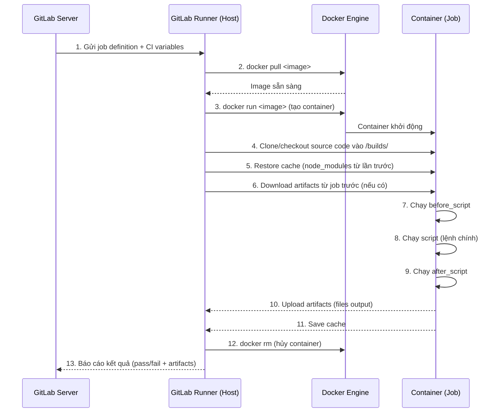

---

## 2. Pipeline tổng thể — 9 Stages

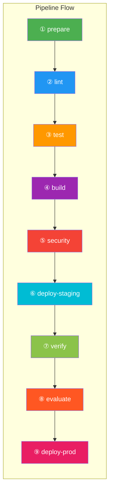

### Song song hóa jobs trong mỗi stage:

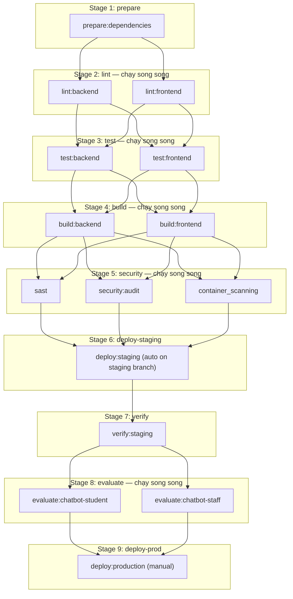

---

## 3. Chi tiết từng Stage — Container bên trong làm gì?

---

### Stage 1: `prepare` — Cài đặt dependencies

```
┌─────────────────────────── GitLab Runner (Host) ───────────────────────────┐
│                                                                             │
│  ┌─────────────────────────────────────────────────────────────────────┐    │
│  │  Container: node:20-alpine                                          │    │
│  │  Job: prepare:dependencies                                          │    │
│  │                                                                     │    │
│  │  /builds/doanhoi-portal/          ← Source code được clone vào đây  │    │
│  │  ├── backend/                                                       │    │
│  │  │   └── package.json                                               │    │
│  │  └── frontend/                                                      │    │
│  │      └── package.json                                               │    │
│  │                                                                     │    │
│  │  SCRIPT:                                                            │    │
│  │  1. cd backend && npm ci --cache ../.npm                            │    │
│  │  2. cd ../frontend && npm ci --cache ../.npm                        │    │
│  │                                                                     │    │
│  │  OUTPUT (Artifacts):                                                │    │
│  │  ├── backend/node_modules/    ─── (1h TTL) ──►  Jobs sau dùng lại  │    │
│  │  └── frontend/node_modules/   ─── (1h TTL) ──►  Jobs sau dùng lại  │    │
│  └─────────────────────────────────────────────────────────────────────┘    │
│                                                                             │
│  Container bị hủy sau khi job hoàn thành ✕                                  │
└─────────────────────────────────────────────────────────────────────────────┘
```

---

### Stage 2: `lint` — Kiểm tra code style (2 container song song)

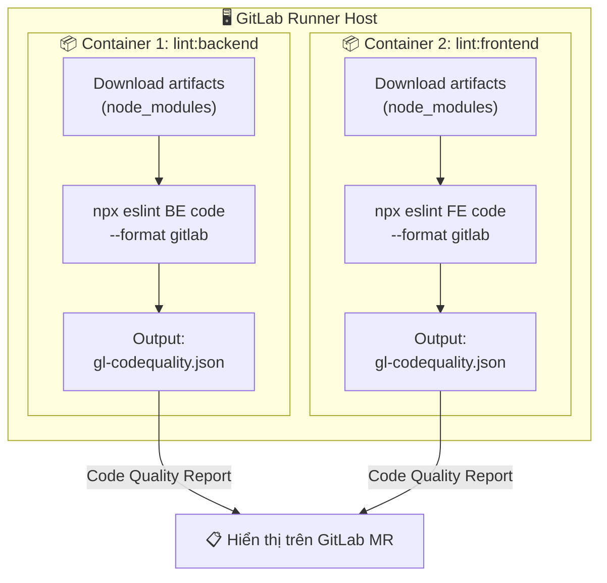

---

### Stage 3: `test` — Chạy kiểm thử (2 container song song)

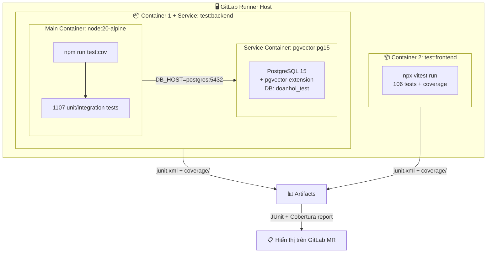

> **Lưu ý:** Job `test:backend` dùng keyword `services` — GitLab Runner tạo **2 container liên kết** (test runner + PostgreSQL) trong cùng 1 network. Container PostgreSQL có hostname `postgres`.

---

### Stage 4: `build` — Đóng gói Docker image (2 container song song)

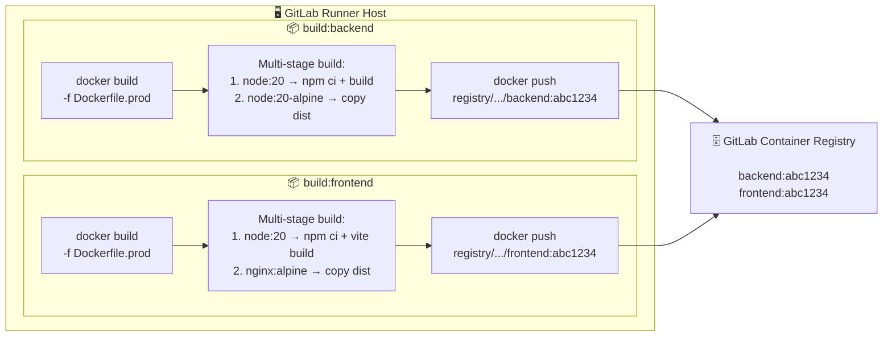

---

### Stage 5: `security` — Quét bảo mật (3 jobs)

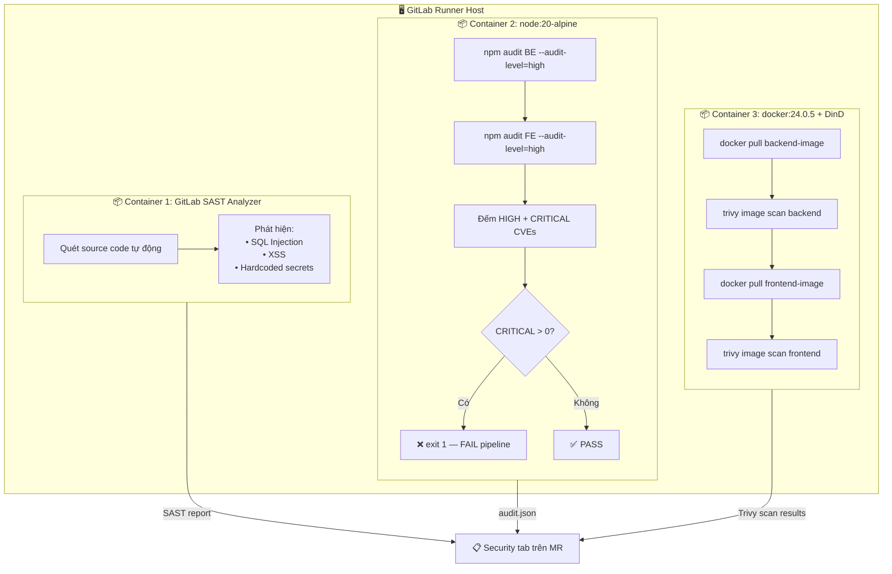

> **`container_scanning` chạy sau build** vì cần pull Docker images đã push lên Registry ở stage 4. Dùng Docker-in-Docker (DinD) để chạy Trivy bên trong container.

---

### Stage 6: `deploy-staging` — Triển khai lên staging

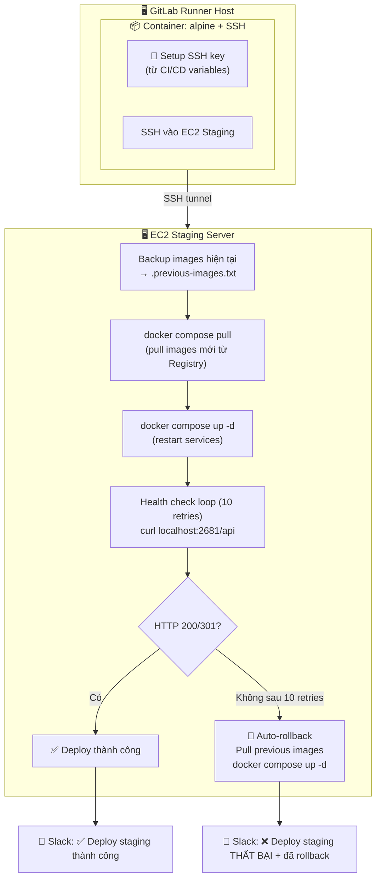

> **Branch `staging`**: tự động deploy (không cần bấm).
> **Branch `dev`**: manual trigger (bấm ▶️ trên GitLab UI).

---

### Stage 7: `verify` — Kiểm tra sau triển khai

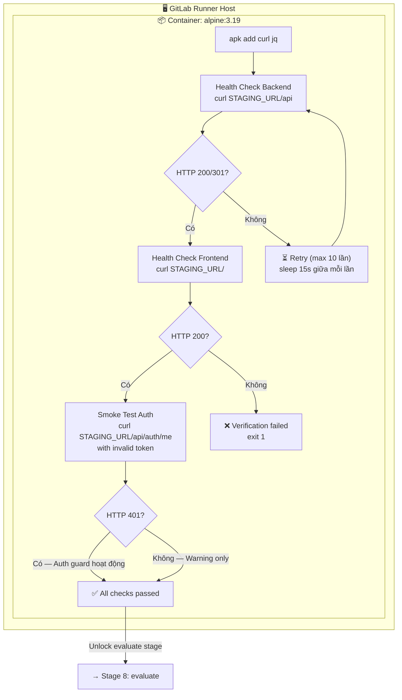

---

### Stage 8: `evaluate` — Đánh giá chất lượng chatbot AI (2 container song song)

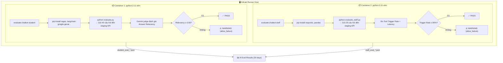

> **Chạy sau verify** vì cần staging server đã deploy version mới + đã xác nhận hoạt động.
> **`allow_failure: true`** — nếu chatbot kém hơn threshold thì hiện warning, không block deploy prod.
> **Chỉ chạy trên branch `dev`/`staging`** — branch `main` deploy prod trực tiếp.

---

### Stage 9: `deploy-prod` — Triển khai Production (Manual trigger)

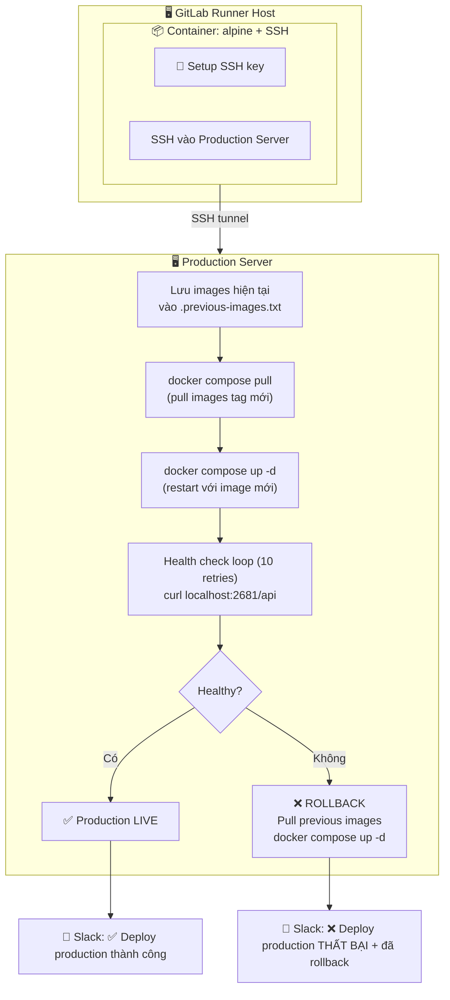

> **Luôn manual trigger** — phải bấm ▶️ trên GitLab UI. Không bao giờ auto deploy prod.

---

## 4. Tổng hợp: Lifecycle của tất cả containers trong 1 pipeline run

```
Thời gian →
═══════════════════════════════════════════════════════════════════════════════

Stage 1 (prepare) ~2 phút
├── [Container] node:20-alpine ▓▓▓▓▓░░░░░░░░░░░░░░░░░░░░░░░░░░░░░░░░░░░░░
│   └── npm ci BE + FE → upload node_modules artifacts

Stage 2 (lint) ~1 phút
├── [Container] node:20-alpine ░░░░░▓▓░░░░░░░░░░░░░░░░░░░░░░░░░░░░░░░░░░░  lint:backend
├── [Container] node:20-alpine ░░░░░▓▓░░░░░░░░░░░░░░░░░░░░░░░░░░░░░░░░░░░  lint:frontend

Stage 3 (test) ~3 phút
├── [Container] node:20-alpine ░░░░░░░▓▓▓▓▓░░░░░░░░░░░░░░░░░░░░░░░░░░░░░  test:backend
│   └── [Service]  pgvector:pg15 ░░░░░░░▓▓▓▓▓░░░░░░░░░░░░░░░░░░░░░░░░░░░  (PostgreSQL)
├── [Container] node:20-alpine ░░░░░░░▓▓▓░░░░░░░░░░░░░░░░░░░░░░░░░░░░░░░  test:frontend

Stage 4 (build) ~4 phút
├── [Container] docker:24.0.5  ░░░░░░░░░░░░▓▓▓▓▓░░░░░░░░░░░░░░░░░░░░░░░  build:backend
├── [Container] docker:24.0.5  ░░░░░░░░░░░░▓▓▓▓▓░░░░░░░░░░░░░░░░░░░░░░░  build:frontend

Stage 5 (security) ~2 phút
├── [Container] GitLab SAST    ░░░░░░░░░░░░░░░░░▓▓░░░░░░░░░░░░░░░░░░░░░░  sast
├── [Container] node:20-alpine ░░░░░░░░░░░░░░░░░▓▓░░░░░░░░░░░░░░░░░░░░░░  security:audit
├── [Container] docker:24.0.5  ░░░░░░░░░░░░░░░░░▓▓░░░░░░░░░░░░░░░░░░░░░░  container_scanning
│   └── [Service]  docker:dind ░░░░░░░░░░░░░░░░░▓▓░░░░░░░░░░░░░░░░░░░░░░  (Docker daemon)

Stage 6 (deploy-staging) ~2 phút — auto on staging, manual on dev
├── [Container] alpine + ssh   ░░░░░░░░░░░░░░░░░░░▓▓░░░░░░░░░░░░░░░░░░░░  deploy:staging

Stage 7 (verify) ~2 phút
├── [Container] alpine:3.19    ░░░░░░░░░░░░░░░░░░░░░▓▓░░░░░░░░░░░░░░░░░░  verify:staging

Stage 8 (evaluate) ~3 phút — chỉ trên dev/staging
├── [Container] python:3.11    ░░░░░░░░░░░░░░░░░░░░░░░▓▓▓░░░░░░░░░░░░░░░  evaluate:chatbot-student
├── [Container] python:3.11    ░░░░░░░░░░░░░░░░░░░░░░░▓▓▓░░░░░░░░░░░░░░░  evaluate:chatbot-staff

Stage 9 (deploy-prod) — Manual trigger
├── [Container] alpine + ssh   ░░░░░░░░░░░░░░░░░░░░░░░░░░▓▓░░░░░░░░░░░░░  deploy:production

═══════════════════════════════════════════════════════════════════════════════
Tổng: ~15-19 phút  |  ~14 containers được tạo và hủy trong 1 pipeline run
```

---

## 5. Sơ đồ tổng hợp: Artifact Flow giữa các stages

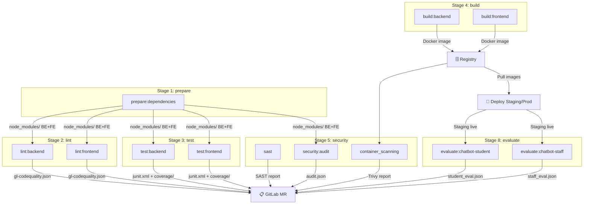

---

## 6. Bảng tóm tắt: Container nào dùng Image gì?

| Stage | Job | Docker Image | Service Container | Chạy gì bên trong | Output |
|-------|-----|-------------|-------------------|-------------------|--------|
| prepare | `prepare:dependencies` | `node:20-alpine` | — | `npm ci` BE + FE | `node_modules/` (artifact) |
| lint | `lint:backend` | `node:20-alpine` | — | `npx eslint` BE code | `gl-codequality.json` |
| lint | `lint:frontend` | `node:20-alpine` | — | `npx eslint` FE code | `gl-codequality.json` |
| test | `test:backend` | `node:20-alpine` | `pgvector/pgvector:pg15` | `npm run test:cov` (1107 tests) | `junit.xml` + `coverage/` |
| test | `test:frontend` | `node:20-alpine` | — | `npx vitest run` (106 tests) | `junit.xml` + `coverage/` |
| build | `build:backend` | `docker:24.0.5` | `docker:24.0.5-dind` | `docker build + push` | Image trên Registry |
| build | `build:frontend` | `docker:24.0.5` | `docker:24.0.5-dind` | `docker build + push` | Image trên Registry |
| security | `sast` | GitLab SAST analyzer | — | SAST scan tự động | Security report |
| security | `security:audit` | `node:20-alpine` | — | `npm audit` BE + FE | `audit.json` |
| security | `container_scanning` | `docker:24.0.5` | `docker:24.0.5-dind` | `trivy image` scan | Scan report |
| deploy-staging | `deploy:staging` | `alpine:3.19` | — | SSH + docker compose | Services trên EC2 |
| verify | `verify:staging` | `alpine:3.19` | — | `curl` health check + smoke | Pass/Fail |
| evaluate | `evaluate:chatbot-student` | `python:3.11-slim` | — | RAGAS evaluation (40 câu) | `student_eval_*.json` |
| evaluate | `evaluate:chatbot-staff` | `python:3.11-slim` | — | Tool trigger eval (20 câu) | `staff_eval_*.json` |
| deploy-prod | `deploy:production` | `alpine:3.19` | — | SSH + docker compose + rollback | Services trên Production |

---

## 7. Flow theo branch

| Branch | Stages chạy | Ghi chú |
|--------|-------------|---------|
| `dev` | prepare → lint → test → build → security → deploy-staging (manual) → verify → evaluate → deploy-prod (manual) | Full pipeline, deploy manual |
| `staging` | prepare → lint → test → build → security → deploy-staging (**auto**) → verify → evaluate → deploy-prod (manual) | Deploy staging tự động |
| `main` | prepare → lint → test → build → security → deploy-prod (manual) | Không qua staging, deploy prod trực tiếp |
| MR (merge request) | prepare → lint → test → build → security | Chỉ kiểm tra, không deploy |
