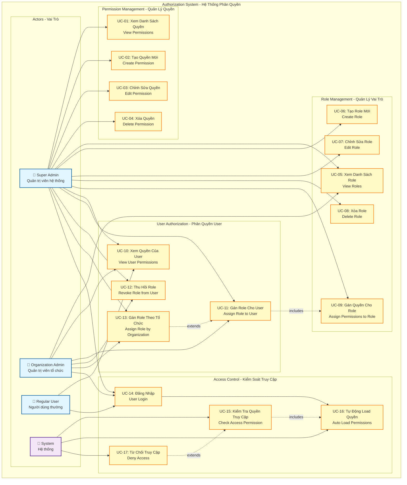
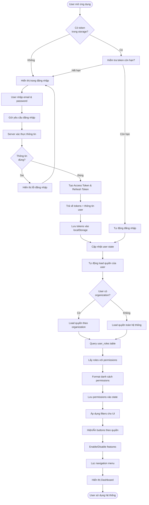
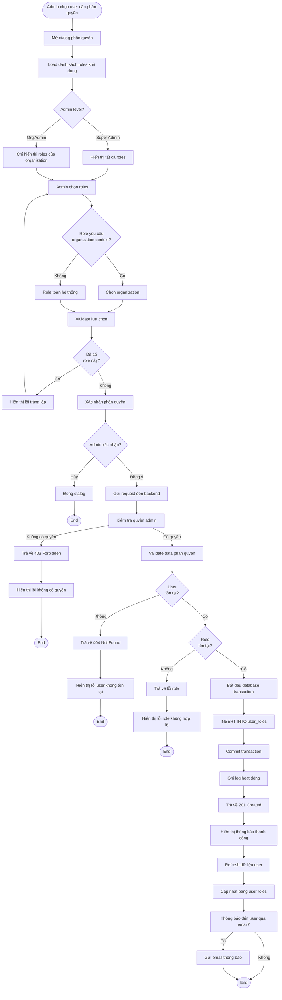
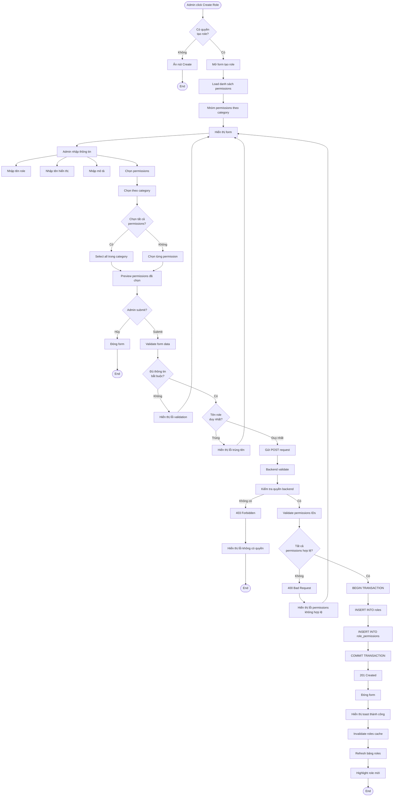
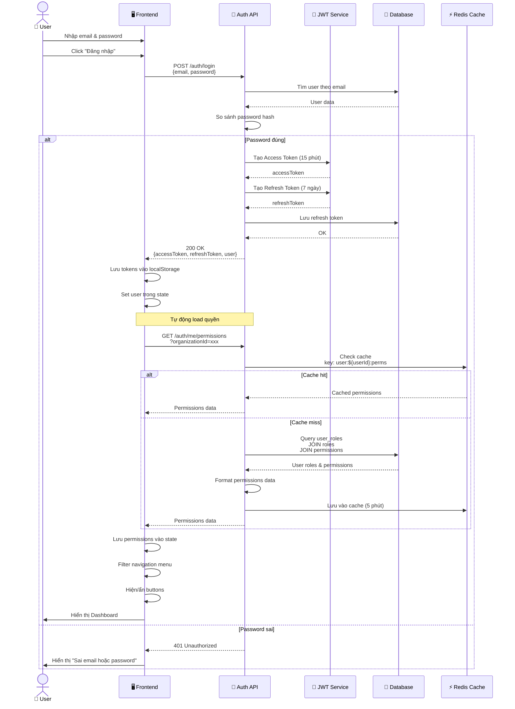
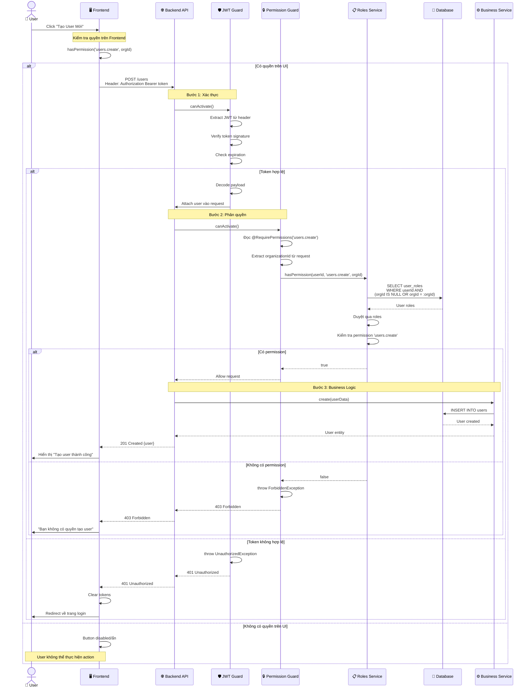
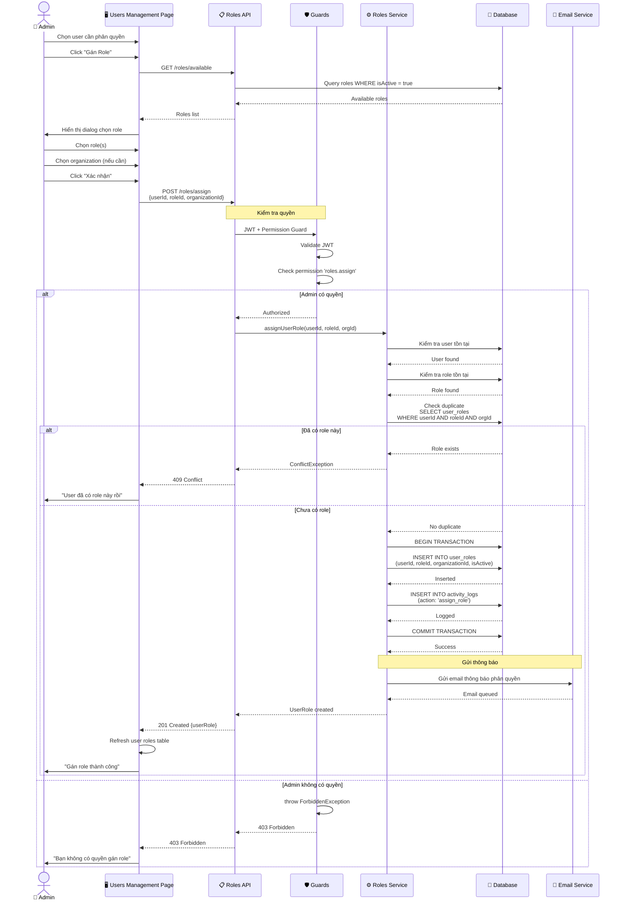
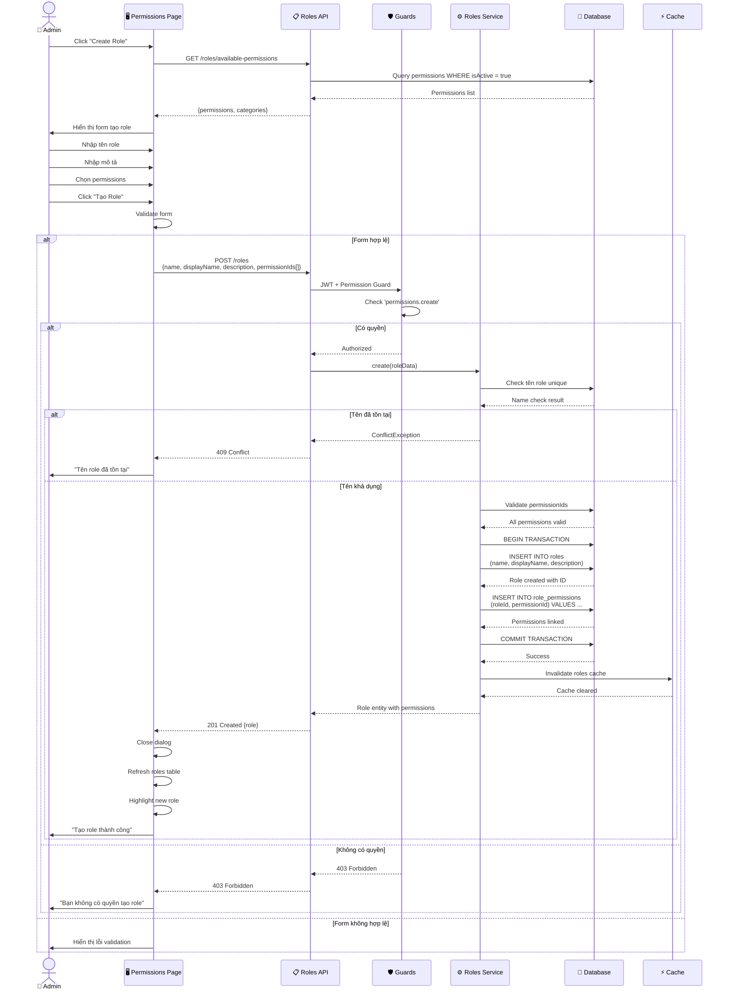

# Cơ Chế Phân Quyền - Diagrams

## 📐 Tổng Quan Hệ Thống

**Module:** Authorization & Permission Management
**System:** Đoàn Hội Portal
**Mô Hình:** Role-Based Access Control (RBAC) với Context Organization

---

## 📊 Mục Lục

1. [Use Case Diagram](#use-case-diagram)
2. [Activity Diagrams](#activity-diagrams)
   - Đăng nhập và Load Quyền
   - Phân Quyền Cho User
   - Tạo Role Mới
   - Kiểm Tra Quyền Truy Cập
3. [Sequence Diagrams](#sequence-diagrams)
   - Luồng Đăng Nhập
   - Luồng Kiểm Tra Quyền
   - Luồng Phân Quyền

---

## 🎯 Use Case Diagram



---

## 🔄 Activity Diagrams

### Activity Diagram 1: Đăng Nhập và Load Quyền



---

### Activity Diagram 2: Phân Quyền Cho User



---

### Activity Diagram 3: Tạo Role Mới



---

### Activity Diagram 4: Kiểm Tra Quyền Truy Cập

```mermaid
flowchart TD
    Start([User thực hiện action]) --> UICheck[Frontend check quyền]
    UICheck --> HasPermUI{Có quyền<br/>trên UI?}

    HasPermUI -->|Không| DisableButton[Disable button/ẩn feature]
    DisableButton --> End1([User không thấy action])

    HasPermUI -->|Có| UserClick[User click action]
    UserClick --> SendAPIRequest[Gửi API request với JWT token]

    SendAPIRequest --> ExtractToken[Backend extract JWT token]
    ExtractToken --> ValidateToken{Token<br/>hợp lệ?}

    ValidateToken -->|Không| Return401[401 Unauthorized]
    Return401 --> RedirectLogin[Redirect về trang login]
    RedirectLogin --> End2([End])

    ValidateToken -->|Có| ExtractUser[Extract user từ token]
    ExtractUser --> ReadDecorator[Đọc @RequirePermissions decorator]

    ReadDecorator --> GetRequiredPerms[Lấy danh sách permissions yêu cầu]
    GetRequiredPerms --> NoPermsRequired{Có yêu cầu<br/>permissions?}

    NoPermsRequired -->|Không| AllowAccess[Cho phép truy cập]
    AllowAccess --> ExecuteBusinessLogic[Thực thi business logic]
    ExecuteBusinessLogic --> ReturnSuccess[Trả về kết quả]
    ReturnSuccess --> End3([End])

    NoPermsRequired -->|Có| ExtractContext[Extract context từ request]
    ExtractContext --> GetOrgId[Lấy organizationId nếu có]

    GetOrgId --> QueryUserRoles[Query user_roles table]
    QueryUserRoles --> GetSystemRoles[Lấy roles toàn hệ thống<br/>organizationId = null]
    GetSystemRoles --> GetOrgRoles{Có<br/>organizationId?}

    GetOrgRoles -->|Có| GetOrgSpecificRoles[Lấy roles của organization cụ thể]
    GetOrgRoles -->|Không| CombineRoles[Combine tất cả roles]
    GetOrgSpecificRoles --> CombineRoles

    CombineRoles --> GetPermissions[Lấy permissions từ roles]
    GetPermissions --> CheckEachPerm[Kiểm tra từng permission]

    CheckEachPerm --> LoopPerms{Duyệt qua<br/>permissions yêu cầu}
    LoopPerms --> CheckPerm1[Kiểm tra permission 1]
    CheckPerm1 --> HasPerm1{Có permission 1?}

    HasPerm1 -->|Không| Return403[403 Forbidden]
    Return403 --> ShowErrorMsg[Hiển thị Permission Denied]
    ShowErrorMsg --> End4([End])

    HasPerm1 -->|Có| MorePerms{Còn permissions<br/>khác?}
    MorePerms -->|Có| CheckPermNext[Kiểm tra permission tiếp]
    CheckPermNext --> HasPermNext{Có permission?}

    HasPermNext -->|Không| Return403
    HasPermNext -->|Có| MorePerms

    MorePerms -->|Không| AllPermsGranted[Tất cả permissions OK]
    AllPermsGranted --> AllowAccess
```



---

## 🔀 Sequence Diagrams

### Sequence Diagram 1: Luồng Đăng Nhập và Load Quyền



---

### Sequence Diagram 2: Luồng Kiểm Tra Quyền Khi Truy Cập API



---

### Sequence Diagram 3: Luồng Phân Quyền Role Cho User



---

### Sequence Diagram 4: Luồng Tạo Role Mới



---

## 🎯 Các Khái Niệm Chính

### 1. **Permission (Quyền)**
- Đơn vị nhỏ nhất của phân quyền
- Format: `category.action` (vd: `users.create`, `organizations.delete`)
- Có 2 loại context:
  - **SYSTEM**: Áp dụng toàn hệ thống
  - **ORGANIZATION**: Áp dụng trong tổ chức cụ thể

### 2. **Role (Vai trò)**
- Nhóm nhiều permissions lại
- Có thể gán cho user
- Ví dụ: Super Admin, Organization Admin, Viewer

### 3. **User Role Assignment (Phân quyền User)**
- Gán role cho user
- Có thể gán theo organization hoặc toàn hệ thống
- Một user có thể có nhiều roles khác nhau

### 4. **Context Organization**
- Quyền có thể áp dụng trong context của một tổ chức
- User có thể có role khác nhau ở các tổ chức khác nhau
- Ví dụ: Admin ở tổ chức A, Viewer ở tổ chức B

---

## 🔒 Luồng Kiểm Tra Quyền

### Frontend Check (UI Layer)
1. Kiểm tra permissions trong state
2. Hiện/ẩn buttons, menu items
3. Enable/disable features
4. **Mục đích:** Tối ưu UX, tránh user thấy action không được phép

### Backend Check (API Layer)
1. Validate JWT token
2. Kiểm tra permissions từ database
3. So sánh với permissions yêu cầu
4. **Mục đích:** Bảo mật thực sự, không thể bypass

### Database Query
```sql
-- Lấy tất cả permissions của user
SELECT DISTINCT p.code
FROM user_roles ur
JOIN roles r ON ur.roleId = r.id
JOIN role_permissions rp ON r.id = rp.roleId
JOIN permissions p ON rp.permissionId = p.id
WHERE ur.userId = :userId
  AND ur.isActive = true
  AND (ur.organizationId = :orgId OR ur.organizationId IS NULL)
  AND p.isActive = true
```

---

## 📊 Phân Quyền Theo Levels

### Level 1: Super Admin
- Có **TẤT CẢ** permissions
- Không bị giới hạn bởi organization
- Có thể quản lý toàn bộ hệ thống

### Level 2: Organization Admin
- Có permissions **trong organization cụ thể**
- Có thể quản lý users, roles trong organization
- Không thể access organization khác

### Level 3: Regular User
- Có permissions **cơ bản**
- Chỉ xem được dữ liệu của mình
- Không có quyền quản lý

---

## 🛡️ Security Measures

### 1. **JWT Token**
- Access Token: Hết hạn sau 15 phút
- Refresh Token: Hết hạn sau 7 ngày
- Tự động refresh khi access token hết hạn

### 2. **Guards**
- **JwtAuthGuard**: Xác thực user
- **PermissionGuard**: Kiểm tra quyền
- Chạy trước mỗi API request

### 3. **Cache**
- Cache permissions trong 5 phút
- Giảm query database
- Invalidate khi có thay đổi

### 4. **Audit Log**
- Ghi lại mọi thay đổi về permissions
- Theo dõi ai gán quyền cho ai
- Có thể rollback nếu cần

---

## 📚 Related Documentation

- **Authorization Mechanism (Chi tiết):** [AUTHORIZATION_MECHANISM.md](../archive/internal/mechanism/Toan/AUTHORIZATION_MECHANISM.md)
- **Backend Component Diagram:** [BACKEND_COMPONENT_DIAGRAM.md](BACKEND_COMPONENT_DIAGRAM.md)
- **Package Diagram:** [PACKAGE_DIAGRAM.md](PACKAGE_DIAGRAM.md)
- **API Roles Controller:** `/backend/src/roles/roles.controller.ts`
- **Permission Guard:** `/backend/src/auth/guards/permission.guard.ts`

---

**Document Version:** 1.0
**Last Updated:** December 20, 2025
**Maintained By:** Backend Development Team
**Module:** Authorization & Permission Management
