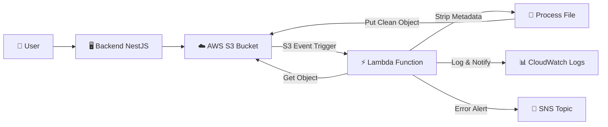

# Kế Hoạch Tích Hợp AWS Lambda để Xóa Metadata File S3

## 📋 Tổng Quan

**Mục tiêu:** Tự động xóa metadata của file khi upload lên S3 bằng AWS Lambda function được trigger bởi S3 event.

**Use Case:** Khi user upload file (PDF, images, documents) lên S3, metadata như author, creation date, GPS location có thể chứa thông tin nhạy cảm cần được xóa bỏ tự động.

---

## 🏗️ Kiến Trúc Tổng Quan



### Luồng Xử Lý

1. **Upload File**: Backend upload file lên S3 bucket
2. **S3 Event**: S3 trigger Lambda function khi có object mới
3. **Lambda Process**: 
   - Download file từ S3
   - Xóa metadata (EXIF, PDF metadata, v.v.)
   - Upload lại file đã clean về S3
4. **Logging**: Ghi log vào CloudWatch
5. **Notification**: Gửi alert nếu có lỗi

---

## 📦 Các Thành Phần Cần Triển Khai

### 1. Lambda Function (Python/Node.js)
- **Ngôn ngữ:** Python 3.11 (khuyến nghị vì có thư viện xử lý metadata tốt)
- **Runtime:** Python 3.11
- **Memory:** 512 MB - 1024 MB
- **Timeout:** 60 seconds
- **Libraries:**
  - `Pillow` (xử lý ảnh)
  - `PyPDF2` hoặc `pikepdf` (xử lý PDF)
  - `boto3` (AWS SDK)

### 2. S3 Bucket Configuration
- **Event Notification**: S3:ObjectCreated:*
- **Prefix Filter**: Có thể filter theo folder cụ thể
- **Suffix Filter**: `.pdf`, `.jpg`, `.png`, `.jpeg`, `.docx`

### 3. IAM Role & Permissions
- Lambda execution role với permissions:
  - `s3:GetObject`
  - `s3:PutObject`
  - `s3:DeleteObject` (nếu cần)
  - `logs:CreateLogGroup`
  - `logs:CreateLogStream`
  - `logs:PutLogEvents`

### 4. CloudWatch Monitoring
- Log groups
- Alarms cho errors
- Metrics cho execution time

---

## 🛠️ Chi Tiết Triển Khai

### Phase 1: Chuẩn Bị Infrastructure (1-2 ngày)

#### Step 1.1: Tạo Lambda Function

**File: `lambda_function.py`**

```python
import json
import boto3
import os
import tempfile
from PIL import Image
from PIL.ExifTags import TAGS
import PyPDF2
from io import BytesIO

s3_client = boto3.client('s3')

def lambda_handler(event, context):
    """
    Main Lambda handler triggered by S3 event
    """
    try:
        # Parse S3 event
        for record in event['Records']:
            bucket = record['s3']['bucket']['name']
            key = record['s3']['object']['key']
            
            print(f"Processing file: s3://{bucket}/{key}")
            
            # Get file extension
            file_ext = os.path.splitext(key)[1].lower()
            
            # Process based on file type
            if file_ext in ['.jpg', '.jpeg', '.png', '.gif']:
                process_image(bucket, key)
            elif file_ext == '.pdf':
                process_pdf(bucket, key)
            elif file_ext in ['.docx', '.doc']:
                process_document(bucket, key)
            else:
                print(f"Unsupported file type: {file_ext}")
                
        return {
            'statusCode': 200,
            'body': json.dumps('Metadata removed successfully')
        }
        
    except Exception as e:
        print(f"Error: {str(e)}")
        # Send SNS notification for error
        send_error_notification(str(e), event)
        raise


def process_image(bucket, key):
    """
    Remove EXIF metadata from images
    """
    # Download image from S3
    response = s3_client.get_object(Bucket=bucket, Key=key)
    image_data = response['Body'].read()
    
    # Open image with Pillow
    image = Image.open(BytesIO(image_data))
    
    # Remove EXIF data
    data = list(image.getdata())
    image_without_exif = Image.new(image.mode, image.size)
    image_without_exif.putdata(data)
    
    # Save to temporary file
    with tempfile.NamedTemporaryFile(delete=False, suffix='.jpg') as tmp_file:
        image_without_exif.save(tmp_file.name, quality=95)
        tmp_file.flush()
        
        # Upload back to S3
        with open(tmp_file.name, 'rb') as f:
            s3_client.put_object(
                Bucket=bucket,
                Key=key,
                Body=f,
                ContentType=response['ContentType'],
                Metadata={'metadata-cleaned': 'true'}
            )
    
    # Clean up
    os.unlink(tmp_file.name)
    print(f"Image metadata removed: {key}")


def process_pdf(bucket, key):
    """
    Remove metadata from PDF files
    """
    # Download PDF from S3
    response = s3_client.get_object(Bucket=bucket, Key=key)
    pdf_data = response['Body'].read()
    
    # Read PDF
    pdf_reader = PyPDF2.PdfReader(BytesIO(pdf_data))
    pdf_writer = PyPDF2.PdfWriter()
    
    # Copy pages without metadata
    for page in pdf_reader.pages:
        pdf_writer.add_page(page)
    
    # Remove metadata
    pdf_writer.add_metadata({})
    
    # Write to temporary file
    with tempfile.NamedTemporaryFile(delete=False, suffix='.pdf') as tmp_file:
        pdf_writer.write(tmp_file)
        tmp_file.flush()
        
        # Upload back to S3
        with open(tmp_file.name, 'rb') as f:
            s3_client.put_object(
                Bucket=bucket,
                Key=key,
                Body=f,
                ContentType='application/pdf',
                Metadata={'metadata-cleaned': 'true'}
            )
    
    # Clean up
    os.unlink(tmp_file.name)
    print(f"PDF metadata removed: {key}")


def process_document(bucket, key):
    """
    Remove metadata from Word documents (future implementation)
    """
    print(f"Document processing not implemented yet: {key}")
    # TODO: Implement using python-docx library


def send_error_notification(error_message, event):
    """
    Send error notification to SNS topic
    """
    sns_client = boto3.client('sns')
    topic_arn = os.environ.get('ERROR_SNS_TOPIC_ARN')
    
    if topic_arn:
        sns_client.publish(
            TopicArn=topic_arn,
            Subject='Lambda Metadata Removal Error',
            Message=f"Error processing file: {error_message}\n\nEvent: {json.dumps(event)}"
        )
```

#### Step 1.2: Tạo requirements.txt

```txt
boto3==1.34.10
Pillow==10.1.0
PyPDF2==3.0.1
pikepdf==8.9.0
```

#### Step 1.3: Tạo IAM Role

**File: `lambda-execution-role.json`**

```json
{
  "Version": "2012-10-17",
  "Statement": [
    {
      "Effect": "Allow",
      "Principal": {
        "Service": "lambda.amazonaws.com"
      },
      "Action": "sts:AssumeRole"
    }
  ]
}
```

**File: `lambda-permissions-policy.json`**

```json
{
  "Version": "2012-10-17",
  "Statement": [
    {
      "Sid": "S3Access",
      "Effect": "Allow",
      "Action": [
        "s3:GetObject",
        "s3:PutObject",
        "s3:DeleteObject"
      ],
      "Resource": "arn:aws:s3:::YOUR_BUCKET_NAME/*"
    },
    {
      "Sid": "CloudWatchLogs",
      "Effect": "Allow",
      "Action": [
        "logs:CreateLogGroup",
        "logs:CreateLogStream",
        "logs:PutLogEvents"
      ],
      "Resource": "arn:aws:logs:*:*:*"
    },
    {
      "Sid": "SNSPublish",
      "Effect": "Allow",
      "Action": [
        "sns:Publish"
      ],
      "Resource": "arn:aws:sns:*:*:lambda-error-notifications"
    }
  ]
}
```

#### Step 1.4: Deployment Script

**File: `deploy-lambda.sh`**

```bash
#!/bin/bash

# Configuration
FUNCTION_NAME="s3-metadata-remover"
REGION="ap-southeast-1"
ROLE_NAME="lambda-s3-metadata-role"
S3_BUCKET="your-bucket-name"

echo "🚀 Deploying Lambda Function for S3 Metadata Removal"

# Step 1: Create IAM Role
echo "📋 Creating IAM Role..."
aws iam create-role \
  --role-name $ROLE_NAME \
  --assume-role-policy-document file://lambda-execution-role.json \
  --region $REGION

# Wait for role to be created
sleep 5

# Step 2: Attach policy to role
echo "🔐 Attaching policy to role..."
aws iam put-role-policy \
  --role-name $ROLE_NAME \
  --policy-name LambdaS3MetadataPolicy \
  --policy-document file://lambda-permissions-policy.json

# Step 3: Package Lambda function
echo "📦 Packaging Lambda function..."
mkdir -p package
pip install -r requirements.txt -t package/
cp lambda_function.py package/
cd package
zip -r ../lambda-deployment.zip .
cd ..

# Step 4: Create Lambda function
echo "⚡ Creating Lambda function..."
ROLE_ARN=$(aws iam get-role --role-name $ROLE_NAME --query 'Role.Arn' --output text)

aws lambda create-function \
  --function-name $FUNCTION_NAME \
  --runtime python3.11 \
  --role $ROLE_ARN \
  --handler lambda_function.lambda_handler \
  --zip-file fileb://lambda-deployment.zip \
  --timeout 60 \
  --memory-size 1024 \
  --region $REGION \
  --environment Variables="{ERROR_SNS_TOPIC_ARN=arn:aws:sns:$REGION:ACCOUNT_ID:lambda-error-notifications}"

# Step 5: Add S3 trigger permission
echo "🔔 Adding S3 trigger permission..."
aws lambda add-permission \
  --function-name $FUNCTION_NAME \
  --principal s3.amazonaws.com \
  --statement-id s3-trigger \
  --action "lambda:InvokeFunction" \
  --source-arn arn:aws:s3:::$S3_BUCKET \
  --region $REGION

echo "✅ Lambda function deployed successfully!"
echo "🔧 Next step: Configure S3 bucket notification"
```

---

### Phase 2: Cấu Hình S3 Bucket (0.5 ngày)

#### Step 2.1: Tạo S3 Event Notification

**File: `s3-notification.json`**

```json
{
  "LambdaFunctionConfigurations": [
    {
      "Id": "metadata-remover-trigger",
      "LambdaFunctionArn": "arn:aws:lambda:ap-southeast-1:ACCOUNT_ID:function:s3-metadata-remover",
      "Events": [
        "s3:ObjectCreated:*"
      ],
      "Filter": {
        "Key": {
          "FilterRules": [
            {
              "Name": "suffix",
              "Value": ".jpg"
            },
            {
              "Name": "suffix",
              "Value": ".jpeg"
            },
            {
              "Name": "suffix",
              "Value": ".png"
            },
            {
              "Name": "suffix",
              "Value": ".pdf"
            }
          ]
        }
      }
    }
  ]
}
```

**Script cấu hình:**

```bash
#!/bin/bash

BUCKET_NAME="your-bucket-name"
REGION="ap-southeast-1"

# Apply notification configuration
aws s3api put-bucket-notification-configuration \
  --bucket $BUCKET_NAME \
  --notification-configuration file://s3-notification.json \
  --region $REGION

echo "✅ S3 notification configured successfully!"
```

#### Step 2.2: Tạo Separate Folder Structure

Để tránh infinite loop (Lambda xử lý file rồi lại trigger chính nó), có 2 cách:

**Option 1: Sử dụng Metadata Tag**
- Check metadata tag `metadata-cleaned` trước khi xử lý
- Nếu đã có tag này thì skip

**Option 2: Separate Folders**
```
your-bucket/
├── uploads/           # User upload vào đây (trigger Lambda)
├── processed/         # Lambda xử lý xong move vào đây
└── errors/           # File lỗi move vào đây
```

---

### Phase 3: Tích Hợp Backend (1-2 ngày)

#### Step 3.1: Cập Nhật Backend Upload Logic

**File: `backend/src/common/services/s3-upload.service.ts`** (tạo mới)

```typescript
import { Injectable, Logger } from '@nestjs/common';
import { S3Client, PutObjectCommand } from '@aws-sdk/client-s3';
import { AwsS3ConfigService } from '../../aws-config/aws-s3-config.service';

@Injectable()
export class S3UploadService {
  private readonly logger = new Logger(S3UploadService.name);
  private s3Client: S3Client;

  constructor(
    private readonly awsConfigService: AwsS3ConfigService,
  ) {}

  async initializeS3Client() {
    const config = await this.awsConfigService.getActiveConfig();
    
    if (!config) {
      throw new Error('No active AWS S3 configuration found');
    }

    this.s3Client = new S3Client({
      region: config.region,
      credentials: {
        accessKeyId: config.accessKeyId,
        secretAccessKey: config.secretAccessKey,
      },
      endpoint: config.s3Endpoint,
      forcePathStyle: true,
    });
  }

  /**
   * Upload file to S3 with metadata for Lambda processing
   */
  async uploadFile(
    file: Express.Multer.File,
    folder: string = 'uploads',
    options?: {
      skipMetadataRemoval?: boolean;
    }
  ): Promise<string> {
    await this.initializeS3Client();
    
    const config = await this.awsConfigService.getActiveConfig();
    const key = `${folder}/${Date.now()}-${file.originalname}`;

    const metadata: Record<string, string> = {
      'uploaded-by': 'backend-api',
      'upload-date': new Date().toISOString(),
    };

    // Nếu không cần xóa metadata, đánh dấu để Lambda skip
    if (options?.skipMetadataRemoval) {
      metadata['skip-metadata-removal'] = 'true';
    }

    const command = new PutObjectCommand({
      Bucket: config.s3Bucket,
      Key: key,
      Body: file.buffer,
      ContentType: file.mimetype,
      Metadata: metadata,
    });

    try {
      await this.s3Client.send(command);
      this.logger.log(`File uploaded successfully: ${key}`);
      
      // Return S3 URL
      return `${config.s3Endpoint}/${config.s3Bucket}/${key}`;
    } catch (error) {
      this.logger.error(`Failed to upload file: ${error.message}`);
      throw error;
    }
  }

  /**
   * Upload file with pre-cleaned metadata
   * (already processed, skip Lambda)
   */
  async uploadCleanFile(
    file: Express.Multer.File,
    folder: string = 'processed'
  ): Promise<string> {
    return this.uploadFile(file, folder, { skipMetadataRemoval: true });
  }
}
```

#### Step 3.2: Update Lambda Function để Check Metadata

```python
def should_skip_processing(metadata):
    """
    Check if file should skip metadata removal
    """
    # Skip if already processed
    if metadata.get('metadata-cleaned') == 'true':
        return True
    
    # Skip if explicitly marked
    if metadata.get('skip-metadata-removal') == 'true':
        return True
    
    return False

def lambda_handler(event, context):
    try:
        for record in event['Records']:
            bucket = record['s3']['bucket']['name']
            key = record['s3']['object']['key']
            
            # Get object metadata
            response = s3_client.head_object(Bucket=bucket, Key=key)
            metadata = response.get('Metadata', {})
            
            # Check if should skip
            if should_skip_processing(metadata):
                print(f"Skipping already processed file: {key}")
                continue
            
            # Process file...
            # ... rest of code
```

---

### Phase 4: Monitoring & Testing (1 ngày)

#### Step 4.1: CloudWatch Dashboard

**File: `cloudwatch-dashboard.json`**

```json
{
  "widgets": [
    {
      "type": "metric",
      "properties": {
        "metrics": [
          ["AWS/Lambda", "Invocations", {"stat": "Sum"}],
          [".", "Errors", {"stat": "Sum"}],
          [".", "Duration", {"stat": "Average"}],
          [".", "Throttles", {"stat": "Sum"}]
        ],
        "period": 300,
        "stat": "Average",
        "region": "ap-southeast-1",
        "title": "Lambda Metadata Remover Metrics"
      }
    }
  ]
}
```

#### Step 4.2: CloudWatch Alarms

```bash
# Alarm cho errors
aws cloudwatch put-metric-alarm \
  --alarm-name lambda-metadata-remover-errors \
  --alarm-description "Alert when Lambda has errors" \
  --metric-name Errors \
  --namespace AWS/Lambda \
  --statistic Sum \
  --period 300 \
  --threshold 5 \
  --comparison-operator GreaterThanThreshold \
  --evaluation-periods 1 \
  --alarm-actions arn:aws:sns:ap-southeast-1:ACCOUNT_ID:lambda-alerts
```

#### Step 4.3: Testing Plan

**Test Cases:**

1. **Upload Image với EXIF**
   - Upload ảnh có GPS location
   - Verify Lambda triggers
   - Verify EXIF data removed
   - Check CloudWatch logs

2. **Upload PDF với Metadata**
   - Upload PDF có author, creation date
   - Verify metadata removed
   - Verify file integrity

3. **Upload Multiple Files**
   - Test concurrent processing
   - Verify no race conditions
   - Check processing time

4. **Error Scenarios**
   - Upload corrupted file
   - Upload unsupported format
   - Verify error handling
   - Verify SNS notification

**Testing Script:**

```bash
#!/bin/bash

# Test 1: Upload image
echo "📸 Testing image upload..."
aws s3 cp test-image.jpg s3://your-bucket/uploads/

# Wait for Lambda processing
sleep 10

# Download and check
aws s3 cp s3://your-bucket/uploads/test-image.jpg downloaded-image.jpg
exiftool downloaded-image.jpg

# Test 2: Upload PDF
echo "📄 Testing PDF upload..."
aws s3 cp test-document.pdf s3://your-bucket/uploads/

# Check Lambda logs
aws logs tail /aws/lambda/s3-metadata-remover --follow
```

---

### Phase 5: Deployment to Production (0.5 ngày)

#### Step 5.1: Production Checklist

- [ ] IAM roles configured với least privilege
- [ ] Lambda timeout phù hợp (60s)
- [ ] Lambda memory đủ (1024 MB)
- [ ] S3 bucket versioning enabled
- [ ] CloudWatch alarms configured
- [ ] SNS topic for error notifications
- [ ] Backup strategy cho S3
- [ ] Cost monitoring enabled
- [ ] Testing completed in staging

#### Step 5.2: Deployment Commands

```bash
# 1. Deploy to staging first
./deploy-lambda.sh staging

# 2. Run tests
./test-lambda.sh staging

# 3. Deploy to production
./deploy-lambda.sh production

# 4. Monitor for 24h
aws logs tail /aws/lambda/s3-metadata-remover-prod --follow
```

---

## 💰 Cost Estimation

### Lambda Costs

**Assumptions:**
- 10,000 files/month
- Average processing time: 3 seconds
- Memory: 1024 MB

**Cost Breakdown:**
```
Requests: 10,000 × $0.20/1M = $0.002
Duration: 10,000 × 3s × ($0.0000166667/GB-second) × 1GB = $0.50
Total: ~$0.51/month
```

### S3 Costs

**Additional costs:**
- GET requests: 10,000 × $0.0004/1000 = $0.004
- PUT requests: 10,000 × $0.005/1000 = $0.05
- Data transfer: Negligible (in-region)

**Total Monthly Cost: ~$0.56**

---

## 🚨 Considerations & Best Practices

### 1. Avoid Infinite Loops
- ✅ Use metadata tags to mark processed files
- ✅ Separate folders for uploads vs processed
- ✅ Add filter conditions in Lambda

### 2. Error Handling
- ✅ Implement retry logic with exponential backoff
- ✅ Dead Letter Queue (DLQ) cho failed invocations
- ✅ SNS notifications cho critical errors

### 3. Performance
- ✅ Use Lambda layers cho shared libraries
- ✅ Optimize memory allocation (1024 MB recommended)
- ✅ Process files in parallel if needed

### 4. Security
- ✅ Encrypt files at rest (S3 encryption)
- ✅ Encrypt files in transit (HTTPS)
- ✅ Least privilege IAM permissions
- ✅ VPC configuration nếu cần

### 5. Monitoring
- ✅ CloudWatch Logs retention: 7 days
- ✅ Alarms cho errors, throttling, duration
- ✅ X-Ray tracing cho debugging

---

## 📋 Timeline Tổng Kết

| Phase | Tasks | Duration | Resources |
|-------|-------|----------|-----------|
| **Phase 1** | Chuẩn bị Infrastructure | 1-2 ngày | 1 DevOps |
| **Phase 2** | Cấu hình S3 Bucket | 0.5 ngày | 1 DevOps |
| **Phase 3** | Tích hợp Backend | 1-2 ngày | 1 Backend Dev |
| **Phase 4** | Monitoring & Testing | 1 ngày | 1 QA + 1 DevOps |
| **Phase 5** | Production Deployment | 0.5 ngày | 1 DevOps |
| **Total** | | **4-6 ngày** | |

---

## 🔄 Alternative Approaches

### Option A: Lambda Function (Current Plan)
**Pros:**
- ✅ Serverless, auto-scaling
- ✅ Pay per use
- ✅ Easy to maintain

**Cons:**
- ❌ Cold start latency
- ❌ 15-minute timeout limit
- ❌ Requires AWS setup

### Option B: Backend Processing
**Pros:**
- ✅ No additional AWS services
- ✅ Full control

**Cons:**
- ❌ Blocking upload flow
- ❌ Increased server load
- ❌ Harder to scale

### Option C: Queue-based (SQS + Worker)
**Pros:**
- ✅ Reliable, async processing
- ✅ Easy to scale workers

**Cons:**
- ❌ More complex architecture
- ❌ Additional costs

**Recommendation:** Stick with **Option A (Lambda)** vì simple, cost-effective, và scalable.

---

## 📚 References

- [AWS Lambda Documentation](https://docs.aws.amazon.com/lambda/)
- [S3 Event Notifications](https://docs.aws.amazon.com/AmazonS3/latest/userguide/NotificationHowTo.html)
- [Pillow Documentation](https://pillow.readthedocs.io/)
- [PyPDF2 Documentation](https://pypdf2.readthedocs.io/)
- [AWS Lambda Best Practices](https://docs.aws.amazon.com/lambda/latest/dg/best-practices.html)

---

## 🎯 Next Steps

1. **Review kế hoạch** với team (0.5 ngày)
2. **Setup AWS account** và permissions (0.5 ngày)
3. **Implement Phase 1** (Lambda function)
4. **Test in staging** environment
5. **Deploy to production**
6. **Monitor for 1 week**
7. **Optimize based on metrics**

---

**Document Version:** 1.0  
**Created:** December 25, 2025  
**Author:** DevOps Team  
**Status:** Draft - Pending Review
