# Entity Relationship Diagram - Doanhoi Portal Database

## Tổng quan hệ thống

Hệ thống quản lý Đoàn Hội bao gồm các module chính:
1. **User & Authentication**: Quản lý người dùng, phân quyền
2. **Organization**: Quản lý cơ cấu tổ chức Đoàn/Hội
3. **CTXH (Công Tác Xã Hội)**: Quản lý hoạt động và tham gia CTXH
4. **Payment**: Quản lý thu phí và thanh toán
5. **Template**: Quản lý biểu mẫu và nộp đơn
6. **Department & Class**: Quản lý khoa và lớp
7. **Configuration**: Cấu hình hệ thống (AWS S3, PayOS)

---

## ERD Diagram

```mermaid
erDiagram
    %% ==========================================
    %% USER & AUTHENTICATION MODULE
    %% ==========================================
    
    users {
        uuid id PK
        string code UK "Mã số sinh viên/cán bộ"
        string familyName "Họ và tên lót"
        string givenName "Tên"
        string email
        string phone
        string password "Local auth"
        string googleId "Google OAuth"
        enum authProvider "LOCAL, GOOGLE"
        boolean isActive
        datetime lastLogin
        text refreshToken
        enum userType "STUDENT, STAFF"
        enum membershipStatus "DOAN_VIEN, HOI_VIEN, BOTH, NONE"
        uuid managementDepartmentId FK
        uuid trainingDepartmentId FK
        uuid classId FK
        string identityCard "CCCD"
        date birthDate
        enum gender "NAM, NU"
        string admissionYear "Năm vào"
        string curriculumYear "Năm CTĐT"
        string facultyCode "Mã khoa"
        string trainingSystem "Hệ đào tạo"
        string trainingLevel "Bậc đào tạo"
        decimal ctxhDays "Tổng số ngày CTXH"
        decimal ctxhDaysOldSystem "Số ngày CTXH từ hệ thống cũ"
        datetime createdAt
        datetime updatedAt
    }

    %% ==========================================
    %% ORGANIZATION MODULE
    %% ==========================================
    
    organizations {
        uuid id PK
        string name
        string description
        enum type "DOAN_TRUONG, DOAN_CO_SO, CHI_DOAN, HOI_SINH_VIEN_TRUONG, LIEN_CHI_HOI, CHI_HOI, CLB_TRUONG, CLB_KHOA"
        string code "Mã tổ chức"
        uuid parentId FK "Closure Table - Tree structure"
        boolean isActive
        datetime createdAt
        datetime updatedAt
    }

    user_organizations {
        uuid id PK
        uuid userId FK
        uuid organizationId FK
        enum role "MEMBER, ADMIN, SUPER_ADMIN"
        boolean isActive
        datetime joinedAt
        datetime updatedAt
    }

    %% ==========================================
    %% PERMISSION & ROLE MODULE
    %% ==========================================
    
    permissions {
        uuid id PK
        string code UK "users.create, organizations.access"
        string name "Tên tiếng Việt"
        string description
        string category "dashboard, users, organizations"
        enum context "SYSTEM, ORGANIZATION"
        boolean isActive
        int sortOrder
        datetime createdAt
        datetime updatedAt
    }

    roles {
        uuid id PK
        string name UK "Quản trị viên, Quản lý"
        string description
        boolean isSystemRole
        boolean isActive
        datetime createdAt
        datetime updatedAt
    }

    role_permissions {
        uuid roleId FK
        uuid permissionId FK
    }

    user_roles {
        uuid id PK
        uuid userId FK
        uuid roleId FK
        uuid organizationId FK "null = system-wide role"
        boolean isActive
        datetime assignedAt
    }

    %% ==========================================
    %% DEPARTMENT & CLASS MODULE
    %% ==========================================
    
    departments {
        uuid id PK
        string name
        string code
        string description
        boolean isActive
        datetime createdAt
        datetime updatedAt
    }

    classes {
        uuid id PK
        string name
        int year "Năm học"
        uuid departmentId FK
        boolean isActive
        datetime createdAt
        datetime updatedAt
    }

    %% ==========================================
    %% CTXH MODULE
    %% ==========================================
    
    ctxh_category {
        uuid id PK
        string name
        text description
        uuid created_by FK
        datetime created_at
        uuid updated_by FK
        datetime updated_at
        uuid deleted_by FK
        datetime deleted_at
    }

    ctxh_activity {
        uuid id PK
        string name
        text description
        uuid category_id FK
        uuid organization_id FK
        datetime start_date
        datetime end_date
        decimal total_days
        string location
        enum status "DRAFT, ACTIVE, COMPLETED, CANCELLED"
        uuid created_by FK
        datetime created_at
        uuid updated_by FK
        datetime updated_at
        uuid deleted_by FK
        datetime deleted_at
    }

    ctxh_participation {
        uuid id PK
        uuid activity_id FK
        uuid student_id FK
        string student_code
        decimal actual_days
        enum status "REGISTERED, COMPLETED, CANCELLED"
        text note
        uuid graded_by FK
        uuid created_by FK
        datetime created_at
        uuid updated_by FK
        datetime updated_at
        uuid deleted_by FK
        datetime deleted_at
    }

    ctxh_limit_config {
        uuid id PK
        uuid organization_id FK
        decimal max_days "Số ngày CTXH tối đa/học kỳ"
        enum status "ACTIVE, INACTIVE, DRAFT"
        text description
        uuid created_by FK
        datetime created_at
        uuid updated_by FK
        datetime updated_at
        uuid deleted_by FK
        datetime deleted_at
    }

    ctxh_embeddings {
        uuid id PK
        uuid activity_id FK
        text content_text
        vector embedding "pgvector - 1536 dimensions"
        int chunk_index
        jsonb metadata
        datetime created_at
        datetime updated_at
    }

    %% ==========================================
    %% TEMPLATE MODULE
    %% ==========================================
    
    templates {
        uuid id PK
        string name "Sơ yếu lý lịch, Đơn xin thực tập"
        text description
        string original_file_url "S3 URL"
        string original_file_name
        int file_size "bytes"
        jsonb schema "Auto-parsed from docxtemplater"
        enum status "PROCESSING, ACTIVE, INACTIVE, ERROR"
        text error_message
        uuid created_by FK
        uuid organization_id FK
        datetime created_at
        datetime updated_at
    }

    template_fields {
        uuid id PK
        uuid template_id FK
        string field_name "student_name"
        string display_name "Họ và tên sinh viên"
        enum field_type "TEXT, TEXTAREA, NUMBER, EMAIL, PHONE, DATE, TIME, DATETIME, RADIO, CHECKBOX, DAY, MONTH, YEAR"
        jsonb validation_rules
        jsonb options "For select/radio"
        jsonb date_parts_mapping "For DATE fields from 3 fields"
        int position "Thứ tự hiển thị"
        string placeholder
        text help_text
        string default_value
        boolean is_visible
        datetime created_at
    }

    template_submissions {
        uuid id PK
        uuid template_id FK
        uuid user_id FK
        jsonb form_data "User input"
        string output_file_url "S3 URL - result"
        string output_file_name
        int output_file_size
        enum status "DRAFT, SUBMITTED, COMPLETED, FAILED"
        text error_message
        datetime submitted_at
        datetime completed_at
        datetime created_at
        datetime updated_at
    }

    %% ==========================================
    %% PAYMENT MODULE
    %% ==========================================
    
    payment_campaigns {
        uuid id PK
        uuid organization_id FK
        string name
        text description
        datetime start_date
        datetime end_date
        enum status "DRAFT, ACTIVE, COMPLETED, CANCELLED"
        uuid created_by FK
        datetime created_at
        datetime updated_at
    }

    payment_fee_levels {
        uuid id PK
        uuid campaign_id FK
        string level_name
        int amount
        text description
        datetime created_at
        datetime updated_at
    }

    payment_assignments {
        uuid id PK
        uuid campaign_id FK
        uuid user_id FK
        uuid fee_level_id FK
        text note
        enum status "PENDING, PAID, OVERDUE, EXEMPTED"
        datetime due_date
        datetime assigned_at
        datetime paid_at
        uuid assigned_by FK
        datetime created_at
        datetime updated_at
    }

    payment_history {
        uuid id PK
        uuid assignment_id FK
        decimal amount
        enum status "PENDING, PAID, CANCELLED, EXPIRED"
        enum payment_method "MANUAL, ONLINE"
        bigint order_code UK
        datetime paid_at
        string client_id "PayOS config"
        string api_key "PayOS config"
        string checksum_key "PayOS config"
        datetime created_at
        datetime updated_at
    }

    payment_campaign_payos_configs {
        uuid id PK
        uuid campaign_id FK
        uuid organization_id FK
        uuid user_id FK
        string client_id
        string api_key
        string checksum_key
        boolean is_active
        datetime created_at
        datetime updated_at
    }

    %% ==========================================
    %% CONFIGURATION MODULE
    %% ==========================================
    
    aws_s3_configs {
        uuid id PK
        string access_key_id
        string secret_access_key
        string region
        string s3_bucket
        string s3_endpoint
        boolean is_active
        datetime created_at
        datetime updated_at
    }

    %% ==========================================
    %% RELATIONSHIPS
    %% ==========================================
    
    %% User relationships
    users ||--o{ user_organizations : "belongs to"
    users ||--o{ user_roles : "has"
    users }o--o| departments : "managementDepartment"
    users }o--o| departments : "trainingDepartment"
    users }o--o| classes : "class"
    
    %% Organization relationships
    organizations ||--o{ user_organizations : "has members"
    organizations ||--o| organizations : "parent/children (Tree)"
    
    %% User-Organization relationships
    user_organizations }o--|| users : "user"
    user_organizations }o--|| organizations : "organization"
    
    %% Permission & Role relationships
    roles ||--o{ role_permissions : "has"
    permissions ||--o{ role_permissions : "assigned to"
    user_roles }o--|| users : "user"
    user_roles }o--|| roles : "role"
    user_roles }o--o| organizations : "scope"
    
    %% Department & Class relationships
    classes }o--o| departments : "department"
    departments ||--o{ users : "management users"
    departments ||--o{ users : "training users"
    classes ||--o{ users : "students"
    
    %% CTXH relationships
    ctxh_category ||--o{ ctxh_activity : "has activities"
    ctxh_activity }o--|| organizations : "organized by"
    ctxh_activity ||--o{ ctxh_participation : "has participants"
    ctxh_activity ||--o{ ctxh_embeddings : "has embeddings"
    ctxh_participation }o--|| users : "student"
    ctxh_participation }o--o| users : "graded by"
    ctxh_limit_config }o--|| organizations : "organization"
    
    %% CTXH audit relationships
    ctxh_category }o--|| users : "created by"
    ctxh_category }o--o| users : "updated by"
    ctxh_category }o--o| users : "deleted by"
    ctxh_activity }o--|| users : "created by"
    ctxh_activity }o--o| users : "updated by"
    ctxh_activity }o--o| users : "deleted by"
    ctxh_participation }o--|| users : "created by"
    ctxh_participation }o--o| users : "updated by"
    ctxh_participation }o--o| users : "deleted by"
    ctxh_limit_config }o--|| users : "created by"
    ctxh_limit_config }o--o| users : "updated by"
    ctxh_limit_config }o--o| users : "deleted by"
    
    %% Template relationships
    templates }o--|| users : "created by"
    templates }o--o| organizations : "organization"
    templates ||--o{ template_fields : "has fields"
    templates ||--o{ template_submissions : "has submissions"
    template_submissions }o--|| users : "submitted by"
    
    %% Payment relationships
    payment_campaigns }o--|| organizations : "organization"
    payment_campaigns }o--|| users : "created by"
    payment_campaigns ||--o{ payment_fee_levels : "has fee levels"
    payment_campaigns ||--o{ payment_assignments : "has assignments"
    payment_campaigns ||--o{ payment_campaign_payos_configs : "has configs"
    payment_fee_levels ||--o{ payment_assignments : "assigned to"
    payment_assignments }o--|| users : "user"
    payment_assignments }o--|| users : "assigned by"
    payment_assignments ||--o{ payment_history : "payment history"
    payment_campaign_payos_configs }o--|| organizations : "organization"
    payment_campaign_payos_configs }o--|| users : "user"
```

---

## Chi tiết các bảng theo module

### 1. User & Authentication Module

#### **users**
Bảng chính quản lý người dùng (sinh viên/cán bộ).

**Key Features:**
- Hỗ trợ đa phương thức xác thực: Local (email/password) và Google OAuth
- Phân loại người dùng: Student/Staff
- Tình trạng thành viên: Đoàn viên/Hội viên/Cả hai/Không
- Quản lý CTXH: Tổng số ngày CTXH và số ngày từ hệ thống cũ
- Thông tin sinh viên đầy đủ: CCCD, ngày sinh, giới tính, năm vào, khoa, hệ đào tạo

**Relationships:**
- `managementDepartment`: Khoa quản lý (optional)
- `trainingDepartment`: Khoa đào tạo (optional)
- `class`: Lớp học (optional)

---

### 2. Organization Module

#### **organizations**
Quản lý cơ cấu tổ chức theo cấu trúc cây (Tree Structure - Closure Table).

**Organization Types:**
- **Đoàn**: `DOAN_TRUONG` → `DOAN_CO_SO` → `CHI_DOAN`
- **Hội**: `HOI_SINH_VIEN_TRUONG` → `LIEN_CHI_HOI` → `CHI_HOI`
- **Câu lạc bộ**: `CLB_TRUONG`, `CLB_KHOA`

#### **user_organizations**
Bảng trung gian quản lý thành viên trong tổ chức.

**Roles:**
- `MEMBER`: Thành viên thường
- `ADMIN`: Quản trị viên tổ chức
- `SUPER_ADMIN`: Quản trị cấp cao

---

### 3. Permission & Role Module

#### **permissions**
Quản lý quyền hạn chi tiết theo từng chức năng.

**Permission Context:**
- `SYSTEM`: Quyền toàn hệ thống
- `ORGANIZATION`: Quyền theo từng tổ chức

**Categories:**
- dashboard, users, organizations, departments, classes, permissions, ctxh, payment, template

#### **roles**
Vai trò người dùng (Quản trị viên, Biên tập viên, v.v.)

#### **role_permissions**
Bảng many-to-many mapping roles với permissions

#### **user_roles**
Gán role cho user, hỗ trợ cả system-wide và organization-scoped roles

---

### 4. Department & Class Module

#### **departments**
Quản lý các khoa/phòng ban.

#### **classes**
Quản lý lớp học, thuộc department.

---

### 5. CTXH (Công Tác Xã Hội) Module

#### **ctxh_category**
Danh mục hoạt động CTXH (do trường tạo).

#### **ctxh_activity**
Hoạt động CTXH cụ thể.

**Status:**
- `DRAFT`: Nháp
- `ACTIVE`: Đang diễn ra
- `COMPLETED`: Hoàn thành
- `CANCELLED`: Hủy bỏ

**Features:**
- Tổ chức bởi một organization
- Thuộc một category
- Có thời gian bắt đầu/kết thúc
- Tính tổng số ngày CTXH

#### **ctxh_participation**
Quản lý việc tham gia hoạt động CTXH của sinh viên.

**Status:**
- `REGISTERED`: Đã đăng ký
- `COMPLETED`: Đã hoàn thành
- `CANCELLED`: Hủy đăng ký

**Features:**
- Có thể chấm điểm số ngày thực tế (`actual_days`)
- Người chấm điểm (`graded_by`)

#### **ctxh_limit_config**
Cấu hình giới hạn số ngày CTXH tối đa mà mỗi tổ chức có thể cấp trong 1 học kỳ.

#### **ctxh_embeddings**
Lưu embeddings vector (sử dụng pgvector) cho RAG chatbot CTXH.

**Features:**
- Vector 1536 chiều (OpenAI embeddings)
- Hỗ trợ semantic search cho chatbot
- Chunk-based storage với metadata

---

### 6. Template Module

#### **templates**
Quản lý file mẫu Word (sơ yếu lý lịch, đơn xin thực tập, v.v.)

**Status:**
- `PROCESSING`: Đang parse file Word
- `ACTIVE`: Sẵn sàng sử dụng
- `INACTIVE`: Tạm ngưng
- `ERROR`: Lỗi khi parse

**Features:**
- Upload file Word lên S3
- Auto-parse schema từ docxtemplater
- Organization-scoped hoặc system-wide

#### **template_fields**
Các trường trong biểu mẫu (được parse từ file Word).

**Field Types:**
- Basic: TEXT, TEXTAREA, NUMBER, EMAIL, PHONE
- Date/Time: DATE, TIME, DATETIME, DAY, MONTH, YEAR
- Selection: RADIO, CHECKBOX

**Features:**
- Validation rules (required, min/max length, regex pattern)
- Options cho radio/checkbox
- Date parts mapping (hỗ trợ parse 3 field riêng biệt thành 1 DATE)

#### **template_submissions**
Quản lý việc nộp đơn/điền biểu mẫu.

**Status:**
- `DRAFT`: Lưu nháp
- `SUBMITTED`: Đã nộp, đang generate
- `COMPLETED`: Đã hoàn thành
- `FAILED`: Lỗi

**Flow:**
1. User điền form → lưu `formData` (JSONB)
2. Submit → Backend generate file Word từ template
3. Upload file kết quả lên S3
4. Lưu URL file output

---

### 7. Payment Module

#### **payment_campaigns**
Chiến dịch thu phí (thu Đoàn phí, Hội phí, v.v.)

**Status:**
- `DRAFT`: Nháp
- `ACTIVE`: Đang hoạt động
- `COMPLETED`: Hoàn thành
- `CANCELLED`: Hủy bỏ

#### **payment_fee_levels**
Các mức phí trong chiến dịch (VD: Sinh viên năm 1: 100k, năm 2: 150k)

#### **payment_assignments**
Gán phí cho từng sinh viên.

**Status:**
- `PENDING`: Chưa đóng
- `PAID`: Đã đóng
- `OVERDUE`: Quá hạn
- `EXEMPTED`: Được miễn

#### **payment_history**
Lịch sử thanh toán.

**Payment Methods:**
- `MANUAL`: Đóng thủ công (admin xác nhận)
- `ONLINE`: Đóng online qua PayOS

**Features:**
- Tích hợp PayOS gateway
- Lưu order_code duy nhất
- Lưu cấu hình PayOS (client_id, api_key, checksum_key)

#### **payment_campaign_payos_configs**
Cấu hình PayOS cho từng chiến dịch (mỗi tổ chức có thể có PayOS riêng).

---

### 8. Configuration Module

#### **aws_s3_configs**
Cấu hình AWS S3 cho việc lưu trữ file.

**Features:**
- Access Key ID & Secret Access Key
- Region, Bucket name
- Custom endpoint (hỗ trợ MinIO hoặc các S3-compatible services)

---

## Database Features

### 1. Soft Delete
Các bảng CTXH sử dụng soft delete với `deleted_at` và `deleted_by`.

### 2. Audit Trail
Các bảng quan trọng có audit fields:
- `created_by`, `created_at`
- `updated_by`, `updated_at`
- `deleted_by`, `deleted_at`

### 3. Tree Structure
`organizations` sử dụng **Closure Table** pattern của TypeORM cho tree structure.

### 4. JSONB Fields
Sử dụng PostgreSQL JSONB cho:
- `template.schema`: Parsed schema từ docxtemplater
- `template_fields.validation_rules`: Validation rules động
- `template_fields.options`: Options cho select/radio
- `template_fields.date_parts_mapping`: Mapping cho DATE field
- `template_submissions.form_data`: User input data
- `ctxh_embeddings.metadata`: Metadata cho embeddings

### 5. Vector Search (pgvector)
`ctxh_embeddings.embedding`: Vector 1536 chiều cho semantic search (RAG chatbot).

### 6. Indexing
- Unique indexes: `users.code`, `permissions.code`, `roles.name`, `payment_history.order_code`
- Composite indexes:
  - `user_roles`: `(userId, roleId, organizationId)`
  - `templates`: `(status, createdAt)`, `(organizationId, status)`
  - `template_fields`: `(templateId, position)`
  - `template_submissions`: `(userId, createdAt)`, `(templateId, status)`
  - `ctxh_embeddings`: `(activityId)`, `(activityId, chunkIndex)`

---

## Enums Summary

### User Enums
- `UserType`: STUDENT, STAFF
- `MembershipStatus`: DOAN_VIEN, HOI_VIEN, BOTH, NONE
- `Gender`: NAM, NU
- `AuthProvider`: LOCAL, GOOGLE

### Organization Enums
- `OrganizationType`: DOAN_TRUONG, DOAN_CO_SO, CHI_DOAN, HOI_SINH_VIEN_TRUONG, LIEN_CHI_HOI, CHI_HOI, CLB_TRUONG, CLB_KHOA
- `UserOrgRole`: MEMBER, ADMIN, SUPER_ADMIN

### Permission Enums
- `PermissionContext`: SYSTEM, ORGANIZATION

### CTXH Enums
- `ActivityStatus`: DRAFT, ACTIVE, COMPLETED, CANCELLED
- `ParticipationStatus`: REGISTERED, COMPLETED, CANCELLED
- `LimitConfigStatus`: ACTIVE, INACTIVE, DRAFT

### Template Enums
- `TemplateStatus`: PROCESSING, ACTIVE, INACTIVE, ERROR
- `FieldType`: TEXT, TEXTAREA, NUMBER, EMAIL, PHONE, DATE, TIME, DATETIME, RADIO, CHECKBOX, DAY, MONTH, YEAR
- `SubmissionStatus`: DRAFT, SUBMITTED, COMPLETED, FAILED

### Payment Enums
- `PaymentCampaignStatus`: DRAFT, ACTIVE, COMPLETED, CANCELLED
- `PaymentAssignmentStatus`: PENDING, PAID, OVERDUE, EXEMPTED
- `PaymentHistoryStatus`: PENDING, PAID, CANCELLED, EXPIRED
- `PaymentMethod`: MANUAL, ONLINE

---

## Notes

1. **Performance Optimization:**
   - Các bảng quan trọng đều có indexes phù hợp
   - Sử dụng eager loading cho một số relations thường dùng
   - JSONB indexing có thể thêm GIN index nếu cần search trong JSON

2. **Security:**
   - Passwords được hash (không lưu plain text)
   - Refresh tokens được mã hóa
   - PayOS credentials cần encrypt trước khi lưu DB (hiện tại chưa có)
   - AWS S3 credentials cần encrypt

3. **Scalability:**
   - Tree structure của organizations cho phép mở rộng không giới hạn cấp
   - JSONB fields cho phép schema linh hoạt không cần migration
   - Vector embeddings có thể scale với indexing strategy phù hợp

4. **Data Integrity:**
   - Foreign keys với CASCADE delete phù hợp
   - Unique constraints đảm bảo data consistency
   - Enum constraints đảm bảo status values hợp lệ

---

**Generated:** December 16, 2025
**Database System:** PostgreSQL with pgvector extension
**ORM:** TypeORM
