# Entity Relationship Model - Doanhoi Portal

## Overview
This document presents the complete Entity Relationship Model for the Doanhoi Portal system, following standard ER modeling conventions with strong entities, weak entities, and relationships with cardinality.

---

## ER Diagram

```mermaid
erDiagram
    %% ========================================
    %% CORE ENTITIES
    %% ========================================
    
    USERS ||--o{ USER_ORGANIZATIONS : "BELONGS_TO"
    USERS ||--o{ USER_ROLES : "HAS"
    USERS }o--o| DEPARTMENTS : "MANAGED_BY"
    USERS }o--o| DEPARTMENTS : "TRAINED_BY"
    USERS }o--o| CLASSES : "ENROLLED_IN"
    
    ORGANIZATIONS ||--o{ USER_ORGANIZATIONS : "CONTAINS"
    ORGANIZATIONS ||--o| ORGANIZATIONS : "PARENT_OF"
    ORGANIZATIONS ||--o{ CTXH_ACTIVITY : "ORGANIZES"
    ORGANIZATIONS ||--o{ CTXH_LIMIT_CONFIG : "LIMITS"
    ORGANIZATIONS ||--o{ PAYMENT_CAMPAIGNS : "CONDUCTS"
    ORGANIZATIONS ||--o{ TEMPLATES : "OWNS"
    
    DEPARTMENTS ||--o{ CLASSES : "CONTAINS"
    
    %% ========================================
    %% PERMISSION & ROLE MODULE
    %% ========================================
    
    ROLES ||--o{ ROLE_PERMISSIONS : "HAS"
    PERMISSIONS ||--o{ ROLE_PERMISSIONS : "GRANTED_TO"
    ROLES ||--o{ USER_ROLES : "ASSIGNED_TO"
    
    %% ========================================
    %% CTXH MODULE
    %% ========================================
    
    CTXH_CATEGORY ||--o{ CTXH_ACTIVITY : "CATEGORIZES"
    CTXH_ACTIVITY ||--o{ CTXH_PARTICIPATION : "INVOLVES"
    CTXH_ACTIVITY ||--o{ CTXH_EMBEDDINGS : "GENERATES"
    USERS ||--o{ CTXH_PARTICIPATION : "PARTICIPATES_IN"
    USERS ||--o{ CTXH_PARTICIPATION : "GRADES"
    
    %% ========================================
    %% TEMPLATE MODULE
    %% ========================================
    
    TEMPLATES ||--o{ TEMPLATE_FIELDS : "DEFINES"
    TEMPLATES ||--o{ TEMPLATE_SUBMISSIONS : "RECEIVES"
    USERS ||--o{ TEMPLATE_SUBMISSIONS : "SUBMITS"
    
    %% ========================================
    %% PAYMENT MODULE
    %% ========================================
    
    PAYMENT_CAMPAIGNS ||--o{ PAYMENT_FEE_LEVELS : "DEFINES"
    PAYMENT_CAMPAIGNS ||--o{ PAYMENT_ASSIGNMENTS : "CREATES"
    PAYMENT_CAMPAIGNS ||--o{ PAYMENT_CAMPAIGN_PAYOS_CONFIGS : "CONFIGURED_BY"
    PAYMENT_FEE_LEVELS ||--o{ PAYMENT_ASSIGNMENTS : "APPLIED_TO"
    USERS ||--o{ PAYMENT_ASSIGNMENTS : "ASSIGNED_TO"
    USERS ||--o{ PAYMENT_ASSIGNMENTS : "ASSIGNS"
    PAYMENT_ASSIGNMENTS ||--o{ PAYMENT_HISTORY : "GENERATES"
    
    %% ========================================
    %% AUDIT RELATIONSHIPS
    %% ========================================
    
    USERS ||--o{ CTXH_CATEGORY : "CREATES"
    USERS ||--o{ CTXH_ACTIVITY : "CREATES"
    USERS ||--o{ CTXH_LIMIT_CONFIG : "CREATES"
    USERS ||--o{ TEMPLATES : "CREATES"
    USERS ||--o{ PAYMENT_CAMPAIGNS : "CREATES"
    
    %% ========================================
    %% ENTITY DEFINITIONS
    %% ========================================
    
    USERS {
        uuid id PK
        string code UK "Unique identifier"
        string familyName
        string givenName
        string email
        string phone
        string password
        string googleId
        enum authProvider
        boolean isActive
        datetime lastLogin
        text refreshToken
        enum userType
        enum membershipStatus
        uuid managementDepartmentId FK
        uuid trainingDepartmentId FK
        uuid classId FK
        string identityCard
        date birthDate
        enum gender
        string admissionYear
        string curriculumYear
        string facultyCode
        string trainingSystem
        string trainingLevel
        decimal ctxhDays
        decimal ctxhDaysOldSystem
        datetime createdAt
        datetime updatedAt
    }
    
    ORGANIZATIONS {
        uuid id PK
        string name
        string description
        enum type
        string code
        uuid parentId FK
        boolean isActive
        datetime createdAt
        datetime updatedAt
    }
    
    USER_ORGANIZATIONS {
        uuid id PK
        uuid userId FK
        uuid organizationId FK
        enum role
        boolean isActive
        datetime joinedAt
        datetime updatedAt
    }
    
    DEPARTMENTS {
        uuid id PK
        string name
        string code
        string description
        boolean isActive
        datetime createdAt
        datetime updatedAt
    }
    
    CLASSES {
        uuid id PK
        string name
        int year
        uuid departmentId FK
        boolean isActive
        datetime createdAt
        datetime updatedAt
    }
    
    PERMISSIONS {
        uuid id PK
        string code UK
        string name
        string description
        string category
        enum context
        boolean isActive
        int sortOrder
        datetime createdAt
        datetime updatedAt
    }
    
    ROLES {
        uuid id PK
        string name UK
        string description
        boolean isSystemRole
        boolean isActive
        datetime createdAt
        datetime updatedAt
    }
    
    ROLE_PERMISSIONS {
        uuid roleId FK
        uuid permissionId FK
    }
    
    USER_ROLES {
        uuid id PK
        uuid userId FK
        uuid roleId FK
        uuid organizationId FK
        boolean isActive
        datetime assignedAt
    }
    
    CTXH_CATEGORY {
        uuid id PK
        string name
        text description
        uuid created_by FK
        datetime created_at
        uuid updated_by FK
        datetime updated_at
        uuid deleted_by FK
        datetime deleted_at
    }
    
    CTXH_ACTIVITY {
        uuid id PK
        string name
        text description
        uuid category_id FK
        uuid organization_id FK
        datetime start_date
        datetime end_date
        decimal total_days
        string location
        enum status
        uuid created_by FK
        datetime created_at
        uuid updated_by FK
        datetime updated_at
        uuid deleted_by FK
        datetime deleted_at
    }
    
    CTXH_PARTICIPATION {
        uuid id PK
        uuid activity_id FK
        uuid student_id FK
        string student_code
        decimal actual_days
        enum status
        text note
        uuid graded_by FK
        uuid created_by FK
        datetime created_at
        uuid updated_by FK
        datetime updated_at
        uuid deleted_by FK
        datetime deleted_at
    }
    
    CTXH_LIMIT_CONFIG {
        uuid id PK
        uuid organization_id FK
        decimal max_days
        enum status
        text description
        uuid created_by FK
        datetime created_at
        uuid updated_by FK
        datetime updated_at
        uuid deleted_by FK
        datetime deleted_at
    }
    
    CTXH_EMBEDDINGS {
        uuid id PK
        uuid activity_id FK
        text content_text
        vector embedding
        int chunk_index
        jsonb metadata
        datetime created_at
        datetime updated_at
    }
    
    TEMPLATES {
        uuid id PK
        string name
        text description
        string original_file_url
        string original_file_name
        int file_size
        jsonb schema
        enum status
        text error_message
        uuid created_by FK
        uuid organization_id FK
        datetime created_at
        datetime updated_at
    }
    
    TEMPLATE_FIELDS {
        uuid id PK
        uuid template_id FK
        string field_name
        string display_name
        enum field_type
        jsonb validation_rules
        jsonb options
        jsonb date_parts_mapping
        int position
        string placeholder
        text help_text
        string default_value
        boolean is_visible
        datetime created_at
    }
    
    TEMPLATE_SUBMISSIONS {
        uuid id PK
        uuid template_id FK
        uuid user_id FK
        jsonb form_data
        string output_file_url
        string output_file_name
        int output_file_size
        enum status
        text error_message
        datetime submitted_at
        datetime completed_at
        datetime created_at
        datetime updated_at
    }
    
    PAYMENT_CAMPAIGNS {
        uuid id PK
        uuid organization_id FK
        string name
        text description
        datetime start_date
        datetime end_date
        enum status
        uuid created_by FK
        datetime created_at
        datetime updated_at
    }
    
    PAYMENT_FEE_LEVELS {
        uuid id PK
        uuid campaign_id FK
        string level_name
        int amount
        text description
        datetime created_at
        datetime updated_at
    }
    
    PAYMENT_ASSIGNMENTS {
        uuid id PK
        uuid campaign_id FK
        uuid user_id FK
        uuid fee_level_id FK
        text note
        enum status
        datetime due_date
        datetime assigned_at
        datetime paid_at
        uuid assigned_by FK
        datetime created_at
        datetime updated_at
    }
    
    PAYMENT_HISTORY {
        uuid id PK
        uuid assignment_id FK
        decimal amount
        enum status
        enum payment_method
        bigint order_code UK
        datetime paid_at
        string client_id
        string api_key
        string checksum_key
        datetime created_at
        datetime updated_at
    }
    
    PAYMENT_CAMPAIGN_PAYOS_CONFIGS {
        uuid id PK
        uuid campaign_id FK
        uuid organization_id FK
        uuid user_id FK
        string client_id
        string api_key
        string checksum_key
        boolean is_active
        datetime created_at
        datetime updated_at
    }
    
    AWS_S3_CONFIGS {
        uuid id PK
        string access_key_id
        string secret_access_key
        string region
        string s3_bucket
        string s3_endpoint
        boolean is_active
        datetime created_at
        datetime updated_at
    }
```

---

## Entity Classification

### Strong Entities (Thực thể mạnh)
Strong entities can exist independently and have their own primary keys.

1. **USERS**
   - Primary Key: `id`
   - Unique Key: `code`
   - Description: Core entity representing all system users (students and staff)

2. **ORGANIZATIONS**
   - Primary Key: `id`
   - Description: Organizational units in hierarchical tree structure
   - Special: Self-referencing for parent-child relationships

3. **DEPARTMENTS**
   - Primary Key: `id`
   - Description: Academic or administrative departments

4. **CLASSES**
   - Primary Key: `id`
   - Description: Student classes within departments

5. **PERMISSIONS**
   - Primary Key: `id`
   - Unique Key: `code`
   - Description: System and organization-level permissions

6. **ROLES**
   - Primary Key: `id`
   - Unique Key: `name`
   - Description: User roles for authorization

7. **CTXH_CATEGORY**
   - Primary Key: `id`
   - Description: Categories for community service activities

8. **CTXH_ACTIVITY**
   - Primary Key: `id`
   - Description: Community service activities

9. **TEMPLATES**
   - Primary Key: `id`
   - Description: Document templates for forms and applications

10. **PAYMENT_CAMPAIGNS**
    - Primary Key: `id`
    - Description: Payment collection campaigns

11. **AWS_S3_CONFIGS**
    - Primary Key: `id`
    - Description: AWS S3 storage configuration

---

### Weak Entities (Thực thể yếu)
Weak entities depend on strong entities for their existence and identity.

1. **USER_ORGANIZATIONS**
   - Depends on: USERS, ORGANIZATIONS
   - Description: Many-to-many relationship between users and organizations
   - Weak because: Cannot exist without both user and organization

2. **ROLE_PERMISSIONS**
   - Depends on: ROLES, PERMISSIONS
   - Description: Many-to-many relationship between roles and permissions
   - Weak because: Cannot exist without both role and permission

3. **USER_ROLES**
   - Depends on: USERS, ROLES
   - Description: Assignment of roles to users
   - Weak because: Cannot exist without user and role

4. **TEMPLATE_FIELDS**
   - Depends on: TEMPLATES
   - Description: Fields definition for a template
   - Weak because: Cannot exist without parent template

5. **TEMPLATE_SUBMISSIONS**
   - Depends on: TEMPLATES, USERS
   - Description: User submissions of template forms
   - Weak because: Cannot exist without template and user

6. **CTXH_PARTICIPATION**
   - Depends on: CTXH_ACTIVITY, USERS
   - Description: Student participation in activities
   - Weak because: Cannot exist without activity and student

7. **CTXH_EMBEDDINGS**
   - Depends on: CTXH_ACTIVITY
   - Description: Vector embeddings for RAG chatbot
   - Weak because: Cannot exist without parent activity

8. **CTXH_LIMIT_CONFIG**
   - Depends on: ORGANIZATIONS
   - Description: CTXH day limits per organization
   - Weak because: Cannot exist without organization

9. **PAYMENT_FEE_LEVELS**
   - Depends on: PAYMENT_CAMPAIGNS
   - Description: Fee tiers within a campaign
   - Weak because: Cannot exist without parent campaign

10. **PAYMENT_ASSIGNMENTS**
    - Depends on: PAYMENT_CAMPAIGNS, USERS, PAYMENT_FEE_LEVELS
    - Description: Fee assignments to users
    - Weak because: Cannot exist without campaign and user

11. **PAYMENT_HISTORY**
    - Depends on: PAYMENT_ASSIGNMENTS
    - Description: Payment transaction history
    - Weak because: Cannot exist without payment assignment

12. **PAYMENT_CAMPAIGN_PAYOS_CONFIGS**
    - Depends on: PAYMENT_CAMPAIGNS, ORGANIZATIONS
    - Description: PayOS gateway configurations
    - Weak because: Cannot exist without campaign

---

## Relationships Detail

### 1. User Management Relationships

#### BELONGS_TO (USERS → USER_ORGANIZATIONS → ORGANIZATIONS)
- **Type**: Many-to-Many
- **Cardinality**: 
  - One user can belong to multiple organizations (0..*)
  - One organization can have multiple users (0..*)
- **Attributes**: role, isActive, joinedAt

#### HAS (USERS → USER_ROLES → ROLES)
- **Type**: Many-to-Many with context
- **Cardinality**: 
  - One user can have multiple roles (0..*)
  - One role can be assigned to multiple users (0..*)
- **Attributes**: organizationId (scope), isActive, assignedAt

#### MANAGED_BY (USERS → DEPARTMENTS)
- **Type**: Many-to-One (Optional)
- **Cardinality**: 
  - Many users can be managed by one department (0..1) 
  - One department can manage multiple users (0..*)

#### TRAINED_BY (USERS → DEPARTMENTS)
- **Type**: Many-to-One (Optional)
- **Cardinality**: 
  - Many users can be trained by one department (0..1)
  - One department can train multiple users (0..*)

#### ENROLLED_IN (USERS → CLASSES)
- **Type**: Many-to-One (Optional)
- **Cardinality**: 
  - Many students can be enrolled in one class (0..1)
  - One class can have multiple students (0..*)

---

### 2. Organization Relationships

#### PARENT_OF (ORGANIZATIONS → ORGANIZATIONS)
- **Type**: Self-referencing Hierarchical
- **Cardinality**: 
  - One organization can have one parent (0..1)
  - One organization can have multiple children (0..*)
- **Implementation**: Closure Table pattern

#### CONTAINS (ORGANIZATIONS → USER_ORGANIZATIONS)
- **Type**: One-to-Many
- **Cardinality**: 
    - One organization can have multiple user memberships (0..*)
    - One user membership belongs to one organization (1)

#### ORGANIZES (ORGANIZATIONS → CTXH_ACTIVITY)
- **Type**: One-to-Many
- **Cardinality**: 
  - One organization can organize multiple activities (0..*)
  - One activity is organized by one organization (1)

#### LIMITS (ORGANIZATIONS → CTXH_LIMIT_CONFIG)
- **Type**: One-to-Many
- **Cardinality**: 
    - One organization can have multiple CTXH limit configurations (0..*)
    - One limit configuration belongs to one organization (1)

#### CONDUCTS (ORGANIZATIONS → PAYMENT_CAMPAIGNS)
- **Type**: One-to-Many
- **Cardinality**: 
    - One organization can conduct multiple payment campaigns (0..*)
    - One campaign belongs to one organization (1)

#### OWNS (ORGANIZATIONS → TEMPLATES)
- **Type**: One-to-Many (Optional)
- **Cardinality**: 
    - One organization can own multiple templates (0..*)
    - One template belongs to one organization (1)

---

### 3. Department & Class Relationships

#### CONTAINS (DEPARTMENTS → CLASSES)
- **Type**: One-to-Many
- **Cardinality**: 
  - One department contains multiple classes (0..*)
  - One class belongs to one department (1)

---

### 4. Permission & Role Relationships

#### GRANTED_TO (PERMISSIONS → ROLE_PERMISSIONS → ROLES)
- **Type**: Many-to-Many
- **Cardinality**: 
  - One permission can be granted to multiple roles (0..*)
  - One role can have multiple permissions (0..*)

#### ASSIGNED_TO (ROLES → USER_ROLES)
- **Type**: One-to-Many
- **Cardinality**: One role can be assigned to multiple users

---

### 5. CTXH Relationships

#### CATEGORIZES (CTXH_CATEGORY → CTXH_ACTIVITY)
- **Type**: One-to-Many
- **Cardinality**: 
  - One category can have multiple activities (0..*)
  - One activity belongs to one category (1)

#### INVOLVES (CTXH_ACTIVITY → CTXH_PARTICIPATION)
- **Type**: One-to-Many
- **Cardinality**: 
  - One activity can have multiple participants (0..*)
  - One participation belongs to one activity (1)

#### PARTICIPATES_IN (USERS → CTXH_PARTICIPATION)
- **Type**: One-to-Many
- **Cardinality**: 
  - One user can participate in multiple activities (0..*)
  - One participation is by one user (1)

#### GRADES (USERS → CTXH_PARTICIPATION)
- **Type**: One-to-Many (Optional)
- **Cardinality**: One user can grade multiple participations

#### GENERATES (CTXH_ACTIVITY → CTXH_EMBEDDINGS)
- **Type**: One-to-Many
- **Cardinality**: One activity generates multiple embedding chunks

---

### 6. Template Relationships

#### DEFINES (TEMPLATES → TEMPLATE_FIELDS)
- **Type**: One-to-Many
- **Cardinality**: 
  - One template defines multiple fields (0..*)
  - One field belongs to one template (1)

#### RECEIVES (TEMPLATES → TEMPLATE_SUBMISSIONS)
- **Type**: One-to-Many
- **Cardinality**: 
  - One template can receive multiple submissions (0..*)
  - One submission is for one template (1)

#### SUBMITS (USERS → TEMPLATE_SUBMISSIONS)
- **Type**: One-to-Many
- **Cardinality**: 
  - One user can submit multiple forms (0..*)
  - One submission is by one user (1)

---

### 7. Payment Relationships

#### DEFINES (PAYMENT_CAMPAIGNS → PAYMENT_FEE_LEVELS)
- **Type**: One-to-Many
- **Cardinality**: 
    - One campaign defines multiple fee levels (0..*)
    - One fee level belongs to one campaign (1)

#### CREATES (PAYMENT_CAMPAIGNS → PAYMENT_ASSIGNMENTS)
- **Type**: One-to-Many
- **Cardinality**: One campaign creates multiple assignments

#### APPLIED_TO (PAYMENT_FEE_LEVELS → PAYMENT_ASSIGNMENTS)
- **Type**: One-to-Many
- **Cardinality**: 
    - One fee level can be applied to multiple assignments (0..*)
    - One assignment has one fee level (1)

#### ASSIGNED_TO (USERS → PAYMENT_ASSIGNMENTS)
- **Type**: One-to-Many
- **Cardinality**: 
    - One user can have multiple payment assignments (0..*)
    - One assignment is for one user (1)
#### ASSIGNS (USERS → PAYMENT_ASSIGNMENTS)
- **Type**: One-to-Many
- **Cardinality**: 
    - One user can assign multiple payment assignments (0..*)
    - One assignment is assigned by one user (1)

#### GENERATES (PAYMENT_ASSIGNMENTS → PAYMENT_HISTORY)
- **Type**: One-to-Many
- **Cardinality**: 
    - One assignment can generate multiple payment history records (0..*)
    - One payment history record belongs to one assignment (1)

#### CONFIGURED_BY (PAYMENT_CAMPAIGNS → PAYMENT_CAMPAIGN_PAYOS_CONFIGS)
- **Type**: One-to-Many
- **Cardinality**: 
    - One campaign can have multiple PayOS configurations (0..*)
    - One configuration belongs to one campaign (1)

---

### 8. Audit Relationships

#### CREATES (USERS → Various Entities)
- **Type**: One-to-Many
- **Applied to**: CTXH_CATEGORY, CTXH_ACTIVITY, CTXH_LIMIT_CONFIG, TEMPLATES, PAYMENT_CAMPAIGNS
- **Cardinality**:
    - One user can create multiple records in these entities (0..*)
    - One record is created by one user (1)
- **Purpose**: Audit trail for record creation

---

## Cardinality Notation

- **1** : Exactly one (mandatory)
- **0..1** : Zero or one (optional)
- **0..*** : Zero or many (optional many)
- **1..*** : One or many (mandatory many)

---

## Key Constraints

### Primary Keys (PK)
All entities have UUID primary keys (`id`), ensuring global uniqueness.

### Unique Keys (UK)
- `USERS.code`: Student/Staff identifier
- `PERMISSIONS.code`: Permission identifier
- `ROLES.name`: Role name
- `PAYMENT_HISTORY.order_code`: Payment transaction code

### Foreign Keys (FK)
Foreign keys enforce referential integrity between related entities.

**Cascade Rules:**
- **ON DELETE CASCADE**: Applied to weak entities (e.g., TEMPLATE_FIELDS, CTXH_EMBEDDINGS)
- **ON DELETE SET NULL**: Applied to optional relationships (e.g., USER.managementDepartmentId)
- **ON DELETE RESTRICT**: Applied to critical relationships (e.g., PAYMENT_ASSIGNMENTS.userId)

---

## Special Data Types

### JSONB Fields
PostgreSQL JSONB type for flexible schema storage:
- `TEMPLATES.schema`
- `TEMPLATE_FIELDS.validation_rules`
- `TEMPLATE_FIELDS.options`
- `TEMPLATE_FIELDS.date_parts_mapping`
- `TEMPLATE_SUBMISSIONS.form_data`
- `CTXH_EMBEDDINGS.metadata`

### Vector Type
pgvector extension for AI/ML applications:
- `CTXH_EMBEDDINGS.embedding`: 1536-dimensional vector for semantic search

---

## Business Rules

### 1. User Management
- A user must have either email or phone for authentication
- Student users must have `code` (student ID)
- Users can belong to multiple organizations with different roles
- System-wide roles have `USER_ROLES.organizationId = NULL`

### 2. Organization Hierarchy
- Organizations form a tree structure using closure table pattern
- Root organizations have `parentId = NULL`
- Tree depth is unlimited

### 3. CTXH System
- Students accumulate CTXH days through activity participation
- Each organization can set maximum CTXH days per semester
- Activities must be approved before students can participate
- Participation status flow: REGISTERED → COMPLETED or CANCELLED

### 4. Template System
- Templates are parsed from Word documents using docxtemplater
- Field schema is automatically generated during template creation
- Users can save draft submissions before final submission
- Output documents are generated upon submission

### 5. Payment System
- Payment campaigns define multiple fee levels
- Fee assignments can be manual or automatic
- Payment methods: MANUAL (admin confirmation) or ONLINE (PayOS gateway)
- Each organization can have separate PayOS configurations

---

## Indexes

### Unique Indexes
- `users_code_unique` on USERS(code)
- `permissions_code_unique` on PERMISSIONS(code)
- `roles_name_unique` on ROLES(name)
- `payment_history_order_code_unique` on PAYMENT_HISTORY(order_code)

### Composite Indexes
- `user_roles_user_role_org` on USER_ROLES(userId, roleId, organizationId)
- `templates_status_created` on TEMPLATES(status, createdAt)
- `templates_org_status` on TEMPLATES(organizationId, status)
- `template_fields_template_position` on TEMPLATE_FIELDS(templateId, position)
- `template_submissions_user_created` on TEMPLATE_SUBMISSIONS(userId, createdAt)
- `template_submissions_template_status` on TEMPLATE_SUBMISSIONS(templateId, status)
- `ctxh_embeddings_activity` on CTXH_EMBEDDINGS(activityId)
- `ctxh_embeddings_activity_chunk` on CTXH_EMBEDDINGS(activityId, chunkIndex)

### Vector Indexes
- HNSW or IVFFlat index on `CTXH_EMBEDDINGS.embedding` for efficient similarity search

---

## Security Considerations

1. **Password Storage**: Hashed using bcrypt (never plain text)
2. **Refresh Tokens**: Encrypted before storage
3. **API Keys**: PayOS credentials should be encrypted at rest
4. **AWS Credentials**: S3 access keys should be encrypted
5. **Role-Based Access**: Enforced at application level using USER_ROLES and PERMISSIONS

---

## Normalization Level

The database schema follows **Third Normal Form (3NF)**:
- **1NF**: All attributes contain atomic values
- **2NF**: No partial dependencies (all non-key attributes depend on entire primary key)
- **3NF**: No transitive dependencies (non-key attributes don't depend on other non-key attributes)

JSONB fields are denormalized by design for flexibility.

---

**Generated:** December 17, 2025  
**Version:** 1.0  
**Database:** PostgreSQL 14+ with pgvector extension  
**ORM:** TypeORM
