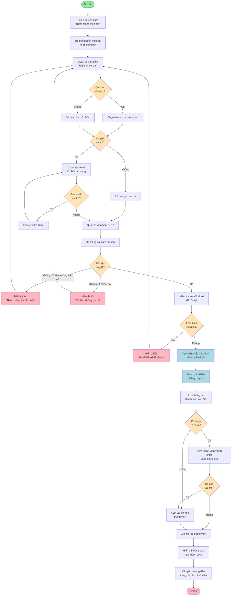
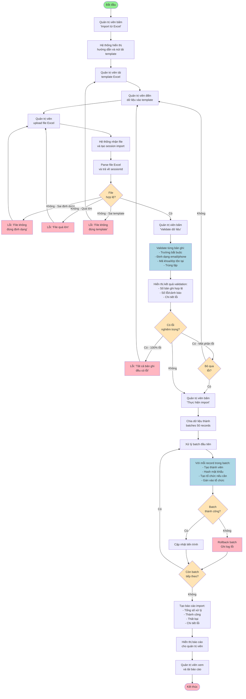
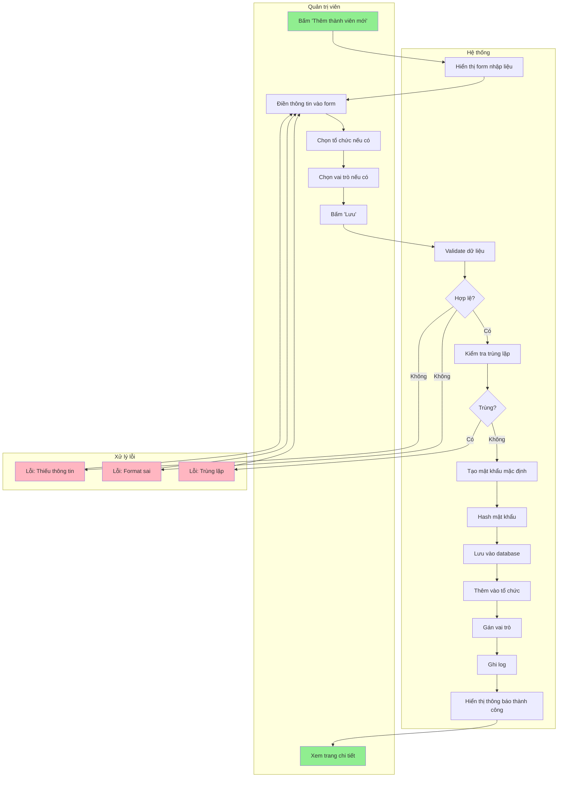

# Activity Diagram - Thêm Người Dùng

## Mô tả
Activity diagram mô tả quy trình thêm một thành viên mới vào hệ thống thông qua form nhập liệu.

---

## Activity Diagram - Thêm Một Thành Viên Bằng Form

---

## Activity Diagram - Thêm Nhiều Thành Viên Từ Excel (Server-side)

---

## Activity Diagram - Thêm Nhiều Thành Viên (Client-side Batch Processing)

```mermaid
graph TD
    Start([Bắt đầu]) --> C1[Quản trị viên bấm<br/>'Import từ Excel']
    
    C1 --> C2[Hệ thống hiển thị<br/>hướng dẫn]
    
    C2 --> C3[Quản trị viên tải<br/>template và điền dữ liệu]
    
    C3 --> C4[Upload file Excel]
    
    C4 --> C5[Frontend parse file<br/>trực tiếp trên client]
    
    C5 --> C6[Frontend validate<br/>cơ bản trên client]
    
    C6 --> C7[Hiển thị kết quả<br/>validation với phân trang]
    
    C7 --> C8[Quản trị viên xem<br/>và xác nhận dữ liệu]
    
    C8 --> C9[Cấu hình tùy chọn import:<br/>- Skip duplicates<br/>- Update existing]
    
    C9 --> C10[Quản trị viên bấm<br/>'Bắt đầu import']
    
    C10 --> C11[Frontend chia dữ liệu<br/>thành batches 200 records]
    
    C11 --> C12[Lấy batch đầu tiên]
    
    C12 --> C13[Gửi batch lên backend<br/>qua API /users/import/batch]
    
    C13 --> C14[Backend xử lý batch:<br/>- Validation server-side<br/>- Process sub-batches 50<br/>- Transaction management]
    
    C14 --> D1{Batch<br/>thành công?}
    
    D1 -->|Không| C15[Frontend retry<br/>lần 1]
    
    C15 --> D2{Thành công<br/>sau retry?}
    
    D2 -->|Không| C16[Retry lần 2]
    
    C16 --> D3{Thành công?}
    
    D3 -->|Không| C17[Retry lần 3]
    
    C17 --> D4{Thành công?}
    
    D4 -->|Không| C18[Ghi log batch thất bại<br/>Hiển thị cảnh báo]
    
    C18 --> D5
    
    D4 -->|Có| C19
    D3 -->|Có| C19
    D2 -->|Có| C19
    D1 -->|Có| C19[Cập nhật tiến trình:<br/>- Số batch xử lý/tổng<br/>- Số records thành công<br/>- Tỷ lệ %<br/>- Thời gian còn lại]
    
    C19 --> D5{Còn batch<br/>tiếp theo?}
    
    D5 -->|Có| C12
    
    D5 -->|Không| C20[Frontend gọi API<br/>lấy tổng kết session]
    
    C20 --> C21[Hiển thị báo cáo<br/>chi tiết]
    
    C21 --> C22[Quản trị viên xem<br/>và tải báo cáo]
    
    C22 --> End([Kết thúc])
    
    style Start fill:#90EE90
    style End fill:#FFB6C1
    style D1 fill:#FFE4B5
    style D2 fill:#FFE4B5
    style D3 fill:#FFE4B5
    style D4 fill:#FFE4B5
    style D5 fill:#FFE4B5
    style C5 fill:#87CEEB
    style C6 fill:#87CEEB
    style C11 fill:#87CEEB
    style C13 fill:#87CEEB
    style C14 fill:#ADD8E6
    style C15 fill:#FFA07A
    style C16 fill:#FFA07A
    style C17 fill:#FFA07A
    style C18 fill:#FFB6C1
```

---

## Swimlane Diagram - Thêm Thành Viên Bằng Form

---

## Giải thích các thành phần

### Decision Points (Decision Nodes)
- **Diamond shapes**: Các điểm quyết định trong flow
- Ví dụ: "Có chọn tổ chức?", "Dữ liệu hợp lệ?", "Email/Mã trùng lặp?"

### Activities (Action Nodes)
- **Rectangle shapes**: Các hoạt động/hành động
- Ví dụ: "Validate dữ liệu", "Lưu vào database", "Hash mật khẩu"

### Error Handling
- **Pink/Red nodes**: Các trường hợp lỗi và exception
- Flow quay về bước trước để sửa lỗi

### Key Features
1. **Validation**: Nhiều bước kiểm tra dữ liệu
2. **Security**: Hash mật khẩu trước khi lưu
3. **Auto-generation**: Tạo mật khẩu mặc định tự động
4. **Flexibility**: Hỗ trợ gán nhiều vai trò
5. **Error Recovery**: Cho phép sửa lỗi và thử lại

### Batch Processing Features
1. **Retry Logic**: Tự động retry tối đa 3 lần khi thất bại
2. **Progress Tracking**: Hiển thị tiến trình real-time
3. **Transaction Management**: Rollback khi batch thất bại
4. **Session Management**: Lưu trạng thái để tiếp tục sau

---

**Tài liệu Activity Diagram cho chức năng Thêm Người Dùng**

*Phiên bản: 1.0*  
*Ngày tạo: 19/12/2025*  
*Người tạo: GitHub Copilot*
