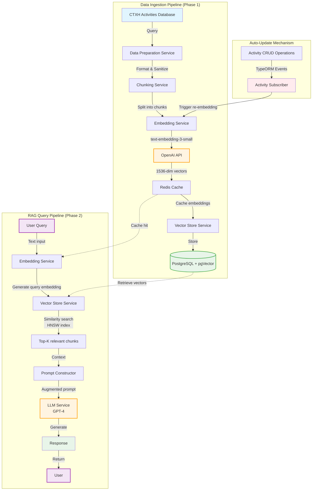
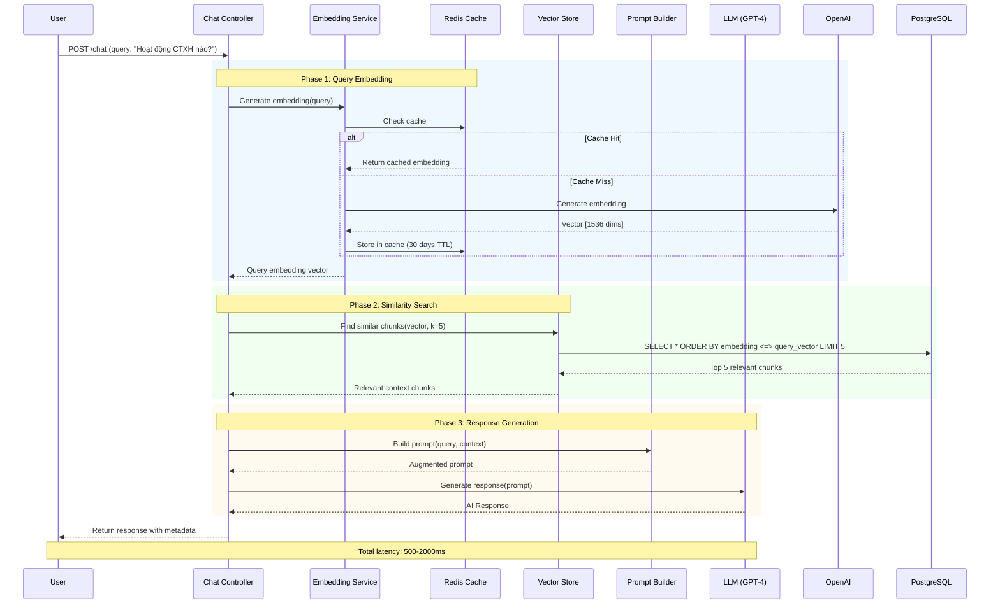

Optimizing tool selection...Dưới đây là sơ đồ kiến trúc chatbot RAG của hệ thống:

```mermaid
flowchart LR
    subgraph Input["📥 Input Layer"]
        Q[User Query]
    end
    
    subgraph Retrieval["🔍 Retrieval Layer"]
        E1[Embedding<br/>Generation]
        VS[Vector<br/>Similarity Search]
        RC[Redis Cache<br/>30 days TTL]
        
        E1 --> RC
        RC --> VS
    end
    
    subgraph Context["📚 Context Layer"]
        PG[(PostgreSQL<br/>pgVector)]
        TOP[Top-K<br/>Chunks<br/>k=5]
        
        PG --> TOP
    end
    
    subgraph Generation["🤖 Generation Layer"]
        PR[Prompt<br/>Construction]
        LLM[GPT-4<br/>LLM]
        FMT[Response<br/>Formatting]
        
        PR --> LLM --> FMT
    end
    
    subgraph Output["📤 Output Layer"]
        RESP[Response +<br/>Metadata]
    end
    
    Q --> E1
    VS --> PG
    TOP --> PR
    FMT --> RESP
    
    style Q fill:#e1bee7
    style E1 fill:#fff9c4
    style VS fill:#b2dfdb
    style PG fill:#c8e6c9
    style LLM fill:#ffccbc
    style RESP fill:#bbdefb
```

**Giải thích các thành phần:**

1. **Data Ingestion Pipeline (Phase 1)**: 
   - Xử lý dữ liệu CTXH → Chunking → Embedding → Vector Store

2. **RAG Query Pipeline (Phase 2)**:
   - Query → Embedding → Similarity Search → Context Retrieval → LLM → Response

3. **Auto-Update Mechanism**:
   - TypeORM Subscriber tự động cập nhật embeddings khi dữ liệu thay đổi

4. **Caching Layer**:
   - Redis cache embeddings để tăng tốc độ truy vấn