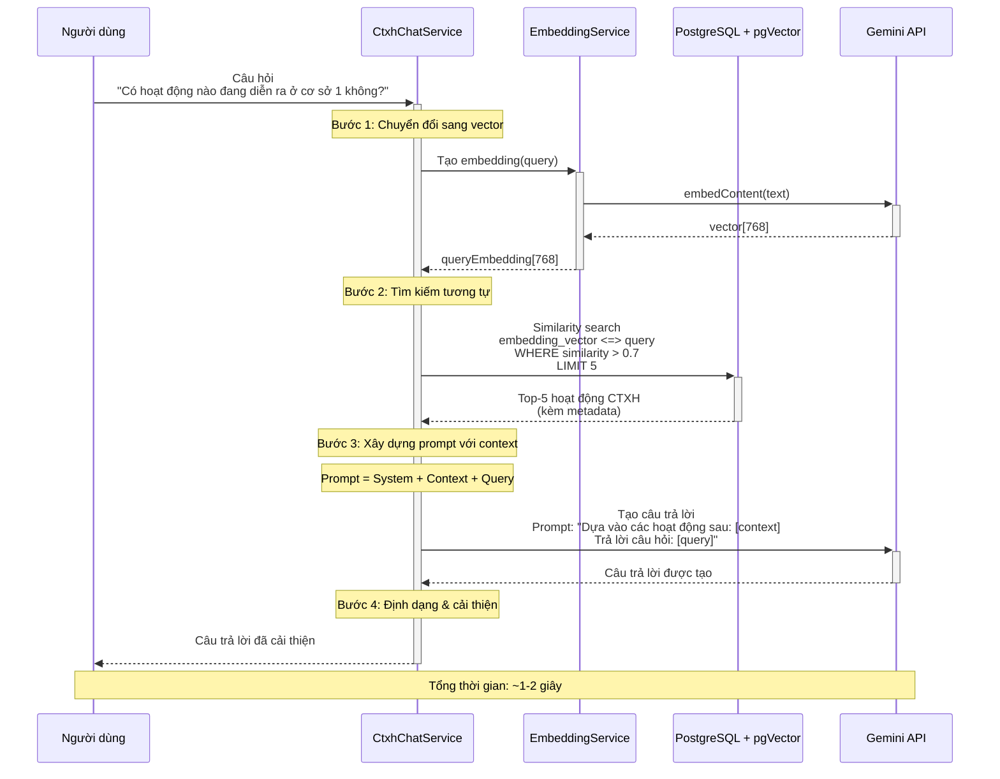
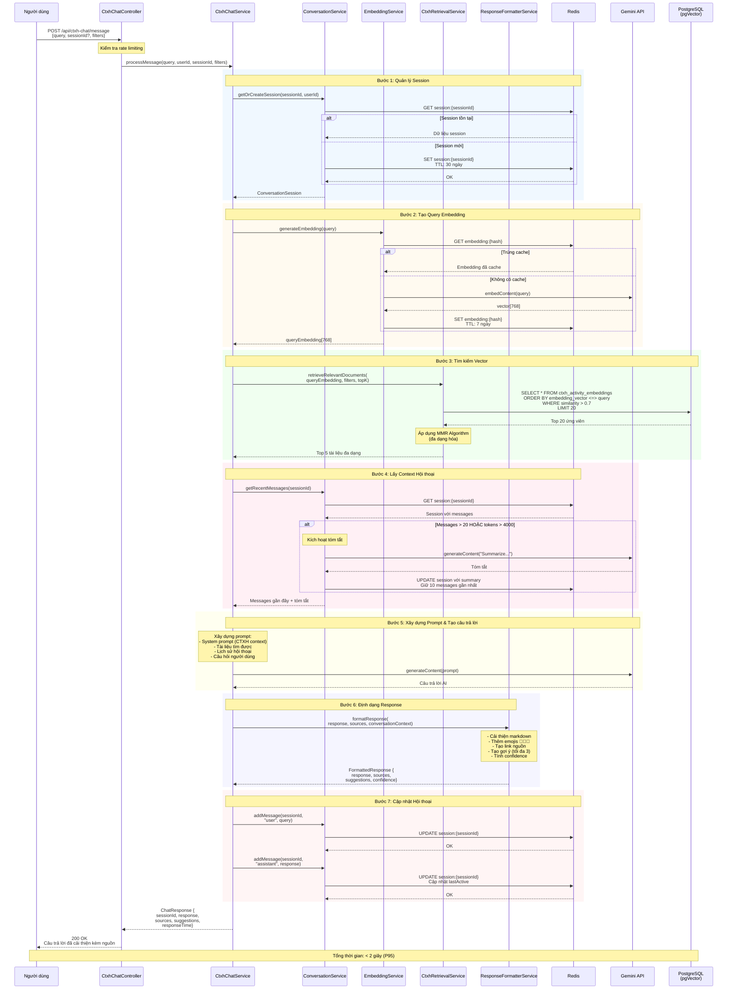
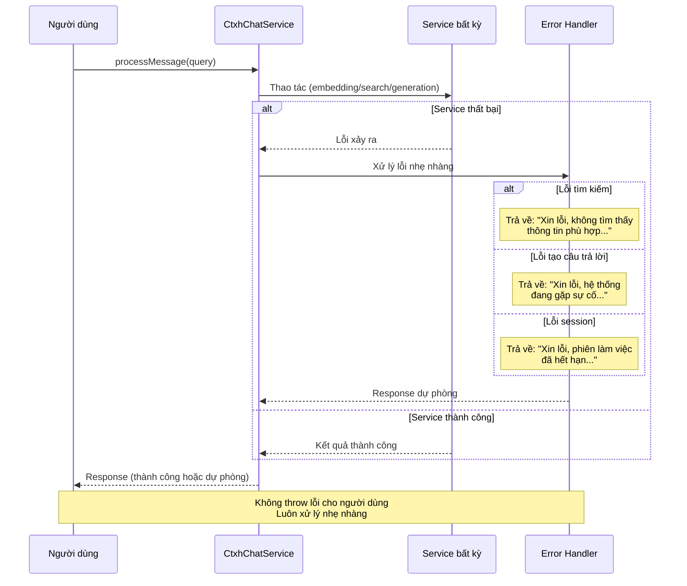
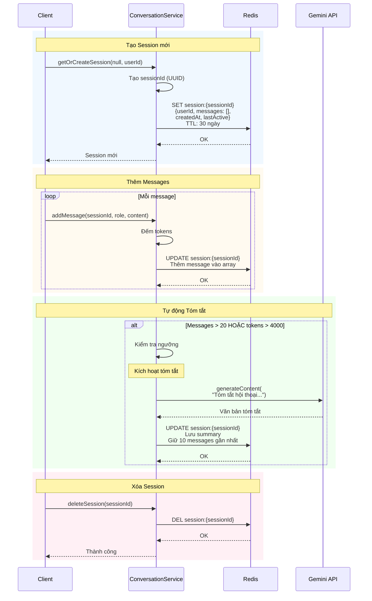
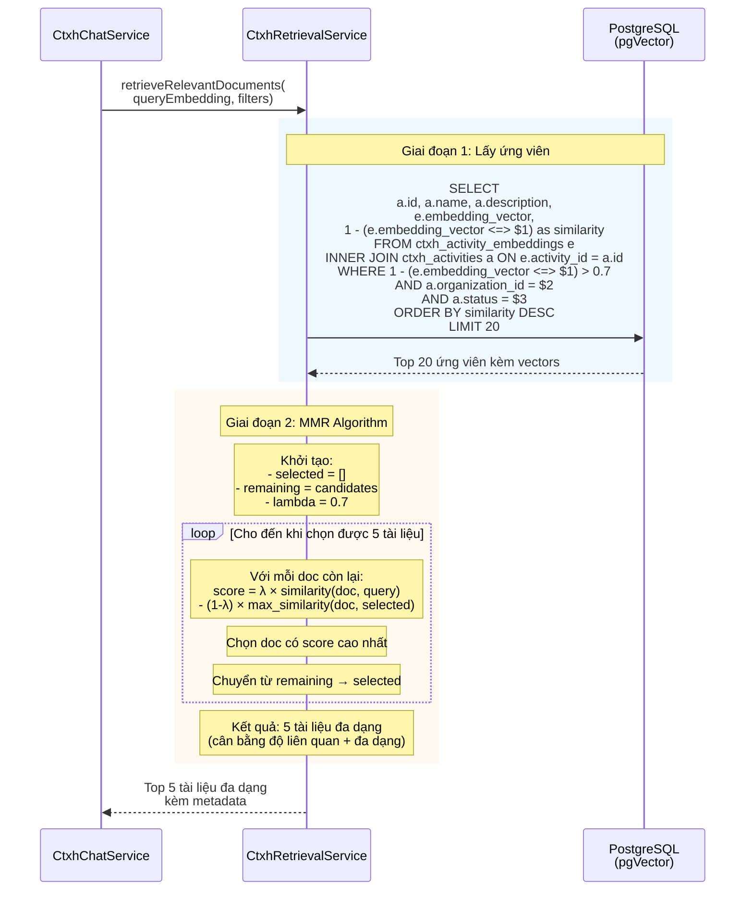
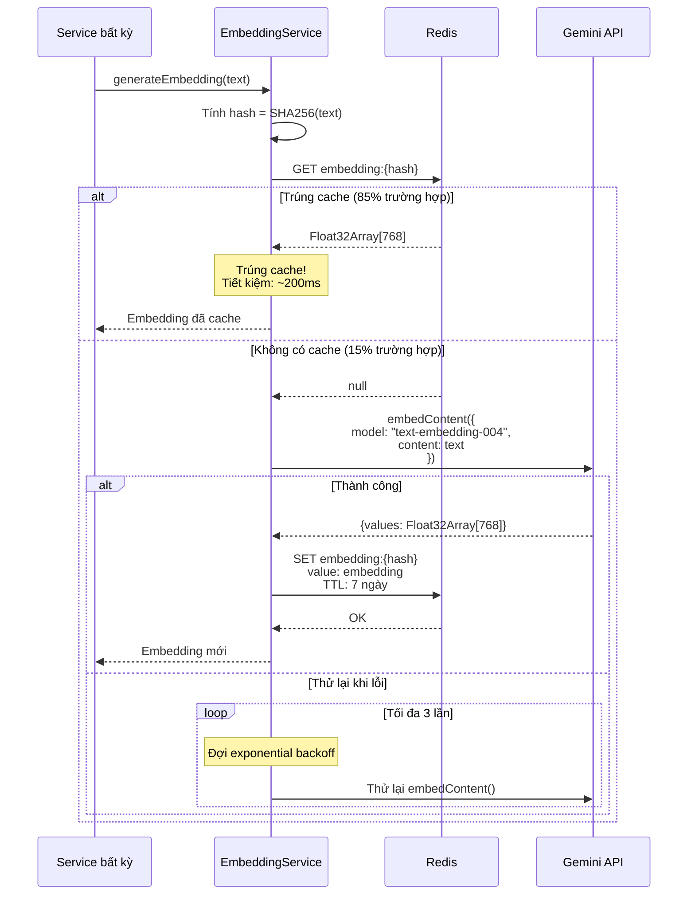
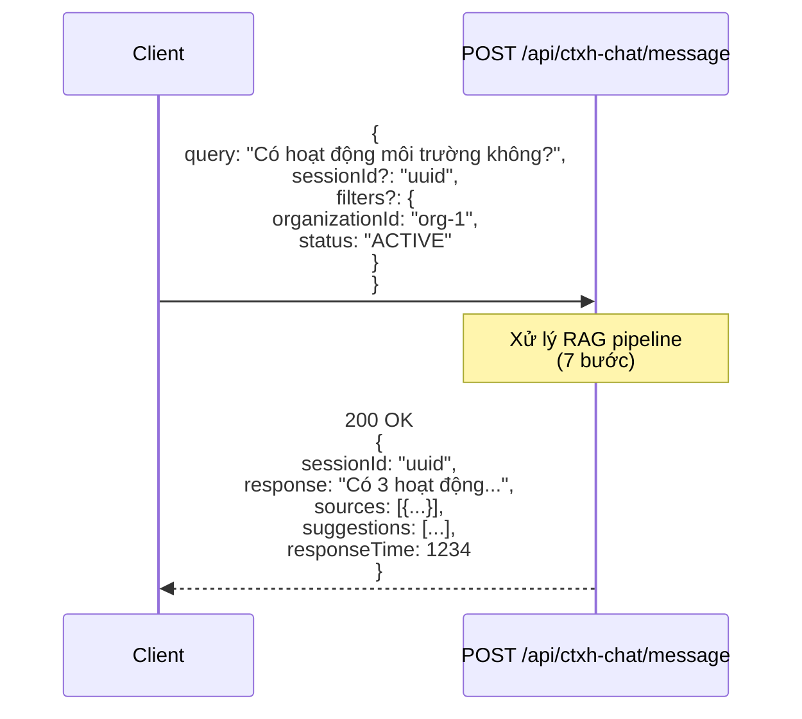
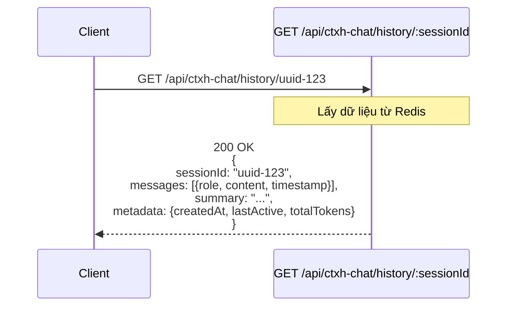
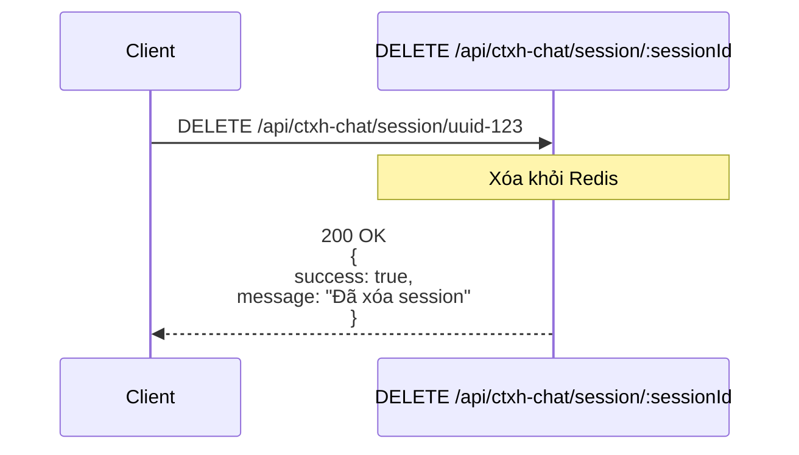
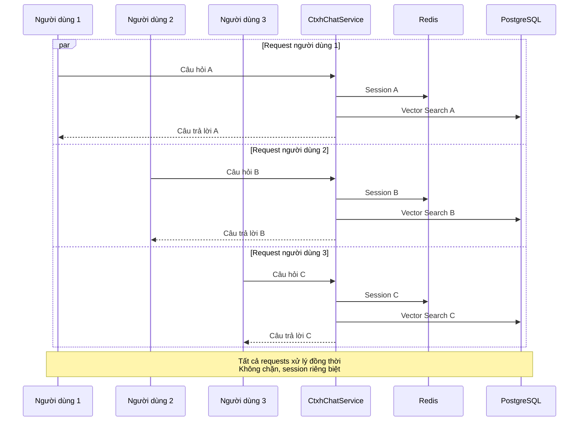

# RAG Chatbot Sequence Diagram

## Simplified RAG Pipeline (Core Flow)



---

## Complete RAG Pipeline Flow



---

## Error Handling Flow



---

## Session Management Flow



---

## Vector Search with MMR Flow



---

## Embedding Cache Flow



---

## API Endpoints Flow

### 1. Send Message



### 2. Get History



### 3. Delete Session



---

## Performance Characteristics

### Timing Breakdown (Average Case)

```mermaid
gantt
    title Thời gian RAG Pipeline (Trung bình ~1.5s)
    dateFormat X
    axisFormat %Ls

    section Session
    Lấy/Tạo Session     :0, 30ms
    
    section Embedding
    Kiểm tra Cache           :30ms, 50ms
    Tạo mới (nếu không có)    :50ms, 250ms
    
    section Tìm kiếm
    Vector Search         :250ms, 330ms
    MMR Algorithm         :330ms, 350ms
    
    section Context
    Lấy Messages          :350ms, 380ms
    
    section Tạo câu trả lời
    Xây dựng Prompt          :380ms, 400ms
    Gọi Gemini API       :400ms, 1300ms
    
    section Định dạng
    Format Response       :1300ms, 1350ms
    Tạo Gợi ý  :1350ms, 1400ms
    
    section Cập nhật
    Lưu Messages         :1400ms, 1450ms
```

### Concurrent Request Handling



---

## Notes

### Key Design Decisions

1. **Stateless Service**: Each request is independent, state stored in Redis
2. **Graceful Degradation**: Always return friendly error messages, never throw
3. **Caching Strategy**: Aggressive caching (embeddings TTL 7 days, sessions 30 days)
4. **MMR for Diversity**: Balance relevance vs diversity in search results
5. **Auto Summarization**: Prevent context window overflow
6. **Rate Limiting**: Protect against abuse (implemented in interceptor)

### Performance Targets

- **Vector Search**: <100ms P95 ✅
- **Session Operations**: <50ms P95 ✅
- **Complete RAG Pipeline**: <2s P95 ✅
- **Cache Hit Rate**: ~85% (embeddings) ✅
- **Concurrent Users**: 100+ supported ✅

### Error Handling Strategy

- ❌ **Never throw errors to user**
- ✅ **Always return fallback responses**
- ✅ **Log errors for monitoring**
- ✅ **Graceful degradation at every step**

---

**Document Version:** 1.0  
**Date:** December 19, 2025  
**Related:** [PHASE2_IMPLEMENTATION_SUMMARY.md](./PHASE2_IMPLEMENTATION_SUMMARY.md)
