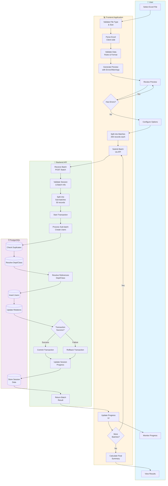
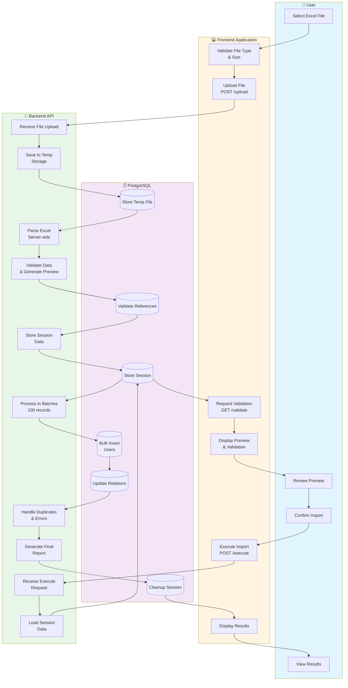
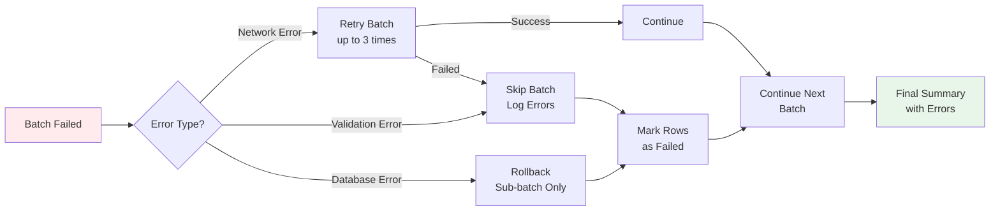
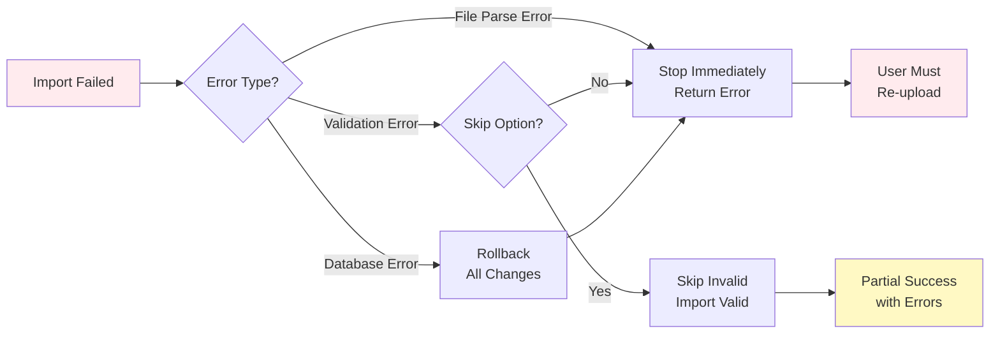
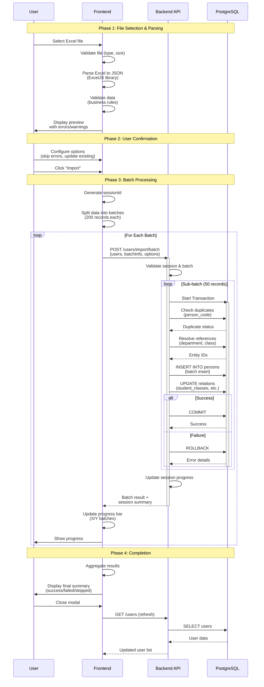
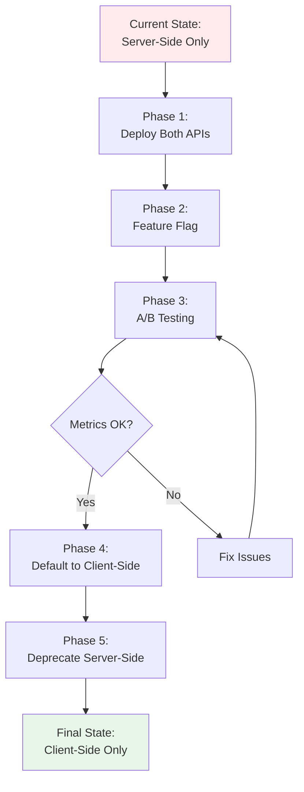

# ACTIVITY DIAGRAM - BATCH IMPORT SYSTEM

## 1. CLIENT-SIDE PROCESSING (NEW APPROACH)

### Swimlane Diagram



---

## 2. SERVER-SIDE PROCESSING (LEGACY APPROACH)

### Swimlane Diagram



---

## 3. DETAILED WORKFLOW COMPARISON

### Client-Side Processing Flow

| Phase | Actor | Actions | Duration |
|-------|-------|---------|----------|
| **1. File Selection** | User | Select Excel file from local storage | 1s |
| | Frontend | Validate file type (.xlsx, .xls, .csv) and size (<10MB) | <100ms |
| **2. Parsing** | Frontend | Parse Excel rows to JSON (ExcelJS library) | 1-3s for 10k rows |
| | Frontend | Progress bar: 0% → 100% during parsing | Real-time |
| **3. Validation** | Frontend | Validate each row (required fields, format, business rules) | 2-5s for 10k rows |
| | Frontend | Generate error/warning messages with row numbers | Real-time |
| | Frontend | Create preview data with validation results | <500ms |
| **4. Preview** | User | Review preview table with errors highlighted | Variable |
| | User | Filter: All rows / Errors only / Warnings only | Instant |
| | User | Configure options: Skip errors, Update existing | Variable |
| **5. Batch Submission** | Frontend | Split valid data into batches (200 records each) | <100ms |
| | Frontend | Generate unique sessionId | Instant |
| | Frontend | For each batch: POST /users/import/batch | 500ms-2s per batch |
| | Backend | Receive batch, validate session info | <50ms |
| | Backend | Split into sub-batches (50 records) | <10ms |
| | Backend | Process sub-batch in transaction | 200-500ms |
| | Backend | Resolve department/class references | 50-100ms |
| | Backend | Insert users with relationships | 100-300ms |
| | Backend | Update session progress | 10-20ms |
| | Backend | Return batch result + session summary | <50ms |
| | Frontend | Update progress bar: X/Y batches completed | Real-time |
| **6. Completion** | Frontend | Aggregate all batch results | <100ms |
| | Frontend | Display final summary (success/failed/skipped) | Instant |
| | User | Review results and close modal | Variable |

**Performance (10,000 records):**
- Parsing: ~2s
- Validation: ~3s
- Import: ~25-50s (50 batches × 500ms-1s)
- **Total: ~30-55s**

---

### Server-Side Processing Flow (Legacy)

| Phase | Actor | Actions | Duration |
|-------|-------|---------|----------|
| **1. File Upload** | User | Select Excel file | 1s |
| | Frontend | Validate file type and size | <100ms |
| | Frontend | Upload file via FormData: POST /users/import/upload | 2-5s for large file |
| | Backend | Receive multipart/form-data | Variable |
| | Backend | Save to temp storage (/tmp/uploads/) | 500ms-2s |
| | Backend | Generate sessionId | <10ms |
| | Backend | Return sessionId to frontend | <50ms |
| **2. Validation** | Frontend | Request validation: GET /users/import/:sessionId/validate | Auto-triggered |
| | Backend | Load file from temp storage | 200-500ms |
| | Backend | Parse Excel server-side (exceljs) | 2-5s for 10k rows |
| | Backend | Validate all rows (database queries for references) | 5-15s for 10k rows |
| | Backend | Generate preview data (first 100 rows) | 100-300ms |
| | Backend | Store session data in memory/Redis | 50-200ms |
| | Backend | Return validation result | 100-500ms |
| | Frontend | Display preview table with errors | Instant |
| **3. Confirmation** | User | Review preview, configure options | Variable |
| | User | Click "Import" button | Instant |
| **4. Execution** | Frontend | POST /users/import/:sessionId/execute | Triggered |
| | Backend | Load session data from storage | 100-500ms |
| | Backend | Process in batches (100 records per batch) | Variable |
| | Backend | For each batch: Start transaction | 10-20ms |
| | Backend | Insert users with duplicate handling | 200-800ms per batch |
| | Backend | Update department/class relationships | 100-300ms per batch |
| | Backend | Commit transaction | 50-150ms per batch |
| | Backend | Generate final report | 100-500ms |
| | Backend | Cleanup temp files and session | 100-300ms |
| | Backend | Return final result | <100ms |
| | Frontend | Display results modal | Instant |
| **5. Completion** | User | Review results and close | Variable |

**Performance (10,000 records):**
- Upload: ~3s
- Validation: ~10s
- Import: ~60-120s (100 batches × 600ms-1.2s)
- **Total: ~73-133s**

---

## 4. KEY DIFFERENCES

### Architecture Comparison

| Aspect | Client-Side (New) | Server-Side (Legacy) |
|--------|------------------|----------------------|
| **Parsing** | Frontend (ExcelJS) | Backend (ExcelJS) |
| **Validation** | Frontend (business logic) | Backend (database queries) |
| **File Upload** | No (only JSON) | Yes (entire file) |
| **Batch Size** | 200 records/API call | 100 records/transaction |
| **Sub-batching** | 50 records/transaction | None |
| **Session Storage** | Backend memory/Redis | Backend memory/file |
| **Progress Tracking** | Real-time per batch | Single operation |
| **Error Recovery** | Batch-level retry | All-or-nothing |
| **Network Overhead** | Higher (multiple API calls) | Lower (3 API calls total) |
| **Server Load** | Lower (offloaded parsing) | Higher (all processing) |
| **User Experience** | Better (instant preview) | Slower (wait for server) |

### Performance Metrics (10,000 records)

| Metric | Client-Side | Server-Side |
|--------|------------|-------------|
| **Total Time** | 30-55s | 73-133s |
| **Time to Preview** | 5s | 13s |
| **Import Duration** | 25-50s | 60-120s |
| **API Calls** | 51 (50 batches + 1 summary) | 3 (upload + validate + execute) |
| **Data Transfer** | ~2-5MB (JSON batches) | ~3-8MB (file upload) |
| **Server CPU** | Low (only DB ops) | High (parsing + validation) |
| **Frontend CPU** | High (parsing + validation) | Low (only UI rendering) |
| **Memory (Backend)** | Low (batch processing) | High (full dataset in memory) |
| **Memory (Frontend)** | Medium (parsed data) | Low (only preview) |

---

## 5. ERROR HANDLING & RECOVERY

### Client-Side Approach



### Server-Side Approach



---

## 6. SCALABILITY ANALYSIS

### Client-Side Processing Scalability

**Advantages:**
- ✅ **Linear scaling**: Each batch processed independently
- ✅ **Server load distribution**: Parsing offloaded to clients
- ✅ **Horizontal scaling**: Easy to add backend replicas
- ✅ **Concurrent sessions**: Multiple users can import simultaneously
- ✅ **Memory efficient**: Backend processes small batches

**Limitations:**
- ⚠️ **Client device dependency**: Slow devices affect parsing
- ⚠️ **Network overhead**: Many API calls for large files
- ⚠️ **Browser limits**: ~500MB file size limit in browser

**Recommended for:**
- Regular imports (10-10,000 records)
- Multiple concurrent users
- Cloud deployments with horizontal scaling

### Server-Side Processing Scalability

**Advantages:**
- ✅ **Consistent performance**: Not affected by client device
- ✅ **Fewer API calls**: Lower network overhead
- ✅ **Centralized validation**: Easier to maintain business rules

**Limitations:**
- ❌ **Memory bottleneck**: Full file in server memory
- ❌ **CPU bottleneck**: Server processes everything
- ❌ **Difficult scaling**: Vertical scaling required
- ❌ **Concurrent limit**: Limited by server resources

**Recommended for:**
- Large enterprise deployments (10,000+ records)
- Single-tenant installations
- High-spec servers with vertical scaling

---

## 7. SEQUENCE DIAGRAM - CLIENT-SIDE BATCH PROCESSING



---

## 8. USE CASE SCENARIOS

### Scenario 1: Small Import (100 records)

**Client-Side:**
1. User selects file (1s)
2. Frontend parses and validates instantly (0.5s)
3. Preview displayed (0.2s)
4. User confirms, 1 batch submitted (1s)
5. **Total: ~3s ✅**

**Server-Side:**
1. User selects file (1s)
2. Upload to server (2s)
3. Server parses and validates (3s)
4. Preview displayed (0.5s)
5. User confirms, execute import (5s)
6. **Total: ~12s ⚠️**

**Winner: Client-Side (4x faster)**

---

### Scenario 2: Large Import (27,000 records)

**Client-Side:**
1. Parsing: 5s
2. Validation: 8s
3. Preview: 1s
4. Import: 135 batches × 800ms = 108s
5. **Total: ~122s ✅**

**Server-Side:**
1. Upload: 8s
2. Server parsing: 15s
3. Validation: 45s (database lookups)
4. Preview: 2s
5. Import: 270 batches × 1.5s = 405s
6. **Total: ~475s ❌**

**Winner: Client-Side (3.9x faster)**

---

### Scenario 3: Network Issues

**Client-Side:**
- Batch 50/135 fails → Retry batch 50 (3 attempts)
- Other batches unaffected
- **Recovery: Partial data saved, retry failed batch**

**Server-Side:**
- Execute fails at record 5000 → Rollback all
- **Recovery: Re-upload entire file, start over**

**Winner: Client-Side (better resilience)**

---

## 9. MIGRATION STRATEGY



**Timeline:**
- Phase 1: 1 week (API development)
- Phase 2: 2 weeks (frontend integration)
- Phase 3: 4 weeks (testing with real users)
- Phase 4: 2 weeks (rollout to all users)
- Phase 5: 4 weeks (deprecation period)

**Total: 13 weeks**

---

## 10. RECOMMENDATIONS

### When to Use Client-Side Processing:
✅ Most common use case (80% of imports)
✅ File size: 10 - 10,000 records
✅ Multi-tenant SaaS deployments
✅ Users with modern browsers (Chrome 90+, Firefox 88+)
✅ Need real-time progress tracking

### When to Use Server-Side Processing:
✅ Enterprise deployments with high-spec servers
✅ Very large files (>10,000 records)
✅ Legacy browser support required
✅ Centralized audit logging needed
✅ Complex validation requiring external APIs

### Hybrid Approach (Recommended):
```typescript
function chooseImportMethod(fileSize: number, recordCount: number): 'client' | 'server' {
  // Use client-side for most cases
  if (recordCount < 10000 && fileSize < 5 * 1024 * 1024) {
    return 'client';
  }
  
  // Use server-side for very large imports
  return 'server';
}
```

---

**Kết luận:** Client-side processing với batch API mang lại hiệu suất tốt hơn, user experience tốt hơn, và khả năng mở rộng tốt hơn cho hầu hết các trường hợp sử dụng. Tuy nhiên, nên giữ lại server-side processing cho các trường hợp đặc biệt (files rất lớn, legacy browsers, enterprise requirements).
