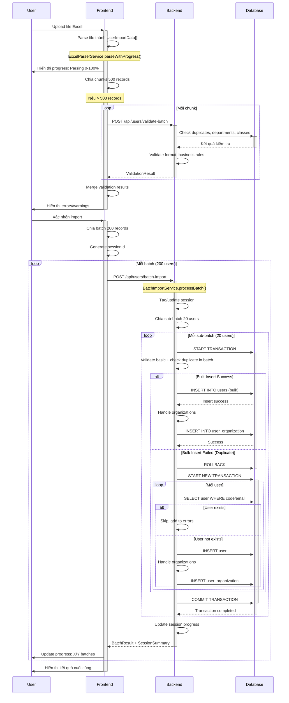

# Workflow Import Người Dùng Từ File Excel

## 📌 Tổng Quan

Chức năng import cho phép tải lên file Excel chứa danh sách người dùng và tự động thêm vào hệ thống theo từng batch.

**Giới hạn:**
- Kích thước batch: **200 người dùng/batch**
- Kích thước sub-batch: **20 người dùng/sub-batch** (xử lý trong transaction)
- Kích thước validate chunk: **500 người dùng/chunk**

---

## 🔄 Quy Trình Chính

```mermaid
flowchart TD
    Start([Bắt đầu]) --> Upload[Tải file Excel lên]
    Upload --> Parse[Parse Excel thành data]
    
    Parse --> CheckSize{Số lượng<br/>records?}
    CheckSize -->|≤ 500| ValidateSingle[Validate 1 lần]
    CheckSize -->|> 500| SplitValidate[Chia chunk 500 records]
    
    SplitValidate --> ValidateChunks[Validate từng chunk]
    ValidateChunks --> MergeValidation[Gộp kết quả validation]
    ValidateSingle --> ShowValidation[Hiển thị kết quả]
    MergeValidation --> ShowValidation
    
    ShowValidation --> UserCheck{User<br/>xác nhận?}
    UserCheck -->|Không| Cancel([Hủy bỏ])
    UserCheck -->|Có| SplitBatch[Chia batch 200 records]
    
    SplitBatch --> ProcessBatch[Xử lý từng batch]
    ProcessBatch --> CreateSession[Tạo sessionId]
    CreateSession --> SplitSubBatch[Chia sub-batch 20 records]
    
    SplitSubBatch --> Transaction[Mở Transaction]
    Transaction --> ValidateBasic[Validate cơ bản]
    ValidateBasic --> CheckDuplicate[Kiểm tra duplicate trong batch]
    
    CheckDuplicate --> BulkInsert{Bulk Insert}
    BulkInsert -->|Thành công| HandleOrg[Xử lý tổ chức]
    BulkInsert -->|Lỗi duplicate| ResetTx[Reset Transaction]
    
    ResetTx --> IndividualInsert[Insert từng user]
    IndividualInsert --> HandleOrg
    
    HandleOrg --> CommitTx[Commit Transaction]
    CommitTx --> MoreSubBatch{Còn sub-batch?}
    MoreSubBatch -->|Có| SplitSubBatch
    MoreSubBatch -->|Không| MoreBatch{Còn batch?}
    
    MoreBatch -->|Có| ProcessBatch
    MoreBatch -->|Không| Complete[Hoàn thành]
    Complete --> ShowResult[Hiển thị kết quả]
    ShowResult --> End([Kết thúc])
    
    style Start fill:#4caf50
    style End fill:#4caf50
    style Cancel fill:#f44336
    style BulkInsert fill:#ff9800
    style ResetTx fill:#f44336
    style Complete fill:#4caf50
```



---

## 📝 Chi Tiết Từng Bước

### **Bước 1: Parse File Excel**

**Frontend:** `ExcelParserService.parseWithProgress()`

```typescript
Input: File Excel
Process:
  1. Đọc file bằng xlsx library
  2. Lấy sheet đầu tiên
  3. Detect headers từ 10 dòng đầu
  4. Map headers theo alias (ví dụ: "MSSV" → "code")
  5. Parse từng dòng thành UserImportData
  6. Chuẩn hóa dữ liệu (giới tính, trạng thái)
Output: UserImportData[]
Progress: 0% → 100% (phần này chiếm 60% quá trình)
```

**Các trường được parse:**
- code, familyName, givenName (bắt buộc)
- email, phone, gender, birthDate
- className, managementDepartment, trainingDepartment
- admissionYear, curriculumYear, facultyCode
- trainingSystem, trainingLevel, identityCard

---

### **Bước 2: Validate Dữ Liệu**

**Frontend:** `BatchImportService.validateClientData()`

#### 2.1. Chia chunk để validate

```typescript
if (data.length ≤ 500) {
  // Validate 1 lần
  validateSingleChunk(data)
} else {
  // Chia chunk 500 records
  chunks = chunkArray(data, 500)
  for each chunk:
    validateSingleChunk(chunk)
    // Điều chỉnh row numbers cho đúng
}
```

#### 2.2. Gọi backend validate

**API:** `POST /api/users/validate-batch`

```typescript
Request: {
  users: UserImportData[],
  pagination: {
    errorPage: 1,
    errorLimit: 50,
    warningPage: 1,
    warningLimit: 50
  }
}
```

**Backend:** `ImportValidationService.validateBatch()`

```typescript
Process:
  1. Validate format (email, phone, ngày sinh)
  2. Kiểm tra duplicate code/email trong DB
  3. Kiểm tra tồn tại:
     - Department (managementDepartment, trainingDepartment)
     - Class (className)
  4. Validate business rules
  5. Phân loại: valid, errors, warnings
Response: {
  isValid: boolean,
  data: ValidUser[],
  errors: ValidationError[],
  warnings: ValidationError[],
  summary: {
    total, valid, invalid, duplicates
  }
}
```

#### 2.3. Merge kết quả validation

```typescript
Process:
  1. Gộp data từ các chunks
  2. Điều chỉnh row numbers:
     - Backend trả về row từ 2 (Excel row)
     - Thêm chunk offset để có row number chính xác
  3. Tổng hợp summary
Output: Hiển thị errors/warnings cho user
```

---

### **Bước 3: Chia Batch và Import**

**Frontend:** `BatchImportService.submitClientData()`

#### 3.1. Chia batch 200 records

```typescript
batches = chunkArray(data, 200)
sessionId = generateSessionId()

for each batch:
  batchNumber = i + 1
  processBatch(batch, batchNumber, totalBatches)
```

#### 3.2. Xử lý từng batch

**API:** `POST /api/users/batch-import`

```typescript
Request: {
  users: UserImportDto[],  // 200 users max
  options: {
    skipDuplicates: true,
    updateExisting: false
  },
  batchInfo: {
    sessionId,
    batchNumber,
    totalBatches
  }
}
```

**Backend:** `BatchImportService.processBatch()`

```typescript
Process:
  1. Validate batch size ≤ 200
  2. Tạo hoặc update session trong cache
  3. Chia sub-batches (20 users/sub-batch)
  4. Xử lý từng sub-batch trong transaction
  5. Aggregate kết quả
  6. Update session progress
Response: {
  success: boolean,
  batchResult: {
    processed, successful, failed, errors[]
  },
  sessionSummary: {
    totalProcessed, totalSuccessful, totalFailed
  }
}
```

---

### **Bước 4: Xử Lý Sub-Batch**

**Backend:** `BatchImportService.processSubBatch()`

#### 4.1. Validation trong sub-batch

```typescript
for each user in sub-batch:
  1. Check required fields (code, familyName, givenName)
  2. Check duplicate code trong batch (Set)
  3. Check duplicate email trong batch (Set)
  
  if hasErrors:
    result.failed++
    result.errors.push(errorMessage)
  else:
    validUsers.push(user)
```

#### 4.2. Bulk Insert

```typescript
try {
  // Tạo User entities
  userEntities = createUserEntitiesDirectly(validUsers)
  
  // Bulk insert vào DB
  insertResult = await queryRunner.manager.insert(User, userEntities)
  
  // Xử lý organizations
  for each insertedUser:
    if (className && trainingDepartment):
      handleClassOrganizationCreation()
  
  result.successful += userEntities.length
  
} catch (bulkError) {
  // Xử lý duplicate constraint error
}
```

#### 4.3. Xử lý lỗi duplicate key

```typescript
if (bulkError.message.includes('duplicate key')) {
  // Reset transaction
  await resetTransactionSafely(queryRunner)
  
  // Insert từng user
  for each user in validUsers:
    // Check existing
    existingUser = findOne({ code or email })
    
    if (existingUser):
      result.failed++
      result.errors.push("User already exists")
    else:
      // Insert individual
      savedUser = await save(user)
      
      // Handle organizations
      if (className && trainingDepartment):
        handleClassOrganizationCreation()
      
      result.successful++
}
```

#### 4.4. Reset Transaction

**Quan trọng:** Khi bulk insert lỗi, cần reset transaction trước khi insert individual

```typescript
resetTransactionSafely(queryRunner):
  1. Rollback transaction hiện tại
  2. Release queryRunner
  3. Tạo queryRunner mới
  4. Start transaction mới
```

---

### **Bước 5: Xử Lý Tổ Chức**

**Backend:** `handleClassOrganizationCreation()`

Tự động tạo và gán user vào tổ chức theo lớp:

```typescript
Process:
  1. Tạo/lấy tổ chức level 2 (Liên chi đoàn/Liên chi hội)
  2. Tạo/lấy tổ chức level 3 (Chi đoàn/Chi hội lớp)
  3. Lấy tổ chức level 1 (Đoàn trường/Hội sinh viên)
  
  4. Gán user vào TẤT CẢ các tổ chức:
     - Level 1: Đoàn trường, Hội sinh viên
     - Level 2: Liên chi đoàn khoa, Liên chi hội khoa
     - Level 3: Chi đoàn lớp, Chi hội lớp
  
  5. Role: MEMBER cho tất cả
```

**Logic tạo tổ chức:**
- Nếu className bắt đầu bằng CC/CN/CT/TT → Khoa "Văn Phòng Đào Tạo Quốc Tế"
- Ngược lại → Lấy từ trainingDepartment code

---

## 📊 Session Management

### Session Cache

```typescript
SessionData {
  sessionId: string,
  totalRecords: number,
  processedRecords: number,
  successfulRecords: number,
  failedRecords: number,
  errors: string[],
  startTime: Date,
  endTime?: Date,
  expectedBatches: number,
  completedBatches: number,
  isComplete: boolean
}
```

### Cập nhật session

```typescript
updateSessionProgress(sessionId, batchResult, isLastBatch):
  1. Get session from cache
  2. Update counters:
     - processedRecords += batchResult.processed
     - successfulRecords += batchResult.successful
     - failedRecords += batchResult.failed
     - errors.push(...batchResult.errors)
     - completedBatches++
  3. If isLastBatch:
     - isComplete = true
     - endTime = now
```

---

## 🔍 Luồng Xử Lý Chi Tiết



---

## ⚙️ Các Tham Số Quan Trọng

| Tham số | Giá trị | Mục đích |
|---------|---------|----------|
| BATCH_SIZE | 200 | Số lượng user tối đa mỗi batch gửi lên server |
| SUB_BATCH_SIZE | 20 | Số lượng user xử lý trong 1 transaction |
| VALIDATION_CHUNK_SIZE | 500 | Số lượng user validate cùng lúc |
| ERROR_LIMIT | 50 | Số lượng errors tối đa trả về |
| WARNING_LIMIT | 50 | Số lượng warnings tối đa trả về |

---

## 🎯 Kết Quả Import

### Frontend hiển thị:

```typescript
{
  success: boolean,
  sessionSummary: {
    totalProcessed: number,
    totalSuccessful: number,
    totalFailed: number,
    isComplete: boolean
  },
  errors: string[]
}
```

### Message logic:

```typescript
if (totalSuccessful > 0 && totalFailed === 0):
  "Import thành công. {totalSuccessful} người dùng đã được thêm."
  
else if (totalSuccessful > 0 && totalFailed > 0):
  "Import hoàn thành với một số lỗi. {totalSuccessful} thành công, {totalFailed} thất bại."
  
else:
  "Import thất bại. Không có người dùng nào được thêm thành công."
```

---

## 🔴 Xử Lý Lỗi

### Các loại lỗi:

1. **Parse Error**: File không đúng định dạng, không có header
2. **Validation Error**: Dữ liệu không hợp lệ (email sai, thiếu trường bắt buộc)
3. **Duplicate Error**: User đã tồn tại trong DB
4. **Transaction Error**: Lỗi khi insert vào DB
5. **Organization Error**: Không tạo được tổ chức (không ảnh hưởng đến import user)

### Strategy xử lý:

- **Bulk insert fail** → Reset transaction → Insert individual
- **Organization creation fail** → Log warning, tiếp tục import user
- **Validation fail** → Skip user, thêm vào errors[], tiếp tục với user khác
- **Batch fail** → Log error, tiếp tục với batch tiếp theo

---

## 💡 Điểm Quan Trọng

1. **Transaction Safety**: 
   - Mỗi sub-batch chạy trong 1 transaction riêng
   - Khi bulk insert fail do duplicate, phải reset transaction trước khi insert individual

2. **Progress Tracking**:
   - Frontend track progress theo batch (X/Y batches)
   - Backend track theo session (total processed/successful/failed)

3. **Validation 2 Lần**:
   - Lần 1: Frontend gọi validate-batch endpoint trước khi import
   - Lần 2: Backend validate lại trong processSubBatch (basic + duplicate in batch)

4. **Organization Auto-Creation**:
   - Tự động tạo 3 level tổ chức (Trường → Khoa → Lớp)
   - User được gán vào tất cả 3 level
   - Lỗi organization không làm fail import user

5. **Duplicate Handling**:
   - Check duplicate trong batch (Set)
   - Check duplicate trong DB (query)
   - Skip duplicate, thêm vào errors

---

**📅 Document Version:** 1.0  
**🗓️ Last Updated:** 02/11/2025
