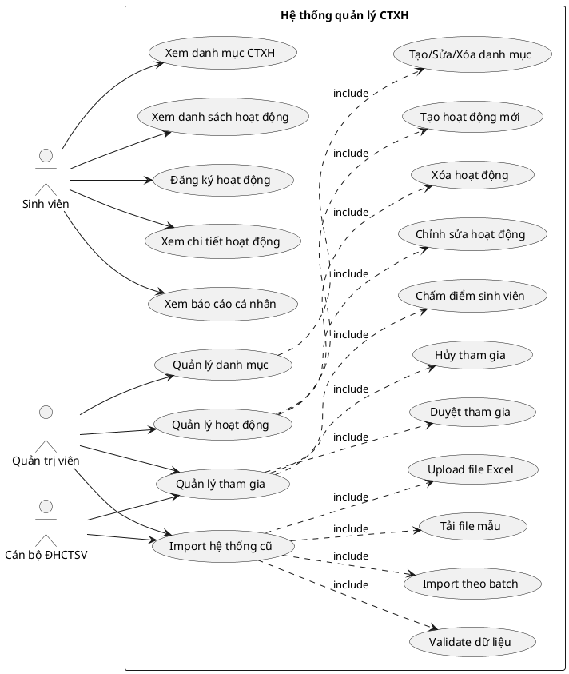
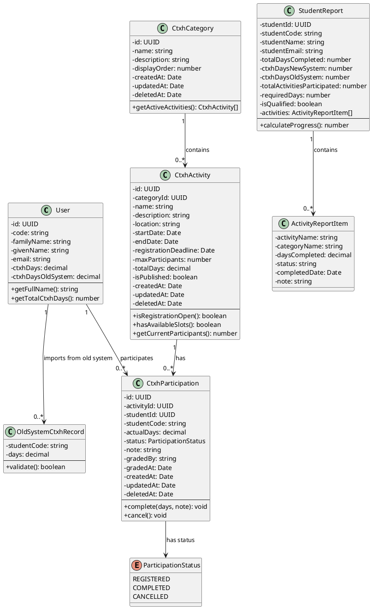
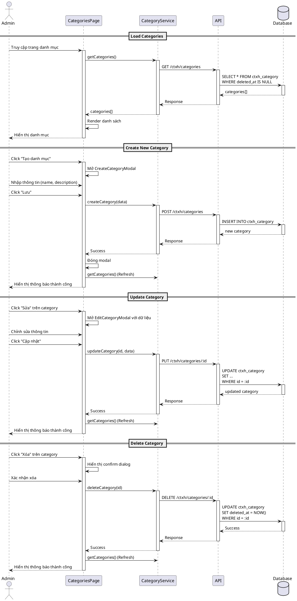
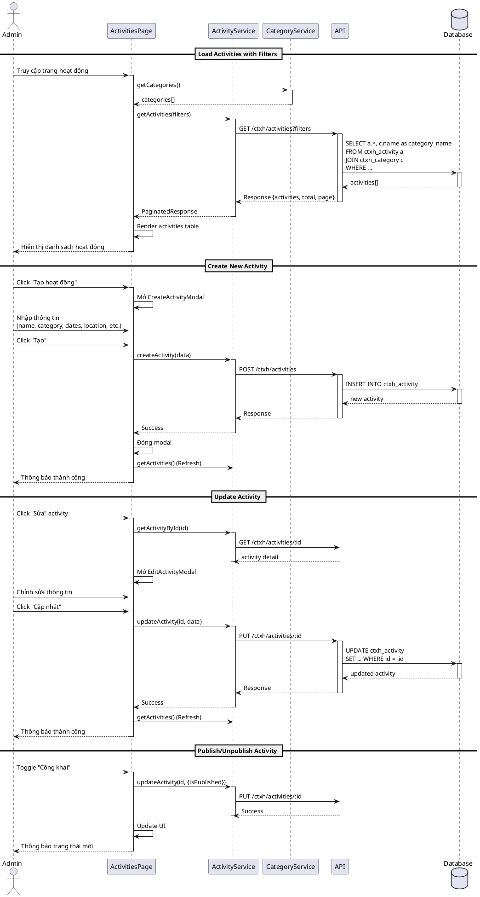
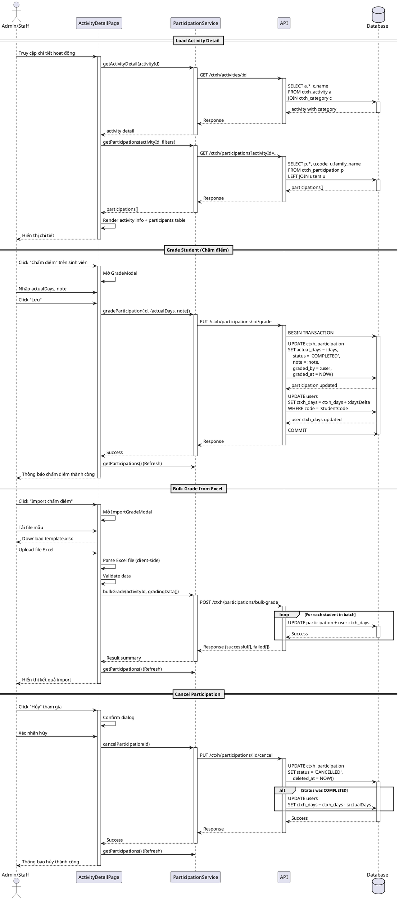
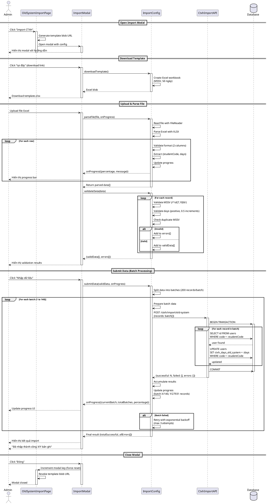
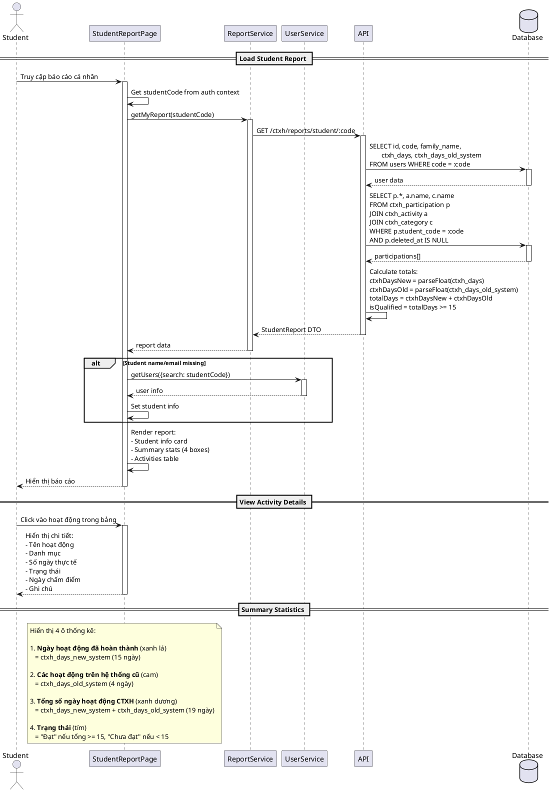
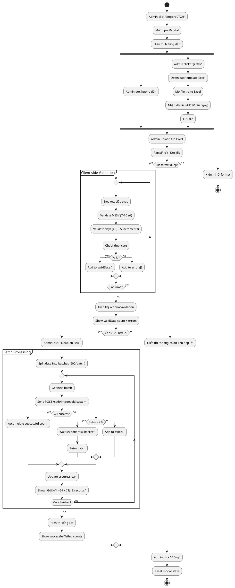
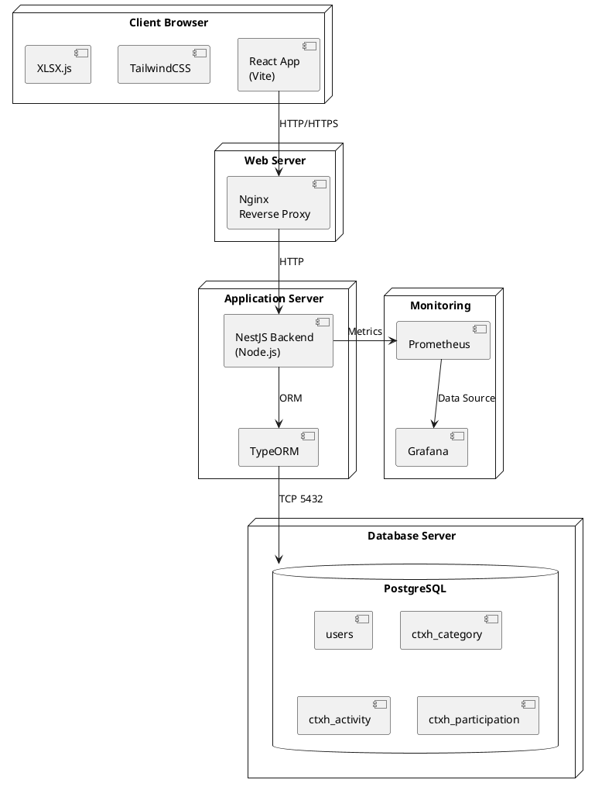

# CTXH System UML Diagrams

## 1. Use Case Diagram - Tổng quan hệ thống

## 2. Class Diagram - Cấu trúc dữ liệu

## 3. Sequence Diagram - Page: Category Management

## 4. Sequence Diagram - Page: Activity Management

## 5. Sequence Diagram - Page: Activity Detail (Participation)

## 6. Sequence Diagram - Page: Import Old System

## 7. Sequence Diagram - Page: Student Report

## 8. Activity Diagram - Import Old System Process

## 9. Component Diagram - Frontend Architecture

```plantuml
@startuml CTXH Frontend Components
package "Frontend - React Application" {
  
  package "Pages" {
    [CategoriesPage]
    [ActivitiesPage]
    [ActivityDetailPage]
    [OldSystemImportPage]
    [StudentReportPage]
  }
  
  package "Components" {
    package "Category" {
      [CategoryCard]
      [CreateCategoryModal]
      [EditCategoryModal]
    }
    
    package "Activity" {
      [ActivityCard]
      [CreateActivityModal]
      [EditActivityModal]
      [ActivityFilters]
    }
    
    package "Participation" {
      [ParticipationTable]
      [GradeModal]
      [BulkGradeModal]
    }
    
    package "Import" {
      [ImportModal]
      [ProgressBar]
      [ValidationResults]
    }
    
    package "Report" {
      [StudentInfoCard]
      [SummaryStats]
      [ActivitiesTable]
    }
  }
  
  package "Services" {
    [CategoryService]
    [ActivityService]
    [ParticipationService]
    [CtxhImportService]
    [ReportService]
  }
  
  package "Config" {
    [oldSystemImportConfig]
  }
  
  package "API Client" {
    [axiosInstance]
    [authInterceptor]
  }
}

' Page -> Component relationships
[CategoriesPage] --> [CategoryCard]
[CategoriesPage] --> [CreateCategoryModal]
[CategoriesPage] --> [EditCategoryModal]

[ActivitiesPage] --> [ActivityCard]
[ActivitiesPage] --> [ActivityFilters]
[ActivitiesPage] --> [CreateActivityModal]

[ActivityDetailPage] --> [ParticipationTable]
[ActivityDetailPage] --> [GradeModal]
[ActivityDetailPage] --> [BulkGradeModal]

[OldSystemImportPage] --> [ImportModal]
[ImportModal] --> [ProgressBar]
[ImportModal] --> [ValidationResults]

[StudentReportPage] --> [StudentInfoCard]
[StudentReportPage] --> [SummaryStats]
[StudentReportPage] --> [ActivitiesTable]

' Service relationships
[CategoriesPage] --> [CategoryService]
[ActivitiesPage] --> [ActivityService]
[ActivityDetailPage] --> [ParticipationService]
[OldSystemImportPage] --> [oldSystemImportConfig]
[oldSystemImportConfig] --> [CtxhImportService]
[StudentReportPage] --> [ReportService]

' All services use API client
[CategoryService] --> [axiosInstance]
[ActivityService] --> [axiosInstance]
[ParticipationService] --> [axiosInstance]
[CtxhImportService] --> [axiosInstance]
[ReportService] --> [axiosInstance]

[axiosInstance] --> [authInterceptor]

@enduml
```

## 10. Deployment Diagram - System Architecture

## Hướng dẫn sử dụng

### 1. Cài đặt PlantUML

**VS Code Extension:**
- Cài đặt extension "PlantUML" by jebbs
- Cài đặt Java Runtime (nếu chưa có)
- Cài đặt Graphviz (để render)

**Online:**
- Truy cập: http://www.plantuml.com/plantuml/uml/
- Copy/paste code vào để xem diagram

### 2. Xem diagram trong VS Code

1. Mở file này
2. Đặt con trỏ vào block code PlantUML
3. Press `Alt+D` để preview
4. Hoặc right-click → "Preview Current Diagram"

### 3. Export diagram

- Right-click trên preview → "Export Current Diagram"
- Chọn format: PNG, SVG, PDF, etc.

## Giải thích các diagram

### Use Case Diagram
Mô tả các tính năng chính và actor tương tác với hệ thống.

### Class Diagram
Cấu trúc dữ liệu và mối quan hệ giữa các entity.

### Sequence Diagrams (5 pages)
Chi tiết luồng tương tác giữa frontend-backend-database cho từng trang:
- Category Management: CRUD danh mục
- Activity Management: Quản lý hoạt động với filters
- Activity Detail: Chấm điểm, bulk grade, cancel
- Import Old System: Parse Excel, validate, batch processing với progress
- Student Report: Load báo cáo với tính toán tổng số ngày

### Activity Diagram
Luồng xử lý import với validation và batch processing.

### Component Diagram
Kiến trúc frontend với pages, components, services.

### Deployment Diagram
Cấu trúc deployment của hệ thống (Frontend, Backend, Database, Monitoring).
