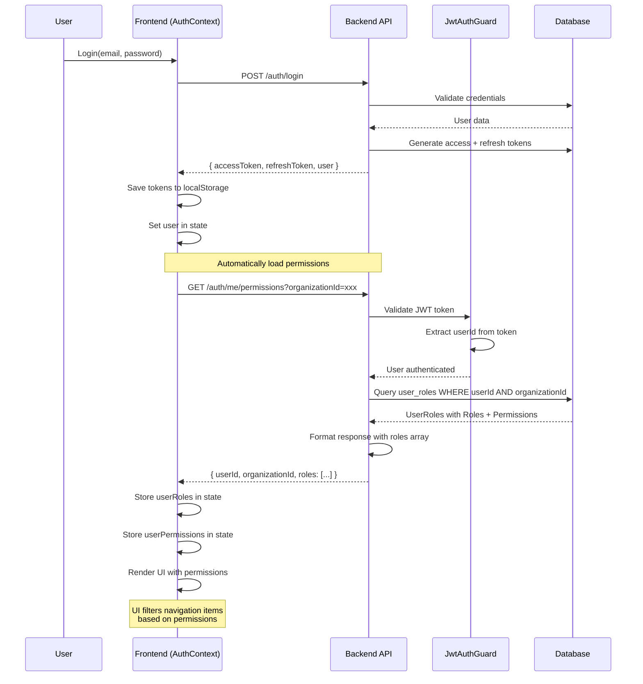
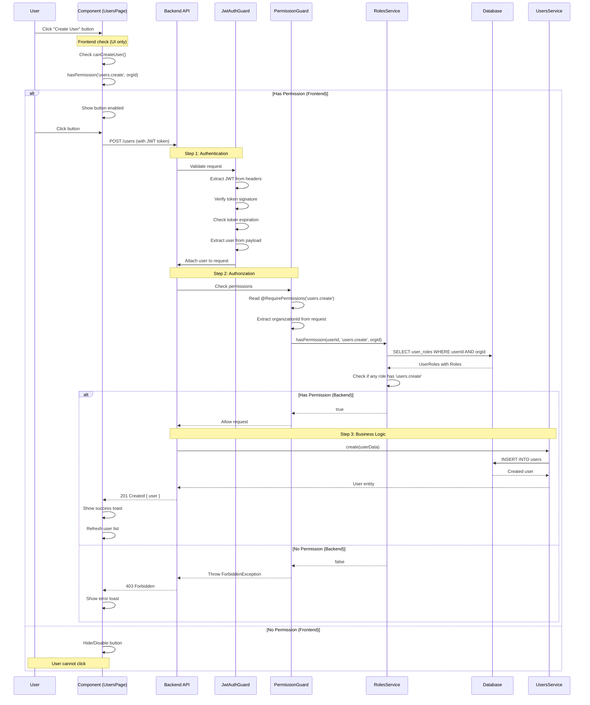
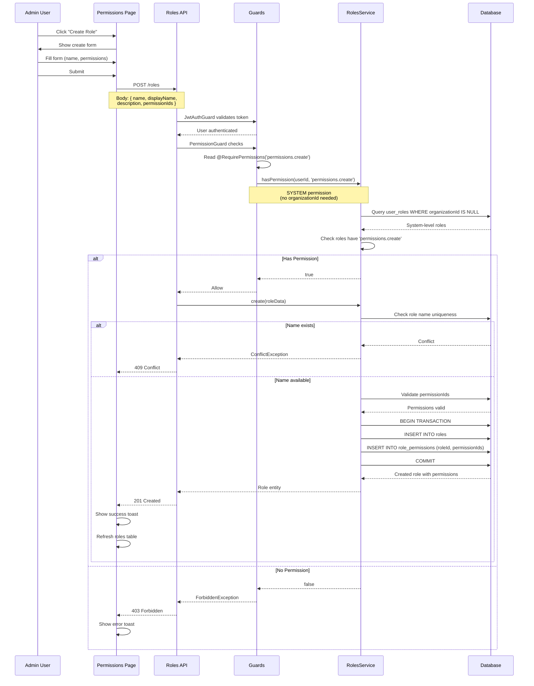
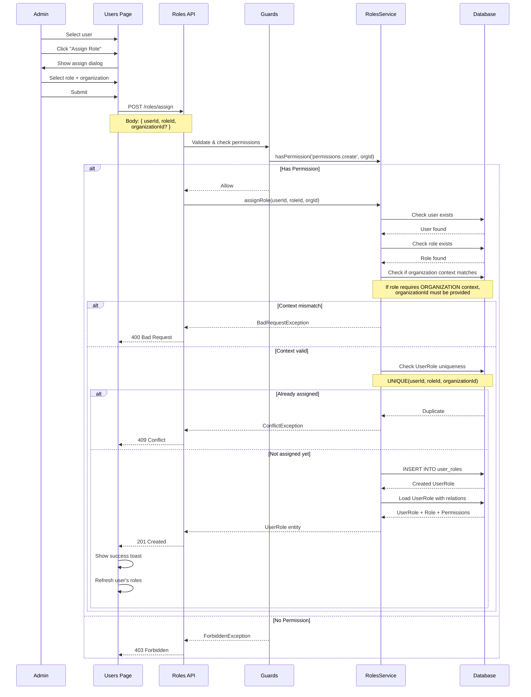
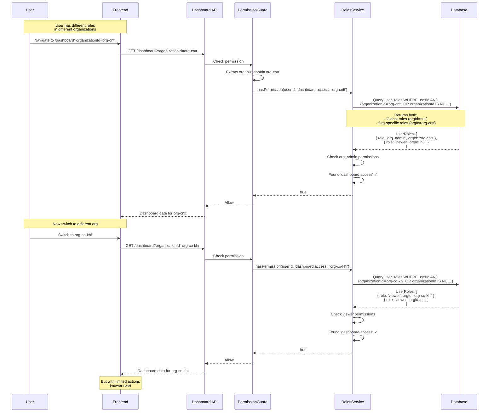
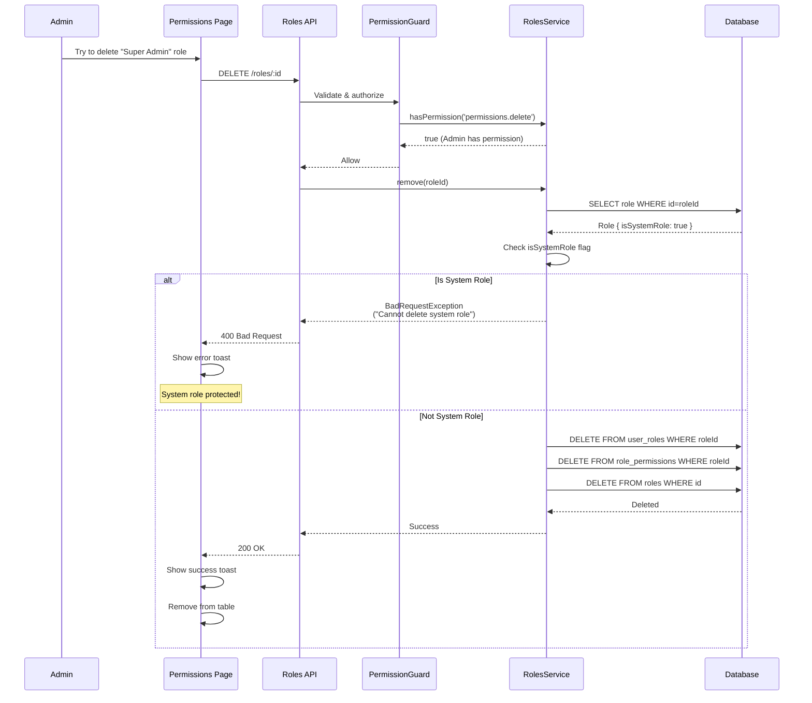
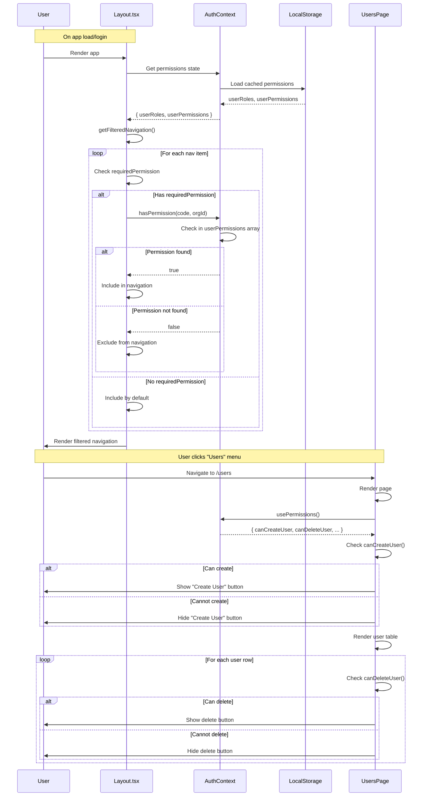
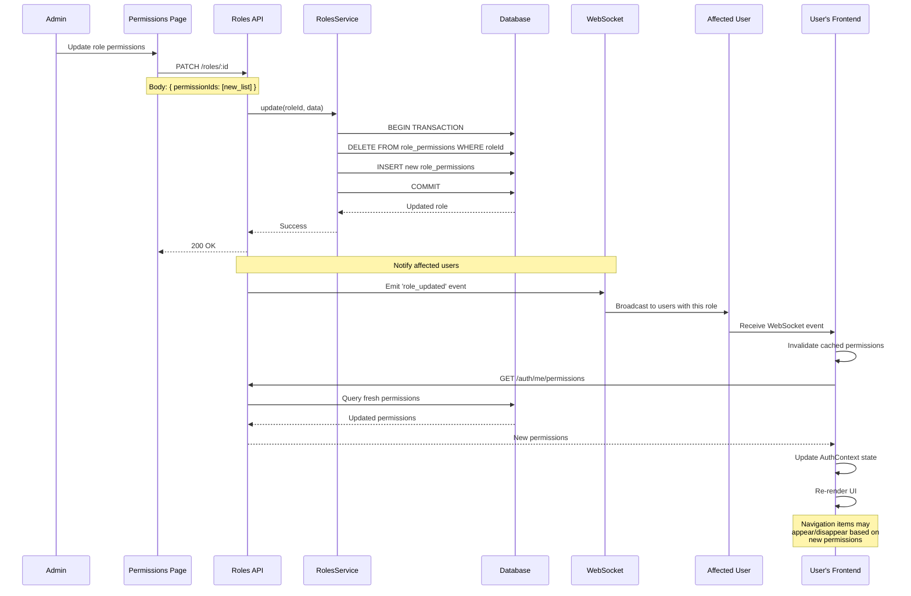

# 🔐 Cơ Chế Phân Quyền (Authorization Mechanism)

## 📋 Mục Lục
- [Tổng Quan](#tổng-quan)
- [Kiến Trúc Phân Quyền](#kiến-trúc-phân-quyền)
- [Các Thành Phần Chính](#các-thành-phần-chính)
- [Luồng Hoạt Động](#luồng-hoạt-động)
- [Phân Quyền Theo Context](#phân-quyền-theo-context)
- [Ví Dụ Thực Tế](#ví-dụ-thực-tế)
- [Best Practices](#best-practices)

---

## 🎯 Tổng Quan

Hệ thống sử dụng **Role-Based Access Control (RBAC)** với **Context-Aware Permissions** để quản lý quyền truy cập.

### Đặc Điểm Chính:
- ✅ **Multi-Context**: Phân quyền theo cấp hệ thống (SYSTEM) hoặc tổ chức (ORGANIZATION)
- ✅ **Hierarchical**: Hỗ trợ cấu trúc tổ chức dạng cây (closure table)
- ✅ **Flexible**: User có thể có nhiều role khác nhau ở các organization khác nhau
- ✅ **Granular**: Kiểm soát chi tiết đến từng action (create, read, update, delete)

---

## 🏗️ Kiến Trúc Phân Quyền

### Sơ Đồ Quan Hệ Entities

```
┌─────────────┐         ┌──────────────┐         ┌─────────────┐
│    User     │────┐    │  UserRole    │    ┌────│    Role     │
│             │    │    │              │    │    │             │
│ - id        │    └───>│ - userId     │<───┘    │ - id        │
│ - email     │         │ - roleId     │         │ - name      │
│ - name      │         │ - orgId      │         │ - isSystem  │
└─────────────┘         │ - isActive   │         └─────────────┘
                        └──────────────┘                │
                               │                        │
                               │                        │ Many-to-Many
                               │                        │
                               │                        ▼
                        ┌──────────────┐         ┌─────────────┐
                        │Organization  │         │ Permission  │
                        │              │         │             │
                        │ - id         │         │ - code      │
                        │ - name       │         │ - context   │
                        │ - parentId   │         │ - category  │
                        └──────────────┘         └─────────────┘
```

### Database Schema

```sql
-- 1. Permission: Định nghĩa các quyền cơ bản
permissions
├── id (UUID)
├── code (UNIQUE) ──────────── 'users.create', 'organizations.access'
├── name ───────────────────── 'Cho phép tạo người dùng'
├── description
├── category ──────────────── 'users', 'organizations', 'dashboard'
├── context (ENUM) ────────── 'SYSTEM' | 'ORGANIZATION'
├── isActive
└── sortOrder

-- 2. Role: Nhóm các permissions lại
roles
├── id (UUID)
├── name (UNIQUE) ─────────── 'super_admin', 'org_admin', 'viewer'
├── displayName ───────────── 'Quản trị viên hệ thống'
├── description
├── isSystemRole ──────────── true cho Super Admin
└── isActive

-- 3. role_permissions: Many-to-Many giữa Role và Permission
role_permissions
├── roleId (FK)
└── permissionId (FK)

-- 4. UserRole: Gán role cho user với context organization
user_roles
├── id (UUID)
├── userId (FK)
├── roleId (FK)
├── organizationId (FK, NULLABLE) ── null = toàn hệ thống
├── isActive
├── assignedAt
└── UNIQUE(userId, roleId, organizationId)
```

---

## 🧩 Các Thành Phần Chính

### 1️⃣ Permission Entity

**File:** `backend/src/entities/permission.entity.ts`

```typescript
export enum PermissionContext {
  SYSTEM = 'system',           // Quyền toàn hệ thống
  ORGANIZATION = 'organization' // Quyền theo tổ chức
}

@Entity('permissions')
export class Permission {
  @Column({ unique: true })
  code: string; // 'users.create', 'organizations.delete'
  
  @Column()
  name: string; // Tên hiển thị tiếng Việt
  
  @Column()
  category: string; // 'users', 'organizations', 'dashboard'
  
  @Column({ type: 'enum', enum: PermissionContext })
  context: PermissionContext; // SYSTEM hoặc ORGANIZATION
}
```

**Ý Nghĩa:**
- **`code`**: Định danh duy nhất của quyền (e.g., `users.create`)
- **`context`**: 
  - `SYSTEM`: Quyền áp dụng toàn hệ thống (không cần organizationId)
  - `ORGANIZATION`: Quyền áp dụng trong từng tổ chức cụ thể
- **`category`**: Nhóm quyền theo module (users, organizations, dashboard...)

### 2️⃣ Role Entity

**File:** `backend/src/entities/role.entity.ts`

```typescript
@Entity('roles')
export class Role {
  @Column({ unique: true })
  name: string; // 'super_admin', 'org_admin', 'viewer'
  
  @Column()
  displayName: string; // 'Quản trị viên hệ thống'
  
  @Column({ default: false })
  isSystemRole: boolean; // true = không thể xóa/sửa
  
  @ManyToMany(() => Permission)
  @JoinTable({ name: 'role_permissions' })
  permissions: Permission[];
}
```

**Ý Nghĩa:**
- **`isSystemRole`**: Bảo vệ role hệ thống (Super Admin) khỏi bị xóa/sửa
- **`permissions`**: Một role chứa nhiều permissions

### 3️⃣ UserRole Entity

**File:** `backend/src/entities/user-role.entity.ts`

```typescript
@Entity('user_roles')
@Index(['userId', 'roleId', 'organizationId'], { unique: true })
export class UserRole {
  @Column()
  userId: string;
  
  @Column()
  roleId: string;
  
  @Column({ nullable: true })
  organizationId?: string; // null = role toàn hệ thống
}
```

**Ý Nghĩa:**
- Bảng junction liên kết User - Role - Organization
- **`organizationId = null`**: Role áp dụng toàn hệ thống
- **`organizationId = <uuid>`**: Role chỉ áp dụng trong organization cụ thể
- **Unique constraint**: Một user không thể có cùng 1 role 2 lần trong cùng 1 organization

### 4️⃣ Permission Guard

**File:** `backend/src/auth/guards/permission.guard.ts`

```typescript
@Injectable()
export class PermissionGuard implements CanActivate {
  async canActivate(context: ExecutionContext): Promise<boolean> {
    // 1. Lấy permissions yêu cầu từ decorator
    const requiredPermissions = this.reflector.getAllAndOverride<string[]>(
      PERMISSIONS_KEY, 
      [context.getHandler(), context.getClass()]
    );
    
    if (!requiredPermissions) return true; // Không yêu cầu permission
    
    // 2. Lấy user và organizationId từ request
    const request = context.switchToHttp().getRequest();
    const user = request.user;
    const organizationId = request.params.organizationId 
                        || request.body.organizationId;
    
    // 3. Kiểm tra từng permission
    for (const permission of requiredPermissions) {
      const hasPermission = await this.rolesService.hasPermission(
        user.id,
        permission,
        organizationId
      );
      
      if (!hasPermission) {
        throw new ForbiddenException(`Permission denied: ${permission}`);
      }
    }
    
    return true;
  }
}
```

**Cách Hoạt Động:**
1. Đọc metadata từ decorator `@RequirePermissions()`
2. Extract `userId` và `organizationId` từ request
3. Gọi `RolesService.hasPermission()` để kiểm tra
4. Throw exception nếu thiếu quyền

### 5️⃣ Permissions Decorator

**File:** `backend/src/auth/decorators/permissions.decorator.ts`

```typescript
export const PERMISSIONS_KEY = 'permissions';
export const RequirePermissions = (...permissions: string[]) => 
  SetMetadata(PERMISSIONS_KEY, permissions);
```

**Cách Sử Dụng:**

```typescript
@Controller('payment-campaigns')
@UseGuards(JwtAuthGuard, PermissionGuard)
export class PaymentCampaignController {
  
  @Post()
  @RequirePermissions('payment-campaigns.create')
  createCampaign(@Body() dto: CreateCampaignDto) {
    // Chỉ user có quyền 'payment-campaigns.create' mới vào được
  }
  
  @Delete(':id')
  @RequirePermissions('payment-campaigns.delete')
  deleteCampaign(@Param('id') id: string) {
    // Yêu cầu quyền 'payment-campaigns.delete'
  }
}
```

### 6️⃣ Roles Service - hasPermission()

**File:** `backend/src/roles/roles.service.ts`

```typescript
async hasPermission(
  userId: string,
  permissionCode: string,
  organizationId?: string
): Promise<boolean> {
  // 1. Lấy tất cả roles của user trong context organization
  const userRoles = await this.getUserRoles(userId, organizationId);
  
  // 2. Kiểm tra trong permissions của các roles đó
  for (const userRole of userRoles) {
    const hasPermission = userRole.role.permissions.some(
      permission => permission.code === permissionCode && permission.isActive
    );
    
    if (hasPermission) return true;
  }
  
  return false;
}

async getUserRoles(userId: string, organizationId?: string) {
  const queryBuilder = this.userRoleRepository
    .createQueryBuilder('ur')
    .leftJoinAndSelect('ur.role', 'role')
    .leftJoinAndSelect('role.permissions', 'permissions')
    .where('ur.userId = :userId', { userId })
    .andWhere('ur.isActive = true');
  
  if (organizationId) {
    // Lấy cả role toàn hệ thống (organizationId = null) 
    // VÀ role trong organization cụ thể
    queryBuilder.andWhere(
      '(ur.organizationId = :organizationId OR ur.organizationId IS NULL)',
      { organizationId }
    );
  }
  
  return queryBuilder.getMany();
}
```

**Logic Kiểm Tra:**
1. Query `user_roles` table để lấy roles của user
2. Nếu có `organizationId`, lấy cả:
   - Roles toàn hệ thống (`organizationId = null`)
   - Roles trong organization cụ thể (`organizationId = <uuid>`)
3. Duyệt qua tất cả permissions của các roles
4. Trả về `true` nếu tìm thấy permission code khớp

---

## 🔄 Luồng Hoạt Động

### 📊 Sequence Diagrams

#### 1. User Login & Load Permissions



#### 2. Protected API Request Flow



#### 3. Create Role Flow



#### 4. Assign Role to User Flow



#### 5. Multi-Organization Permission Check



#### 6. System Role Protection Flow



#### 7. Frontend Permission Check Flow



#### 8. Permission Invalidation on Role Change



---

### Flow 1: Tạo Role Mới

```
┌─────────────┐
│ Admin User  │
└──────┬──────┘
       │ 1. POST /roles
       │    { name: "editor", permissionIds: [...] }
       ▼
┌──────────────────────────────────┐
│  RolesController.create()        │
│  @RequirePermissions(            │
│    'permissions.create'          │ ◄── SYSTEM permission
│  )                               │
└──────┬───────────────────────────┘
       │ 2. PermissionGuard kiểm tra
       │    hasPermission(userId, 'permissions.create')
       ▼
┌──────────────────────────────────┐
│  RolesService.hasPermission()    │
│  - Lấy user's roles              │
│  - Check 'permissions.create'    │
│    trong role's permissions      │
└──────┬───────────────────────────┘
       │ 3. Nếu có quyền
       ▼
┌──────────────────────────────────┐
│  RolesService.create()           │
│  - Validate permissions          │
│  - Create role with permissions  │
└──────┬───────────────────────────┘
       │ 4. Return role
       ▼
┌─────────────┐
│  Response   │
└─────────────┘
```

### Flow 2: User Truy Cập Dashboard Organization

```
┌─────────────┐
│   User      │
└──────┬──────┘
       │ 1. GET /dashboard?organizationId=abc-123
       ▼
┌──────────────────────────────────┐
│  DashboardController.getData()   │
│  @RequirePermissions(            │
│    'dashboard.access'            │ ◄── ORGANIZATION permission
│  )                               │
└──────┬───────────────────────────┘
       │ 2. PermissionGuard extract:
       │    - userId từ JWT
       │    - organizationId = 'abc-123' từ query
       ▼
┌──────────────────────────────────┐
│  RolesService.hasPermission(     │
│    userId,                       │
│    'dashboard.access',           │
│    'abc-123'                     │
│  )                               │
└──────┬───────────────────────────┘
       │ 3. Query user_roles WHERE:
       │    userId = <user>
       │    AND (organizationId = 'abc-123' 
       │         OR organizationId IS NULL)
       ▼
┌──────────────────────────────────┐
│  Kết quả:                        │
│  - UserRole #1: role='viewer',   │
│    organizationId='abc-123'      │
│  - UserRole #2: role='admin',    │
│    organizationId=null (global)  │
└──────┬───────────────────────────┘
       │ 4. Check permissions của 2 roles
       │    Viewer role có 'dashboard.access'? ✅
       ▼
┌─────────────┐
│  Allowed    │
└─────────────┘
```

---

## 🌍 Phân Quyền Theo Context

### SYSTEM Context

**Đặc Điểm:**
- Không cần `organizationId`
- Áp dụng toàn hệ thống
- Thường dùng cho admin features

**Ví Dụ Permissions:**
```typescript
{
  code: 'permissions.create',
  context: PermissionContext.SYSTEM,
  name: 'Quyền tạo role mới'
}

{
  code: 'organizations.create',
  context: PermissionContext.SYSTEM,
  name: 'Quyền tạo tổ chức mới'
}
```

**Use Case:**
- Quản lý roles/permissions (chỉ Super Admin)
- Tạo organization mới (không thuộc organization nào)

### ORGANIZATION Context

**Đặc Điểm:**
- Yêu cầu `organizationId`
- Quyền chỉ áp dụng trong organization cụ thể
- User có thể có quyền khác nhau ở các organization khác nhau

**Ví Dụ Permissions:**
```typescript
{
  code: 'users.create',
  context: PermissionContext.ORGANIZATION,
  name: 'Cho phép thêm người dùng'
}

{
  code: 'dashboard.access',
  context: PermissionContext.ORGANIZATION,
  name: 'Quyền truy cập dashboard'
}
```

**Use Case:**
- User là Admin ở "Đoàn Khoa A" (có quyền `users.create`)
- Nhưng chỉ là Viewer ở "Đoàn Khoa B" (không có `users.create`)

### Bảng So Sánh

| Aspect | SYSTEM | ORGANIZATION |
|--------|--------|--------------|
| **OrganizationId** | Không cần | Bắt buộc |
| **Scope** | Toàn hệ thống | Trong organization cụ thể |
| **User Roles** | `organizationId = null` | `organizationId = <uuid>` |
| **Ví Dụ** | Quản lý roles, tạo org | Quản lý users, classes |
| **Typical Users** | Super Admin | Org Admin, Manager |

---

## 📚 Ví Dụ Thực Tế

### Case 1: Super Admin

**Scenario:** User A là Super Admin toàn hệ thống

```sql
-- User
id: user-001, email: 'admin@doanhoi.com'

-- UserRole
userId: user-001
roleId: role-super-admin
organizationId: NULL  ◄── Toàn hệ thống

-- Role (super_admin)
name: 'super_admin'
isSystemRole: true
permissions: [ALL PERMISSIONS]
```

**Quyền:**
- ✅ Tạo/sửa/xóa roles (`permissions.create`, `permissions.update`, `permissions.delete`)
- ✅ Tạo organizations mới (`organizations.create`)
- ✅ Truy cập tất cả organizations
- ✅ Tất cả quyền SYSTEM và ORGANIZATION

### Case 2: Organization Admin

**Scenario:** User B là Admin của "Đoàn Khoa CNTT"

```sql
-- UserRole
userId: user-002
roleId: role-org-admin
organizationId: org-cntt  ◄── Chỉ trong org này

-- Role (org_admin)
permissions: [
  'dashboard.access',
  'users.create', 'users.update', 'users.delete',
  'organizations.access', 'organizations.update',
  'departments.create', 'departments.update',
  'classes.create', 'classes.update'
]
```

**Quyền:**
- ✅ Quản lý users trong "Đoàn Khoa CNTT"
- ✅ Quản lý departments, classes trong org
- ❌ KHÔNG thể tạo role mới (không có `permissions.create`)
- ❌ KHÔNG thể truy cập "Đoàn Khoa Cơ Khí" (organizationId khác)

### Case 3: Multi-Organization User

**Scenario:** User C có roles khác nhau ở 2 organizations

```sql
-- UserRole #1
userId: user-003
roleId: role-org-admin
organizationId: org-cntt  ◄── Admin ở CNTT

-- UserRole #2
userId: user-003
roleId: role-viewer
organizationId: org-co-khi  ◄── Viewer ở Cơ Khí
```

**Hành Vi:**
- Truy cập `/dashboard?organizationId=org-cntt`:
  - ✅ Có quyền admin (tạo/sửa/xóa users)
  
- Truy cập `/dashboard?organizationId=org-co-khi`:
  - ✅ Chỉ xem được (không tạo/sửa/xóa)

### Case 4: Protected System Role

**Scenario:** Cố xóa role Super Admin

```typescript
@Delete(':id')
@RequirePermissions('permissions.delete')
async remove(@Param('id') id: string) {
  const role = await this.findOne(id);
  
  if (role.isSystemRole) {
    throw new BadRequestException('Cannot delete system role');
  }
  
  await this.roleRepository.remove(role);
}
```

**Kết Quả:**
- ❌ **Error**: "Cannot delete system role"
- System roles được bảo vệ khỏi xóa/sửa

---

## 🎨 Frontend Integration

### 🔍 Cơ Chế Kiểm Tra Quyền: Frontend vs Backend

#### **Quy Tắc Vàng: Double-Check Security**

```
┌─────────────────────────────────────────────────────────────┐
│  Frontend Check: UI/UX (Ẩn/Hiện, Disable buttons)          │
│  Backend Check: SECURITY (PermissionGuard)                  │
│                                                              │
│  ⚠️  FRONTEND KHÔNG PHẢI LÀ BẢO MẬT                         │
│  ✅  BACKEND MỚI LÀ SECURITY LAYER THỰC SỰ                  │
└─────────────────────────────────────────────────────────────┘
```

#### **Flow Kiểm Tra Quyền Đầy Đủ**

```
┌─────────────┐
│   User      │
│  Login      │
└──────┬──────┘
       │ 1. POST /auth/login
       │    { email, password }
       ▼
┌──────────────────────────────────┐
│  Backend: AuthService.login()    │
│  - Validate credentials          │
│  - Generate JWT token            │
│  - Return user + tokens          │
└──────┬───────────────────────────┘
       │ 2. Response: { accessToken, refreshToken, user }
       ▼
┌──────────────────────────────────┐
│  Frontend: AuthContext           │
│  - Save tokens to localStorage   │
│  - Set user in state             │
│  - Call getUserPermissions()     │
└──────┬───────────────────────────┘
       │ 3. GET /auth/me/permissions?organizationId=xxx
       ▼
┌──────────────────────────────────┐
│  Backend: GET /auth/me/permissions│
│  - Extract userId from JWT       │
│  - Query user_roles table        │
│  - Join roles → permissions      │
│  - Return roles + permissions    │
└──────┬───────────────────────────┘
       │ 4. Response: { roles: [...], permissions: [...] }
       ▼
┌──────────────────────────────────┐
│  Frontend: AuthContext           │
│  - Store userRoles in state      │
│  - Store userPermissions in state│
│  - Render UI with permissions    │
└──────┬───────────────────────────┘
       │ 5. User clicks menu item
       ▼
┌──────────────────────────────────┐
│  Frontend: Sidebar (Layout.tsx)  │
│  - Filter navigation items       │
│  - Check hasPermission()         │
│  - Hide items without permission │
└──────┬───────────────────────────┘
       │ 6. User clicks "Tạo User" button
       ▼
┌──────────────────────────────────┐
│  Frontend: UsersPage.tsx         │
│  - Check canCreateUser()         │
│  - Show/Hide button              │
│  - Make API call if allowed      │
└──────┬───────────────────────────┘
       │ 7. POST /users (with JWT token)
       ▼
┌──────────────────────────────────┐
│  Backend: JwtAuthGuard           │
│  - Validate JWT token            │
│  - Extract user from token       │
│  - Attach user to request        │
└──────┬───────────────────────────┘
       │ 8. Request with user attached
       ▼
┌──────────────────────────────────┐
│  Backend: PermissionGuard        │
│  - Read @RequirePermissions()    │
│  - Extract organizationId        │
│  - Call hasPermission()          │
│  - Allow/Deny request            │
└──────┬───────────────────────────┘
       │ 9. If allowed
       ▼
┌──────────────────────────────────┐
│  Backend: UsersService.create()  │
│  - Execute business logic        │
│  - Create user in database       │
│  - Return response               │
└──────┬───────────────────────────┘
       │ 10. Response: { user }
       ▼
┌─────────────┐
│  Frontend   │
│  Show toast │
└─────────────┘
```

---

### 🖥️ Frontend: Sidebar Permission Check

#### **File:** `frontend/src/shared/components/Layout.tsx`

**Cách Hoạt Động:**

```typescript
const getFilteredNavigation = () => {
  const baseNavigation = [
    {
      name: 'Dashboard',
      href: '/',
      icon: Home,
      requiredPermission: 'dashboard.access' // ← Quyền cần thiết
    },
    {
      name: 'Users',
      href: '/users',
      icon: Users,
      requiredPermission: 'users.access'
    },
    {
      name: 'Organizations',
      href: '/organizations',
      icon: Building,
      requiredPermission: 'organizations.access'
    },
    {
      name: 'Data Management',
      key: 'dataManagement',
      icon: Database,
      children: [
        {
          name: 'Departments',
          href: '/departments',
          icon: Building2,
          requiredPermission: 'departments.access'
        },
        {
          name: 'Classes',
          href: '/classes',
          icon: GraduationCap,
          requiredPermission: 'classes.access'
        }
      ]
    },
    {
      name: 'Permissions',
      href: '/permissions',
      icon: Shield,
      requiredPermission: 'permissions.access' // ← SYSTEM permission
    }
  ];

  // 1. Nếu chưa authenticated → return empty
  if (!permissions.isAuthenticated) {
    return [];
  }

  // 2. Nếu đang load permissions → show all (tránh flicker)
  if (permissions.permissionsLoading) {
    return baseNavigation;
  }

  // 3. Filter items dựa trên permissions
  const filteredNavigation = baseNavigation.filter(item => {
    // Nếu item có requiredPermission
    if (item.requiredPermission) {
      return permissions.hasPermission(
        item.requiredPermission, 
        permissions.currentOrganizationId
      );
    }

    // Nếu item có children (parent menu)
    if (item.children) {
      // Filter children trước
      const accessibleChildren = item.children.filter(child => {
        if (child.requiredPermission) {
          return permissions.hasPermission(
            child.requiredPermission, 
            permissions.currentOrganizationId
          );
        }
        return true;
      });
      
      // Chỉ show parent nếu có ít nhất 1 child accessible
      return accessibleChildren.length > 0;
    }

    // Nếu không có requiredPermission → show
    return true;
  });

  return filteredNavigation;
};
```

**Ví Dụ Thực Tế:**

```typescript
// User A: Có quyền 'users.access' nhưng KHÔNG có 'permissions.access'
const permissions = {
  userPermissions: [
    { code: 'dashboard.access', ... },
    { code: 'users.access', ... },
    { code: 'organizations.access', ... }
  ]
};

// Kết quả sidebar:
// ✅ Dashboard       (có 'dashboard.access')
// ✅ Users           (có 'users.access')
// ✅ Organizations   (có 'organizations.access')
// ❌ Permissions     (KHÔNG có 'permissions.access') ← BỊ ẨN
```

**Kiểm Tra Permission trong hasPermission():**

```typescript
// frontend/src/features/auth/context/AuthContext.tsx
const hasPermission = (permissionCode: string, organizationId?: string): boolean => {
  if (!auth.user || !auth.userRoles.length) return false;

  const targetOrgId = organizationId ?? auth.currentOrganizationId;

  // Duyệt qua tất cả roles của user
  return auth.userRoles.some(role => {
    // Check organization context
    if (targetOrgId && role.organizationId && role.organizationId !== targetOrgId) {
      return false; // Role không áp dụng cho org này
    }

    // Check permission code
    return role.permissions.some(
      permission => permission.code === permissionCode
    );
  });
};
```

**Làm Sao Frontend Có Được Permissions?**

```typescript
// 1. Sau khi login thành công
async login(email: string, password: string) {
  const response = await authService.login({ email, password });
  
  // Save tokens
  setTokens(response.accessToken, response.refreshToken);
  setUser(response.user);
  
  // 2. Tự động gọi API lấy permissions
  await loadUserPermissions();
}

// 2. Load permissions từ backend
async loadUserPermissions() {
  const response = await authService.getUserPermissions(
    auth.currentOrganizationId
  );
  
  // response = {
  //   userId: 'user-123',
  //   organizationId: 'org-cntt',
  //   roles: [
  //     {
  //       id: 'role-viewer',
  //       name: 'viewer',
  //       displayName: 'Người xem',
  //       organizationId: 'org-cntt',
  //       permissions: [
  //         { code: 'dashboard.access', name: '...', ... },
  //         { code: 'users.access', name: '...', ... }
  //       ]
  //     }
  //   ]
  // }
  
  setAuth(prev => ({
    ...prev,
    userRoles: response.roles,
    userPermissions: flattenPermissions(response.roles)
  }));
}
```

**API Backend Trả Permissions:**

```typescript
// GET /auth/me/permissions?organizationId=org-cntt
@Get('me/permissions')
@UseGuards(JwtAuthGuard)
async getMyPermissions(
  @Request() req,
  @Query('organizationId') organizationId?: string
) {
  const userId = req.user.id;
  
  // 1. Lấy roles của user trong context organization
  const userRoles = await this.rolesService.getUserRoles(
    userId, 
    organizationId
  );
  
  // 2. Format response
  return {
    userId,
    organizationId,
    roles: userRoles.map(ur => ({
      id: ur.role.id,
      name: ur.role.name,
      displayName: ur.role.displayName,
      organizationId: ur.organizationId,
      permissions: ur.role.permissions.map(p => ({
        id: p.id,
        code: p.code,
        name: p.name,
        category: p.category,
        context: p.context,
        isActive: p.isActive
      }))
    }))
  };
}
```

---

### 🔒 Backend: Permission Guard Check

#### **File:** `backend/src/auth/guards/permission.guard.ts`

**Cách Hoạt Động:**

```typescript
@Injectable()
export class PermissionGuard implements CanActivate {
  async canActivate(context: ExecutionContext): Promise<boolean> {
    // 1. Đọc metadata từ @RequirePermissions() decorator
    const requiredPermissions = this.reflector.getAllAndOverride<string[]>(
      PERMISSIONS_KEY,
      [context.getHandler(), context.getClass()]
    );

    // Nếu không có permission yêu cầu → cho phép
    if (!requiredPermissions) return true;

    // 2. Lấy request object
    const request = context.switchToHttp().getRequest();
    const user = request.user; // Từ JwtAuthGuard
    const organizationId = request.params.organizationId 
                        || request.body.organizationId;

    if (!user) {
      throw new ForbiddenException('User not authenticated');
    }

    // 3. Kiểm tra TỪNG permission
    for (const permission of requiredPermissions) {
      const hasPermission = await this.rolesService.hasPermission(
        user.id,
        permission,
        organizationId
      );

      if (!hasPermission) {
        throw new ForbiddenException(`Permission denied: ${permission}`);
      }
    }

    return true;
  }
}
```

**Sử Dụng Trong Controller:**

```typescript
@Controller('users')
@UseGuards(JwtAuthGuard, PermissionGuard) // ← Apply guards
export class UsersController {
  
  @Post()
  @RequirePermissions('users.create') // ← Metadata
  create(@Body() dto: CreateUserDto) {
    // Chỉ vào được nếu:
    // 1. User đã authenticated (JwtAuthGuard)
    // 2. User có quyền 'users.create' (PermissionGuard)
  }
  
  @Delete(':id')
  @RequirePermissions('users.delete')
  remove(@Param('id') id: string) {
    // Yêu cầu quyền 'users.delete'
  }
}
```

---

### ⚖️ So Sánh Frontend vs Backend Check

| Aspect | Frontend Check | Backend Check |
|--------|---------------|---------------|
| **Mục đích** | UI/UX (Ẩn/hiện menu, buttons) | Security (Bảo mật thật) |
| **Vị trí** | Layout.tsx, Components | PermissionGuard |
| **Dữ liệu từ** | localStorage + AuthContext | Database (user_roles, role_permissions) |
| **Có thể bypass?** | ✅ CÓ (DevTools, disable JS) | ❌ KHÔNG (Server-side) |
| **Khi nào chạy** | Khi render component | Khi API được gọi |
| **Lỗi nếu fail** | Không render element | 403 Forbidden Exception |
| **Performance** | Nhanh (local check) | Chậm hơn (query database) |
| **Bắt buộc?** | Không (chỉ UX) | CÓ (bảo mật) |

**Ví Dụ Bypass Frontend:**

```javascript
// ❌ Hacker có thể bypass frontend check:
// 1. Mở DevTools Console
localStorage.setItem('userPermissions', JSON.stringify([
  { code: 'users.delete', name: 'Delete user' }
]));
location.reload();

// 2. Hoặc dùng curl gọi API trực tiếp
curl -X DELETE http://api.example.com/users/123 \
  -H "Authorization: Bearer <token>"

// ✅ NHƯNG backend PermissionGuard vẫn chặn:
// Backend query database → User KHÔNG có quyền 'users.delete'
// → Response: 403 Forbidden
```

---

### 🛡️ Best Practice: Luôn Kiểm Tra Cả 2 Tầng

#### ✅ Đúng: Check Both Frontend & Backend

```typescript
// Frontend: UsersPage.tsx
function UsersPage() {
  const { canDeleteUser } = usePermissions();
  
  return (
    <Table>
      {users.map(user => (
        <tr>
          <td>{user.name}</td>
          <td>
            {/* Frontend check: Ẩn button nếu không có quyền */}
            {canDeleteUser() && (
              <Button onClick={() => handleDelete(user.id)}>
                Delete
              </Button>
            )}
          </td>
        </tr>
      ))}
    </Table>
  );
}

// Backend: users.controller.ts
@Delete(':id')
@UseGuards(JwtAuthGuard, PermissionGuard)
@RequirePermissions('users.delete') // ← Backend check: Bảo mật thật
async remove(@Param('id') id: string) {
  return this.usersService.remove(id);
}
```

#### ❌ Sai: Chỉ Check Frontend

```typescript
// ❌ KHÔNG AN TOÀN: Chỉ check frontend
function UsersPage() {
  const { canDeleteUser } = usePermissions();
  
  return (
    <Button 
      disabled={!canDeleteUser()} 
      onClick={() => handleDelete(user.id)}
    >
      Delete
    </Button>
  );
}

// Backend KHÔNG có guard → Ai cũng gọi được!
@Delete(':id')
async remove(@Param('id') id: string) {
  return this.usersService.remove(id); // ← Nguy hiểm!
}
```

---

### usePermissions Hook

**File:** `frontend/src/shared/hooks/usePermissions.ts`

```typescript
export const usePermissions = () => {
  const { auth, hasPermission, hasAnyPermission } = useAuth();
  const { currentOrganizationId } = auth;

  return {
    // Users permissions
    canAccessUsers: () => hasPermission('users.access', currentOrganizationId),
    canCreateUser: () => hasPermission('users.create', currentOrganizationId),
    canUpdateUser: () => hasPermission('users.update', currentOrganizationId),
    canDeleteUser: () => hasPermission('users.delete', currentOrganizationId),
    
    // Organizations permissions
    canAccessOrganizations: () => hasPermission('organizations.access', currentOrganizationId),
    canCreateOrganization: () => hasPermission('organizations.create'), // No orgId = SYSTEM
    
    // Permissions management
    canAccessPermissions: () => hasPermission('permissions.access'), // SYSTEM
    canCreateRole: () => hasPermission('permissions.create'),
    
    // Generic check
    hasPermission,
    currentOrganizationId,
  };
};
```

### Sử Dụng Trong Component

```typescript
function UsersPage() {
  const { canCreateUser, canDeleteUser } = usePermissions();
  
  return (
    <div>
      {canCreateUser() && (
        <Button onClick={handleCreate}>Thêm User</Button>
      )}
      
      <Table>
        {users.map(user => (
          <tr>
            <td>{user.name}</td>
            <td>
              {canDeleteUser() && (
                <Button onClick={() => handleDelete(user.id)}>Xóa</Button>
              )}
            </td>
          </tr>
        ))}
      </Table>
    </div>
  );
}
```

---

### PermissionGuard Component

**File:** `frontend/src/shared/components/PermissionGuard.tsx`

**Chức Năng:** Wrapper component để ẩn/hiện children dựa trên permissions

```typescript
interface PermissionGuardProps {
  permission?: string;           // Single permission
  permissions?: string[];        // Multiple permissions
  organizationId?: string;       // Organization context
  fallback?: ReactNode;          // Render khi không có quyền
  children: ReactNode;
  requireAll?: boolean;          // true = cần tất cả, false = chỉ cần 1
}

export const PermissionGuard: React.FC<PermissionGuardProps> = ({
  permission,
  permissions,
  organizationId,
  fallback = null,
  children,
  requireAll = false,
}) => {
  const { hasPermission, hasAnyPermission } = usePermissions();

  let hasAccess = false;

  if (permission) {
    // Check single permission
    hasAccess = hasPermission(permission, organizationId);
  } else if (permissions) {
    if (requireAll) {
      // Cần TẤT CẢ permissions
      hasAccess = permissions.every(p => hasPermission(p, organizationId));
    } else {
      // Chỉ cần 1 trong các permissions
      hasAccess = hasAnyPermission(permissions, organizationId);
    }
  } else {
    // Không có permission → show children
    hasAccess = true;
  }

  return hasAccess ? <>{children}</> : <>{fallback}</>;
};
```

**Cách Sử Dụng:**

```typescript
// 1. Single permission
<PermissionGuard permission="users.create">
  <Button onClick={handleCreate}>Thêm User</Button>
</PermissionGuard>

// 2. Multiple permissions (OR logic)
<PermissionGuard permissions={['users.update', 'users.delete']}>
  <ActionButtons />
</PermissionGuard>

// 3. Multiple permissions (AND logic)
<PermissionGuard 
  permissions={['users.update', 'organizations.add_member']} 
  requireAll={true}
>
  <BulkAssignButton />
</PermissionGuard>

// 4. With fallback message
<PermissionGuard 
  permission="users.delete"
  fallback={<div>Bạn không có quyền xóa</div>}
>
  <DeleteButton />
</PermissionGuard>

// 5. With specific organization
<PermissionGuard 
  permission="users.create"
  organizationId="org-cntt"
>
  <CreateUserButton />
</PermissionGuard>
```

---

## 🛡️ Best Practices

### 1. Luôn Kiểm Tra Context

```typescript
// ❌ Sai: Permission ORGANIZATION nhưng không truyền organizationId
@Get('users')
@RequirePermissions('users.access')
findAll() {
  // organizationId sẽ undefined → check fail
}

// ✅ Đúng: Lấy organizationId từ query/params
@Get('users')
@RequirePermissions('users.access')
findAll(@Query('organizationId') organizationId: string) {
  // PermissionGuard sẽ extract organizationId tự động
}
```

### 2. Sử Dụng Multiple Permissions

```typescript
@Post('bulk-assign')
@RequirePermissions('users.update', 'organizations.add_member')
bulkAssignUsers(@Body() dto: BulkAssignDto) {
  // Yêu cầu CẢ 2 quyền mới được thực hiện
}
```

### 3. Bảo Vệ System Roles

```typescript
async update(id: string, dto: UpdateRoleDto) {
  const role = await this.findOne(id);
  
  if (role.isSystemRole) {
    throw new BadRequestException('Cannot modify system role');
  }
  
  // ... proceed with update
}
```

### 4. Cascade Delete UserRoles

```typescript
async remove(id: string) {
  const role = await this.findOne(id);
  
  // Xóa tất cả UserRole assignments trước
  await this.userRoleRepository.delete({ roleId: id });
  
  // Sau đó mới xóa role
  await this.roleRepository.remove(role);
}
```

### 5. Validate Permission IDs

```typescript
async create(dto: CreateRoleDto) {
  const permissions = await this.permissionRepository.find({
    where: { id: In(dto.permissionIds), isActive: true }
  });
  
  if (permissions.length !== dto.permissionIds.length) {
    throw new BadRequestException('Some permissions are invalid');
  }
  
  // ... proceed
}
```

---

## 📝 Danh Sách Permissions Mặc Định

### Dashboard
- `dashboard.access` (ORGANIZATION)

### Users
- `users.access` (ORGANIZATION)
- `users.create` (ORGANIZATION)
- `users.view_details` (ORGANIZATION)
- `users.update` (ORGANIZATION)
- `users.delete` (ORGANIZATION)
- `users.export` (ORGANIZATION)

### Organizations
- `organizations.access` (ORGANIZATION)
- `organizations.create` (SYSTEM)
- `organizations.view_member_count` (ORGANIZATION)
- `organizations.access_children` (ORGANIZATION)
- `organizations.update` (ORGANIZATION)
- `organizations.delete` (ORGANIZATION)
- `organizations.add_member` (ORGANIZATION)
- `organizations.remove_member` (ORGANIZATION)

### Departments
- `departments.access` (ORGANIZATION)
- `departments.create` (ORGANIZATION)
- `departments.view_details` (ORGANIZATION)
- `departments.update` (ORGANIZATION)
- `departments.delete` (ORGANIZATION)

### Classes
- `classes.access` (ORGANIZATION)
- `classes.create` (ORGANIZATION)
- `classes.view_details` (ORGANIZATION)
- `classes.update` (ORGANIZATION)
- `classes.delete` (ORGANIZATION)

### Permissions Management
- `permissions.access` (SYSTEM)
- `permissions.create` (SYSTEM)
- `permissions.update` (SYSTEM)
- `permissions.delete` (SYSTEM)
- `permissions.view_details` (SYSTEM)

### Payment Campaigns
- `payment-campaigns.access` (ORGANIZATION)
- `payment-campaigns.create` (ORGANIZATION)
- `payment-campaigns.read` (ORGANIZATION)
- `payment-campaigns.update` (ORGANIZATION)
- `payment-campaigns.delete` (ORGANIZATION)
- `payment-campaigns.manage_assignments` (ORGANIZATION)
- `payment-campaigns.view_reports` (ORGANIZATION)
- `payment-campaigns.export` (ORGANIZATION)

### CTXH (Công Tác Xã Hội)
- `ctxh.activities.create` (ORGANIZATION)
- `ctxh.activities.view` (ORGANIZATION)
- `ctxh.activities.update` (ORGANIZATION)
- `ctxh.activities.delete` (ORGANIZATION)
- `ctxh_reports:read` (ORGANIZATION)
- `ctxh_reports:read_system` (SYSTEM)
- `ctxh_limit_config:create` (ORGANIZATION)
- `ctxh_limit_config:read` (ORGANIZATION)
- `ctxh_limit_config:update` (ORGANIZATION)
- `ctxh_limit_config:delete` (ORGANIZATION)

---

## 🔧 Seeding Default Data

### Default Roles

```typescript
// backend/src/roles/roles.service.ts
async seedDefaultRoles() {
  const defaultRoles = [
    {
      name: 'super_admin',
      displayName: 'Quản trị viên hệ thống',
      isSystemRole: true,
      permissions: [ALL PERMISSIONS]
    },
    {
      name: 'org_admin',
      displayName: 'Quản trị viên tổ chức',
      permissions: [dashboard, users, orgs, departments, classes]
    },
    {
      name: 'manager',
      displayName: 'Quản lý',
      permissions: [dashboard, users (except delete), orgs (view only)]
    },
    {
      name: 'editor',
      displayName: 'Biên tập viên',
      permissions: [dashboard, users (except delete/export)]
    },
    {
      name: 'viewer',
      displayName: 'Người xem',
      permissions: [dashboard, users (view only), orgs (view only)]
    }
  ];
}
```

---

## 🚀 API Examples

### Assign Role to User

```http
POST /roles/assign
Authorization: Bearer <jwt-token>
Content-Type: application/json

{
  "userId": "user-123",
  "roleId": "role-org-admin",
  "organizationId": "org-cntt"  // Optional, null = global
}
```

### Check User Permissions

```typescript
// Backend
const hasPermission = await rolesService.hasPermission(
  'user-123',
  'users.create',
  'org-cntt'
);

// Frontend
const { canCreateUser } = usePermissions();
if (canCreateUser()) {
  // Render Create button
}
```

### Grant Multiple Roles

```http
POST /roles/grant
Authorization: Bearer <jwt-token>

{
  "userId": "user-456",
  "roleAssignments": [
    {
      "roleIds": ["role-admin"],
      "organizationIds": ["org-cntt", "org-co-khi"]
    },
    {
      "roleIds": ["role-viewer"],
      "organizationIds": ["org-dien"],
      "isGlobal": false
    }
  ]
}
```

---

## 📊 Monitoring & Debugging

### Kiểm Tra Roles của User

```sql
SELECT 
  u.email,
  r.displayName as role_name,
  o.name as organization_name,
  ur.organizationId
FROM user_roles ur
JOIN users u ON u.id = ur.userId
JOIN roles r ON r.id = ur.roleId
LEFT JOIN organizations o ON o.id = ur.organizationId
WHERE u.id = 'user-123'
  AND ur.isActive = true;
```

### Kiểm Tra Permissions của Role

```sql
SELECT 
  r.displayName as role_name,
  p.code,
  p.name,
  p.context,
  p.category
FROM role_permissions rp
JOIN roles r ON r.id = rp.roleId
JOIN permissions p ON p.id = rp.permissionId
WHERE r.id = 'role-org-admin'
ORDER BY p.category, p.sortOrder;
```

### Log Permission Checks

```typescript
// Add logging to hasPermission()
async hasPermission(userId: string, permissionCode: string, organizationId?: string) {
  console.log(`[Permission Check] User: ${userId}, Permission: ${permissionCode}, Org: ${organizationId}`);
  
  const userRoles = await this.getUserRoles(userId, organizationId);
  console.log(`[Permission Check] Found ${userRoles.length} roles`);
  
  for (const userRole of userRoles) {
    const hasPermission = userRole.role.permissions.some(
      p => p.code === permissionCode && p.isActive
    );
    
    if (hasPermission) {
      console.log(`[Permission Check] ✅ GRANTED via role: ${userRole.role.name}`);
      return true;
    }
  }
  
  console.log(`[Permission Check] ❌ DENIED`);
  return false;
}
```

---

## 🎓 Summary

### Key Takeaways

1. **RBAC + Context-Aware**: Hệ thống kết hợp RBAC với context organization
2. **Flexible Assignments**: User có thể có nhiều roles ở các organizations khác nhau
3. **System vs Organization**: 2 loại permissions với scope khác nhau
4. **Guard-Based**: Sử dụng NestJS Guards để kiểm tra quyền tự động
5. **Frontend Integration**: Hook `usePermissions()` để kiểm tra quyền trên UI

### Flow Tóm Tắt

```
Request → JWT Auth → Permission Guard → Check hasPermission()
                          ↓
            Query user_roles (userId + organizationId)
                          ↓
            Load roles.permissions (code, context)
                          ↓
            Match required permission → Allow/Deny
```

---

## 📞 Contact & Support

Nếu có thắc mắc về cơ chế phân quyền:
1. Đọc file này
2. Check database schema
3. Xem logs của PermissionGuard
4. Test với SQL queries

**Các File Quan Trọng:**
- `backend/src/entities/permission.entity.ts`
- `backend/src/entities/role.entity.ts`
- `backend/src/entities/user-role.entity.ts`
- `backend/src/auth/guards/permission.guard.ts`
- `backend/src/roles/roles.service.ts`
- `frontend/src/shared/hooks/usePermissions.ts`

---

*Tài liệu này được tạo ngày 28/10/2025 - Phiên bản 1.0*
