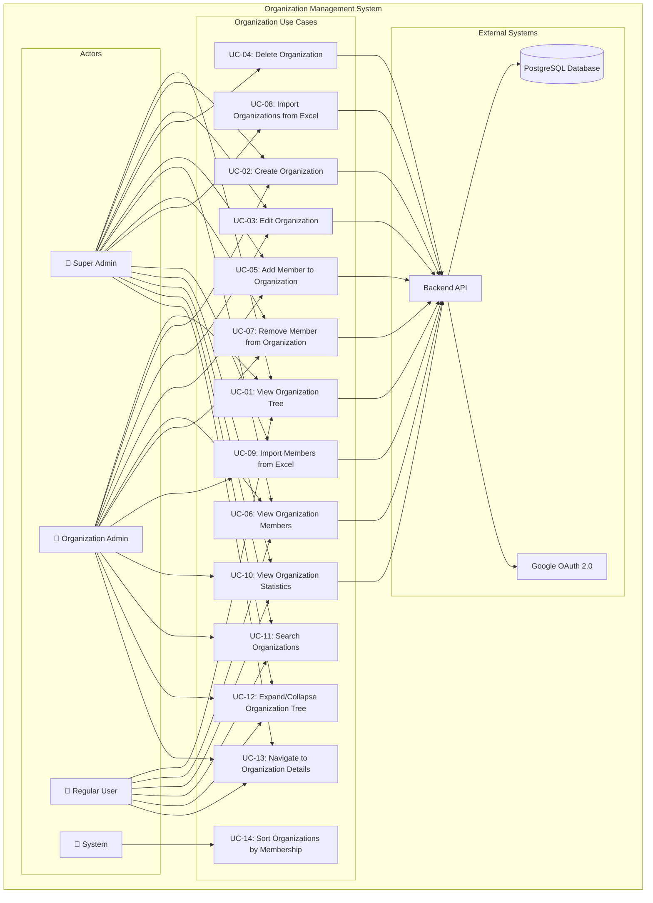
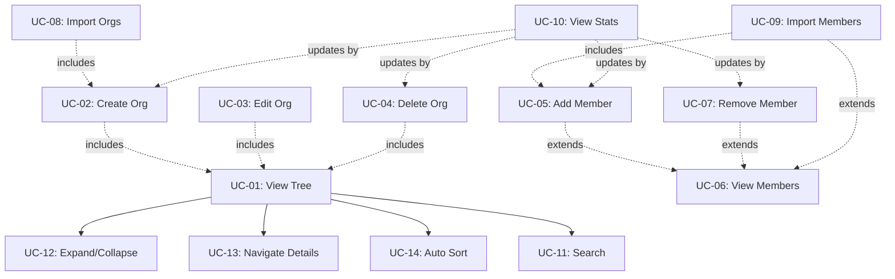

# Use Case Diagram - Organization Management System

## 📐 System Overview

**Module:** Organization Management (Quản Lý Tổ Chức)  
**Page:** OrganizationsPage.tsx  
**System:** Đoàn Hội Portal

---

## 🎭 Use Case Diagram

---

## 📋 Detailed Use Cases

### UC-01: View Organization Tree

**Use Case Name:** View Organization Tree (Xem Cây Tổ Chức)

**Actors:**
- **Primary:** Super Admin, Organization Admin, Regular User
- **Secondary:** Backend System, Database

**Description:**  
User can view the hierarchical tree structure of all organizations in the system. The tree displays organizations with their type, code, member count, and allows expanding/collapsing child organizations.

**Trigger:**  
User navigates to the Organizations page (`/portal/organizations`)

**Pre-Conditions:**
- User must be authenticated and logged in
- User must have valid JWT token
- Database contains organization data

**Post-Conditions:**
- **Success:** Organization tree is displayed with proper hierarchy
- **Failure:** Error message is shown to user

**Normal Flow:**
1. User navigates to Organizations page
2. System retrieves user authentication status
3. System fetches organization tree from backend API
4. System fetches organization statistics (total members per org)
5. System sorts organizations prioritizing user's membership
6. System renders organization tree with:
   - Organization name, code, type
   - Member count badge
   - Expand/collapse icons for organizations with children
   - Action buttons (based on permissions)
7. User views the complete organization hierarchy

**Alternative Flow:**

*AF-01: Partial Data Load*
1. Step 3 fails to fetch some organizations
2. System displays available organizations
3. System shows warning toast about partial data
4. User can retry loading

*AF-02: Empty Organization Tree*
1. Step 4 returns no organizations
2. System displays empty state message
3. System shows "Create Organization" button (if user has permission)
4. User can create first organization

*AF-03: User Has Limited Access*
1. Step 2 identifies user as regular user
2. System only shows organizations where user is a member
3. System hides action buttons user doesn't have permission for
4. User views filtered tree

**Exception:**

*EX-01: Network Error*
- **Condition:** Network connection fails during API call
- **Handling:** Display error toast "Failed to load organizations. Please check your connection."
- **Recovery:** User can click "Retry" button to reload

*EX-02: Authentication Error*
- **Condition:** JWT token expired or invalid
- **Handling:** Redirect user to login page with return URL
- **Recovery:** User logs in again and returns to page

*EX-03: Server Error (500)*
- **Condition:** Backend server error or database unavailable
- **Handling:** Display error toast "Server error. Please try again later."
- **Recovery:** User can retry after server is restored

---

### UC-02: Create Organization

**Use Case Name:** Create Organization (Tạo Tổ Chức)

**Actors:**
- **Primary:** Super Admin, Organization Admin (with permission)
- **Secondary:** Backend System, Database

**Description:**  
User can create a new organization in the system. The organization can be created at root level or as a child of an existing organization. Organization types are restricted based on parent type and hierarchy level.

**Trigger:**  
User clicks "Add Organization" button from dropdown menu

**Pre-Conditions:**
- User must be authenticated
- User must have `CREATE_ORGANIZATION` permission
- For child organizations: Parent organization must exist
- User must be in parent organization or be Super Admin

**Post-Conditions:**
- **Success:** 
  - New organization is created in database
  - Organization appears in tree structure
  - Success toast notification is shown
  - Organization tree is refreshed
- **Failure:** 
  - No organization is created
  - Error message is displayed
  - Form remains open for correction

**Normal Flow:**
1. User clicks "Add Organization" button in dropdown
2. System opens CreateOrganizationModal
3. System determines allowed organization types based on:
   - Current level (2 or 3)
   - Parent organization type (if creating child)
4. System displays form with fields:
   - Name (text input)
   - Code (text input, auto-uppercase)
   - Type (dropdown with allowed types)
   - Description (optional textarea)
5. User fills in organization details
6. System auto-generates name placeholder based on type and code
7. User clicks "Create" button
8. System validates form:
   - Name: required, min 3 characters
   - Code: required, uppercase, no spaces
   - Type: required, must be in allowed list
9. System sends POST request to `/api/organizations`
10. Backend validates and creates organization
11. System receives success response with new organization data
12. System closes modal
13. System shows success toast
14. System refreshes organization tree
15. New organization appears in appropriate position

**Alternative Flow:**

*AF-01: Create Child Organization*
1. User clicks "Add Child Organization" on specific org
2. System pre-fills parentId with selected organization
3. System restricts type options based on parent type:
   - doan_co_so → chi_doan
   - lien_chi_hoi → chi_hoi or clb_khoa
4. Continue from step 4 of Normal Flow

*AF-02: Code Already Exists*
1. Step 9 validation detects duplicate code
2. Backend returns 400 error
3. System displays error message under code field
4. User modifies code and resubmits

*AF-03: Auto-fill Name from Suggestion*
1. At step 6, user leaves name field empty
2. User clicks "Create" button
3. System auto-fills name with placeholder value
4. System validates and submits with auto-filled name

**Exception:**

*EX-01: Validation Error*
- **Condition:** Required fields missing or invalid format
- **Handling:** Display field-specific error messages in red
- **Recovery:** User corrects errors and resubmits

*EX-02: Duplicate Organization Code*
- **Condition:** Organization code already exists in database
- **Handling:** Backend returns 409 Conflict error
- **Recovery:** User changes code to unique value

*EX-03: Permission Denied*
- **Condition:** User doesn't have CREATE_ORGANIZATION permission
- **Handling:** 
  - "Add Organization" button is hidden
  - If API call attempted: Return 403 Forbidden
  - Display error toast
- **Recovery:** User requests permission from admin

*EX-04: Parent Organization Not Found*
- **Condition:** Parent organization was deleted during operation
- **Handling:** Backend returns 404 error
- **Recovery:** User refreshes page and tries again

*EX-05: Invalid Organization Type for Parent*
- **Condition:** Selected type not allowed under parent type
- **Handling:** Backend returns 400 error with validation message
- **Recovery:** User selects valid organization type

---

### UC-03: Edit Organization

**Use Case Name:** Edit Organization (Chỉnh Sửa Tổ Chức)

**Actors:**
- **Primary:** Super Admin, Organization Admin (with permission)
- **Secondary:** Backend System, Database

**Description:**  
User can modify the details of an existing organization including name, code, type, and description. Organization hierarchy (parent-child relationship) cannot be changed through edit.

**Trigger:**  
User clicks "Edit" icon button on organization item

**Pre-Conditions:**
- User must be authenticated
- User must have `UPDATE_ORGANIZATION` permission for this organization
- Organization must exist in database
- User must be Super Admin or member of the organization

**Post-Conditions:**
- **Success:**
  - Organization details are updated in database
  - Updated data reflects in UI immediately (optimistic update)
  - Success toast notification is shown
  - No need to refresh entire tree
- **Failure:**
  - Organization data remains unchanged
  - Error message is displayed
  - UI reverts to original state (if optimistic update)

**Normal Flow:**
1. User clicks Edit icon (pencil) on organization item
2. System checks user permission for UPDATE_ORGANIZATION
3. System opens EditOrganizationModal
4. System pre-fills form with current organization data:
   - Current name
   - Current code
   - Current type
   - Current description
5. User modifies one or more fields
6. User clicks "Save Changes" button
7. System validates form:
   - Name: required, min 3 characters
   - Code: required, uppercase, no spaces
   - Type: required
8. System performs optimistic update (updates UI immediately)
9. System sends PUT request to `/api/organizations/:id`
10. Backend validates and updates organization
11. System receives success response
12. System closes modal
13. System shows success toast
14. Updated organization data persists in UI

**Alternative Flow:**

*AF-01: No Changes Made*
1. At step 5, user doesn't modify any field
2. User clicks "Save Changes"
3. System detects no changes
4. System closes modal without API call
5. No toast notification shown

*AF-02: Cancel Editing*
1. User modifies some fields
2. User clicks "Cancel" or X button
3. System shows confirmation dialog: "Discard changes?"
4. User confirms
5. System closes modal
6. No changes are saved

*AF-03: Update Only Description*
1. User only modifies description field
2. System validates and submits
3. Backend updates only description
4. Success response returned
5. UI shows updated description

**Exception:**

*EX-01: Validation Error*
- **Condition:** Modified fields fail validation
- **Handling:** Display field-specific error messages
- **Recovery:** User corrects errors and resubmits

*EX-02: Code Conflict*
- **Condition:** New code already used by another organization
- **Handling:** Backend returns 409 Conflict
- **Recovery:** User chooses different code

*EX-03: Organization Not Found*
- **Condition:** Organization was deleted by another user
- **Handling:** Backend returns 404 error
- **Recovery:** 
  - System shows error toast
  - System refreshes organization tree
  - Deleted organization removed from UI

*EX-04: Optimistic Update Rollback*
- **Condition:** Backend returns error after optimistic UI update
- **Handling:**
  - System reverts UI to previous state
  - System shows error toast
  - Modal remains open with user's changes
- **Recovery:** User fixes error and retries

*EX-05: Permission Changed During Edit*
- **Condition:** User loses UPDATE_ORGANIZATION permission while modal is open
- **Handling:** Backend returns 403 Forbidden
- **Recovery:**
  - System closes modal
  - System shows error toast
  - System refreshes page to update permissions

*EX-06: Type Change Validation Failed*
- **Condition:** New type incompatible with existing children
- **Handling:** Backend returns 400 error
- **Recovery:** User reverts to original type or removes children first

---

### UC-04: Delete Organization

**Use Case Name:** Delete Organization (Xóa Tổ Chức)

**Actors:**
- **Primary:** Super Admin, Organization Admin (with permission)
- **Secondary:** Backend System, Database

**Description:**  
User can delete an organization from the system. This is a destructive action that requires confirmation. Organizations with children or active members cannot be deleted directly.

**Trigger:**  
User clicks "Delete" icon button on organization item

**Pre-Conditions:**
- User must be authenticated
- User must have `DELETE_ORGANIZATION` permission for this organization
- User must be Super Admin or organization admin
- Organization must exist in database
- Organization should not have:
  - Active child organizations (must delete children first)
  - Active members (must remove members first) - *may depend on business rules*

**Post-Conditions:**
- **Success:**
  - Organization is soft-deleted or hard-deleted from database
  - Organization removed from UI immediately (optimistic delete)
  - Success toast notification shown
  - Organization tree refreshed
- **Failure:**
  - Organization remains in database
  - Error message displayed
  - UI reverts if optimistic delete was performed

**Normal Flow:**
1. User clicks Delete icon (trash) on organization item
2. System checks user permission for DELETE_ORGANIZATION
3. System opens DeleteOrganizationModal (confirmation dialog)
4. System displays warning message:
   - Organization name and code
   - Consequences of deletion
   - "This action cannot be undone" warning
5. User reviews information
6. User types organization code to confirm (extra safety)
7. User clicks "Delete Organization" button
8. System validates confirmation code matches
9. System performs optimistic delete (removes from UI)
10. System sends DELETE request to `/api/organizations/:id`
11. Backend validates:
    - Organization has no children
    - Organization has no active members (or force delete)
    - User has permission
12. Backend deletes organization
13. System receives success response
14. System closes modal
15. System shows success toast
16. Deleted organization no longer appears in tree

**Alternative Flow:**

*AF-01: Cancel Deletion*
1. At step 5, user realizes they don't want to delete
2. User clicks "Cancel" button or X
3. System closes modal
4. No changes made to organization

*AF-02: Force Delete with Children*
1. Step 11 detects organization has children
2. Backend provides option to cascade delete
3. System asks user: "Delete this organization and all X children?"
4. User confirms cascade delete
5. Backend recursively deletes organization and children
6. Success response returned

*AF-03: Wrong Confirmation Code*
1. At step 8, entered code doesn't match
2. System prevents form submission
3. System shows error: "Confirmation code doesn't match"
4. User corrects code or cancels

**Exception:**

*EX-01: Organization Has Children*
- **Condition:** Organization has active child organizations
- **Handling:** Backend returns 400 error: "Cannot delete organization with children"
- **Recovery:** 
  - System shows error toast
  - User must delete children first or use force delete

*EX-02: Organization Has Active Members*
- **Condition:** Organization has users assigned
- **Handling:** Backend returns 400 error with member count
- **Recovery:**
  - System shows error: "Organization has X active members. Remove members first."
  - User removes members then retries delete

*EX-03: Organization Not Found*
- **Condition:** Organization was already deleted by another user
- **Handling:** Backend returns 404 error
- **Recovery:**
  - System closes modal
  - System refreshes tree
  - Organization already removed

*EX-04: Permission Denied*
- **Condition:** User doesn't have DELETE_ORGANIZATION permission
- **Handling:** 
  - Delete button hidden in UI
  - If API call made: Backend returns 403 Forbidden
- **Recovery:** User requests permission from admin

*EX-05: Optimistic Delete Rollback*
- **Condition:** Backend returns error after optimistic UI removal
- **Handling:**
  - System re-adds organization to UI
  - System shows error toast
  - Modal closes
- **Recovery:** User addresses error and retries

*EX-06: Referenced by Other Entities*
- **Condition:** Organization is referenced by other data (activities, payments, etc.)
- **Handling:** Backend returns 400 error: "Organization cannot be deleted due to existing references"
- **Recovery:**
  - System shows detailed error
  - User must remove references or contact admin for help

---

### UC-05: Add Member to Organization

**Use Case Name:** Add Member to Organization (Thêm Thành Viên)

**Actors:**
- **Primary:** Super Admin, Organization Admin (with permission)
- **Secondary:** Backend System, Database, User Service

**Description:**  
User can add existing system users as members to an organization. The system supports both direct user code entry and user search with autocomplete. Adding a member creates an active user-organization relationship.

**Trigger:**  
User clicks "Add Member" icon button on organization item

**Pre-Conditions:**
- User must be authenticated
- User must have `ADD_MEMBER` permission for this organization
- User must be Super Admin or member of the organization
- Target user must exist in the system
- Target user must not already be an active member of the organization

**Post-Conditions:**
- **Success:**
  - User-organization relationship created in database
  - Member count for organization incremented by 1
  - Success toast notification shown
  - Organization stats refreshed
- **Failure:**
  - No relationship created
  - Error message displayed
  - Modal remains open

**Normal Flow:**
1. User clicks "Add Member" icon (user-plus) on organization
2. System checks ADD_MEMBER permission
3. System opens AddMemberModal
4. System displays form with:
   - Organization name (read-only display)
   - User search input field
   - Member list preview (optional)
5. User starts typing in search field (min 2 characters)
6. System debounces input (300ms delay)
7. System calls User API to search users
8. System displays dropdown with matching users:
   - User code
   - Full name
   - Email
   - Avatar (if available)
9. User selects a user from dropdown
10. Selected user details populate the form
11. User clicks "Add Member" button
12. System validates:
    - User exists
    - User not already a member
13. System sends POST request to `/api/organizations/:code/members`
14. Backend creates user-organization relationship
15. System receives success response
16. System calls onMemberAdded callback
17. System shows success toast
18. System closes modal
19. Organization stats refresh to show new member count

**Alternative Flow:**

*AF-01: Direct User Code Entry*
1. User types complete user code without selecting from dropdown
2. System validates user code format
3. User clicks "Add Member"
4. System fetches user details by code
5. If user found, continue from step 13
6. If user not found, show error

*AF-02: Add Multiple Members*
1. After step 16, user doesn't close modal
2. User clears search and selects another user
3. System adds second member
4. Repeat for multiple users
5. User closes modal when done

*AF-03: User Already Member*
1. At step 12, system detects user is already member
2. System shows warning: "User is already a member"
3. System disables "Add Member" button
4. User must select different user

*AF-04: No Search Results*
1. At step 7, no users match search criteria
2. System displays "No users found"
3. User refines search or enters user code directly

**Exception:**

*EX-01: User Not Found*
- **Condition:** Entered user code doesn't exist in system
- **Handling:** Backend returns 404 error
- **Recovery:**
  - System shows error: "User not found"
  - User verifies code or searches differently

*EX-02: User Already Member*
- **Condition:** User is already active member of organization
- **Handling:** Backend returns 409 Conflict
- **Recovery:**
  - System shows error: "User is already a member"
  - User closes modal or selects different user

*EX-03: Permission Denied*
- **Condition:** User lost ADD_MEMBER permission
- **Handling:** Backend returns 403 Forbidden
- **Recovery:**
  - System closes modal
  - System shows error toast
  - System refreshes permissions

*EX-04: Search API Timeout*
- **Condition:** User search API takes too long
- **Handling:** 
  - System shows loading spinner for max 10 seconds
  - After timeout, show error: "Search timed out"
- **Recovery:** User tries search again

*EX-05: Organization Not Found*
- **Condition:** Organization was deleted during operation
- **Handling:** Backend returns 404 error
- **Recovery:**
  - System closes modal
  - System refreshes organization tree
  - Deleted organization removed

*EX-06: Network Error During Search*
- **Condition:** Network fails during user search
- **Handling:**
  - System shows error message in dropdown
  - User can retry search
- **Recovery:** User waits for network and tries again

*EX-07: Maximum Members Reached*
- **Condition:** Organization has reached maximum member limit
- **Handling:** Backend returns 400 error
- **Recovery:**
  - System shows error with current count
  - User must remove members before adding new ones

---

### UC-06: View Organization Members

**Use Case Name:** View Organization Members (Xem Danh Sách Thành Viên)

**Actors:**
- **Primary:** Super Admin, Organization Admin, Regular User
- **Secondary:** Backend System, Database

**Description:**  
User can view the complete list of all members (users) belonging to a specific organization. The member list includes user details, roles, and membership status. Users can also perform bulk actions on members (if they have permissions).

**Trigger:**  
User clicks "View Members" icon button on organization item

**Pre-Conditions:**
- User must be authenticated
- User must have `VIEW_MEMBERS` permission or be member of organization
- Organization must exist in database

**Post-Conditions:**
- **Success:**
  - Navigate to organization members page
  - Member list is displayed with pagination
  - Member statistics shown
- **Failure:**
  - Error message displayed
  - User remains on current page

**Normal Flow:**
1. User clicks "View Members" icon (eye) on organization
2. System checks VIEW_MEMBERS permission
3. System navigates to `/portal/organizations/:type/:code/members`
4. System displays OrganizationMembersPage
5. System fetches organization details
6. System fetches member list with pagination
7. System displays:
   - Organization header (name, code, type)
   - Member statistics (total count, active count)
   - Member table with columns:
     - Avatar
     - User code
     - Full name
     - Email
     - Roles in organization
     - Join date
     - Status (active/inactive)
     - Actions (if user has permission)
8. User views member list
9. System provides pagination controls at bottom
10. User can navigate through pages

**Alternative Flow:**

*AF-01: Search Members*
1. At step 8, user enters search term
2. System filters members by:
   - User code
   - Name
   - Email
3. System updates table with filtered results

*AF-02: Sort Members*
1. User clicks column header to sort
2. System sorts members by selected column
3. System updates table with sorted results

*AF-03: No Members in Organization*
1. Step 6 returns empty member list
2. System displays empty state:
   - "No members in this organization"
   - "Add Member" button (if user has permission)
3. User can add first member

*AF-04: Export Member List*
1. User clicks "Export" button
2. System generates Excel file with member data
3. System downloads file to user's device

**Exception:**

*EX-01: Organization Not Found*
- **Condition:** Organization doesn't exist or was deleted
- **Handling:** Display 404 error page
- **Recovery:** User navigates back to organization list

*EX-02: Permission Denied*
- **Condition:** User doesn't have VIEW_MEMBERS permission
- **Handling:** 
  - Display 403 error page
  - Show "You don't have permission" message
- **Recovery:** User requests permission from admin

*EX-03: API Error*
- **Condition:** Backend fails to fetch member list
- **Handling:** 
  - Display error message in table area
  - Show "Retry" button
- **Recovery:** User clicks retry to reload

*EX-04: Large Member List (Performance)*
- **Condition:** Organization has 1000+ members
- **Handling:**
  - System uses pagination (default 20 per page)
  - System uses virtualized scrolling for better performance
  - System shows loading indicator during fetch
- **Recovery:** N/A - system handles automatically

---

### UC-07: Remove Member from Organization

**Use Case Name:** Remove Member from Organization (Xóa Thành Viên)

**Actors:**
- **Primary:** Super Admin, Organization Admin (with permission)
- **Secondary:** Backend System, Database

**Description:**  
User can remove a member from an organization. This deactivates the user-organization relationship but doesn't delete the user from the system. The member can be re-added later if needed.

**Trigger:**  
User clicks "Remove" action button on member row in members list

**Pre-Conditions:**
- User must be authenticated
- User must have `REMOVE_MEMBER` permission for this organization
- Target member must be active member of the organization
- User cannot remove themselves (self-removal prevented)

**Post-Conditions:**
- **Success:**
  - User-organization relationship deactivated
  - Member count decremented by 1
  - Member removed from member list
  - Success toast notification shown
- **Failure:**
  - Relationship remains active
  - Error message displayed

**Normal Flow:**
1. User navigates to organization members page
2. User locates member to remove in table
3. User clicks "Remove" button on member row
4. System opens confirmation dialog
5. System displays:
   - Member name and user code
   - Warning message
   - "Remove Member" and "Cancel" buttons
6. User confirms by clicking "Remove Member"
7. System validates:
   - User has REMOVE_MEMBER permission
   - User is not removing themselves
8. System performs optimistic delete (removes from UI)
9. System sends DELETE request to `/api/organizations/:code/members/:userCode`
10. Backend deactivates user-organization relationship
11. System receives success response
12. System shows success toast
13. System updates member statistics
14. Member no longer appears in list

**Alternative Flow:**

*AF-01: Bulk Remove Members*
1. User selects multiple members using checkboxes
2. User clicks "Remove Selected" button
3. System shows confirmation with count
4. User confirms
5. System removes all selected members in batch
6. Success toast shows "X members removed"

*AF-02: Cancel Removal*
1. At step 6, user clicks "Cancel"
2. System closes confirmation dialog
3. No changes made

*AF-03: Remove and Reassign*
1. Member being removed has active assignments (tasks, roles)
2. System prompts to reassign before removal
3. User reassigns or force removes
4. Continue with removal

**Exception:**

*EX-01: Self-Removal Attempt*
- **Condition:** User tries to remove themselves
- **Handling:** 
  - System prevents action
  - Show error: "You cannot remove yourself"
- **Recovery:** User asks another admin to remove them

*EX-02: Permission Denied*
- **Condition:** User doesn't have REMOVE_MEMBER permission
- **Handling:** Backend returns 403 Forbidden
- **Recovery:**
  - System shows error toast
  - System refreshes permissions
  - Remove button hidden

*EX-03: Member Not Found*
- **Condition:** Member was already removed by another user
- **Handling:** Backend returns 404 error
- **Recovery:**
  - System shows error toast
  - System refreshes member list
  - Member already removed from UI

*EX-04: Member Has Active Roles*
- **Condition:** Member is assigned critical roles in organization
- **Handling:** Backend returns 400 error
- **Recovery:**
  - System shows error with role list
  - User must remove roles first or reassign

*EX-05: Last Admin Removal*
- **Condition:** Removing this member would leave organization with no admins
- **Handling:** Backend returns 400 error
- **Recovery:**
  - System shows error: "Cannot remove last admin"
  - User must assign another admin first

---

### UC-08: Import Organizations from Excel

**Use Case Name:** Import Organizations from Excel (Nhập Tổ Chức từ Excel)

**Actors:**
- **Primary:** Super Admin, System Admin
- **Secondary:** Backend System, Database, Excel Parser Service

**Description:**  
User can batch import multiple organizations from an Excel file. The system validates data, previews changes, and imports organizations in bulk. This significantly reduces manual data entry time for initial setup or large updates.

**Trigger:**  
User clicks "Import from Excel" option in dropdown menu

**Pre-Conditions:**
- User must be authenticated
- User must have `IMPORT_ORGANIZATIONS` permission
- User must be Super Admin
- Excel file must follow required format/template
- Organizations in file must have valid types and codes

**Post-Conditions:**
- **Success:**
  - All valid organizations created in database
  - Organization tree refreshed with new entries
  - Success summary toast shown
  - Import log available for review
- **Failure:**
  - No organizations imported (atomic transaction)
  - Validation errors displayed
  - User can correct and retry

**Normal Flow:**
1. User clicks "Import from Excel" in dropdown
2. System opens ImportModal dialog
3. System displays:
   - File upload area (drag & drop or click)
   - "Download Template" link
   - Instructions for file format
4. User clicks "Download Template" (optional)
5. System provides Excel template with:
   - Column headers (Name, Code, Type, ParentCode, Description)
   - Example rows
   - Data validation rules
6. User prepares Excel file with organization data
7. User drags file into upload area or clicks to browse
8. System validates file:
   - File type: .xlsx or .xls
   - File size: max 10 MB
   - Required columns present
9. System reads Excel file
10. System parses data and validates each row:
    - Required fields filled
    - Code format valid (uppercase, no spaces)
    - Type is valid organization type
    - ParentCode exists (if provided)
    - No duplicate codes in file
11. System displays preview table:
    - Rows with validation status (✓ valid, ✗ error)
    - Error messages for invalid rows
    - Row count summary (X valid, Y errors)
12. User reviews preview
13. User clicks "Import" button
14. System enables "Skip Invalid Rows" option
15. User confirms import
16. System sends data to backend
17. Backend processes in transaction:
    - Creates organizations in correct order (parents first)
    - Establishes parent-child relationships
    - Validates business rules
18. Backend returns success with import summary
19. System closes modal
20. System shows success toast: "X organizations imported successfully"
21. System refreshes organization tree
22. New organizations appear in tree

**Alternative Flow:**

*AF-01: Import with Errors*
1. At step 11, preview shows some invalid rows
2. User enables "Skip Invalid Rows"
3. User clicks "Import"
4. System imports only valid rows
5. Success toast shows: "X imported, Y skipped"
6. System provides download link for error report

*AF-02: Update Existing Organizations*
1. File contains codes that already exist
2. System detects duplicates
3. System asks: "Update existing organizations?"
4. User confirms update mode
5. System updates instead of creates
6. Success toast shows: "X created, Y updated"

*AF-03: Cancel Import*
1. At step 12, user realizes file has issues
2. User clicks "Cancel" or uploads new file
3. System clears preview
4. User can upload corrected file

*AF-04: Download Template First*
1. User unfamiliar with format
2. User clicks "Download Template"
3. System downloads Excel template
4. User fills template
5. User uploads filled template
6. Continue from step 8

**Exception:**

*EX-01: Invalid File Format*
- **Condition:** File is not Excel format (.xlsx, .xls)
- **Handling:** Show error: "Please upload Excel file (.xlsx or .xls)"
- **Recovery:** User uploads correct file type

*EX-02: File Too Large*
- **Condition:** File exceeds 10 MB size limit
- **Handling:** Show error: "File too large. Maximum size: 10 MB"
- **Recovery:** User reduces file size or splits into multiple files

*EX-03: Missing Required Columns*
- **Condition:** Excel file missing Name, Code, or Type columns
- **Handling:** Show error: "Missing required columns: [column names]"
- **Recovery:** User adds missing columns to Excel

*EX-04: All Rows Invalid*
- **Condition:** Preview shows 0 valid rows
- **Handling:**
  - System prevents import
  - Show error: "No valid rows to import"
  - Display common errors
- **Recovery:** User fixes Excel file and re-uploads

*EX-05: Duplicate Codes in File*
- **Condition:** Same code appears multiple times in Excel
- **Handling:** 
  - Mark duplicate rows as invalid
  - Show error: "Duplicate code: XXX"
- **Recovery:** User removes duplicates from Excel

*EX-06: Parent Not Found*
- **Condition:** ParentCode references non-existent organization
- **Handling:**
  - Mark row as invalid
  - Show error: "Parent organization not found: XXX"
- **Recovery:** 
  - User creates parent first
  - Or removes ParentCode
  - Or fixes parent code

*EX-07: Backend Transaction Failure*
- **Condition:** Database error during import
- **Handling:**
  - All changes rolled back (atomic transaction)
  - Show error: "Import failed. Please try again"
- **Recovery:** User retries import

*EX-08: Network Error During Upload*
- **Condition:** Network connection lost while uploading
- **Handling:**
  - Show error: "Network error. Please check connection"
  - Keep file in upload area
- **Recovery:** User retries when connection restored

*EX-09: Circular Parent-Child Reference*
- **Condition:** File contains circular dependencies
- **Handling:**
  - Backend validation catches cycles
  - Show error: "Circular reference detected"
- **Recovery:** User fixes parent-child relationships

---

### UC-09: Import Members from Excel

**Use Case Name:** Import Members from Excel (Nhập Thành Viên từ Excel)

**Actors:**
- **Primary:** Super Admin, Organization Admin (with permission)
- **Secondary:** Backend System, Database, Excel Parser Service, User Service

**Description:**  
User can batch import multiple members to an organization from an Excel file. The system validates user codes, prevents duplicates, and adds members in bulk. This is useful for adding many students to an organization at once.

**Trigger:**  
User clicks "Import Members" option in organization dropdown or on members page

**Pre-Conditions:**
- User must be authenticated
- User must have `IMPORT_MEMBERS` permission for this organization
- Organization must exist
- Excel file must contain valid user codes
- Users in file must exist in system

**Post-Conditions:**
- **Success:**
  - All valid users added as organization members
  - Member count updated
  - Success summary shown
  - Import log available
- **Failure:**
  - No members added (or only valid ones)
  - Validation errors displayed
  - User can retry

**Normal Flow:**
1. User clicks "Import Members" in dropdown
2. System opens ImportMembersModal
3. System displays:
   - Organization name (read-only)
   - File upload area
   - "Download Template" link
   - Expected format: Single column with user codes
4. User downloads template (optional)
5. System provides Excel template:
   - Single column: "User Code"
   - Example rows with sample codes
6. User prepares Excel file with user codes
7. User uploads file
8. System validates file:
   - File type: Excel
   - File size: max 5 MB
   - Has "User Code" column
9. System parses Excel file
10. System validates each user code:
    - Format valid
    - User exists in system
    - User not already member
11. System displays preview:
    - List of user codes
    - Validation status per user
    - Summary: X valid, Y invalid
12. User reviews preview
13. User clicks "Import Members"
14. System sends batch request to backend
15. Backend creates user-organization relationships
16. Backend returns success with count
17. System closes modal
18. System shows success toast: "X members added"
19. System refreshes member list
20. New members appear in list

**Alternative Flow:**

*AF-01: Import with Invalid Users*
1. At step 11, some user codes are invalid
2. User enables "Skip Invalid Rows"
3. User imports valid users only
4. Success shows: "X added, Y skipped"

*AF-02: Some Users Already Members*
1. Step 10 detects existing members
2. System marks as "Already member"
3. User can skip or continue
4. Only new members added

*AF-03: Import to Multiple Organizations*
1. Excel has two columns: User Code, Organization Code
2. User uploads to system level (not specific org)
3. System validates against multiple organizations
4. Success: "X members added across Y organizations"

**Exception:**

*EX-01: User Code Not Found*
- **Condition:** User code doesn't exist in system
- **Handling:** Mark row as invalid with error
- **Recovery:** User verifies codes or creates users first

*EX-02: All Users Already Members*
- **Condition:** All users in file are already members
- **Handling:** 
  - Show warning: "All users are already members"
  - Prevent import
- **Recovery:** User checks organization or selects different users

*EX-03: Invalid User Code Format*
- **Condition:** User code doesn't match required format
- **Handling:** Show error: "Invalid format: XXX"
- **Recovery:** User corrects codes in Excel

*EX-04: Empty Excel File*
- **Condition:** File has no data rows
- **Handling:** Show error: "File is empty"
- **Recovery:** User adds user codes to Excel

*EX-05: Duplicate Codes in File*
- **Condition:** Same user code multiple times
- **Handling:** 
  - Remove duplicates automatically
  - Show warning: "Removed X duplicates"
- **Recovery:** N/A - system handles automatically

---

### UC-10: View Organization Statistics

**Use Case Name:** View Organization Statistics (Xem Thống Kê Tổ Chức)

**Actors:**
- **Primary:** Super Admin, Organization Admin, Regular User
- **Secondary:** Backend System, Database

**Description:**  
User can view statistical information about organizations including total count, member distribution, and organization type breakdown. Statistics are displayed at the top of the organization page and updated in real-time.

**Trigger:**  
Statistics automatically load when user views organization page

**Pre-Conditions:**
- User must be authenticated
- User must have access to organization page

**Post-Conditions:**
- **Success:** Statistics displayed accurately
- **Failure:** Error message or zero values shown

**Normal Flow:**
1. User navigates to organizations page
2. System fetches organization statistics from backend
3. Backend aggregates data:
   - Total organizations count
   - Organizations by type
   - Total members across all organizations
   - Active vs inactive organizations
4. System receives statistics data
5. System displays stats in header:
   - Total Organizations: XXX
   - Total Members: YYY
   - By Type breakdown
6. Each organization shows member count badge
7. User views statistics

**Alternative Flow:**

*AF-01: Filter Statistics by Type*
1. User filters organizations by type
2. System updates statistics for filtered view
3. Stats show counts for filtered subset only

*AF-02: Real-time Stats Update*
1. User creates new organization
2. System increments organization count
3. System updates type breakdown
4. No need to refresh page

**Exception:**

*EX-01: Stats API Failure*
- **Condition:** Backend fails to compute statistics
- **Handling:** Show default values (0) with warning icon
- **Recovery:** User can refresh to retry

*EX-02: Stale Data*
- **Condition:** Statistics not updated after changes
- **Handling:** User manually refreshes page
- **Recovery:** System recalculates from database

---

### UC-11: Search Organizations

**Use Case Name:** Search Organizations (Tìm Kiếm Tổ Chức)

**Actors:**
- **Primary:** All authenticated users
- **Secondary:** Backend System, Database

**Description:**  
User can search for organizations by name, code, or type. Search is performed on the client-side for fast results and supports real-time filtering as user types.

**Trigger:**  
User types in search input field at top of page

**Pre-Conditions:**
- User must be viewing organization page
- Organization data must be loaded

**Post-Conditions:**
- **Success:** Matching organizations displayed
- **Failure:** "No results found" message shown

**Normal Flow:**
1. User clicks search input field
2. User types search query
3. System filters organizations in real-time:
   - Match by name (case-insensitive)
   - Match by code (case-insensitive)
   - Match by type
4. System highlights matching organizations
5. System collapses non-matching organizations
6. User views filtered results

**Alternative Flow:**

*AF-01: Clear Search*
1. User clicks X in search field
2. System clears filter
3. All organizations shown again

*AF-02: No Results*
1. Search returns no matches
2. System shows "No organizations found"
3. User clears search or refines query

**Exception:**

*EX-01: Special Characters in Search*
- **Condition:** User enters special regex characters
- **Handling:** System escapes special characters
- **Recovery:** N/A - system handles automatically

---

### UC-12: Expand/Collapse Organization Tree

**Use Case Name:** Expand/Collapse Organization Tree (Mở Rộng/Thu Gọn Cây Tổ Chức)

**Actors:**
- **Primary:** All authenticated users
- **Secondary:** System (local state management)

**Description:**  
User can expand or collapse organizations that have children to view or hide the hierarchical structure. The expand/collapse state is maintained locally in the session.

**Trigger:**  
User clicks expand/collapse icon (chevron) on organization with children

**Pre-Conditions:**
- Organization must have children (hasChildren = true)
- Organization tree must be loaded

**Post-Conditions:**
- **Success:** 
  - Expanded: Children become visible
  - Collapsed: Children become hidden
- **State:** Expand state stored in local component state

**Normal Flow:**
1. User views organization with children
2. System shows chevron icon (right = collapsed, down = expanded)
3. User clicks chevron icon
4. System toggles expand state in local state
5. System animates expand/collapse transition
6. For expand: System lazy-loads children if not already loaded
7. Children organizations appear/disappear
8. Chevron icon updates direction

**Alternative Flow:**

*AF-01: Expand All*
1. User clicks "Expand All" button (future feature)
2. System expands all organizations with children
3. Full tree hierarchy visible

*AF-02: Collapse All*
1. User clicks "Collapse All" button
2. System collapses all organizations
3. Only top-level organizations visible

**Exception:**

*EX-01: Lazy Load Children Failed*
- **Condition:** Backend error when loading children
- **Handling:** 
  - Show error icon instead of children
  - Display error message
- **Recovery:** User can click to retry load

---

### UC-13: Navigate to Organization Details

**Use Case Name:** Navigate to Organization Details (Điều Hướng Chi Tiết Tổ Chức)

**Actors:**
- **Primary:** All authenticated users
- **Secondary:** React Router, Backend System

**Description:**  
User can navigate to a detailed view of a specific organization showing only that organization's subtree and members. This provides a focused view for managing a single organization.

**Trigger:**  
User clicks on organization name/code link in tree

**Pre-Conditions:**
- User must be authenticated
- Organization must exist

**Post-Conditions:**
- **Success:** Navigate to organization detail page
- **URL:** `/portal/organizations/:type/:code`

**Normal Flow:**
1. User clicks organization name link
2. System captures click event
3. System navigates to detail URL
4. OrganizationsDetailPage loads
5. System fetches organization details
6. System fetches organization's children
7. System displays:
   - Organization header (name, code, type)
   - Statistics for this organization
   - Children tree (if any)
   - Actions menu
8. User views detailed organization page

**Alternative Flow:**

*AF-01: Navigate to Sub-detail*
1. User clicks child organization on detail page
2. System navigates to sub-detail page
3. URL: `/portal/organizations/:parentType/:parentCode/:type/:code`

*AF-02: Breadcrumb Navigation*
1. User clicks breadcrumb to go back
2. System navigates to parent page
3. Tree state preserved

**Exception:**

*EX-01: Organization Not Found*
- **Condition:** Organization ID invalid or deleted
- **Handling:** Display 404 error page
- **Recovery:** User navigates back to main page

---

### UC-14: Sort Organizations by Membership

**Use Case Name:** Sort Organizations by Membership (Sắp Xếp Tổ Chức Theo Thành Viên)

**Actors:**
- **Primary:** System (automatic)
- **Secondary:** User (benefits from automatic sorting)

**Description:**  
System automatically sorts organizations to prioritize those where the current user is a member. This improves user experience by showing relevant organizations first.

**Trigger:**  
Automatically when organization tree loads

**Pre-Conditions:**
- User must be authenticated
- User organization memberships loaded
- Organization tree loaded

**Post-Conditions:**
- **Success:** Organizations with user membership appear first
- **Order:** Member organizations → Non-member organizations

**Normal Flow:**
1. System loads organization tree
2. System retrieves user's organization memberships
3. System applies sorting algorithm:
   - Organizations where user is member: priority 1
   - Other organizations: priority 2
4. System maintains alphabetical order within each priority
5. System renders sorted tree
6. User sees relevant organizations at top

**Alternative Flow:**

*AF-01: User Has No Memberships*
1. User is not member of any organization
2. System shows all organizations in default order
3. No special sorting applied

**Exception:**

*EX-01: Membership Data Unavailable*
- **Condition:** User membership data fails to load
- **Handling:** Show all organizations in default order
- **Recovery:** N/A - non-critical feature

---

## 🔐 Permission Matrix

| Use Case | Super Admin | Org Admin | Regular User |
|----------|-------------|-----------|--------------|
| UC-01: View Organization Tree | ✅ All orgs | ✅ All orgs | ✅ Only member orgs |
| UC-02: Create Organization | ✅ Anywhere | ✅ In their org | ❌ |
| UC-03: Edit Organization | ✅ Any org | ✅ Their org only | ❌ |
| UC-04: Delete Organization | ✅ Any org | ✅ Their org only | ❌ |
| UC-05: Add Member | ✅ Any org | ✅ Their org only | ❌ |
| UC-06: View Members | ✅ Any org | ✅ Any org | ✅ Their orgs only |
| UC-07: Remove Member | ✅ Any org | ✅ Their org only | ❌ |
| UC-08: Import Organizations | ✅ Yes | ❌ | ❌ |
| UC-09: Import Members | ✅ Any org | ✅ Their org only | ❌ |
| UC-10: View Statistics | ✅ All stats | ✅ All stats | ✅ Limited stats |
| UC-11: Search Organizations | ✅ All orgs | ✅ All orgs | ✅ Member orgs |
| UC-12: Expand/Collapse | ✅ Yes | ✅ Yes | ✅ Yes |
| UC-13: Navigate Details | ✅ Any org | ✅ Any org | ✅ Member orgs |
| UC-14: Auto Sort | ✅ Yes | ✅ Yes | ✅ Yes |

---

## 📊 Use Case Relationships

---

## 🎯 Business Rules

### BR-01: Organization Hierarchy
- Maximum depth: 3 levels (Root → Level 2 → Level 3)
- Root organizations (level 1): Only created by system
- Parent-child relationships must be valid by type

### BR-02: Organization Types & Hierarchy Rules
- **Level 2 Types:** `doan_co_so`, `lien_chi_hoi`, `clb_truong`
- **Level 3 Types:** `chi_doan`, `chi_hoi`, `clb_khoa`
- **Parent-Child Rules:**
  - `doan_co_so` can only have `chi_doan` children
  - `lien_chi_hoi` can have `chi_hoi` or `clb_khoa` children
  - `clb_truong` can have `clb_khoa` children

### BR-03: Organization Code Rules
- Must be unique across system
- Uppercase letters and numbers only
- No spaces or special characters
- Recommended format: 3-10 characters

### BR-04: Member Management Rules
- User can be member of multiple organizations
- User cannot be added twice to same organization
- Membership has status: active/inactive
- User cannot remove themselves from organization

### BR-05: Deletion Rules
- Organization with children cannot be deleted (must delete children first)
- Organization with active members cannot be deleted (option to force delete)
- Soft delete: Organization marked inactive, data preserved
- Super Admin can force delete with cascade

### BR-06: Permission Rules
- Super Admin: All permissions on all organizations
- Organization Admin: Full permissions on their organization and children
- Regular User: View-only permissions on member organizations
- Permissions checked at both frontend and backend

### BR-07: Import Rules
- Excel files: max 10 MB for organizations, max 5 MB for members
- Batch size: max 1000 organizations, max 5000 members per import
- Validation: All rows validated before any import
- Transaction: All-or-nothing (or skip invalid rows option)

---

## 📝 System Constraints

### Technical Constraints
- **Performance:** Tree rendering optimized for up to 1000 organizations
- **Browser:** Modern browsers (Chrome 90+, Firefox 88+, Safari 14+)
- **Network:** Requires stable internet connection
- **API Response Time:** Maximum 5 seconds for tree load

### Business Constraints
- **Data Integrity:** Organization codes must remain unique
- **Audit Trail:** All create/update/delete operations logged
- **Concurrency:** Optimistic locking for concurrent edits
- **Permissions:** Evaluated on every request

---

## 🔄 Integration Points

### Backend APIs Used
- `GET /api/organizations` - Fetch organization tree
- `GET /api/organizations/stats` - Fetch statistics
- `POST /api/organizations` - Create organization
- `PUT /api/organizations/:id` - Update organization
- `DELETE /api/organizations/:id` - Delete organization
- `GET /api/organizations/:code/members` - Get members
- `POST /api/organizations/:code/members` - Add member
- `DELETE /api/organizations/:code/members/:userCode` - Remove member
- `POST /api/organizations/import` - Import organizations
- `POST /api/organizations/:code/import-members` - Import members
- `GET /api/users` - Search users (for add member)

### External Services
- **Google OAuth 2.0:** For user authentication
- **PostgreSQL:** For data persistence
- **AWS S3:** For file storage (import/export files)

---

## 📚 Related Documentation

- **Backend API:** `/mechanism/backend-api.md`
- **Permission System:** `/mechanism/Toan/AUTHORIZATION_MECHANISM.md`
- **Database Schema:** `/backend/database.dbml`
- **Component Diagram:** `/BACKEND_COMPONENT_DIAGRAM.md`
- **Package Diagram:** `/PACKAGE_DIAGRAM.md`

---

**Document Version:** 1.0  
**Last Updated:** December 17, 2025  
**Maintained By:** Frontend Development Team  
**Page:** OrganizationsPage.tsx  
**Module:** Organization Management
